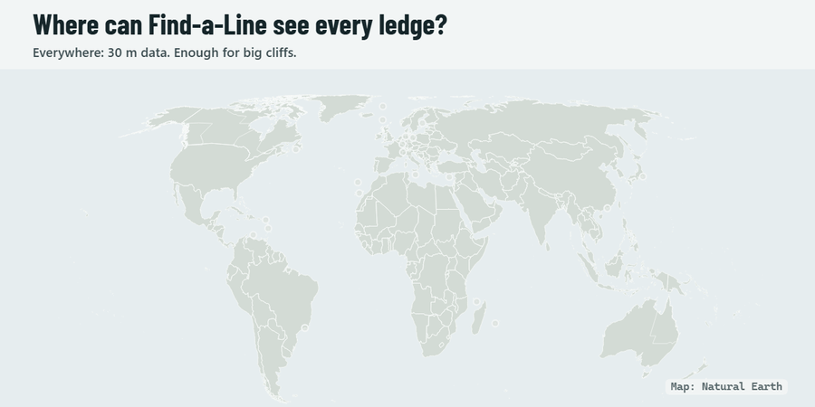
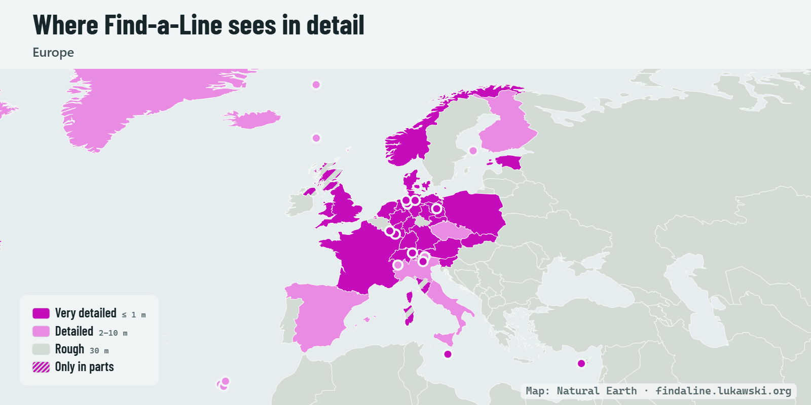
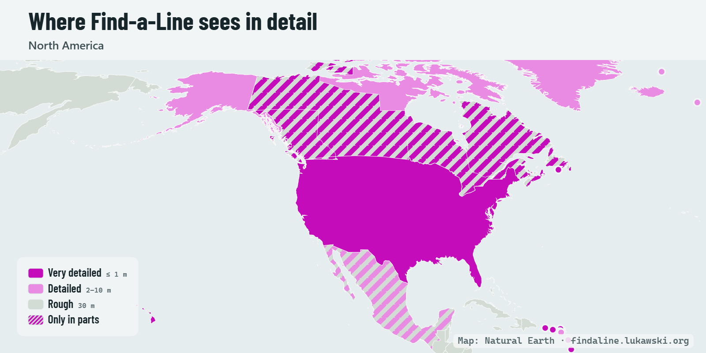
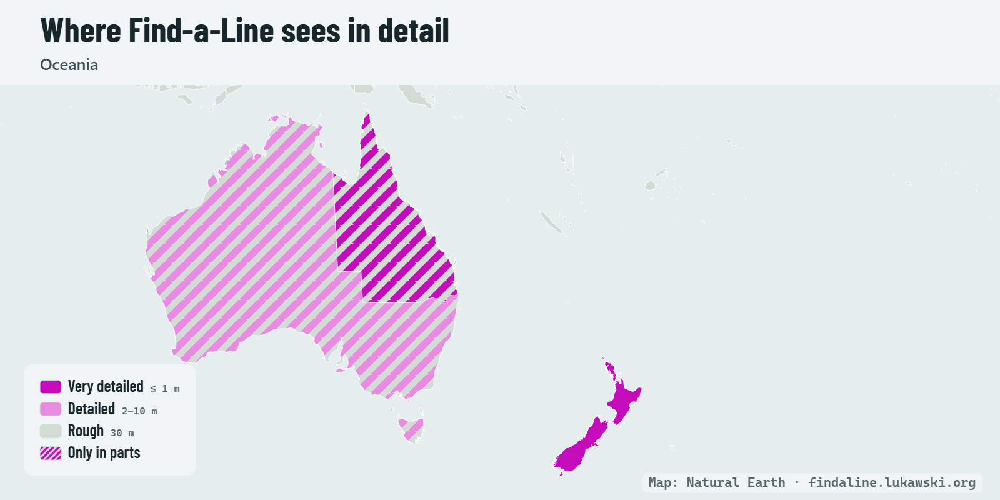
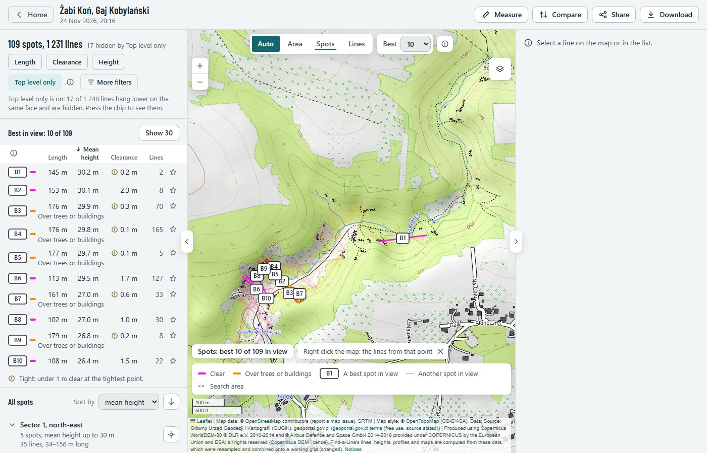
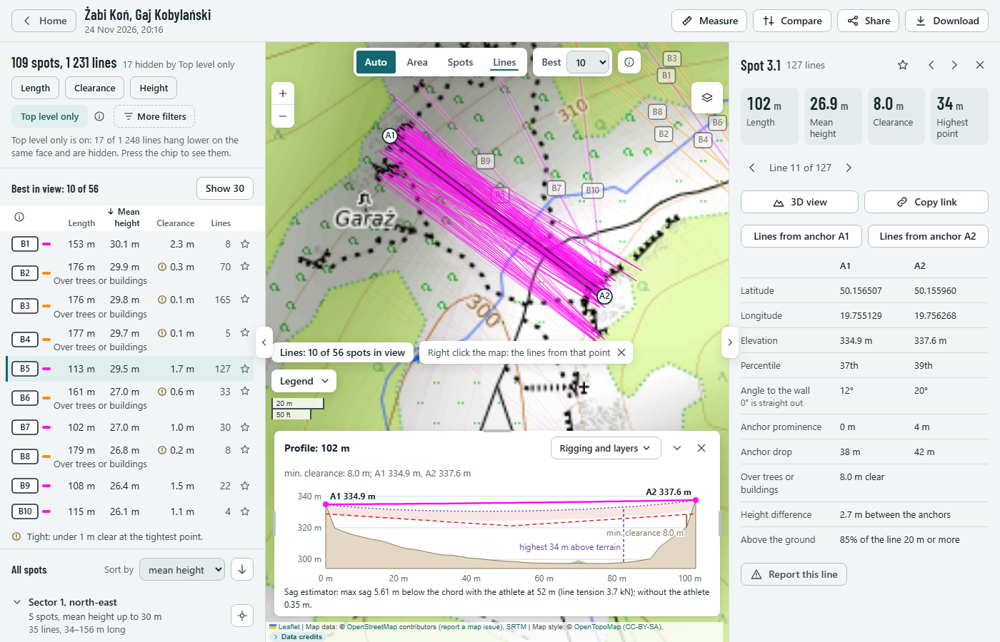
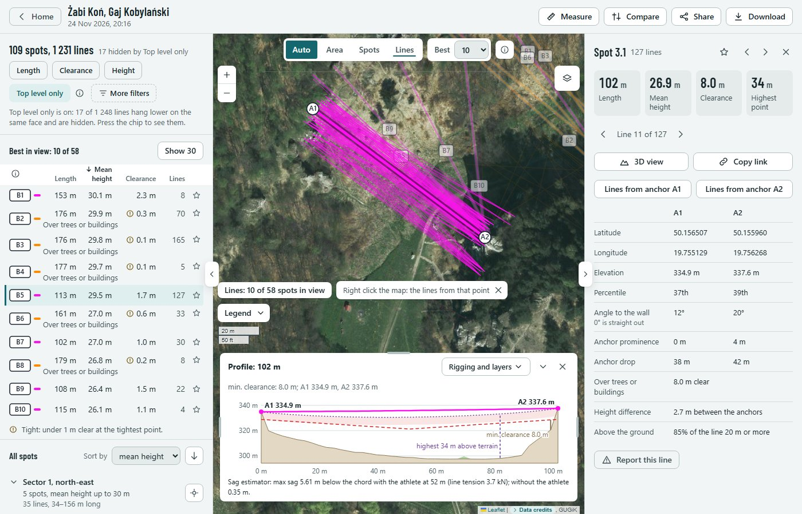

# Find a Line
This is an application that finds topographically valid highlines. It downloads elevation data for the area you choose and evaluates the potential of each raster pixel by applying a custom "maximum elevation formula" (or a physical sag estimate of the webbing).

<picture>
  <source media="(prefers-color-scheme: dark)" srcset="docs/images/coverage-dark.gif">
  
</picture>

Where the data is detailed and what that means for the lines it finds: the [coverage map](https://findaline.lukawski.org/coverage) (no sign-in needed; *Coverage map* below).

Where a country publishes airborne LiDAR data, the tool uses it: a terrain model (ground only) and a surface model including trees and buildings. Built in, and picked automatically from the location of the search:

| Country | Data | Grid |
| --- | --- | --- |
| Poland | GUGiK NMT / NMPT ([geoportal.gov.pl](https://www.geoportal.gov.pl)) | 1 m (NMPT 0.5–1 m) |
| Malta | Planning Authority LiDAR 2018 (2012 on request) | 1 m |
| Spain, incl. the Balearic and Canary Islands | IGN MDT05 / MDS05 (PNOA-LiDAR) | 5 m |
| Switzerland, Liechtenstein | swisstopo swissALTI3D / swissSURFACE3D Raster | 0.5 m (terrain also 2 m) |
| Slovakia | ÚGKK SR DMR 5.0 / DMP 1.0 (our own tiles, see *Data*: needs a local copy for now) | 1 m |
| USA with Hawaii, Puerto Rico, US Virgin Islands | USGS 3DEP 1 m DEM (lidar; terrain only, no surface model yet) | 1 m |
| Alaska | USGS 3DEP IfSAR DTM (radar; terrain only) | 5 m |
| Austria | BEV ALS DTM / DSM (national edition) | 1 m |
| United Kingdom: England | Environment Agency LIDAR Composite DTM / first-return DSM 2022 | 1 m |
| United Kingdom: Wales | Welsh Government LiDAR 2020–22 DTM / DSM | 1 m |
| Germany: Lower Saxony | LGLN DGM1 / DOM1 | 1 m |
| Germany: Saxony-Anhalt | LVermGeo DGM1 / DOM1 | 1 m |
| Italy: South Tyrol | Province of Bolzano DTM / DSM (LiDAR 2004–2006 in the mountains) | 2.5 m |
| Germany: Hesse | HVBG DGM1 / DOM1 | 1 m |
| Germany: Mecklenburg-Vorpommern | LAiV DGM1 / DOM1 | 1 m |
| Luxembourg | ACT BD-L-Lidar2024 MNT / MNS (winter 2024) | 0.5 m, averaged to 1 m |
| Denmark | Klimadatastyrelsen DHM terrain / surface (needs a Datafordeler API key) | 0.4 m, averaged to 1 m |
| Finland, Åland | NLS elevation model 2 m (terrain only, no surface model) | 2 m |

Other countries can be added (see *Data sources*). Everywhere else in Europe (and the world) the tool uses 30 m global models (FABDEM and Copernicus DEM), which is enough for long lines only. NASADEM and your own raster files are supported too. The sea and lakes are filled in where the data has none, so lines between sea cliffs are found as well.

**Limitations and future scope**
- High-resolution data is built in for Poland, Malta, Spain, Switzerland, Slovakia, Austria, England, Wales, Lower Saxony, Saxony-Anhalt, Hesse, Mecklenburg-Vorpommern, South Tyrol, Luxembourg, Denmark (with an API key), Finland and the USA only; elsewhere the 30 m models find long lines only, at 5 m (Spain, Alaska) lines shorter than about 30 m are not reliable, and at 2.5 m (South Tyrol) lines shorter than about 15 m. On steep rock South Tyrol's 2.5 m surface model stands metres above its terrain model, so most lines there are marked as over trees or buildings.
- England and Wales have no open orthophoto: their maps show the map's own base layers. England's LIDAR Composite merges surveys of 2000–2022 and is not updated; newer surveys exist only as 5 km archives.
- In the USA there is no surface model yet: lines over trees and buildings are not recognised there.
- Trees and buildings are taken into account through NMPT (on by default, `--nmpt off` to skip it). Other factors that make rigging difficult are not.
- It would be nice to overlay with property maps.
- The math behind line dynamics is very nuanced and somewhat complex. By default we use a simple formula; the sag estimator (`--model sag`) models the webbing physically, but still with anchors at ground level.
- Because our formula always takes into account the elevation of the lowest anchor, the lines may be off-level, or required to be rigged shorter than shown on the map.
- Please be aware that our formula **does not** take into account the additional height required for a safe mainline failure.

## Maximum Elevation Formula
Due to deflection, the further an athlete travels from the nearest anchor the lower elevation required. The maximum safe elevation for a hypothetical 0 metre highline is 6 metres lower than the anchors- this is to account for a leash fall. From there we require 15cm more clearance for every metre longer the line is. This slope was calculated based on 155kg athlete walking a median stretch webbing tensioned at 2kN.

The formula for safe elevation at any given point on a highline can be described as


- a<sub>1</sub> = anchor 1
- a<sub>2</sub> = anchor 2
- c = current point
- d = distance from the current point to an anchor (metres)
- e = elevation (metres)

This can also be visualised as a slope below the line that is always exactly 6 metres below the line at maximum deflection.


## Sag Estimator
Instead of the formula above, lines can be checked against a physical estimate of the webbing (`--model sag`). Inspired by the [Highline Sag Calculator](https://sagcalc.krw.sk), the webbing is modelled as an elastic catenary:
- the webbing has its own weight (`--webbing-weight`, g/m) and stretches under load (`--stretch`, % at 10 kN);
- its unstretched length follows from the pretension (`--pretension`, kN) for the given span and height difference of the anchors;
- the athlete (`--athlete-mass`, kg) is a point load. For every position of the athlete along the line the webbing shape is solved, which gives the *sag envelope*: how low the webbing is under the athlete at each point;
- below the envelope a *fall zone* (`--fall-zone`, m) must stay free of terrain (and of trees/buildings with NMPT).

Anchors are taken at ground level, as with the formula. With the default values (2.5 kN, 5% @ 10 kN, 70 g/m, 80 kg, 6 m) the estimator is less strict than the formula for most lengths, so it finds more lines (two to three times as many in the Polish valleys of the regression tests R2–R5; with a fall zone of 3 m, the default until 2026-11-14, 27 to 36 times as many); tune the values to your setup. The interactive map always shows the estimator in the line profile, whichever model was used for the search.

## Algorithm Breakdown
- Elevation data for a circle around the given point is downloaded in tiles from the data source (see *Data sources*) and resampled to the working resolution (`--resolution`). Tiles are cached, so a second run over the same area does not download anything.
- Slope is computed from the terrain model (or read from your own slope raster, `--slope-file`). Pixels steeper than `--slope-threshold` degrees become promising anchors.
- A line between two anchors is "drawn" with a DDA (Digital Differential Analyzer) algorithm, which gives every raster pixel between them. For each pixel the maximum acceptable elevation is calculated using our formula (or the sag estimator), and the pixel's actual elevation is subtracted from it to get the clearance. A **positive** clearance means the pixel is **lower** than the required maximum; if every pixel has a positive clearance, the line is valid.
- Checking every pair of anchors this way would be slow (a 1 km circle at 1 m has around 100 million pairs), but almost all of them fail within a few metres of an anchor: the terrain right next to it has to be about 6 m lower. So the search skips what cannot pass, without losing any valid line:
  - For every anchor and 64 directions, it checks how far a line could leave the anchor before the terrain is certainly too high for any partner. Anchors with no open direction are dropped (usually most of them).
  - Partners are anchors at the right distance, at most 5% of the line length or 50 m apart in height, and with both anchors open towards each other. Each pair is looked at once, and whole groups of nearby anchors that cannot hold a partner (too far away, or beyond what the anchor's open directions reach) are skipped.
  - The pixels of the remaining lines are checked from both anchors inwards, stopping at the first one that is too high. Lines of 130 to 1024 pixels test two pixels at each end and then their middle in a spread-out order, since long lines over a valley or a bay often fail in the middle.
  - This runs as compiled code (numba) on all CPU cores; the lines found are checked once more pixel by pixel to compute their clearances.
- The same check is repeated against the surface model (treetops, roofs), unless `--nmpt off`. In `mark` mode lines that fail it are kept but drawn in orange; in `reject` mode they are dropped.
  - A pixel of the surface model counts only where it stands more than 1 m above the highest terrain within 2 pixels (5 × 5). On a steep face a pixel of the surface model holds the highest point of its area (the rim, the face's upper part) while the terrain model holds the ground at the pixel's centre, and the rims of the surface model often reach a pixel or two beyond those of the terrain model: that is rock, not a tree, and without this rule nearly every line from a wall was marked. Water filled where the terrain model has no data (the foot of a sea cliff) never counts. Trees right next to higher rock count only where they stand above it, so a forest reaching the rim just below an anchor may go unmarked. FABDEM + Copernicus (30 m) are compared as they are: their difference is the trees and buildings FABDEM removed.
- The list of valid lines is then converted into GPS coordinates, printed, and displayed on a map.

## Data sources
<!-- sources-table:start -->
| `--source` | Where | `auto` | Terrain (DTM) | Surface (DSM, trees/buildings) | Orthophoto (cached) | Resolution | Gaps from |
| --- | --- | --- | --- | --- | --- | --- | --- |
| `czechia` | Czechia | CZ | ČÚZK DMR 5G, 2 m (ImageServer) | ČÚZK DMP 1G, 2 m (ImageServer) | ČÚZK Ortofoto | 2 m | `geoportal`, `slovakia`, `austria`, `saxony`, `bavaria` at the border, then `europe` |
| `geoportal` | Poland | PL | GUGiK NMT sheets, 1 m, newest survey | GUGiK NMPT sheets, 0.5–1 m (about 85% of Poland) | geoportal.gov.pl | 1 m | `slovakia`, `mecklenburg_vorpommern`, `czechia`, `saxony`, `brandenburg` at the border, then `europe` |
| `france` | France (mainland, Corsica) | FR | IGN LiDAR HD MNT, 0.5 m (WMS-R, fetched at 1 m) | IGN LiDAR HD MNS, 0.5 m (WMS-R, fetched at 1 m) | IGN BD ORTHO | 1 m | `swisstopo`, `luxembourg`, `spain`, `baden_wurttemberg`, `rhineland_palatinate`, `saarland` at the border, then `france_rgealti`, then `europe` |
| `france_rgealti` | France (mainland, Corsica) | FR | IGN RGE ALTI, 1 m (WMS-R) | – | IGN BD ORTHO | 1 m | `europe` |
| `france_guadeloupe` | Guadeloupe, Saint-Barthélemy, Saint-Martin (France) | FR | IGN RGE ALTI, 1 m (WMS-R) | – | IGN BD ORTHO | 1 m | `europe` |
| `france_martinique` | Martinique (France) | FR | IGN RGE ALTI, 1 m (WMS-R) | – | IGN BD ORTHO | 1 m | `europe` |
| `france_guiana` | French Guiana (France) | FR | IGN RGE ALTI, 1 m (WMS-R) | – | IGN BD ORTHO | 1 m | `europe` |
| `france_spm` | Saint-Pierre-et-Miquelon (France) | FR | IGN RGE ALTI, 1 m (WMS-R) | – | IGN BD ORTHO | 1 m | `europe` |
| `france_mayotte` | Mayotte (France) | FR | IGN RGE ALTI, 1 m (WMS-R) | – | IGN BD ORTHO | 1 m | `europe` |
| `france_reunion` | La Réunion (France) | FR | IGN LiDAR HD MNT, 0.5 m (WMS-R, fetched at 1 m) | IGN LiDAR HD MNS, 0.5 m (WMS-R, fetched at 1 m) | IGN BD ORTHO | 1 m | `france_reunion_rgealti`, then `europe` |
| `france_reunion_rgealti` | La Réunion (France) | FR | IGN RGE ALTI, 1 m (WMS-R) | – | IGN BD ORTHO | 1 m | `europe` |
| `swisstopo` | Switzerland, Liechtenstein | CH, LI | swissALTI3D, 2 m tiles for grids of 2 m or more, 0.5 m below; newest survey | swissSURFACE3D Raster, 0.5 m | SWISSIMAGE (swisstopo) | 1 m | `austria`, `south_tyrol`, `france`, `baden_wurttemberg`, `aosta_valley`, `tinitaly` at the border, then `europe` |
| `slovakia` | Slovakia | SK | ÚGKK SR DMR 5.0, ALS 1 m (2017–2023) | ÚGKK SR DMP 1.0, 1 m | ZBGIS (ÚGKK SR) | 1 m | `geoportal`, `austria`, `czechia` at the border, then `europe` |
| `malta` | Malta | MT | MSDI DTM 2018, LiDAR 1 m (heights in whole metres) | MSDI DSM 2018, 1 m | MSDI 2018 | 1 m | `europe` |
| `malta2012` | Malta | – | MSDI DTM 2012, centimetre heights | MSDI DSM 2012 | MSDI 2018 | 1 m | `malta` |
| `porto_santo` | Porto Santo (PT) | PT | DROTe MDT 5 m, photogrammetry 2018–2019 | – | DROTe orthophoto 2023 | 5 m | `europe` |
| `desertas` | Desertas (PT) | PT | DROTe MDT 5 m, photogrammetry 2018–2019 | – | DROTe orthophoto 2023 | 5 m | `europe` |
| `selvagens` | Selvagens (PT) | PT | DROTe MDT 5 m, photogrammetry 2018–2019 | – | DROTe orthophoto 2023 | 5 m | `europe` |
| `madeira` | Madeira (PT) | PT | DROTe MDT 2 m, photogrammetry 2018–2019 (Madeira island) | – | DROTe orthophoto 2023 | 2 m | `europe` |
| `spain_canarias` | Canary Islands | ES | IGN MDT05 (REGCAN95 / UTM 28N), 5 m | IGN MDS05, 5 m | PNOA (IGN) | 5 m | `europe` |
| `spain` | Spain (peninsula, Balearic Islands) | ES | IGN MDT05, PNOA-LiDAR 5 m | IGN MDS05, 5 m | PNOA (IGN) | 5 m | `france` at the border, then `europe` |
| `mexico` | Mexico, where it has lidar | MX | INEGI MDE LiDAR 5 m, terrain (2006-2012) | INEGI MDE LiDAR 5 m, surface | – | 5 m | `usa` at the border, then `europe` |
| `alaska` | Alaska, where it has 1 m data | US | USGS 3DEP 1 m DEM | – | – (USGS's Alaska imagery: licence restrictions) | 1 m | `canada`, `british_columbia` at the border, then `alaska_ifsar`, then `usgs10m` |
| `alaska_ifsar` | Alaska | – | USGS 3DEP IfSAR DTM, 5 m (radar, 2012–2019) | – | – (USGS's Alaska imagery: licence restrictions) | 5 m | `canada`, `british_columbia` at the border, then `usgs10m` |
| `usa` | USA with Hawaii, Puerto Rico, US Virgin Islands | US, PR, VI | USGS 3DEP 1 m DEM (lidar), newest project first | – | USGS Imagery (NAIP, up to zoom 16) | 1 m | `canada`, `british_columbia`, `mexico`, `ontario` at the border, then `usgs10m` |
| `usgs10m` | USA and its territories | – | USGS 3DEP seamless 1/3 arc-second DEM (about 10 m) | – | USGS Imagery | 10 m | `europe` |
| `greenland` | Greenland | GL | ArcticDEM v4.1 mosaic, 2 m (a surface model) | – | – (no open orthophoto service) | 2 m | `copernicus` |
| `svalbard` | Svalbard and Jan Mayen (NO) | NO | ArcticDEM v4.1 mosaic, 2 m (a surface model) | – | Norwegian Polar Institute orthophoto (Svalbard) | 2 m | `copernicus` |
| `nunavut` | Nunavut (CA) | CA | ArcticDEM v4.1 mosaic, 2 m (a surface model) | – | – (no national orthophoto service) | 2 m | `canada` at the border, then `mrdem30` |
| `british_columbia` | British Columbia (CA), where it has lidar | CA | GeoBC LidarBC DEM 2011-2026, 1 m | GeoBC LidarBC DSM, 1 m | – (no national orthophoto service) | 1 m | `usa`, `alaska`, `alaska_ifsar` at the border, then `canada`, then `canada_2m`, then `mrdem30` |
| `ontario` | Ontario (CA), where it has lidar | CA | Geospatial Ontario DTM (Lidar-Derived) 2009-2026, 0.5 m | Geospatial Ontario DSM (Lidar-Derived), 0.5 m | – (no national orthophoto service) | 1 m | `usa` at the border, then `canada`, then `canada_2m`, then `mrdem30` |
| `canada` | Canada, where it has lidar | CA | NRCan HRDEM national mosaic DTM, 1 m | NRCan HRDEM national mosaic DSM, 1 m | – (no national orthophoto service) | 1 m | `usa`, `alaska`, `alaska_ifsar`, `nunavut` at the border, then `canada_2m`, then `mrdem30` |
| `canada_2m` | Canada, where it has lidar | – | NRCan HRDEM national mosaic DTM, 2 m | NRCan HRDEM national mosaic DSM, 2 m | – (no national orthophoto service) | 2 m | `mrdem30` |
| `mrdem30` | Canada | – | NRCan MRDEM-30 DTM, 30 m | NRCan MRDEM-30 DSM, 30 m | – (no national orthophoto service) | 30 m | – |
| `slovenia` | Slovenia | SI | ARSO LiDAR DMR 1 m (2011-2015) | – | GURS DOF050 | 1 m | `austria`, `tinitaly` at the border, then `europe` |
| `austria` | Austria | AT | BEV ALS DTM, 1 m (edition 2025) | BEV ALS DSM, 1 m (edition 2025) | basemap.at Orthofoto | 1 m | `swisstopo`, `south_tyrol`, `slovakia`, `czechia`, `bavaria`, `slovenia` at the border, then `europe` |
| `northern_ireland` | Northern Ireland (GB), its coast | GB | DAERA 2021 NI 3D Coastal Survey DTM, 0.25 m (elevation tiles) | – | – (no open orthophoto) | 1 m | `northern_ireland_10m`, then `europe` |
| `northern_ireland_10m` | Northern Ireland (GB), inland and the coastal DTM's gaps | GB | OSNI Open Data 10 m DTM (interpolated from the Enhanced DTM 2014-2016) | – | – | 10 m | `europe` |
| `scotland` | Scotland (GB) | GB | Scottish LiDAR DTM 2023-2026, 0.5 m (about 10 % of Scotland) | Scottish LiDAR DSM, 0.5 m | – (no open orthophoto) | 1 m | `england` at the border, then `europe` |
| `wales` | Wales (GB) | GB | Welsh Government LiDAR 2020-22 DTM, 1 m | Welsh Government LiDAR DSM, 1 m | – (no open orthophoto) | 1 m | `england` at the border, then `europe` |
| `england` | England (GB) | GB | Environment Agency LIDAR Composite DTM 2022, 1 m | EA LIDAR Composite First Return DSM 2022, 1 m | – (no open orthophoto) | 1 m | `wales`, `scotland` at the border, then `europe` |
| `saba` | Saba (Caribbean Netherlands) | NL | AHN Caribisch Nederland DTM, 0.5 m | AHN Caribisch Nederland DSM, 0.5 m | Beeldmateriaal orthophoto 2024 | 2 m | `europe` |
| `sint_eustatius` | Sint Eustatius (Caribbean Netherlands) | NL | AHN Caribisch Nederland DTM, 0.5 m | AHN Caribisch Nederland DSM, 0.5 m | Beeldmateriaal orthophoto 2024 | 2 m | `europe` |
| `bonaire` | Bonaire (Caribbean Netherlands) | NL | AHN Caribisch Nederland DTM, 0.5 m | AHN Caribisch Nederland DSM, 0.5 m | Beeldmateriaal orthophoto 2024 | 2 m | `europe` |
| `netherlands` | Netherlands (European part) | NL | PDOK AHN4 DTM, 0.5 m (WCS) | PDOK AHN4 DSM, 0.5 m (WCS) | PDOK aerial photo (Beeldmateriaal) | 1 m | `north_rhine_westphalia`, `wallonia` at the border, then `europe` |
| `hesse` | Hesse (DE) | DE | HVBG DGM1, 1 m (WCS) | HVBG DOM1, 1 m (WCS) | HVBG DOP | 1 m | `lower_saxony`, `baden_wurttemberg`, `bavaria`, `rhineland_palatinate`, `north_rhine_westphalia` at the border, then `europe` |
| `mecklenburg_vorpommern` | Mecklenburg-Vorpommern (DE) | DE | LAiV DGM1, 1 m (WCS) | LAiV DOM1, 1 m (WCS) | LAiV DOP | 1 m | `lower_saxony`, `geoportal`, `brandenburg`, `schleswig_holstein` at the border, then `europe` |
| `saxony_anhalt` | Saxony-Anhalt (DE) | DE | LVermGeo DGM1, 1 m (WCS) | LVermGeo DOM1, 1 m (WCS) | LVermGeo DOP20 | 1 m | `lower_saxony`, `saxony`, `brandenburg` at the border, then `europe` |
| `hamburg` | Hamburg (DE) | DE | LGV DGM1, 1 m (2022) | LGV bDOM1, 1 m (2022; image matching) | – | 1 m | `schleswig_holstein` at the border, then `europe` |
| `bremen` | Bremen, the city (DE) | DE | GeoInformation Bremen DGM1, 1 m (2017) | GeoInformation Bremen DOM1, 1 m (2017) | GeoInformation Bremen DOP10 | 1 m | `europe` |
| `bremerhaven` | Bremerhaven (DE) | DE | GeoInformation Bremen DGM1, 1 m (2015) | GeoInformation Bremen DOM1, 1 m (2015; the city only) | GeoInformation Bremen DOP10 | 1 m | `europe` |
| `lower_saxony` | Lower Saxony (DE) | DE | LGLN DGM1, 1 m; newest survey | LGLN DOM1, 1 m | LGLN DOP20 | 1 m | `saxony_anhalt`, `hesse`, `mecklenburg_vorpommern`, `north_rhine_westphalia`, `brandenburg`, `schleswig_holstein` at the border, then `europe` |
| `saxony` | Saxony (DE) | DE | GeoSN DGM1, 1 m (2 km tiles) | GeoSN DOM1, 1 m (2 km tiles) | GeoSN DOP20 | 1 m | `geoportal`, `saxony_anhalt`, `czechia`, `bavaria`, `brandenburg` at the border, then `europe` |
| `baden_wurttemberg` | Baden-Württemberg (DE) | DE | LGL DGM1, 1 m (2 km tiles) | LGL DOM1, 1 m (2 km tiles) | LGL DOP20 | 1 m | `hesse`, `swisstopo`, `france`, `bavaria`, `rhineland_palatinate` at the border, then `europe` |
| `bavaria` | Bavaria (DE) | DE | LDBV DGM1, 1 m (1 km tiles) | LDBV DOM20 averaged to 1 m (image matching) | LDBV DOP20 | 1 m | `austria`, `hesse`, `saxony`, `baden_wurttemberg`, `czechia` at the border, then `europe` |
| `saarland` | Saarland (DE) | DE | LVGL DGM1, 1 m (2025) | LVGL DOM1, 1 m (2025) | LVGL DOP20 | 1 m | `rhineland_palatinate`, `france`, `luxembourg` at the border, then `europe` |
| `rhineland_palatinate` | Rhineland-Palatinate (DE) | DE | LVermGeo RP DGM1, 1 m; newest survey | LVermGeo RP DOM1, 1 m | LVermGeo RP DOP20 | 1 m | `hesse`, `luxembourg`, `france`, `baden_wurttemberg`, `north_rhine_westphalia`, `saarland` at the border, then `europe` |
| `north_rhine_westphalia` | North Rhine-Westphalia (DE) | DE | Geobasis NRW DGM1, 1 m (WCS) | Geobasis NRW DOM1, 1 m (WCS) | Geobasis NRW DOP | 1 m | `hesse`, `lower_saxony`, `rhineland_palatinate`, `netherlands`, `wallonia` at the border, then `europe` |
| `brandenburg` | Brandenburg and Berlin (DE) | DE | LGB DGM1, 1 m (WCS) | LGB DOM1, 1 m (WCS; image matching) | LGB DOP20 | 1 m | `geoportal`, `saxony`, `saxony_anhalt`, `mecklenburg_vorpommern`, `lower_saxony` at the border, then `europe` |
| `schleswig_holstein` | Schleswig-Holstein (DE) | DE | LVermGeo SH DGM1, 1 m (XYZ); newest survey | – | LVermGeo SH DOP20 | 1 m | `lower_saxony`, `mecklenburg_vorpommern`, `denmark`, `hamburg` at the border, then `europe` |
| `south_tyrol` | South Tyrol (IT) | IT | Province of Bolzano DTM, 2.5 m (LiDAR 2004-2006) | Province of Bolzano DSM, 2.5 m | Province of Bolzano 2023 | 2.5 m | `austria`, `swisstopo`, `trento` at the border, then `tinitaly`, then `europe` |
| `trento` | Trento (IT) | IT | Province of Trento LiDAR 2014 DTM, 0.5 m | Province of Trento DSM, 0.5 m | – (no open orthophoto service) | 1 m | `south_tyrol` at the border, then `tinitaly`, then `europe` |
| `sardinia` | Sardinia (IT) | IT | Regione Sardegna lidar DTM 2008, 1 m (the coastal strip; inland TINITALY 10 m) | Regione Sardegna lidar DSM 2008, 1 m | – (no open orthophoto service) | 1 m | `tinitaly`, then `europe` |
| `aosta_valley` | Valle d'Aosta (IT) | IT | Regione Valle d'Aosta DTM 2005/2008, 2 m (lidar) | – (the DSM follows by hand later) | – (no open orthophoto service) | 2 m | `swisstopo` at the border, then `tinitaly`, then `europe` |
| `tuscany` | Tuscany (IT) | IT | Regione Toscana / MATTM lidar DTM 2004-2017, 1 m (some 2 m; the rest TINITALY 10 m) | Regione Toscana / MATTM lidar DSM, 1 m | – (no open orthophoto service) | 1 m | `tinitaly`, then `copernicus` |
| `tinitaly` | Italy, San Marino, Vatican City (and the gaps of the Italian regional sources) | IT, SM, VA | INGV TINITALY 1.1, 10 m (WCS) | – | – | 10 m | `swisstopo`, `slovenia` at the border, then `europe` |
| `luxembourg` | Luxembourg | LU | ACT BD-L-Lidar2024 MNT, 0.5 m | ACT BD-L-Lidar2024 MNS, 0.5 m | geoportail.lu orthophoto | 1 m | `france`, `rhineland_palatinate`, `saarland`, `wallonia` at the border, then `europe` |
| `denmark` | Denmark | DK | Klimadatastyrelsen DHM/Terræn, 0.4 m (WCS, API key) | Klimadatastyrelsen DHM/Overflade, 0.4 m (WCS, API key) | – | 1 m | `schleswig_holstein` at the border, then `europe` |
| `finland` | Finland (with Åland) | FI, AX | NLS elevation model 2 m | – | – (NLS's orthophoto needs an API key) | 2 m | `norway` at the border, then `europe` |
| `norway` | Norway (mainland) | NO | Kartverket NHM DTM 1, 1 m (WCS) | Kartverket NHM DOM 1, 1 m (WCS) | – (Norge i bilder needs a token) | 1 m | `finland` at the border, then `europe` |
| `new_zealand` | New Zealand (main islands) | NZ | LINZ LiDAR 1m DEM (national composite) | LINZ LiDAR 1m DSM (national composite) | – (LINZ Basemaps needs a key) | 1 m | `nz8m` |
| `nz8m` | New Zealand (main islands) | – | LINZ contour-interpolated 8m DEM (2012) | – | – | 8 m | `europe` |
| `tasmania` | Tasmania (AU) | AU | Tasmania 2 metre DEM (2021; lidar 2008-2020, elsewhere contours) | – | theLIST orthophoto | 2 m | `europe` |
| `queensland` | Queensland (AU), where it has lidar | AU | State of Queensland DEM time series: lidar DTMs 1 m (2006-2024, ImageServer) | – | Queensland latest State imagery | 1 m | `queensland_demh` |
| `queensland_demh` | Queensland (AU) | – | Geoscience Australia DEM-H 30 m (from Queensland's service) | – | – | 30 m | – |
| `australia` | Australia (outside Queensland and Tasmania), where it has lidar | AU | Geoscience Australia DEM from lidar, 5 m (2001-2015, WCS) | – | – | 5 m | `europe` |
| `iceland` | Iceland | IS | ArcticDEM v4.1 mosaic, 2 m (a surface model) | – | Grunnkort - Loftmynd (Natural Science Institute of Iceland), 25 cm | 2 m | `islandsdem10`, then `copernicus` |
| `islandsdem10` | Iceland | – | IslandsDEM v1.0, 10 m | – | Grunnkort - Loftmynd (Natural Science Institute of Iceland), 25 cm | 10 m | `copernicus` |
| `uruguay` | Uruguay | UY | IDE Uruguay MDT 2.5 m (photogrammetric, 2017-2018) | – | IDE Uruguay ortofoto nacional | 2.5 m | `europe` |
| `faroe_islands` | Faroe Islands | FO | Umhvorvisstovan DSM 2015, 2 m (a surface model) | – | Umhvorvisstovan orthophoto | 2 m | `copernicus` |
| `cyprus` | Cyprus (government-controlled area) | CY | DLS DTM 2019, 1 m (resampled twice) | DLS DSM 2019, 0.5 m | – | 1 m | `europe` |
| `estonia` | Estonia | EE | Maa- ja Ruumiamet DTM, 1 m (lidar 2021-2024) | Maa- ja Ruumiamet DSM, 1 m | Maa- ja Ruumiamet orthophoto | 1 m | `europe` |
| `rio_de_janeiro` | Rio de Janeiro city (BR) | BR | Instituto Pereira Passos lidar DTM 2019, 5 m (elevation tiles) | – | – | 5 m | `europe` |
| `tokyo` | Tokyo (JP) | JP | Tokyo Digital Twin lidar grid 0.5 m (Tama, Izu islands 2022-2023; 23 wards 2023) | – (point clouds only) | – | 1 m | `europe` |
| `shizuoka` | Shizuoka (JP) | JP | VIRTUAL SHIZUOKA lidar grid 0.5 m (FY2019-2022, FY2025) | – (point clouds only) | – | 1 m | `europe` |
| `hong_kong` | Hong Kong (CN) | CN | CEDD lidar DTM 0.5 m (2020; heights above HKPD lowered by 1.30 m to about mean sea level) | CEDD lidar DSM 0.5 m (2020, lowered alike; 57 coastal sheets without terrain: europe's under it) | – | 1 m | `europe` |
| `wallonia` | Wallonia (BE) | BE | SPW MNT 2021–2022, lidar 0.5 m | SPW MNS 2021–2022, lidar 0.5 m | SPW orthophoto (most recent) | 1 m | `luxembourg`, `north_rhine_westphalia`, `netherlands` at the border, then `europe` |
| `europe` | anywhere | – | [FABDEM](https://data.bris.ac.uk/data/dataset/s5hqmjcdj8yo2ibzi9b4ew3sn) V1-2, 30 m (trees and buildings removed) | [Copernicus DEM GLO-30](https://registry.opendata.aws/copernicus-dem/), 30 m | – | 30 m | – |
| `copernicus` | anywhere (the gap filler of the Arctic sources) | – | [Copernicus DEM GLO-30](https://registry.opendata.aws/copernicus-dem/), 30 m (a surface model) | – | – | 30 m | – |
| `nasadem` | anywhere | – | NASADEM 30 m via the [OpenTopography API](https://portal.opentopography.org/apidocs/) | – | – | 30 m | `europe` |
| `files` | your files | – | `--elevation-file` | `--surface-file` (optional) | – | the file's | `europe` |
<!-- sources-table:end -->

- The table is generated from the sources' declarations in [sources/catalogue/](sources/catalogue/) (`uv run tools/source_docs.py`), in the order `--source auto` tries them. With the default `--source auto`, the country of the search centre is looked up in OpenStreetMap (offline: rough boxes of the countries) and the first source whose *`auto`* column lists it is used (a source of a region, such as a German Land, wins in its region: then the region is looked up too), `spain_canarias` and `alaska` only within their own boxes; anywhere else `europe`. `slovakia`, `madeira`, `aosta_valley`, `porto_santo`, `desertas`, `selvagens` and `wallonia` read the project's own tiles: from a local copy when it holds the dataset, else from the project's data server, whose list of published datasets the search's start reads. The data server publishes the datasets with a row in the publish tool's `PUBLISHABLE` (all seven have one) and serves each once it is published (`wallonia` after its cut). A dataset its list does not name (one not yet published) is unavailable, as without a data server: "<layer>: <product's folder> is not published on the data server at mirror.findaline.lukawski.org, and no local copy is set up"; `--source auto` takes the next source of the place, `--source` naming the source is refused with that text, and `findaline.py sources check` shows it with that note, not as a failure; it starts working by itself once it is published. An islet not available while Madeira's dataset is (listed, or in a local copy) falls to Madeira's source: the catalogue's order puts it after the islets in their region, so a search there names Madeira's source and the gap filling (`europe`) fills the area; with Madeira's not available either, `europe` (*The project's data server* below); `alaska` only where the 1 m DEM has data near the centre, `alaska_ifsar` elsewhere (today everywhere: USGS publishes no 1 m DEM in Alaska yet), and `usa` likewise, `usgs10m` where its 1 m DEM has no data within 2 km of the centre (parts of western Oregon's coast, tribal lands). Giving `--elevation-file` selects `files`.
- Downloaded data is kept in `cache/`, with one folder per country or Europe-wide dataset (`poland`, `malta`, `spain`, `switzerland`, `slovakia`, `usa`, `copernicus30`, `fabdem`, `nasadem`, `osm`): switching between sources (or back) never downloads again what is already there, and deleting such a folder frees its space (it is downloaded again when needed). Inside, the path names the dataset, its edition and the tiling, e.g. `malta/dtm/2018/epsg32633-1m-2000px-tif/` or `copernicus30/2021/dem/`; `live` marks services that always serve their current state. Each folder has an `index.sqlite` listing its files with when and where they were fetched; every run records in `run.json` which data it used. Polish data is cached per map sheet (1:5000, about 2.3 × 2.3 km, one GeoTIFF of about 9 MB each), Swiss data per 1 km tile and survey as published (0.5 m: about 17–20 MB, 2 m: about 1.3 MB), Slovak data in our own 2 km tiles, US data in blocks read from the USGS files (1 km of the 1 m DEM, about 2 MB; 5 km of Alaska's IfSAR; 0.1° of the 1/3 arc-second DEM), Malta and Spain in WCS tiles of 2000 × 2000 pixels at native resolution (2 km and 10 km), the 30 m models in 1°×1° tiles; the same files serve every working resolution.
- **Keeping the cache up to date**: nothing is updated on its own. `python findaline.py cache status` lists the folders with their size, when their data was fetched and last used, what is due for a check, and the saved runs computed on data that has changed since. `python findaline.py cache update [FOLDER] [--all] [--bbox S,W,N,E | --point LAT,LON]` checks what is due: new surveys of the cached geoportal.gov.pl sheets, swisstopo tiles and USGS 1 m and IfSAR blocks (the index is asked again after 180 days; a newer survey replaces the older file), tiles of services that serve their current state (IGN Spain, the USGS 1/3 arc-second DEM, the orthophotos of geoportal.gov.pl, IGN, swisstopo and USGS; after 2 years), OpenStreetMap coastline and cliff tiles from Overpass (after a year), the world water polygons (after a year) and the OpenStreetMap extracts (after 30 days); tiles where a service had no data are checked again after 90 days. `--all` checks all of it however recent. Versioned releases (Copernicus 2021, FABDEM V1-2, NASADEM, Malta 2012/2018, Slovakia DMR 5.0 / DMP 1.0) never change and are never checked. A search can do the same for its own area first with `--update stale` or `--update all`.
- **The encoding of the cache's tiles**: the elevation tiles are cached as LERC_ZSTD with an error bound of 5 mm (about 40 % smaller than deflate; the providers' float files are written so too, so a cached file is not the provider's byte for byte; integer files and the Slovak tiles stay as they are). A tile cached in the older encoding is written again before a search reads it, so a result never depends on how much of the cache was converted; `python findaline.py cache migrate [FOLDER] [--dry-run]` converts all of them at once to free the disk space (it prints the tiles and GB per folder, can be repeated, and leaves a tile that another process has open, which gives exit code 1), and `cache status` says how many are left.
- The default `--resolution` (the *Resolution* column) is the resolution of the terrain data, but not finer than 1 m, and the file's own resolution for `files`. Finer than 1 m cannot be chosen: it brings nothing for highlines (clearances are a matter of metres, and 0.5 m LiDAR grids are partly interpolated) and costs four times the pixels. A 1 m grid has four times the pixels of a 2 m one and finds many more lines (often ten times more in steep terrain), so `--resolution 2` is a good start for large areas. The grouping distance follows the resolution (twice the resolution, at least 20 m).
- The source's orthophoto (where the catalogue has one) is the aerial background of every map. Esri World Imagery, removed on 2026-11-01 because its terms do not cover keyless use, is back as the *Satellite* layer only with a key of ArcGIS Location Platform: the operator's on the public site, your own in the local app (see *Satellite imagery in the local app*).
- **NASADEM**: `--source nasadem` needs a free API key from [opentopography.org](https://portal.opentopography.org/myopentopo), given with `--opentopo-key` or in the `OPENTOPOGRAPHY_API_KEY` environment variable (step-by-step: [getting an API key](setup-for-regular-folk.md#getting-an-opentopography-api-key-optional)). Alternatively download a NASADEM GeoTIFF (or a slope raster) from the [OpenTopography portal](https://portal.opentopography.org/raster?opentopoID=OTSDEM.032021.4326.2), as in the original version of this tool, and use `--elevation-file` (and `--slope-file`).
- **Spain**: IGN publishes MDT05/MDS05 (5 m) through WCS; the finer MDT02 (2 m) is only available as files from the [CNIG download centre](https://centrodedescargas.cnig.es/CentroDescargas/modelo-digital-terreno-mdt02-segunda-cobertura), which has no download API, so it is not built in (you can download sheets yourself and use them with `--elevation-file`). At 5 m, lines shorter than about 30 m are not reliable. The data is requested as ASCII grids, which keep centimetres (the WCS GeoTIFF output is rounded to whole metres).
- **Licences**: every run lists the data it used with its licence and the notice it must be shown with: in the run panel and the attribution line of its map, in `run.json` (`attribution`) and in `ATTRIBUTION.txt` in its folder. FABDEM V1-2 is licensed under [CC BY-NC-SA 4.0](https://creativecommons.org/licenses/by-nc-sa/4.0/) (the data.bris.ac.uk record and its `license.txt`): non-commercial use only, and results computed from it (`europe`, and gaps filled from it) are adapted material, to be shared under the same terms. Copernicus DEM (and its water body mask) is free for any use with the notice "produced using Copernicus WorldDEM-30 © DLR e.V. 2010-2014 and © Airbus Defence and Space GmbH 2014-2018 provided under COPERNICUS by the European Union and ESA; all rights reserved". GUGiK (source stated), swisstopo ("© swisstopo"), IGN (CC BY 4.0), ÚGKK SR (CC BY 4.0), NASADEM (NASA open data) and OpenStreetMap (ODbL, "© OpenStreetMap contributors") are free to use with attribution; Malta 2018 has no conditions in its INSPIRE metadata, while the licence of Malta 2012 is unresolved (CC BY-NC-ND 4.0 in the MSDI records, no conditions in the INSPIRE ones). USGS 3DEP data and the USGS orthophoto are in the public domain (credited as "USGS 3D Elevation Program (3DEP)"); in the USA the gaps are filled from USGS data too, so a US run carries no FABDEM terms.
- **Malta**: the 2018 survey covers the coast down to the sea, but its heights are published in whole metres. The 2012 survey has centimetre precision, but leaves out buildings and much of the coast (filled from 2018), and its WCS service places the data about 56 m east and 196 m north of the true position; `--source malta2012` corrects this (measured against Copernicus DEM and the 2018 survey at three places, the corrected data matches 2018 to 0.2 m).

### The project's data server
The elevation models of Slovakia, Madeira (with Porto Santo, the Desertas and the Selvagens), Valle d'Aosta and Wallonia are published by their owners only as large files a search cannot read on demand, so the project cuts them into 2 km tiles ([tools/sk_tiles.py](tools/sk_tiles.py), [tools/mirror_tiles.py](tools/mirror_tiles.py)) and serves them from a data server of its own, `https://mirror.findaline.lukawski.org` (on the operator's home server: [deploy/mirror/README.md](deploy/mirror/README.md)). A search downloads the tiles it needs from there into `cache/`, each checked against the sha256 of its dataset's `index.json` before it is written; nothing has to be set up.
- **`FINDALINE_MIRROR_URL`** (an environment variable): unset, the address above; another `http://` or `https://` address (a copy on your own network, the test stack of `deploy/mirror/compose.test.yaml`); `off` for none (an empty value too, where the system keeps one: Windows deletes an empty variable, and the address above is then used): those regions then use the next source (`europe`, 30 m, for Slovakia, Wallonia, and Madeira and its islets; `tinitaly`, 10 m, for Valle d'Aosta). Any other value (a word, an address without `http://` or `https://`, or with a user or a password) stops every search at its start with a text saying what the setting must be.
- **`FINDALINE_MIRROR`**: a local copy of the tiles (the folder above `slovakia/`, in the server's layout) is read first; a dataset it holds needs no data server.
- **When the data server does not answer** as a search starts (its list of datasets asked twice, 10 s to connect and 20 s for each read, kept 300 s for the process; any 5xx, a 404 of the list and a list that cannot be read count as not answering), the source counts as unavailable with that reason and `--source auto` takes the next one, also when the cache already holds every tile; a source named with `--source` stops with the reason. A busy server (429) counts as answering. If it stops answering in the middle of a search, the search fails ("the data server at ... does not answer") and running it again resumes from the cache; a finished run's profiles and 3D views work from the cache.
- Each installation opens at most 2 connections to it and makes at most 600 requests a minute: half of what the server allows one address, so two installations behind one address fit.

**Privacy.** An installation that downloads from the project's data server shows it its address and which tiles it asks for. The server writes down the time, the address, the dataset (not the tile), the size, whether the request was served or refused, how long it took, and the Find-a-Line version of each request. It keeps this for at most 14 days, to hold the service within its limits, and uses it for nothing else. To never contact the data server, set `FINDALINE_MIRROR_URL` to `off`; the regions it serves then use coarser data.

**Publishing (the operator).** `python tools/mirror_publish.py` puts a dataset of the master (`FINDALINE_MIRROR`) onto the data server, over SFTP with [rclone](https://rclone.org) 1.76 or newer (on `PATH`, or named by `FINDALINE_RCLONE`), each command with `--config <file>`, the rclone config file that holds the remote `findaline-mirror` (its top `findaline-mirror:/mirror` is `<root>` on the server): `verify <folder>` (the master's) or `verify --config <file> findaline-mirror:/mirror/public/v1/tiles/<dataset>`, `publish <dataset> --config <file> --to findaline-mirror:/mirror` (the master from `FINDALINE_MIRROR`, or `--mirror <folder>`), `unpublish <dataset> --config <file> --to findaline-mirror:/mirror` (a takedown), `clean --config <file> --to findaline-mirror:/mirror` (the trash of replaced datasets, 7 days) and `stats --config <file> --from findaline-mirror:/mirror/logs` (requests, bytes, refusals and client versions per day; never an address); `--help` says the rest. The remote is an SFTP remote in that config file of its own (rclone writes into the file it is given, so keep it private) with `shell_type = unix`, `hashes = sha256`, `sha256sum_command = sha256sum` and a `known_hosts_file` holding the server's host key (the whole section, with the publishing door it reaches: [deploy/mirror/README.md](deploy/mirror/README.md), "The publishing account"). `<root>` is one mount on the server (its `staging/`, `public/` and `trash/` on one file system: the tool moves a dataset by renames, and the door refuses a rename it cannot do instead of copying). A publish hashes the whole master first, also when it resumes, and refuses a dataset without its approved row in `PUBLISHABLE`, one already published (unless `--same-values`: a re-encoding with the same values), and a server with less free space than it needs plus 10 GB (rclone reads the free blocks, which on Linux include those reserved for root: a copy can still stop on a nearly full disk, leaving the public folder untouched). A recut with other values is a new edition under a new folder name; to replace a dataset otherwise, `unpublish` it, then `publish` it. A first publish of a dataset leaves "directory not found" lines in rclone's log (`--log`): the tool checks folders before it makes them; they are no fault. `publish` and `verify` of a master folder print a note when a dataset's own `README.md` is missing or differs from the card the tool serves (the server always gets the tool's card); `python tools/mirror_tiles.py cut <dataset> --work <folder> --out <mirror>` rewrites it for a finished dataset and cuts nothing (Slovakia's card only by `tools/sk_tiles.py`'s cut, average and recompress, beside their own work). `stats` and `clean` are a monthly item ([docs/deployment.md](docs/deployment.md), section 17).

### Coverage map
`/coverage` of the web app (on the public site [findaline.lukawski.org/coverage](https://findaline.lukawski.org/coverage), open without signing in, linked from the sign-in, about and search pages) shows on a map where the data is detailed, in words for people who never met an elevation model: *very detailed* (1 m or finer: single boulders and ledges), *detailed* (2–5 m: walls and towers, small details smoothed) and *rough* (the global 30 m: only big cliffs), hatched where only parts of a country or region have it; a card per country or region tells whether trees and buildings are known, the survey's years, the provider and what is good to know (heights in whole metres, lines shorter than about 30 m unreliable, gaps filled from coarser data). It has three views (a flat map, a map with the app's base layers, a globe), English and Polish, and the quality also as everyday sizes or stars. The place map of a new search shows the same areas with *Data coverage*.

<p>
<picture><source media="(prefers-color-scheme: dark)" srcset="docs/images/coverage-europe-dark.png"></picture>
<picture><source media="(prefers-color-scheme: dark)" srcset="docs/images/coverage-na-dark.png"></picture>
<picture><source media="(prefers-color-scheme: dark)" srcset="docs/images/coverage-oceania-dark.png"></picture>
</p>

- The map is generated from the catalogue: each source that colours it declares a `coverage` (`Coverage` in [sources/source.py](sources/source.py): its provider, the areas, partial or not, the survey, notes), `uv run tools/coverage_data.py` writes [viewer/src/coverage/coverage.json](viewer/src/coverage/coverage.json) from it (`--check` in the tests), and `uv run tools/coverage_shapes.py` the outlines of the countries and regions from [Natural Earth](https://www.naturalearthdata.com) (public domain; a part of a country its source does not cover, such as France's overseas regions or Svalbard, stays at 30 m). Change a source's coverage or add one, then run both and `node build.mjs` in `viewer/`.
- *Is 30 m enough?* At nine famous places (Żabi Koń, the Matterhorn, Preikestolen, the Bastei, the Verdon's Imbut, Half Dome, Delicate Arch, the Stawamus Chief, Aoraki) the same national lidar was searched at 1 m and averaged to 30 m (anchors from 40.5°, the first version's rule for 30 m; lines of 30–150 m in a circle of 400 m): the 1 m data shows 1730 highline spots, 30 m finds 685 of them (4 in 10), and 34 of the 127 spots found at 30 m are not there in the 1 m data (a 30 m spot counts as real when a 1 m line has both anchors within 45 m). `uv run tools/coverage_contrast.py search --data-dir <folder>` and `write` make [docs/coverage/contrast/](docs/coverage/contrast/) (hillshades, spots and the check), which the animations show.
- Animations and images for social media and this README: `tools/coverage_media.py` renders them from the same drawing code in headless Chromium and encodes them with the ffmpeg of imageio-ffmpeg (group `ui`; Node and `npm ci` in `viewer/` build the page): MP4 videos of four stories (the 30 m against 1 m contrast, the map filling up, how the map grew, a mix) at 10, 18 and 26 seconds, 4:5 and 9:16, light and dark, English and Polish, optionally with music; the README's GIFs and images; a carousel, Stories and an A3 poster.

  ```
  uv sync --group ui
  uv run playwright install chromium
  uv run tools/coverage_media.py video --story contrast|fill|timeline|mix --length short|medium|long \
      --format 4x5|9x16 --theme light|dark --lang en|pl [--place <id>] [--music <file>] [--out <folder>]
  uv run tools/coverage_media.py gif [--theme light|dark] [--lang en|pl]
  uv run tools/coverage_media.py images [--group readme|carousel|stories|poster] [--theme ...] [--lang ...]
  uv run tools/coverage_media.py all [--music <file>] [--force]    # 96 videos, the GIFs, every image
  uv run tools/coverage_media.py readme                            # docs/images/coverage-*
  ```

  Videos are H.264, yuv420p, 30 fps, CRF 18, `+faststart`; `--music` is cut to the video's length and faded out over its last second (AAC), without it there is no audio. The poster is a PNG of 300 dpi and a PDF of one A3 page. The output goes to `--out`, by default `<data folder>/work/coverage-media/`, and every file is checked after writing.

### OpenStreetMap extracts
The coastline (`--coastline overpass`) and the cliffs and crags of `--area cliffs` come from the Overpass API, which is often overloaded. `python findaline.py osm download poland` downloads the whole OpenStreetMap data of a country or region from [Geofabrik](https://download.geofabrik.de) (Poland about 1.9 GB, Malta 9 MB; any Geofabrik id or name, e.g. `malta`, `spain`, `malopolskie`) into `cache/<country>/osm-extract/`. From then on the coastline and cliff tiles it covers are built from the extract, without Overpass; the part of a tile outside the extract may be open sea, but a tile reaching into another country is built from extracts only when that country's extract is there too. In the app, the *OSM* tab (on the public site: the administrators' *Admin* tab) lists the regions at the map centre with a *download* button and the downloaded extracts with *update*. Without an extract, Overpass is asked, and a second server (maps.mail.ru) when the first is overloaded. `python findaline.py osm update` brings the extracts up to date with Geofabrik's daily diffs (a few MB), and rebuilds the tiles; `cache update` does it too once an extract is 30 days old.

### Sea, lakes and gaps in the data
LiDAR models usually have no data over water. Without it, lines across the sea between cliffs are never found, and neither are the cliff edges themselves (their slope needs the pixels next to them). By default (`--water fill`):
- **The sea** gets 0 m where the elevation data has none. Where the sea is comes from `--coastline`:
  - `overpass` (default): the OpenStreetMap coastline of the search area from the Overpass API (cached in `cache/osm/themes/coastline` in tiles of 0.25°), or from a downloaded OpenStreetMap extract (below). If Overpass does not answer, the Copernicus mask is used instead and a warning is printed. Once the world file below has been downloaded, it is used instead of Overpass (same OpenStreetMap data, no waiting for the server).
  - `world`: the OpenStreetMap water polygons of the whole world, downloaded once (about 900 MB) into `cache/osm/water-polygons/<date>/`; no Overpass needed afterwards.
  - `copernicus`: the Copernicus DEM water body mask (30 m).

  Measured along 2 km of the Maltese coast, 90% of the OpenStreetMap coastline is within 13 m of the shoreline in the LiDAR data (median 6 m), against 70 m for the Copernicus mask (median 12 m). Pixels without data within `--shore-buffer` metres (default 20) of the sea are taken as water too, as the mapped coastline is not exact; the exact shoreline comes from the elevation data itself. Cliffs can be vertical, so the land right next to the water may be high. Where the terrain model has no data on a cliff's face but the surface model has (LiDAR gets no ground returns on a steep face; Malta's DTM lacks the lower 5-15 m of its sea cliffs), the face takes the surface model's heights, reached from the terrain's data edge downwards, and the surface model's sea surface marks the exact shoreline; such pixels count as filled data (`filled_m`), not water. A ship, a mole or a boulder standing up from the water is never taken as terrain. Where that happened, and where the terrain model ends on a cliff more than 5 m above the water with nothing to fill the face (the sea stands in for its foot), the run records the *uncertain shore*: the map shows it as a layer (orange dashed: the face from the surface model, red: the sea standing in) with a note of the metres of it in view, the 3D view hatches it, and a search with more than 100 m of it gets a warning. Lines ending or passing there are less certain.
- **Lakes** of the Copernicus mask get the level of their shore.
- **Gaps on land** (for example under buildings in the Maltese 2012 data) are filled from other sources (`--fill-gaps on`), those of the *Gaps from* column of *Data sources*, each filling what the ones before it left. Near a border the national data of the neighbouring country or region comes first (`Source.neighbours`: e.g. the Slovak side of a Tatra search from ÚGKK SR, the Swiss bank of the Inn from swisstopo), wherever its rough box holds a gap reaching the edge of the search area; then the fallback (`europe`: FABDEM, non-commercial) and any further ones (`Source.more_fallbacks`). Each gap is shifted to match the heights around it. No anchors are taken where two surveys meet. A neighbour is fetched in the compute step, only around those gaps, and is credited only when it filled pixels; its pixels do not count as filled gaps, as its data is as good. A neighbour that cannot be used (Slovakia without a copy of its tiles) is skipped and the fallback fills its side.
- The details of a line tell how much of it is over water and over filled gaps, the profile shows water in blue, and the CSV export has `water_m` and `filled_m` columns.

### Adding a country
Most European countries publish LiDAR terrain models as open data, many through an INSPIRE WCS service. To add one, add a module to [sources/catalogue/](sources/catalogue/) with its `Source` objects in a list `SOURCES`, modelled on [malta.py](sources/catalogue/malta.py), and the module to `FAMILIES` in `sources/catalogue/__init__.py` (the order `--source auto` tries them in):

```python
Source(
    id="austria", name="Austria (BEV)", description="BEV ALS DTM and DSM 1 m",
    nmt=WcsTiles("DTM Austria", "https://.../wcs", "coverage_id", "EPSG:31287", "austria/dtm",
                 native_res=1.0, fetch_res=1.0, axes=("E", "N")),
    nmpt=WcsTiles("DSM Austria", "https://.../wcs", "coverage_id", "EPSG:31287", "austria/dsm",
                  native_res=1.0, fetch_res=1.0, axes=("E", "N")),
    countries=("at",), crs="EPSG:31287",
    credits=(Credit("ALS DTM / DSM (BEV)", "© BEV", "CC BY 4.0", "https://creativecommons.org/licenses/by/4.0/"),),
    ortho=OrthoService("Orthophoto Austria", "https://.../wms", "layer", "austria/ortho", "BEV"))
```

- `crs` is the service's coordinate system (metric), `axes` the axis labels the service expects in `SUBSET` (see its DescribeCoverage), and `fetch_res` the resolution of the cached tiles (usually the native resolution; leaving it out lets the server downsample to the working resolution, which some services do badly: check the coverage at coarse resolutions).
- `credits` names the licence and the notice the data must be shown with (`Credit`: dataset, notice, licence, its URL, and any further text the licence asks for); every run records it, shows it in its map and writes it to `ATTRIBUTION.txt`. A source whose layers have different licences gives each layer its own `credit` (as `europe`).
- `countries` holds the ISO codes for which `--source auto` picks it; `regions` (ISO 3166-2, lower case: `gb-wls`, `de-ni`, `it-bz`) narrows a source to regions of its country, and it then wins there over the country's other sources. The default working resolution follows the terrain layer's `native_res` (at least 1 m); `default_resolution` overrides it.
- `OrthoService` is a WMS requested in WGS84. When it covers only part of the country and answers with white elsewhere, `base_url` (a `{z}/{x}/{y}` Web Mercator tile URL, up to `base_max_zoom`) fills those parts, as for geoportal.gov.pl.
- `OrthoService` without a WMS (`url=None`) uses the `base_url` tiles alone, as for SWISSIMAGE; `detail` limits the groups with detailed tiles where the service's terms ask for restraint.
- Services that publish files instead of WCS can use `DegreeTiles` with a function returning the URL of a tile, as for FABDEM and Copernicus, `SheetTiles` when a sheet index lists the files (geoportal.gov.pl), or `StacTiles` for a STAC collection with one item per tile and survey (swisstopo). Big cloud-optimized files are read in blocks by HTTP range requests: `TnmBlocks` for files found through an index, composed newest survey first (USGS 3DEP), `DegreeBlocks` for 1° files at a fixed URL (the 1/3 arc-second DEM). A country that publishes only huge archives gets our own tiles: `GridTiles` on a fixed grid, made by a converter like [tools/sk_tiles.py](tools/sk_tiles.py) (Slovakia).
- Each of these layers is made of two parts ([sources/composed.py](sources/composed.py)): an index that finds the tiles of an area (a fixed tiling in [sources/indexes/tilings.py](sources/indexes/tilings.py), or a `CachedIndex` of a service's listing with a policy for its versions: the newest survey per sheet, or blocks composed newest first; the listings in [sources/indexes/listings.py](sources/indexes/listings.py) read a STAC API with pystac-client, a WFS sheet index's GML with pyogrio and The National Map's own API with requests) and a reader that fetches one tile ([sources/readers/](sources/readers/): a whole file, a WCS GetCoverage, windows of remote files, zipped sheets). A service whose index and files work like an existing one needs only its catalogue entry; one that differs in one respect (another index API, another file format) needs one new part, tested against recorded answers of the service on the local server of the tests (`tests/test_parts.py`).
- A source's row in the "Data sources" table and its `--source` id come from the `Source` itself: `listing` (the cells: where, terrain, surface, orthophoto), `offline` (the boxes of its countries, for `--source auto` without a network) and `sample` (a point with data, for the checks below). After adding or changing a source run `uv run tools/source_docs.py` (the test `test_docs_list_every_source` fails until README is rewritten), then `findaline.py sources check <id>` (its index and services answer) and `uv run tools/check_source.py <id> --lat <lat> --lon <lon>` (the data checks of [docs/regression-tests.md](docs/regression-tests.md)).
- How to research a country's data and choose between files, WCS and a hosted copy: [docs/data-sources.md](docs/data-sources.md).

## Getting Started
New to the terminal? Follow the [step-by-step setup guide](setup-for-regular-folk.md) for macOS and Windows.

Get the code and install the dependencies with [uv](https://docs.astral.sh/uv/) (it also installs Python 3.12 or newer if needed); `pyproject.toml` and `uv.lock` pin the tested versions:

```
git clone https://github.com/reastdignity/Find-a-Line-WebUI.git
cd Find-a-Line-WebUI
uv sync
```

Then run the script with the centre of the area you want to search:

```
uv run findaline.py --lat 49.2320 --lon 19.9817
```

Without uv, install the libraries listed under `dependencies` in `pyproject.toml` with pip into a Python 3.12+ environment and run `python findaline.py ...`. The examples below use `python findaline.py`; with uv write `uv run findaline.py`.

No data files are needed; everything is downloaded automatically into the `cache` folder. The `cache`, `runs` and `work` folders are kept in the folder of the script; `--data-dir` or the environment variable `FINDALINE_DATA` moves all three elsewhere (for example to another disk).

The search centre can be given in either of two coordinate systems:
- **WGS84** (`--lat`, `--lon`), as shown in Google Maps or a GPS. Example: `--lat 49.2320 --lon 19.9817`
- **PL-1992 / EPSG:2180** (`--northing`, `--easting`), in metres. Note that geoportal.gov.pl labels the northing as **X** and the easting as **Y**. Example: `--northing 152074 --easting 571448`

Instead of a circle, `--area` searches any area; both anchors of a line lie inside it, while the webbing may leave it (e.g. over a bay):
- `--area coast --buffer 100 --within osm:"Gozo"`: within 100 m of the OpenStreetMap coastline of Gozo and of everything within `--max-length` of it: islets off its coast, the sea side of the coastline and the cliff edges are included (the named area itself is only the land of the island); coastline a little further away is reported. A box (`--within S,W,N,E`) clips the band instead;
- `--area cliffs --buffer 50 --within 50.14,19.73,50.18,19.78`: within 50 m of OSM cliffs (`natural=cliff`) and crags (`climbing=crag`);
- `--area my-area.geojson` (or KML, GPX): polygons as they are, points and lines grown by `--buffer`;
- `--area osm:"Ojcowski Park Narodowy"`: a named OpenStreetMap area (Nominatim). Its answers are cached in `cache/osm/nominatim.sqlite` (a name that found nothing is asked again after 30 days). All searches on the same data folder share the limits of the public servers: at most one Nominatim request per second and one Overpass query at a time, so a search may wait for another one's requests. Every request names Find-a-Line, its version and who runs it in its User-Agent: `Find-a-Line/<version> (highline finder; self-hosted)` from the command line and the local app, the site's address (`FINDALINE_PUBLIC_URL`) from a public site's worker; a public site sets `FINDALINE_CONTACT` (an e-mail or URL) to add its operator's contact, as the Nominatim and Overpass usage policies ask.

The script shows the size of the area, the number of tiles and the download before it starts, and asks to go on (`--yes` skips the question). Large areas are computed tile by tile (`--tile-size`, by default as large as a quarter of the free memory allows; each tile also reads `--max-length` around it, but looks for lines only from the anchors inside it); every finished tile is saved, so running the same command again after an interruption carries on where it stopped. In the map of an area (and of a circle whose profiles would take more than 500 MB, about 26 000 lines at 1 m) only the line shown for each group has a terrain profile saved (any other line gets its profile computed in about half a second when the map is opened from the app, `findaline.py web`), and detailed aerial photos are kept for the best `--ortho-detail` groups (50; swisstopo and Iceland 20, for circles too); the run's store holds every line, and its CSV and GeoJSON exports too.

### In the browser
`uv run findaline.py web` (or double-click `start.bat` on Windows, `start.command` on macOS, `./start.sh` on Linux) starts Find-a-Line as a page in your browser, served from your own computer only (`http://127.0.0.1:8765/`; `--port`, `--no-browser`, `--data-dir`; with `--no-worker` the searches are run by `uv run findaline.py worker` started separately, with the same `--data-dir`, and the page says when no worker runs). `--public` serves the public site behind a reverse proxy instead (it needs `FINDALINE_PUBLIC_URL`, `FINDALINE_TRUSTED_PROXY` and `FINDALINE_CONTACT`, from the environment or Docker secrets, and never runs the worker itself: `findaline.py worker --public` does; `--host` other than 127.0.0.1 only with it). Its visitors sign in with GitHub or Google: `web --public` also needs `FINDALINE_SESSION_SECRET` (at least 32 random characters) and the OAuth client of at least one provider (`FINDALINE_GITHUB_CLIENT_ID` and `FINDALINE_GITHUB_CLIENT_SECRET`, `FINDALINE_GOOGLE_CLIENT_ID` and `FINDALINE_GOOGLE_CLIENT_SECRET`; the callback addresses are `<FINDALINE_PUBLIC_URL>/auth/github` and `/auth/google`). `FINDALINE_ADMINS` names the administrators (`github:<numeric user id>`, `google:<sub>`, comma-separated); new accounts wait for an administrator's approval (`FINDALINE_SIGNUP=approval`, or `open`, or `closed`). The site keeps the provider's user id and display name of an account, no e-mail address, and the country of the browser's time zone, which the app sends after a sign-in (only the country code, from tzdata's `zone.tab`; the account menu shows it); a session lasts 30 days, or ends after 7 days without a visit. Each user sees only their own searches and runs (an administrator sees every search); the runs saved before the site went public belong to the first administrator. *Share…* in a search's ⋯ menu (and in its result) makes a link that opens its map (and its credits) for anyone who has it, without the other runs, measuring or profiles computed again; a new link replaces it (the old one stops working) and *Stop sharing* revokes it. The site stores only a hash of the link, so a link is shown once. Administrators find *Admin* in the account menu: the worker, the free disk and the queue; the users (approve, block and unblock, *without limits*, *end sessions*); every search with its owner (cancel); every run with its owner and a *demo* switch; the users' problem reports; a link to the OpenStreetMap extracts (*OpenStreetMap extracts* in the account menu, for administrators and the local app). A *demo* run's map is open to everyone, also without an account; visitors who are not signed in (and accounts waiting for approval) see a read-only page with the demo runs and the sign-in buttons, and signed-in users find the demos on their home page next to their own searches. After every sign-in the site shows a notice once: it is an early beta, a break of the main (a fall onto the backup) is not part of the clearance, and how to report problems: GitHub issues (templates for results, water levels and the interface), the site's e-mail (`FINDALINE_CONTACT`) or *Report a problem*, which opens from the account menu, a line's details (*Report this line*: its run and line are sent with it) and a search's ⋯ menu. A report holds its kind (results, water level, interface, other), the text (at most 4000 characters), the page, the run and line, the window's size and the browser's User-Agent; administrators find the reports on the Admin page (done or open, delete), and they are kept until an administrator deletes them. The site has a *Privacy* page (what it stores, why and for how long), an *About / data licences* page (the credits and licences of every data source and of OpenStreetMap) and a *Data coverage* page (`/coverage`, see *Coverage map*: open to everyone, locally too), linked from the sign-in page and from the app. It keeps an audit log (`audit.sqlite` in the data folder: sign-ins and sign-ups, approvals and blocks, searches and cancels, share links, deleted runs, exports of a run's lines made (CSV or GeoJSON: the format, not the content), the demo flag, favourite lines and their folders (not the folders' names), rigs saved, changed and deleted (not their names or values), problem reports (not their text), changes of an account's country, administrators' actions and refusals by a limit, with the user id and no IP address) for 90 days; there is no viewer in the app: `sqlite3 audit.sqlite "SELECT * FROM audit ORDER BY id DESC LIMIT 50"`. Time limits and limits on the options can be set in environment variables (see *Limits of the web app* below); by default there are none, and the messages and progress of searches that ended more than 90 days ago are deleted (the searches stay in the queue). The home page lists your searches as cards with a small map, running ones with their progress, and your favourite lines beside them. *New search* opens the search form, always on its *Basic* tab: *What are you looking for?* (five goals: *The best lines here*, 30–300 m with anchors within 10 m of height; *Long and exposed*, 100–600 m at least 30 m above the ground over half the line; *First highline*, 15–60 m, anchors at the same height, clear of trees; *Sea cliffs*, 30–300 m with 30 m of drop below both anchors, which switches *Where* to the coast with a band of 100 m until another goal brings the place back; *Everything*, every line the rig allows, 30–1000 m), *Where* (a place name, looked up when you press Enter, then *Point* (click the map for the centre of a circle; the radius starts at 500 m), *Area* (draw polygons or rectangles, or a named OpenStreetMap area), *Along cliffs* (the OpenStreetMap cliffs or the coast) or *File* (a GeoJSON/KML/GPX file)) and *Rigged as*, the rig every Basic search uses. Without a saved rig that is the starting rig (sag, a no-fall zone of 5 m, no A-frames, 6 m of leash fall space, 2.5 kN, 5 %, 70 g/m, an athlete of 80 kg), which *Yes, save it* keeps as *My rig*; you can keep up to 10 named rigs (with your account on the public site, on this computer in the local app; a no-fall zone and A-frames within the site's limits, see *Limits of the web app*), change, copy and delete them in the rig's window and choose the one in use, which the browser remembers. A Basic search is an ordinary one with every value written out, so it keeps its meaning if a default changes: the goal's values, the sag model, the rig's seven values and the square rule of 5 (`--same-line-square 5`). *Advanced* (also *Show every setting*, or a part of the line above *Start search*, which opens its field) has every option (the same as on the command line, without file paths), filled from Basic: the goals as cards with *Custom*, the key fields and *More settings* by topic; a dot marks a value that differs from Basic's and *reset* puts Basic's back, and *Clearance model* saves the rigging shown into the rig in use or as a new rig. Going back to *Basic* is silent when the values fit a goal and the rig in use, else a dialog lists what Basic cannot show (stay in Advanced, or reset them to Basic's values). The bar under the form shows a rough size word (*Light*, *Heavier*, *Heavy*, *Very heavy*: one step each for sag, a no-fall zone and A-frames, and one for lines spanning 900 m or more, else for an area above 3.2 km²; its *?* gives the factors measured at other places), the area, the data source and grid of the estimate (updated while you set the search up) and what the search will do; on a phone it folds into one line. *Start search* queues it. The search tells how many separate areas the drawn or loaded shapes make (shapes that overlap or touch are one area; points and lines of a file count with their buffer); *Clear the place* removes the point, the drawn shapes and the file. A search's ⋯ menu on the home page has *Open the result*, *Edit & run again* (its place and options loaded into a new search, on *Basic* when they fit a goal and the rig in use, else on *Advanced*; a large area resumes where it stopped), *Share…*, *Cancel the search* and *Delete…*; one search computes at a time (the public site may run several: `COMPUTE_SLOTS` below), and the next one already downloads its data meanwhile. A finished search opens inside the app: the map with its lines, the filters, the list, a line's details and its profile at the bottom; `findaline.py view <run>` opens a run of the command line there too. *Favourites* holds the favourite lines of all runs in folders, like a browser's bookmarks (make, rename, move, drag and drop, delete a folder with what is in it), sorted by any of their values; a line opens in its result, ☆ removes it, and *GeoJSON* and *CSV* export them. The app keeps the line's values with it (at most 10000 favourites per user); a favourite goes when it is removed or its run is deleted, and on the public site a favourite of a demo run is listed only while the run is a demo. The worker stores the area of every search in km², its outline (simplified to about 50 m) and the country it lies in: the account menu and the home page show your km² of today, of the last 30 days and in total (finished searches), and the public site's sign-in page the total of everyone. `web --public` also serves the site's statistics for its monitoring (aggregates only: the queue, the worker, finished jobs, accounts by status and country, km² by country, the worker's requests to outside services per host and outcome, the site's requests per route, open event streams, what the housekeeping removed, the area searched at least once and the searches per cell of 0.25°; no user ids, addresses or titles) in the Prometheus format on its own port, `--metrics-port` (8766 by default with `--public`, on every address of its container; `0`: none; the local app serves them only when given, on 127.0.0.1); compose.yaml publishes it on the host's loopback (`127.0.0.1:8766`), never through nginx ([docs/monitoring.md](docs/monitoring.md)). Close the window of the server (or press Ctrl+C) to stop it; a search running at that moment is stopped, and a large area resumes where it stopped when it is started again.

The page described above is the app's only interface since 2026-11-04 (the old one with tabs was removed on 2026-10-30, the two others that were tried beside it, a map-first one and one with the results on a full-screen map, on 2026-11-04). Your searches are cards with mini maps next to your favourite lines; a new search and a result each get a page of their own. A result has the list of lines on the left, the selected line's details on the right and the map between them, with the terrain profile as a card over the bottom of the map: drag a side panel's edge to make it wider or narrower and fold it to a narrow strip with the arrow on its edge; drag the card's top edge for its height and its side edges for its width, and fold it to its bar with ▾. The browser remembers these sizes (not on a phone, where the result is the map with a sheet). A new search starts on *Basic* with *The best lines here* and the rig in use, and updates the estimate while you set it up, without an *Estimate* button.

#### The 3D view of a line
*3D view* among a line's actions (its details in a result) opens the line in a page of its own (`/view3d`, for signed-in users on the public site and in the local app; not on share links): the terrain of the run around the line, a patch of at least 1.5 km (the line's length plus 500 m), from the same elevation data and resolution the search used, with the webbing sagging under an athlete as the sag estimator computes it, and the length, sag and clearance of the line. *Back to the map* returns to the result. The heights come from the site (`/api/patch`, computed for the view and not stored: about 1–1.5 MB at 1 m on the desktop, a quarter of that on a phone; where the other anchor of a line may stand (`/api/reach`, a few KB) and the trees and buildings (`/api/patch?part=canopy`, up to about 0.2 MB) come the same way, only when the view asks for them); the imagery on the terrain is the run's orthophoto (from the cache, the tiles not cached from the service, as the map loads them), *Satellite (Esri)* where a key is set (below) or the terrain shaded; *Edges* draws the shaded terrain on light paper (dark grey in the dark theme) with its ridges, cliff edges and outlines as lines, as a drawing of the relief. It is a visual preview: the imagery may be off by metres; check every line on the spot.

On the desktop the view is full: drag an anchor to move it (length and sag follow, the clearance is checked when you let go; nothing is saved, *Back to the found line* restores it), drag the athlete along the line or let it walk. Phones (a coarse pointer) get a simplified view with half the samples in each direction: the view, the athlete's slider and the walk, no dragging of anchors. `?level=phone` or `?level=full` before the hash chooses the level (`/view3d?level=full#run=...`). The view needs WebGL 2.

Three views: *Orbit* (the default: the camera around the line, the only view where anchors are dragged), *Athlete's eyes* (from the eyes of the person on the webbing, looking along the line, 60° wide: about what the eye takes in when judging distances on the spot) and *Behind the athlete* (a few metres behind and above the person). Both follow the athlete: its slider and the walk carry the camera, the webbing's sag included. Drag to look around; *Phone motion* turns the view as you turn the phone, where the browser offers it (iOS asks for permission; the readings stay in the browser). The mouse wheel, two fingers or the +/− buttons zoom: like binoculars in the athlete's eyes (from about 110° to ×8), nearer or farther behind the athlete (1.5 to 30 m).

The view can also show the terrain around its patch, a coarse ring of a few kilometres that the browser loads itself from a tile server of Terrarium-encoded elevation (Mapterhorn by default). It is off: Mapterhorn's maintainer has not been asked yet whether a public site may use its tiles, and it is switched on only once they agree. While it is on, the page's Content-Security-Policy lets the browser fetch the ring's tiles and their imagery (the tile server, Esri and the orthophoto services of the catalogue), the privacy page says that the browser asks Mapterhorn, and the about page credits it.

| Variable | Default | Setting |
| --- | --- | --- |
| `FINDALINE_3D_RING` | `off` | `on`: the 3D view shows the terrain around its patch (read when the web app starts) |
| `FINDALINE_3D_RING_URL` | `https://tiles.mapterhorn.com/{z}/{x}/{y}.webp` | The ring's tiles: a URL template with `{z}`, `{x}` and `{y}` (https; http only to 127.0.0.1 or localhost, for tests) |

#### Satellite imagery in the local app
The maps and the 3D view offer Esri World Imagery (*Satellite*) only with an API key of [ArcGIS Location Platform](https://location.arcgis.com). On the public site the operator's key is used (`secrets/esri_api_key`, [docs/deployment.md](docs/deployment.md), section 8); the local app has no key of its own, so it shows the satellite layer only with yours, in the environment variable `ESRI_API_KEY` when `findaline.py web` starts (e.g. `setx ESRI_API_KEY <key>` on Windows, then a new terminal; `export ESRI_API_KEY=<key>` in your shell's profile on macOS and Linux). Make the key in your own ArcGIS Location Platform account: leave pay-as-you-go off (the free tiles of a month are then a hard limit: the layer stops until the next month, nothing is billed), make an API key credential with the Basemaps privilege only, restrict its referrers to `http://127.0.0.1:8765` and give it a short expiry. The key goes into the page only (the app page's meta and the `runs.js` the server sends), never into a run's files. Without the key nothing changes: the orthophoto of the source and the other background maps. By using the satellite imagery you agree to Esri's terms of use for it ([ArcGIS Location Platform's legal terms](https://www.esri.com/content/dam/esrisites/en-us/media/legal/platform/platform-legal.pdf)): it may only be viewed in the map and in the 3D view, not downloaded, stored, copied or passed on.

#### Limits of the web app
Each is an environment variable `FINDALINE_LIMIT_<NAME>`; nothing is limited by default (the local app). The public site (`--public`) starts from the values below instead, and each can be changed the same way (`none`: no limit). The form shows them as the smallest and largest values of its fields, and leaves out what is not allowed.

| Variable (`FINDALINE_LIMIT_...`) | Public site | Limits |
| --- | --- | --- |
| `DOWNLOAD_SECONDS` / `COMPUTE_SECONDS` | 3600 / 7200 | Time of the download / computing phase of a search (it fails with "time limit") |
| `OSM_SECONDS` | 7200 | Time of a download or update of an OpenStreetMap extract |
| `QUICK_SECONDS` | 120 | Time of an estimate or a profile (the page waits at most this long for each one ahead of it and its own, plus 30 s, at most 10 min) |
| `KEEP_EVENTS_DAYS` | 90 (also locally) | Days the messages and progress of a finished search are kept |
| `COMPUTE_SLOTS` / `DOWNLOAD_SLOTS` | 1 / 1 (also locally) | Searches the worker computes / downloads the data of at once; with several compute slots each search gets an equal share of the memory free at the worker's start, less a grid of 6000 × 6000 pixels for the profiles measured on a map and 0.8 GB per download slot (its tiles and `LINES_MAX`'s memory check use that share), and the worker warns at its start when the largest search the limits allow does not fit into one; compose.yaml sets them from `WORKER_COMPUTE_SLOTS` / `WORKER_DOWNLOAD_SLOTS` of `.env`. The waiting search of the user with the fewest running searches goes first (the oldest one of those) |
| `BUFFER_MAX` | 500 | Largest `--buffer`, m |
| `MAX_LENGTH_MAX` | 2000 | Largest `--max-length`, m |
| `PROMINENCE_SPAN_MAX` / `DROP_RADIUS_MAX` | 1000 / 1000 | Largest `--prominence-span` / `--drop-radius`, m |
| `SLOPE_THRESHOLD_MIN` | 30 | Smallest `--slope-threshold`, degrees |
| `GROUP_DISTANCE_MIN_RES` | 2 | Smallest `--group-distance`, in multiples of the resolution |
| `ORTHO_DETAIL_MAX` | 50 | Largest `--ortho-detail` |
| `RADIUS_MAX` | 3500 | Largest `--radius`, m |
| `RESOLUTION_MAX` | 30 | Largest `--resolution` (also the data's own when none is given), m |
| `END_ZONE_MAX` / `ANCHOR_LIFT_MAX` | 5 / 2 | Largest `--end-zone` / `--anchor-lift`, m |
| `REGION_KM2_MAX` | 2500 | Largest bounding box of a `--within` box or of a named OpenStreetMap area, km² (checked before OpenStreetMap is asked for the coastline or cliffs in it) |
| `AREA_KM2_MAX` | 50 | Largest search area (a circle's too: π × radius²), km² |
| `BBOX_KM_MAX` | 75 | Longest side of the bounding box of a search (its area, then its grid with the margin), km; checked before any service is asked for data in it |
| `GRID_MPX_MAX` | 64 | Most pixels of the grid of a circle, or of a tile of an area with its overlap, in millions (about 50 bytes of memory each; the tiles are made smaller to fit) |
| `TILES_MAX` | 300 | Most tiles over the bounding box of an area |
| `ANCHORS_MAX` | 3000000 | Most anchors of a grid or a tile |
| `LINES_MAX` | 1500000 | Most lines of a search (all its tiles), before their coordinates and profiles; the refusal names what finds fewer, of what applies to the search, the strongest first: `--same-line-square 5` while it is off (it kept 1.5 to 4.2 % of the lines where measured), then (as measured on 15 refused searches) `--end-zone 0` with `--anchor-lift 0`, `--end-zone 0`, `--model formula`, `--max-anchor-diff-m 5` (or half of both height differences), `--anchor-lift 0`, `--slope-threshold` 10° higher, at most four of them, then a smaller area or a lower `--max-length`; a search is also refused when its lines and grids would not fit into the memory free when it started (or its compute slot's share) (about 900 bytes per line, plus about 100 bytes per point of the profile a circle keeps for each line, and 50 bytes per pixel; also up to about 0.75 GiB for sorting the spots into sectors, all of it from 10 000 lines on), and the worker warns at its start when these limits do not fit into its container's memory. With `--same-line-square` both count the lines kept, not the lines found (those are never held) |
| `LINES_EARLY_STOP` | true (also locally) | A search over `LINES_MAX`, or over the memory without the profiles (the memory also for users without limits), is stopped as soon as the lines checked so far exceed it ("more than N lines"), instead of after all the pairs it found are checked; `false`: refused only then, with the exact number of its lines |
| `DOWNLOAD_MB_MAX` | 3000 | Largest download of a search (its estimate), MB |
| `ORTHO_MINUTES` | 10 | Orthophoto that would take longer to download is not cached (the map loads it online) |
| `NOT_ALLOWED` | `["update", "threads", "tile_size", "source", "water", "shore_buffer", "fill_gaps", "coastline", "ortho", "ortho_detail"]` | Options (or values of them) the page may not set, a JSON list |
| `JOBS_ACTIVE_MAX` | 2 | Searches of a user waiting or running at once |
| `JOBS_DAY_MAX` | 20 | Searches a user may start in 24 hours (*run again* counts too) |
| `MPX_DAY_MAX` | 250 | Millions of pixels of the search areas of a user in 24 hours: km² / resolution², so 250 km² at 1 m or 6250 km² at 5 m (counted by the worker once it knows the area and the resolution, circles too); what a search's computing costs follows its pixels |
| `KM2_DAY_MAX` | none | km² of the search areas of a user in 24 hours, whatever their resolution (counted the same way) |
| `RUNS_GB_MAX` | 5 | GB of a user's saved runs; no new search above it (*Delete…* in a search's ⋯ menu frees it) |
| `DOWNLOAD_MB_DAY_MAX` | 10000 | MB a user's searches may download in 24 hours: the estimate of each (the tiles not cached yet), counted when its download starts |
| `NOMINATIM_DAY_MAX` | 50 | Requests to Nominatim not answered from its cache (`osm:` areas, run names, countries, place lookups) of a user's searches, estimates, profiles and lookups in 24 hours |
| `ESTIMATE_RATE` / `PROFILE_RATE` | `20/minute;300/hour` / `30/minute;500/hour` | Estimates / profiles a user may ask for (the notation of the `limits` library); one estimate or profile of a user waits at a time |
| `PATCH_RATE` | `10/minute;120/hour` | Terrain of the 3D view of a line a user may ask for; it waits in the same queue as estimates and profiles, one of a user at a time |
| `REACH_RATE` | `12/minute;200/hour` | Reaches of an anchor in the 3D view (where the other anchor of a line may stand: *Only valid lines*, *Lines from a point*) a user may ask for; they wait in the same queue, one of a user at a time |
| `EXPORT_RATE` | `4/minute;30/hour` | Downloads of a run's lines as CSV or GeoJSON a user may ask for (each file is made for its download in the same queue, one of a user at a time, and kept until it is fetched, for one hour at most) |
| `PLACE_RATE` | `10/minute;100/hour` | Place lookups (the place box of a new search) a user may ask for; their uncached Nominatim requests count toward `NOMINATIM_DAY_MAX` |
| `REPORT_RATE` | `3/minute;20/day` | Problem reports a user may send, refused ones too |
| `TIME_ZONE_RATE` | `5/minute;20/day` | Time zones a user's app may send (the country of the account), refused ones too |
| `JOB_RATE` | `10/minute;60/hour` | Requests to start a search a user may send, refused ones too |
| `QUEUE_MAX` | 50 | Searches waiting or running on the site at once (everyone) |
| `FREE_DISK_GB_MIN` | 20 | No new searches while the data folder's disk has less free space, GB (everyone); a search fails when it is short before its download or its computing |

On the public site there are three kinds of accounts. A *user* has all the limits above. An administrator can make a user *without limits*: the limits on options, the search limits, the quotas and the rates do not apply to them, and they may set the options of `NOT_ALLOWED`; they still see only their own searches and runs, and have no administrator's rights. *Administrators* are without limits too. The time limits, `QUEUE_MAX` and `FREE_DISK_GB_MIN` apply to everyone. `GET /api/usage` tells the signed-in user what they used of the quotas: the Mpx (and km², with that quota), downloads and Nominatim requests of the last 24 hours, the searches started in 24 hours and those waiting or running, the GB of their runs, each with its quota (`null` without one: users without limits, administrators and the local app, whose one user has no quotas), and the limits of one search (`search`: `AREA_KM2_MAX`, `RADIUS_MAX`, `MAX_LENGTH_MAX` and `BBOX_KM_MAX`, `null` the same way); the search's intro *How a search works* lists them. The source `nasadem` (it uses the server's OpenTopography key) is offered to administrators only. A profile computed on a map of the public site must lie in the run's area (with a margin of its `--max-length`) and be at most `--max-length` long; on runs from `nasadem` (demo runs) only administrators compute profiles.

Several places at once: give `--point LAT,LON` (WGS84) once per place, optionally with a name for the run, `--point LAT,LON,NAME`. They are searched one after another with the same options, and each is saved as its own run. Example: `--point 50.15595,19.75627,"Żabi Koń" --point 50.17332,19.74092`

#### Public site
The public site runs in Docker: `Dockerfile` builds one image (Python and the locked dependencies, no build tools; it runs as uid 10001), and `compose.yaml` runs it twice, `web` (`findaline.py web --public`) and `worker` (`findaline.py worker --public`), sharing the data volume (`/data`; the accounts and sessions are in a volume of the web service alone, `/accounts`), with read-only root file systems (the work goes to the volumes and `/tmp`). nginx on the host serves it over HTTPS: [docs/deployment.md](docs/deployment.md) describes the whole setup on a VPS with Ubuntu 26.04, step by step (nginx, certbot and fail2ban from Ubuntu's packages, their configuration in `deploy/nginx/` and `deploy/fail2ban/`: limits per address, the event stream, compression, a log without share tokens, a jail), with SSH, the firewall that keeps the containers from the host and from private addresses, the sign-in apps of GitHub, Google and Microsoft, backups with `sqlite3` and restic, and the checks after start-up; `deploy/vps.sh` runs these steps (`setup`, `update`, `check`), and `tests/nginx_check.sh` runs the nginx and fail2ban files in CI. What `docker compose up -d --build` needs:
- `findaline.env` (from `findaline.env.example`): `FINDALINE_PUBLIC_URL`, `FINDALINE_TRUSTED_PROXY` (the address nginx's connections arrive from: the gateway of the network `web`, `172.30.0.1`), `FINDALINE_CONTACT`, sign-in (`FINDALINE_GITHUB_CLIENT_ID`, `FINDALINE_GOOGLE_CLIENT_ID`, `FINDALINE_MICROSOFT_CLIENT_ID`, `FINDALINE_ADMINS`, `FINDALINE_SIGNUP`), `FINDALINE_LIMIT_*`, and `FINDALINE_CONCURRENCY` (400 by default: connections and requests the web service handles at once, an open page holding one for its event stream; more are answered with 503);
- `secrets/`: one file per secret, listed in `secrets/README.md` (empty ones in `deploy/secrets.example/`); they reach the services as Docker secrets, never the image: the sign-in secrets and `esri_api_key` (ArcGIS Location Platform, the maps' satellite layer; empty: no such layer) the web service, the keys of data services the worker: `opentopography_api_key` (for `--source nasadem`, administrators only), `datafordeler_api_key` (Denmark), `lantmateriet_user`/`lantmateriet_password` (Sweden, not used yet), `nls_api_key` (Finland's orthophoto, not used yet); a source whose key is missing is not offered by `--source auto` (it says why) and refused by `--source <id>`;
- optionally `.env` (from `.env.example`): the cores and memory of the services (`WORKER_CPUS`: the number of cores minus one; `WORKER_COMPUTE_SLOTS` / `WORKER_DOWNLOAD_SLOTS`: searches computed / downloaded at once, 3 / 2 on 8 cores with `WORKER_MEMORY=20g`), an optional local copy of the project's own tiles (`FINDALINE_MIRROR_DIR`; without it the worker downloads them from the project's data server, `FINDALINE_MIRROR_URL` in `findaline.env`), the containers' DNS resolvers, the host's port of the web service (`WEB_PORT`, 8765) and of its metrics (`METRICS_PORT`, 8766).

The web service publishes its ports on the host's loopback only: the site's (`127.0.0.1:8765`), where nginx finds it, and its metrics' (`127.0.0.1:8766`), which Telegraf of the monitoring reads; on your own computer the page of a test is at `http://127.0.0.1:8765/` (with `FINDALINE_PUBLIC_URL=http://127.0.0.1:8765`).

### Options
| Option | Default | Description |
| --- | --- | --- |
| `--point` | | `LAT,LON[,NAME]`: search around this point; repeat for several places (one run each) |
| `--area` / `--buffer` / `--within` | – / 100 / – | Search an area instead of a circle: `coast`, `cliffs`, a GeoJSON/KML/GPX file or `osm:<name>`; `--buffer` around coastline, cliffs, points and lines; `--within` (needed for `coast` and `cliffs`): `osm:<name>` takes the coastline or cliffs within `--max-length` of that area, a box `S,W,N,E` clips the band |
| `--tile-size` | from the free memory | Side of the square tiles a large area is computed in, metres |
| `--ortho-detail` | 50 for an area, all for a circle; swisstopo and Iceland: 20 | Detailed orthophoto only around this many best groups; the others load it online |
| `--source` | `auto` | Data source: <!-- source-ids:start -->`auto`, `czechia`, `geoportal`, `france`, `france_rgealti`, `france_guadeloupe`, `france_martinique`, `france_guiana`, `france_spm`, `france_mayotte`, `france_reunion`, `france_reunion_rgealti`, `swisstopo`, `slovakia`, `malta`, `malta2012`, `porto_santo`, `desertas`, `selvagens`, `madeira`, `spain_canarias`, `spain`, `mexico`, `alaska`, `alaska_ifsar`, `usa`, `usgs10m`, `greenland`, `svalbard`, `nunavut`, `british_columbia`, `ontario`, `canada`, `canada_2m`, `mrdem30`, `slovenia`, `austria`, `northern_ireland`, `northern_ireland_10m`, `scotland`, `wales`, `england`, `saba`, `sint_eustatius`, `bonaire`, `netherlands`, `hesse`, `mecklenburg_vorpommern`, `saxony_anhalt`, `hamburg`, `bremen`, `bremerhaven`, `lower_saxony`, `saxony`, `baden_wurttemberg`, `bavaria`, `saarland`, `rhineland_palatinate`, `north_rhine_westphalia`, `brandenburg`, `schleswig_holstein`, `south_tyrol`, `trento`, `sardinia`, `aosta_valley`, `tuscany`, `tinitaly`, `luxembourg`, `denmark`, `finland`, `norway`, `new_zealand`, `nz8m`, `tasmania`, `queensland`, `queensland_demh`, `australia`, `iceland`, `islandsdem10`, `uruguay`, `faroe_islands`, `cyprus`, `estonia`, `rio_de_janeiro`, `tokyo`, `shizuoka`, `hong_kong`, `wallonia`, `europe`, `copernicus`, `nasadem`, `files`<!-- source-ids:end --> (see *Data sources*) |
| `--elevation-file` / `--surface-file` | | Your own terrain / surface raster (GeoTIFF, ASC...) |
| `--water` | `fill` | Fill the sea and lakes where the data has none (`off` to skip) |
| `--coastline` | `overpass` | Where the sea is: `overpass`, `world` or `copernicus` (see *Sea, lakes and gaps*) |
| `--shore-buffer` | 20 | Metres around the sea where pixels without data are still taken as water, or as the cliff's face where the surface model has data |
| `--fill-gaps` | `on` | Fill gaps in the data on land from other sources, in turn (each source's are in *Data sources*) |
| `--opentopo-key` | `OPENTOPOGRAPHY_API_KEY` (environment or Docker secret) | OpenTopography API key for `--source nasadem` |
| `--radius` | 1000 | Search radius around the centre, in metres |
| `--resolution` | the data's own, at least 1 | Working resolution in metres, at least 1 (each source's default is in *Data sources*) |
| `--min-length` / `--max-length` | 30 / 1000 | Line length constraints, in metres |
| `--slope-threshold` | 45 | Minimum terrain slope (degrees) for an anchor |
| `--min-elevation` / `--max-elevation` | | Keep only lines whose anchors both lie at least / at most this many metres above sea level (in the height system of the data source); anchors outside are left out before the pairs are searched |
| `--max-anchor-diff` / `--max-anchor-diff-m` | 5 / 50 | Maximum height difference of the anchors: % of the line length / metres (whichever is smaller) |
| `--slope-file` | | Your own slope raster in degrees (GeoTIFF or ASC) instead of computing it from NMT |
| `--nmpt` | `mark` | `mark` or `reject` lines that pass too close to trees or buildings; `off` skips the check and the NMPT download |
| `--high-above` | 20 | Height of the webbing above the terrain, in metres, from which a part of a line counts as high (`high_pct`) |
| `--min-height` / `--min-mean-height` | | Keep only lines whose webbing gets at least this many metres above the terrain somewhere / on average (see *Height above the terrain*) |
| `--min-high-share` | | Keep only lines at least `--high-above` above the terrain over this % of their length |
| `--max-wall-angle` | | Keep only lines that leave both anchors at most this many degrees from the downslope direction (0: straight out over the drop, 90: along the wall) |
| `--min-prominence` / `--min-prominence-both` | | Keep only lines with one anchor / both anchors at least this many metres prominent (see *Prominence and drop*) |
| `--prominence-span` | 300 | Width in metres from which terrain no longer counts as the anchor's own rock |
| `--min-drop` / `--drop-radius` | / 50 | Keep only lines whose anchors are both at least this many metres above the lowest terrain within `--drop-radius` metres |
| `--access` | off (on in the web app's form) | Mark whether an athlete can walk to each anchor: easy access, cannot tell or hard access (`access1`, `access2` in the CSV export: 2, 1, 0), read from the terrain alone; no line is filtered out (see *Access to the anchors*) |
| `--threads` | CPU count - 1 | Number of threads for the line search (at most a container's CPU quota by default) |
| `--model` | `formula` | Clearance model for the search: `formula` or `sag` (see *Sag Estimator*) |
| `--pretension` / `--stretch` | 2.5 / 5 | Pretension in kN / webbing stretch at 10 kN in % |
| `--webbing-weight` / `--athlete-mass` | 70 / 80 | Webbing weight in g/m / athlete mass in kg |
| `--fall-zone` | 6 | Height below the sagged webbing that must stay free, in metres (3 until 2026-11-14) |
| `--end-zone` / `--anchor-lift` | 0 / 0 | No-fall zone at both ends: within this many metres of each anchor (at most a quarter of the line's length) the terrain need only stay below the loaded webbing, not the fall zone or leash fall below it, 0 to 20 m / height of an A-frame at both anchors, the webbing that much above each anchor, 0 to 3 m; 0: off. Either finds many more lines and takes longer |
| `--same-line-square` | 0 | The square rule: of all valid lines between the same two anchor squares only one is kept (the one that needs the least rigging: no no-fall zone and no A-frames, then no A-frames; then the highest mean height above the terrain), and it knows how many found lines it stands for. The squares' side in metres, on data coarser than 1 m in pixels (5: 5 m squares at 1 m, 10 m at 2 m); 2 to 20, 0: off, every line is kept. See *One line per pair of anchor squares* under Results |
| `--data-dir` | `FINDALINE_DATA`, else the folder of the script | Folder holding `cache/` (downloaded data), `runs/` (saved runs) and `work/` (working grids of a search, deleted when it ends) |
| `--update` | | `stale` or `all`: check the cached data of the search area before the search (see *Keeping the cache up to date*) |
| `--group-distance` | 20 (2 × resolution if more) | Group similar lines: both anchors within this many metres |
| `--group-by` | `clearance` | Line shown for each group: `clearance` (largest), `longest` or `height` (highest above the terrain) |
| `--all-lines` | | List every line instead of one line per group |
| `--name` | place name from OpenStreetMap | Name of the run |
| `--html` | | No longer used (kept for one release): a run opens through the app, and the search prints the command that opens it (`findaline.py view <run>`) |
| `--ortho` | `auto` | Orthophoto tiles for offline use of the map: `auto` asks when they would take more than 30 min (`--yes` downloads them), `always`, or `never` (the map loads them online) |
| `--no-html` / `--no-plot` | | Skip the interactive map page (the lines are saved all the same: `findaline.py export`) / the matplotlib window |
| `-y`, `--yes` | | Do not ask for confirmation before long runs |

Run `python findaline.py --help` for the full list.

### Results
A steep rock face produces many near-identical lines (anchors shifted by a metre or two). Such lines are grouped into one spot: two lines belong to the same group when both of their anchors are within `--group-distance` metres of each other. Each group is shown as one line, the one with the largest clearance (or the longest one, `--group-by longest`, or the one highest above the terrain, `--group-by height`). Lines over trees/buildings are grouped separately from clear lines. The map shows each spot's line with the highest mean height above the terrain first (*Highest on average*, the default of *Show per spot*), which need not be the representative that the CSV export and the terminal give.

- The coordinates are printed in the terminal (WGS84, latitude and longitude), one line per group with the number of similar lines. Use `--all-lines` to list every line.
- Every run is saved in its own folder, `runs/<date>_<time>_<place>_<random>/`: its lines and their profiles (`lines.arrow`, `profiles.arrow`, the run's store), the interactive map's page (`map.html`; the viewer itself is shared by all runs in `runs/_viewer/`), the parameters (`run.json`) and the licences of the data used (`ATTRIBUTION.txt`). Runs are named after the nearest rock, peak or valley in OpenStreetMap and the locality (for example "Żabi Koń, Gaj Kobylański"); use `--name` to choose your own. The app's Home lists all runs; a search ends by printing the command that opens its run: `View it: findaline.py view <run>`.
- `python findaline.py view [<run>]` opens a run in the app: `<run>` is a run's folder or its id (in the data folder, `--data-dir`), nothing for the newest run. When the app already runs on its port (8765, `--port`) and holds the run, the browser opens it there; when nothing runs there, the command starts the app as `findaline.py web` does (it keeps running; close the window or press Ctrl+C to stop it); an app of another data folder on the port is left alone, with a message. A run's `map.html` opened from disk (a double-click) no longer loads the run: it says to run this command.
- Runs saved by older versions of Find-a-Line without a store (before 2026-11-15) no longer open: their map shows that their data could not be loaded (from disk every map shows how to open a run). Runs with a store from before the result view's columns still open in the result page of before. `runs remove-old` removes both kinds: `python findaline.py runs remove-old --dry-run` lists them (with their size, and in the app's data folder their favourite lines) and deletes nothing; `python findaline.py runs remove-old --yes` deletes them with their favourite lines, prints the list of what it deleted, and the searches that saved them leave the list on Home; a run with a file held open by another program is left whole and named (run the command again later), and a run whose store cannot be read at that moment is never taken for an old one. To keep favourite lines of such a run, save them first with *Export for the trip* on the *Favourites* page; a run's lines can be saved with `findaline.py export` before.
- `python findaline.py export <run> --format csv|geojson [--out FILE]` writes a run's lines as CSV or GeoJSON made from its `lines.arrow` (the text the runs of older versions kept as `lines.csv` and `lines.geojson`): `<run>` is a run's folder or its id (in the data folder, `--data-dir`), and the file goes to `<run id>.csv` or `<run id>.geojson` in the current folder unless `--out` names another, never into the run folder.
- The interactive map opens in the app (`findaline.py view`, or a result on Home). It is the same view as a finished search in the app: a bar at the top, the list of lines on the left, the line's details on the right and the map between them, with the terrain profile as a card over the bottom of the map (on a phone the map with a sheet that slides up from the bottom). The side panels and the card can be resized and folded as in the app, and the browser remembers their sizes. The bar at the top (on a phone a pill) names the run and leads back to the app (a share link has none). You can switch between OpenTopoMap, OpenStreetMap and the source's orthophoto in the top-right corner; the credits of the run's data, the note that they were resampled onto a working grid and the tile credits with OpenStreetMap's *report a map issue* link are in the corner at the bottom right; the credits and licences of the run's data are in the corner at the bottom right, with *notices* opening its `ATTRIBUTION.txt`; while the profile card is open (and on a phone) they fold behind *Data credits*. The list starts with how many spots and lines the map shows. Clicking a line or its row selects it: its details open in the right panel (*Spot k of N* with ‹ › to the previous and next spot, its length, mean height, clearance, highest point and anchors, the other lines of its spot) and its terrain profile at the bottom: terrain (NMT), trees and buildings (NMPT) and the safety limit used by the search, with the point of smallest clearance marked. The sag estimator adds the webbing under its own weight, the sag envelope, the fall zone and, under the mouse cursor or the finger, the webbing with the athlete standing there; each can be switched on and off, and the rigging values can be changed in the panel to see the effect immediately. Moving over the profile shows the values at that point and marks it on the map; the button switches between a fitted and a true (1:1) vertical scale. A click beside the lines, Esc or × of the details ends the selection; a profile closed with × comes back with *Profile*. *Zoom* fits the line into the map. *Download* makes the run's lines as CSV or GeoJSON for the browser to save (in the app's result).
- *Measure* (top right, only in a map opened from the app, `findaline.py web`): click two points and the profile between them opens at the bottom, computed from the run's data like the profile of a found line, so you can see why there is no line where you expected one (the sag, the anchors, or the terrain in the way). The anchors are on the ground; set how many metres above it each one is (a mast, a tree) in the profile. The title tells the smallest clearance and whether the line fits; the length may be outside the search's limits, up to 6000 pixels of the run's grid (6 km at 1 m). Esc or *Cancel* stops measuring.
- *Height above the terrain*: every line has the largest and the mean height of its webbing above the terrain and the share of its length that is at least `--high-above` (20 m) above it (`height_max_m`, `height_mean_m`, `high_pct` in the CSV export). The webbing is the one of the clearance model: with `--model sag` the chord between the anchors minus the sag under the athlete, so the heights follow the rigging values of the search; with the formula the minimum elevation formula without its leash fall (lower anchor − 0.15 × distance to the nearer anchor). The profile marks the highest point; a line's details show all three values. A line that stays high from anchor to anchor has a high mean and `high_pct`; a line that is high only over one gully has a large maximum only. In steep mountains, where a search finds millions of lines, `--min-height`, `--min-mean-height` and `--min-high-share` keep only the high ones already in the search: the others are dropped right after the clearance check, before they are grouped and saved, which saves memory and time (the same lines as the map's filters would leave, but the groups are formed of the kept lines only).
- *Access to the anchors* (`--access`, off by default on the command line; in the app every Basic search marks it, and in Advanced it is the ticked field *Mark anchors you can walk to* under More settings, Anchors): every anchor gets one of three marks, read from the terrain alone. The result shows them as dots (green with a walking person: easy access; amber with "?": cannot tell; slate with a person on a rope: hard access): two in every row of the list (anchor 1, anchor 2), *Reaching the anchors* in a line's details, the selected line's two anchors on the map, and a row of the legend whose "?" explains the three states. A run made without the option looks as before; with *Compare*, its lines show "–" in the column *Anchors*. *Easy access*: you can walk to the anchor on foot, over ground of at most 40° without knife-edge crests, at most 500 m from open ground (under 30°, not water, a connected area of at least 1 ha), to within 3 m of the anchor (2 m below to 3 m above it). *Hard access*: no such walk, not even over ground of up to 50° (scrambling): an anchor that hangs in the face. *Cannot tell*: only the steeper walk reaches it; or the heights are whole metres and lightly smoothed heights give the other answer; or no walk reaches it but its ground comes within 500 m of the end of the data (open ground may lie beyond), which near the edge of the search's grid happens more often; or open ground is under 5 % of the land within 250 m (on alpine walls the measure is not sure enough to say *hard access*). An anchor on data filled from a coarser model, or on a sea cliff's face taken from the surface model where the terrain model has none, gets the answer of the ground around it: those pixels are no ground to walk on. The map cannot see paths, fences, private land or trees, nor tell rock from grass: *easy access* means the ground allows a walk. No line is filtered out. The marks are `access1` and `access2` of the CSV and GeoJSON exports (2 easy access, 1 cannot tell, 0 hard access; runs made without the option have no such columns). The measure is computed once on the search's whole grid (also of a large area in tiles): at once when about 50 bytes per pixel of that grid fit the memory, else in blocks (the same answers): about 12 bytes per pixel of the grid and 50 per pixel of a block's window; a search whose memory (a compute slot's on the site; on the command line and in the local app the memory free when the search starts, so the same search may be marked on one day and not on another) cannot hold even small blocks runs without the mark, and says so: the anchors' access is not marked because the area is too wide (`run.json` and the map's data: `access_skipped`). About 0.25 to 0.35 s per million pixels at once, about 0.4 s in blocks (the coast of Gozo at 1 m: 31 s, or 54 s in six blocks).
- *One line per pair of anchor squares* (`--same-line-square 5`; in the app: More settings, Lines): most lines of a steep face are the same line with an anchor moved by a pixel or two, and a large area may find tens of millions of them, more than fit into memory or a browser. With the option the ground is cut into squares (5 m wide; on data coarser than 1 m five pixels wide) and of all lines between the same two squares one is kept while the search runs: one that needs neither the no-fall zone nor A-frames if there is one, else one that needs no A-frames, and among those the one with the highest mean height above the terrain. The others are counted, not kept: the run says how many lines it found (the map's head: "503 651 lines", under it "24 480 100 found. *Why so many?*", which says what the found lines are and, with the no-fall zone or A-frames, how many lines need each, with a *Show* to hide each kind; `summary.found` in `run.json`) and every line how many found lines it stands for (`stands_for`, the last column of the CSV export; *Stands for* in the line's details). The whole coast of Gozo with a no-fall zone of 5 m and A-frames of 2 m keeps 503 651 of 24 480 100 lines this way. What it costs: a few small spots lose their only line to a neighbouring spot (each still has a kept line within 8 m), and the best-clearance line of a spot may be the one dropped. Squares of 3 m lose less and keep about three times as many lines; from 10 m some dropped lines have no kept line near them. The grouping into spots works on the kept lines as before.
- *Angle to the wall*: at each anchor, the angle between the line and the direction in which the terrain falls there (the gradient of the 3 × 3 pixels around the anchor): 0° means the line leaves the edge straight out over the drop, 90° that it runs along the wall, which usually means it starts on a ledge or skims the face (`anchor1_wall_angle`, `anchor2_wall_angle` in the CSV export). The map filters by the larger of the two; `--max-wall-angle` does the same in the search, before the pixels of a pair are checked.
- *Prominence and drop* of the anchors tell how far they stand out. The prominence is the height of the anchor above the level at which the rock it stands on joins terrain wider than `--prominence-span` (300 m): imagine water rising from the valley, and the level at which the anchor's island becomes smaller than 300 m across. A free-standing tower gets its height above the saddle that joins it to the rest, the edge of a plateau or of a wall that goes on uphill about 0, a ridge narrower than the span the height of the ridge. A tower joined to a hillside by a high saddle is only a few metres prominent (Żabi Koń: mostly 0–6 m, at most 17 m); its exposure shows in the drop instead: the anchor's height above the lowest terrain within `--drop-radius` (50 m; 25–50 m at Żabi Koń). Both are in the CSV export (`anchor1_prominence_m`, `anchor1_drop_m`...) and in a line's details. In the search, `--min-prominence` keeps the lines with one prominent anchor (a tower to the mainland), `--min-prominence-both` those between two (tower to tower), `--min-drop` those with a drop below both anchors; anchors that cannot reach them are left out before the pairs are searched, which is where these limits save the most. The grid of every search reaches `max(--prominence-span, --drop-radius)` beyond the area, so the values do not depend on where the area ends (and the data of that margin is downloaded too).
- *Filters*: the chips under the panel's summary set the main ones (length, clearance, height above the terrain, only clear lines; a set chip shows its value, × removes it), and *More filters* holds all of them, each with a slider and a number field: length from and to, the smallest clearance over the terrain and over trees/buildings, the largest height difference of the anchors, the lowest anchor height and the highest one, the percentile of each anchor among the heights of the search area's land (the lower anchor's at least, the upper one's at most; each run's lines against its own area, lines of runs saved without these statistics pass), the largest and the mean height above the terrain, the share of the line at least `--high-above` above the terrain, the largest angle to the wall, the prominence of one or both anchors, the drop below both anchors, lines over water only or over land only, no lines over filled gaps, only favourite lines, and the smallest number of similar lines in a group; also the grouping (on or off, its distance and the line shown for each group). Lines are filtered first and then grouped, so the line shown for a spot always passes the filters. The filters apply to the lines of other runs too, and the browser remembers them for every map.
- The list in the panel shows what the map shows: one row per spot (with grouping) or per line, with its length, mean height above the terrain, clearance and the number of similar lines, the highest on average first. A line with less than 1 m of clearance (with the run's A-frames up) is marked with a ring and "!" before its clearance, rounded down to 0.1 m; the mark hides nothing. Click a column's heading or choose *Sort by* to sort by any value of the lines (also the clearance over trees/buildings, the mean height, the share of the line that is high, the anchor height difference, the lower anchor's elevation, the angle to the wall, the prominence of one or both anchors and the drop); the arrow reverses the order, and values that are not known come last. *only in the map's view* keeps the rows of the lines in the view and follows the map as it moves. Moving the mouse over a row widens its line on the map. The list shows 100 rows at first (*Show more* adds the next ones); it follows the filters and the grouping, and the browser remembers how it was sorted.
- *Another line of a group*: the line shown for a group is only its best by the chosen measure. Any other of its lines can be shown instead: step through them with ‹ › in the line's details (line 1 is the group's best; *back to the first* returns to it), click one of the thin lines of the selected spot on the map, or unfold the group's row in the list and click one of its lines. The chosen line gets the details, the profile and the row in the list; the groups themselves stay the same. The choice lasts until the map is closed. A link to a line, `map.html#line=<lat1>,<lon1>,<lat2>,<lon2>` (the anchors as in the CSV export; *Copy link* in the details gives it), opens the map with that line selected in its group; if the filters hide it, the panel says so and offers to clear them.
- *Favourites* (in a map opened from the app, `findaline.py web`; on the public site for signed-in users): *Add to favourites* in a line's details opens the folders (the top level, a folder, or *New folder*), and ☆ in its row of the list adds it to the last folder chosen in this browser; ★ removes it. Favourite lines are marked on the map and in the list, and a group with a favourite shows it as its line (a line chosen with ‹ › wins until the map is closed). *only favourite lines* in *More filters* hides the others. The favourites are kept by the app, not the browser; a map opened by a share link has none. The app's *Favourites* page shows them in folders, as a browser's bookmarks: the folder tree and the chosen folder's folders and lines, with *New folder* and a ⋯ menu on each (*Rename*, *Move to…*, *Delete…*; *Open*, *Move to…*, *Remove*); folders and lines can also be dragged onto a folder. Folders go at most 8 deep (1000 per user); deleting a folder deletes the folders and favourite lines in it, after a confirmation that says how many. *GeoJSON* and *CSV* on that page export the chosen folder with the folders in it (the columns of the CSV export, with the run's id and name and the favourite's folder).
- *Compare* (top right) adds the lines of other saved runs to the map, each run in its own colour (dashed over trees/buildings) with its search area: the runs within 20 km first, the others under *Farther away*. Their lines are grouped together with the current run's, so a spot found by two runs is one spot; the details of such a line show its run's colour. A share link has no other runs.
- In Switzerland the orthophoto is SWISSIMAGE (10 cm, tiles up to zoom 20, enlarged at 21); swisstopo's terms ask for no bulk downloads, so detailed tiles are cached for the 20 best groups only (`--ortho-detail`).
- In Iceland the orthophoto is the Natural Science Institute's "Grunnkort - Loftmynd" (25 cm or better); its service takes about a second per tile, so detailed tiles are cached for the 20 best groups only (`--ortho-detail`).
- In Poland the orthophoto is geoportal's high-resolution one (10 cm or finer) where it exists, and its standard one (25 cm, all of Poland) elsewhere: the high-resolution service covers mostly towns and answers with white outside them, so those parts of a tile come from the standard one.
- Orthophoto tiles for the map are saved in the source's folder (for example `cache/poland/ortho/live/wm256`), so the aerial photos also work without internet: the whole search area up to zoom 16, and a 30 m strip around each group's line up to the maximum zoom (21). Elsewhere the map loads the orthophoto online. They are downloaded after the run and its map are saved (in the app after the search is done, so the result is shown meanwhile and the map loads online whatever is not cached yet). The first run in an area can download a couple of thousand tiles (for example about 1700 tiles, 26 MB and 8 minutes for 66 spots within 1 km); later runs reuse them. Maps find the tiles through a relative path, so keep the `runs` and `cache` folders where they are; a map moved elsewhere loads everything online.
- A static map is shown in a separate window (close it to finish the program), with one line per group.

### Progress
The search runs in five steps (data, slopes, anchor pairs, coordinates/groups/profiles, saving), each with its stages: anchor pairs, checking lines, coordinates, over water and filled gaps, line profiles, grouping, saving results. The app shows the step (and the tile of a large area) above the bar of the current stage.
While the script runs, two progress bars at the bottom of the terminal show downloads (elevation and orthophoto tiles) and computations (stitching tiles, finding anchors, evaluating anchor pairs, profiles, grouping), each with the current stage, speed and remaining time. When the output is written to a file instead of a terminal, a line of text with the progress is printed every 10 seconds. Set `FINDALINE_PROGRESS=bars` or `FINDALINE_PROGRESS=text` to force one of the two.

### Run time and data size
With the defaults (1 km radius at 1 m, NMPT on) the first run in Poland downloads about 100 MB and takes a minute or two (in Switzerland about 300 MB, which downloads in seconds), mostly downloading NMPT, which is much slower than NMT. The line search itself takes seconds. Larger areas grow quickly in data: a 20 km radius at 2 m is about 1.5 GB for NMT alone. Before downloading, the script prints an estimate and asks for confirmation if the download looks large. If it is too slow, compromise by doing at least one of the following:
- Use a smaller `--radius`
- Use a coarser `--resolution` (2 metres finds the longer lines with a quarter of the pixels; 5 or 10 metres is good for a first look at a large area)
- Raise `--slope-threshold`
- Change your minimum or maximum line lengths

### A whole country: the highline layer
A whole country can be searched offline, keeping only how many lines and spots each square kilometre holds (for every combination of length, prominence, wall angle, clearance, webbing height, over trees and over water), and shown as a layer in the app (*Highline layer* in the account menu of the local app; on the public site for administrators only). A spot here is a pair of 50 m clusters of anchors with a line between them, coarser than the groups of a search. The counts are made in fixed tiles and length bands, each on its own grid: S 30–300 m at 1 m (the formula), M 300–1000 m at 2 m and L 1000–5000 m at 5 m (the sag estimator with a pretension growing with the span: 2.5 kN at 300 m, 6 kN at 1.5 km, 15 kN at 5 km, Silk 99 webbing), with a control band M2 (1000–2000 m at 2 m) that measures what L's coarser grid loses. Only Slovakia is defined so far, without its surface model (see [docs/country-precompute.md](docs/country-precompute.md) and docs/roadmap.md, "Country layer").

```bash
python findaline.py country run slovakia [--processes K] [--bands S,M,L,M2] [--max-tiles N] [--redo] [--yes]
python findaline.py country status slovakia                 # the tiles by band and status, lines, spots, times
python findaline.py country profile slovakia                # where the time and the memory went, per band and stage
python findaline.py country build slovakia [--partial]      # the cube of the layer bands (run builds it at the end)
python findaline.py country compare slovakia [--control M2] [--against L]
```

`run` downloads what the country needs into the cache first (Slovakia: about 60 GB of DMR 5.0 tiles copied from the local mirror, `FINDALINE_MIRROR`, or downloaded from the project's data server, and the Copernicus water mask), then counts the tiles in as many processes as the memory and the physical cores allow (the tiles under the most lines found already first; a tile counted while the others end takes their cores), with a progress line every 30 s and the processes' logs in `countries/<id>/logs/`. It resumes where it stopped: Ctrl+C is safe, and the tiles that were being counted are counted again at the next run. `--redo` counts everything again; it is needed after a change of the country's configuration or outline. Everything goes into `countries/<id>/` of the data folder (its tiles' grids into `work/country-<id>/`, removed after each tile); `compare` writes `compare.json` there.

Countries in one data folder share the map without overlapping: a country's outline is never simplified and loses what the countries set up before it hold, and `run` warns of any overlap left. A cell on a border is drawn, and its density counted, over its part inside the country. A study area, a box of a country (`within`, `tools/band_study.py`), is shown alone in the layer and never added to its country.

## Examples
### Żabi Koń, Dolina Kobylańska
Żabi Koń is a limestone rock in Dolina Kobylańska near Kraków. Searching within 1 km of it with a 2 m grid (`--resolution 2`; the default is 1 m) and the other settings at their defaults (slope ≥45°, lines 30–1000 m, anchors at most 5% / 50 m apart in height, NMPT marking, maximum elevation formula):

```
python findaline.py --lat 50.1559508 --lon 19.7562722 --resolution 2
```

The terminal shows the settings, the progress of every step and finally the spots found (shortened):

```
Centre: 50.155951, 19.756272 (WGS84) / N 254576, E 554008 (PL-1992)
Radius: 1000m, resolution: 2m (1001 x 1001 px)
Length constraints: 30m - 1000m
Anchor height difference: at most 5% of the length and 50m
Slope threshold: 45 degrees
NMPT (trees/buildings): mark
Clearance model: maximum elevation formula
...
Found 8371 potential anchors to evaluate
Anchors with an open direction: 1000 of 8371
...
Found 691 valid lines in 66 spots (lines with both anchors within 20m are grouped, ...)
GPS Coordinates (lat, lon):
  Spot 1: 102m, min. clearance 4.6m
    38 similar lines, 95-103m
    Anchor 1: 50.156485, 19.755093
    Anchor 2: 50.155991, 19.756290
  Spot 2: 169m, min. clearance 3.8m
    22 similar lines, 168-174m
    Anchor 1: 50.155290, 19.756279
    Anchor 2: 50.154057, 19.754887
  ...
Run "Żabi Koń, Gaj Kobylański" saved to ...
View it: findaline.py view 2026-10-23_174205_Zabi-Kon-Gaj-Kobylanski
```

On a 24-core PC the line search took a fraction of a second (plus a few seconds to compile the search code on the very first run); the first run in an area also downloads about 100 MB of elevation data and a few thousand orthophoto tiles.

Of the 66 spots, 16 have clearance over the trees as well (pink); the other 50 only over the terrain (orange). The interactive map (`findaline.py view`) shows them all:



Clicking a line opens its details and the terrain profile. Spot 1 is a 102 m line from the slope north-west of the rock to the top of Żabi Koń, with 4.6 m to spare below the safety limit (dashed red). The sag estimator shows the webbing would sag about 5.6 m below the straight line between the anchors with an 80 kg athlete in the middle (2.5 kN pretension):



With the geoportal orthophoto you can check the rocks and trees at the anchors (zoomed in to a 10 m scale):



The same results as CSV (`findaline.py export 2026-10-23_174205_Zabi-Kon-Gaj-Kobylanski --format csv`), one row per line, for example (selected columns):

| group | representative | group_size | length_m | clearance_m | clearance_nmpt_m | anchor1_lat | anchor1_lon | anchor2_lat | anchor2_lon |
| --- | --- | --- | --- | --- | --- | --- | --- | --- | --- |
| 1 | True | 38 | 101.5 | 4.56 | 4.55 | 50.156485 | 19.7550932 | 50.1559914 | 19.7562897 |
| 2 | True | 22 | 169.3 | 3.78 | 1.86 | 50.1552897 | 19.7562786 | 50.1540572 | 19.7548869 |

### More examples
```
# The same place, but checked with the sag estimator for your own setup
python findaline.py --lat 50.1559508 --lon 19.7562722 --model sag --pretension 3 --stretch 4 --athlete-mass 75 --fall-zone 4

# Centre given in PL-1992 coordinates (as shown on geoportal.gov.pl: X = northing, Y = easting)
python findaline.py --northing 254576 --easting 554008

# A first look at a larger area: coarser grid, only long lines, no NMPT
python findaline.py --lat 50.17332 --lon 19.74092 --radius 5000 --resolution 5 --min-length 100 --nmpt off

# Every pixel (1 m), steep rock only, short lines too, with your own name for the run
python findaline.py --lat 50.1528584 --lon 19.7846212 --resolution 1 --slope-threshold 60 --min-length 15 --name "Brama Bolechowicka"
```

### Earlier version
Before switching to geoportal.gov.pl data, this tool used 30 m NASADEM data. This is how the map looked for 2500-5000m lines in southern Washington:


And here is an example of one such location found using it.


## Data
- **Poland**: terrain NMT and trees/buildings NMPT as map sheet files, found through the sheet indexes (WFS `Skorowidze`) in height system PL-EVRF2007-NH and downloaded from opendata.geoportal.gov.pl (ASCII grid or zipped XYZ, PL-1992 or, in some cities, PL-2000). For every sheet the newest survey with a grid of 0.5–1 m is used. The NMT covers all of Poland; the NMPT about 85% of it, and the script warns when part of the search area has none (trees and buildings are not marked there). Some newer NMT sheets are labelled as made from aerial photos; in the sheets compared they held the values of the earlier laser scan. The WCS services are not used: they take 30–50 s per tile, their downsampling loses data at coarse resolutions, and the PL-KRON86-NH coverages stop at 2019. The data is averaged locally to the working resolution, so at coarse resolutions small objects such as single trees appear lower than they are. Source: Główny Urząd Geodezji i Kartografii, [geoportal.gov.pl](https://www.geoportal.gov.pl).
- **Malta**: DTM and DSM from the Planning Authority's LiDAR surveys (ERDF156), CC BY 4.0 ([Digital Terrain Model 2018](https://portal.data.gov.mt/dataset/digital-terrain-model-2018) and the other datasets of the Planning Authority on Malta's open data portal), WCS at `malta.coverage.wetransform.eu`, UTM 33N. Downloaded at 1 m and averaged locally.
- **Switzerland and Liechtenstein**: swissALTI3D (terrain) and swissSURFACE3D Raster (trees, buildings), © swisstopo (open government data, free use with attribution), found through swisstopo's STAC API (`data.geo.admin.ch/api/stac/v1`, its recommended download service) and downloaded as 1 km cloud-optimized GeoTIFFs, LV95 (EPSG:2056) with LN02 heights, each checked against its published sha256. Every tile exists per survey year; the newest is used, and older ones are deleted when a newer one is downloaded. Orthophoto SWISSIMAGE from the WMTS `wmts.geo.admin.ch` (Web Mercator).
- **Slovakia**: DMR 5.0 (terrain) and DMP 1.0 (trees, buildings) from the national airborne laser scanning 2017–2023, © ÚGKK SR (Úrad geodézie, kartografie a katastra Slovenskej republiky), CC BY 4.0 ([ALS on ZBGIS](https://www.skgeodesy.sk/geoportal-en/zbgis/als/)), S-JTSK [JTSK03] (EPSG:8353) with Baltic heights (Bpv). ÚGKK publishes each model only as one ZIP of 155–200 GB, so [tools/sk_tiles.py](tools/sk_tiles.py) cuts them into 2 km cloud-optimized GeoTIFFs on the same 1 m grid (LERC, at most 5 mm error) with an `index.json` of sha256 sums. The tiles come from the project's data server (*The project's data server* above), or from a local copy when `FINDALINE_MIRROR` names the folder above `slovakia/` (e.g. `C:\Users\me\findaline-mirror`); a search copies the tiles it needs into `cache/slovakia/`. Without either, Slovakia uses `europe`. Orthophoto ZBGIS from `zbgisws.skgeodesy.sk` (WMS, © GKÚ Bratislava, NLC, CC BY 4.0).
- **USA**: USGS 3D Elevation Program (3DEP), public domain, found through the TNM Access API (`tnmaccess.nationalmap.gov`) and read from the files on `prd-tnm.s3.amazonaws.com` by HTTP range requests, so only the blocks over the search area are fetched, never a whole file (10–450 MB). The 1 m DEM (lidar, NAD83 / UTM with NAVD88 heights, 10 km tiles; about 94% of the contiguous USA, Hawaii, Puerto Rico and the US Virgin Islands; missing on some tribal lands and where the survey is still in progress) is published per project, and a newer project often covers only part of a tile: each 1 km block takes the newest project and fills its holes from the older ones, and the working grid is the NAD83 / UTM zone of the centre, so the blocks are used as they are. Alaska has the IfSAR DTM (radar, 5 m, Alaska Albers, statewide 2012–2019). Gaps are filled from the seamless 1/3 arc-second DEM (about 10 m). There is no surface model (trees, buildings) yet. Orthophoto: USGS Imagery (USDA NAIP) tiles from `basemap.nationalmap.gov`, cached up to zoom 16 (the service has none deeper). Coverage and plans of the program: [usgs.gov/3d-elevation-program](https://www.usgs.gov/3d-elevation-program).
- **Sea**: OpenStreetMap coastline (© OpenStreetMap contributors, ODbL) via Overpass, [Geofabrik](https://download.geofabrik.de) extracts or [osmdata.openstreetmap.de](https://osmdata.openstreetmap.de/data/water-polygons.html); Copernicus DEM water body mask.
- **Europe-wide**: FABDEM V1-2 (University of Bristol / Fathom, CC BY-NC-SA 4.0; tiles from a public mirror on Hugging Face) and Copernicus DEM GLO-30 (ESA / Copernicus, AWS open data), reprojected to the UTM zone of the search centre.
- **Spain**: MDT05 and MDS05 from the PNOA-LiDAR project, © Instituto Geográfico Nacional (CC BY 4.0), WCS at `servicios.idee.es/wcs-inspire/mdt` and `wcs-mds.idee.es/mds`; orthophoto PNOA from `www.ign.es/wms-inspire/pnoa-ma`.
- **NASADEM**: NASA, via the OpenTopography global DEM API.
- **Wallonia (Belgium)**: Relief de la Wallonie MNT (terrain) and MNS (trees, buildings) 2021-2022, lidar 0.5 m, © Service public de Wallonie (SPW), CC BY 4.0 ("Source : Service public de Wallonie (SPW) - Relief de la Wallonie - Modèle Numérique de Terrain (MNT) 2021-2022 (2024-01-23) https://geodata.wallonie.be/id/a004e570-99d6-4fe5-b83d-49b774409278", and the same for the MNS, https://geodata.wallonie.be/id/5a4c28fe-d30c-493e-861e-a80ebc703b64), cut by the project into its own 2 km tiles at 0.5 m and served from its data server (*The project's data server* above); orthophoto SPW ORTHO_LAST (CC BY 4.0).

## Learn More
- [I'm a non-technical user, how do I run this?](setup-for-regular-folk.md)
- [ISA calculators](https://www.slackline.app)
- [BC Tension calculator](https://www.balancecommunity.com/pages/tension-calculator)
- [Geoportal elevation data (NMT/NMPT)](https://www.geoportal.gov.pl/pl/dane/numeryczny-model-terenu-nmt/)
