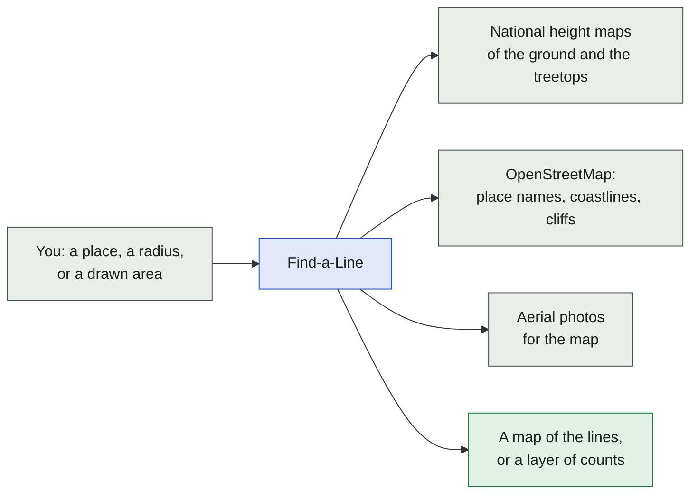
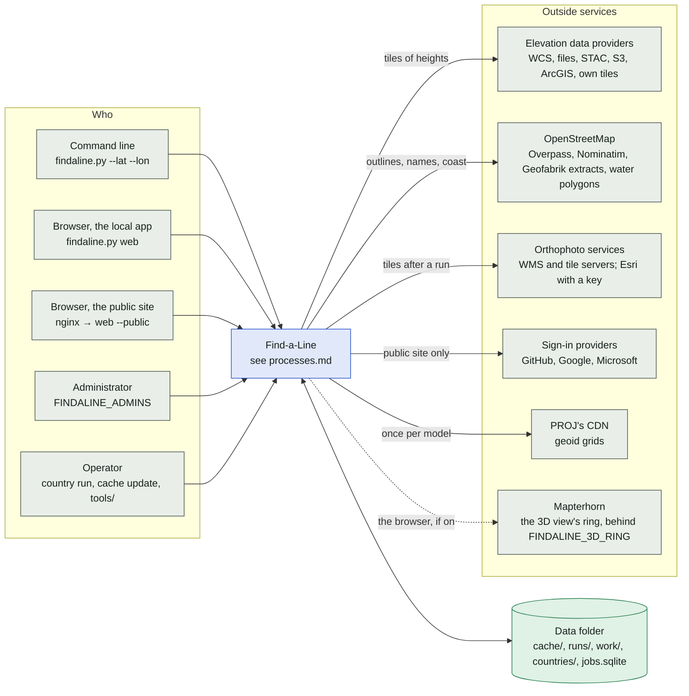

# Find-a-Line and the world around it

The first level: who uses the program, what it talks to outside, and what it keeps on disk. The
processes inside the box are [processes.md](processes.md); the data folder is laid out by
[cache.py](../../cache.py) and the runs by [runs.py](../../runs.py). The sources are listed in
[README](../../README.md#data-sources) ("Data sources") and drawn in [sources.md](sources.md).

## In plain words

Find-a-Line looks for places where a highline could be rigged. You give it a place; it fetches the
height map of the ground there (and of the treetops and roofs), finds the steep spots, and checks
every pair of them for a line that clears the terrain. The result is a map. Over a whole country it
counts the lines per square kilometre instead of keeping them.

## The users and the outside services

Three ways in, and the services every search may ask. The public site is the same program behind
nginx with accounts and quotas ([deployment.md](../deployment.md)).

What each outside service costs is bounded in the code: the providers' request rates and
connections per host ([sources/net.py](../../sources/net.py) `HOST_RATES_OF`, `HOST_SLOTS_OF`),
Overpass at most `OVERPASS_DAY_MAX` queries a day per data folder and Nominatim one request per
1.1 s ([osm.py](../../osm.py)), OpenTopography 50 calls a day per key. [download.md](download.md)
draws how a request takes its turn.

## The data folder

Everything the program writes goes under one folder (`--data-dir`, `FINDALINE_DATA`, the repository
by default). Each top-level folder has its own `index.sqlite`, and the cache is refused without the
current `cache/LAYOUT`.

| Folder or file | What is in it | Written by |
| --- | --- | --- |
| `cache/<source>/...` | the downloaded tiles of every layer, the sheet indexes, OSM themes, orthophoto tiles, geoid grids, the lock files of `cache/locks/` | the download phase, `cache update`, `osm update` |
| `runs/<date>_<time>_<place>_<random>/` | a saved search: `map.html`, `data.js`, `lines.js`, `lines.csv`, `lines.geojson`, `run.json`, `ATTRIBUTION.txt`; `runs/_viewer/` the viewer, `runs/index.html` and `runs.js` the list | `search.save_run`, `runs.write_index` |
| `work/<id>/`, `work/jobs/<job>/<phase>/` | the grids of step 1 and the tiles of a search while it runs; removed at the end | `search.prepare_data`, `search.search_lines` |
| `countries/<id>/` | the country layer: `country.json`, `area.geojson`, `manifest.sqlite`, `tiles/`, `cube/`, `logs/` | `country.py` |
| `jobs.sqlite` | the web app's jobs, events, leases, quick tasks, the runs' owners, favourites, statistics | `jobs.Jobs` |
| `accounts.sqlite`, `audit.sqlite` | the public site's users and sessions; the audit log | `accounts.py`, `audit.py` |

## Where in the code

| Node | File | Function or name |
| --- | --- | --- |
| Command line | [findaline.py](../../findaline.py) | `main`, the first argument's dispatch |
| Browser, the local app | [web.py](../../web.py) | `findaline.py web`, `create_app` |
| Browser, the public site | [web.py](../../web.py), [deploy/](../../deploy/) | `web --public`, `settings.PublicSettings` |
| Administrator | [accounts.py](../../accounts.py), [settings.py](../../settings.py), [web.py](../../web.py) | `AccountSettings.admins` (`FINDALINE_ADMINS`), `web.require_admin` |
| Operator | [country.py](../../country.py), [update.py](../../update.py), [tools/](../../tools/) | `country run`, `cache update` |
| Elevation data providers | [sources/catalogue/](../../sources/catalogue/) | `SOURCES`, `FAMILIES` |
| OpenStreetMap | [osm.py](../../osm.py), [osmextract.py](../../osmextract.py), [coast.py](../../coast.py) | `fetch_tile`, `search`, `reverse`, `world_polygons` |
| Orthophoto services | [orthophoto.py](../../orthophoto.py), [sources/source.py](../../sources/source.py) | `OrthoService`, `download` |
| Sign-in providers | [accounts.py](../../accounts.py) | `CLIENTS`, `oauth_clients` |
| PROJ's CDN | [sources/vertical.py](../../sources/vertical.py) | `Geoid` |
| Mapterhorn | [settings.py](../../settings.py), [viewer/src/view3d/ring.ts](../../viewer/src/view3d/ring.ts) | `ViewSettings.ring`, `FINDALINE_3D_RING_URL` |
| Data folder | [cache.py](../../cache.py), [search.py](../../search.py) | `cache.data_dir`, `search.Paths`, `LAYOUT`, `index.sqlite` |
