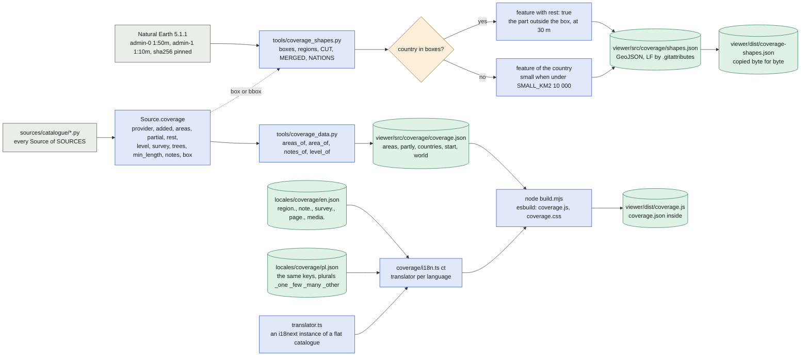
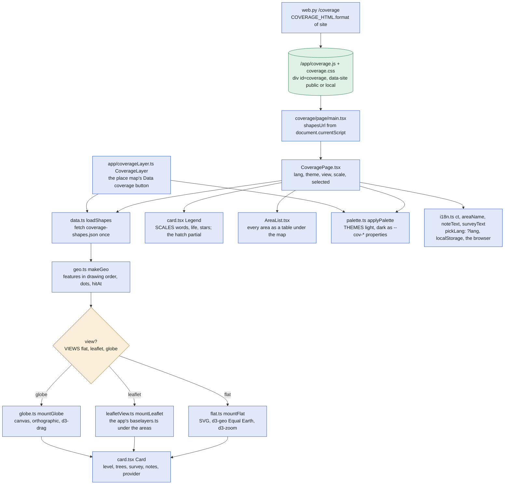
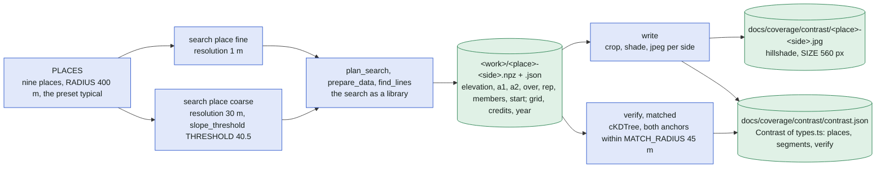
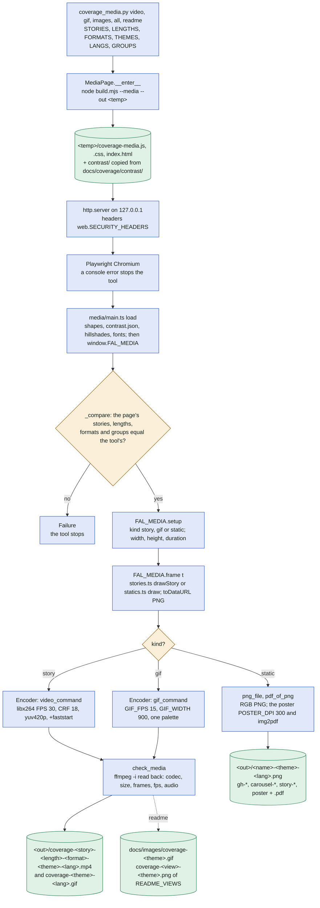

# The coverage map

Where Find-a-Line has detailed elevation data, shown as a page (`/coverage`) and as a layer of the
app's place map, and the pictures made from the same drawing code. This file shows the data pipeline
from the source catalogue to the page's files, the page itself, the "is 30 m enough?" comparison and
the media pipeline. It covers [sources/source.py](../../sources/source.py) (`Coverage`),
[tools/coverage_data.py](../../tools/coverage_data.py), [tools/coverage_shapes.py](../../tools/coverage_shapes.py),
[tools/coverage_contrast.py](../../tools/coverage_contrast.py), [tools/coverage_media.py](../../tools/coverage_media.py),
[viewer/src/coverage/](../../viewer/src/coverage/), [viewer/src/app/coverageLayer.ts](../../viewer/src/app/coverageLayer.ts),
[viewer/src/translator.ts](../../viewer/src/translator.ts), [web.py](../../web.py) (`/coverage`, `COVERAGE_HTML`),
[locales/coverage/](../../locales/coverage/), [tests/test_coverage.py](../../tests/test_coverage.py),
[tests/test_coverage_page.py](../../tests/test_coverage_page.py) and
[tests/test_coverage_media.py](../../tests/test_coverage_media.py). It relies on README's section
"Coverage map" ([README.md](../../README.md)). The sources themselves are in [sources.md](sources.md).

In plain words: the program knows the ground in some countries down to a metre and elsewhere only in
30 m blocks, and a highline between two boulders is invisible at 30 m. The coverage map tells a reader,
before a search, how well the program sees the place, in words rather than metres, and the same
colours appear on the map where a search is set up.

## 1. From the catalogue to the page's files

Every source that colours the map declares a `Coverage`; a gap filler has none. Two tools turn the
catalogue and Natural Earth into two JSON files that the page's bundle holds or fetches, and the
page's texts come from a catalogue of its own in two languages.

What `coverage_data.py` derives for each area of a source (`area_of`):

| Field of `Area` (types.ts) | From | Rule |
| --- | --- | --- |
| `level` | `Coverage.level`, else `level_of(res[0])` | 1 up to 1 m, 2 up to 5 m, 3 coarser |
| `res` | `default_resolution`, then `Coverage.rest` | finest first; more than one is the note `mixed` |
| `trees` | `Coverage.trees`, else `nmpt` present | "yes" with a surface layer, else "no" |
| `notes` | `notes_of` | `mixed`, `no_trees`, `gaps` (the first fallback's resolution unless in `rest` or in `GLOBAL`), `Coverage.notes` (`old_survey` with the survey's years), `short` (`min_length`) |
| `added` | `Coverage.added` | the timeline's step (`data.ts timeline`); `START` is the first version at 30 m |
| the areas | `Coverage.areas`, else `Source.regions`, else `Source.countries` | one source per area, or `coverage()` stops |

## 2. The page /coverage and the app's layer

`web.py` serves one shell for everyone, in both modes (`/coverage` is in `PUBLIC_ROUTES`); the
bundle does the rest in the browser and sends nothing back. The outlines are fetched from next to the
bundle, found through the script's own address.

The page's own state stays in the browser: `findaline.coverage.view`, `.scale`, `.lang` and the app's
theme in `localStorage`; the response sets no cookie (`tests/test_coverage_page.py`). The zoom
presets are `geo.ts BOXES` (`world`, `europe`, `na`, `oceania`). The app's layer
(`CoverageLayer`) draws only the areas with detailed data (never a `rest` feature), fainter as the map
zooms in, remembers its switch in `findaline.layer.coverage` and links to `/coverage?lang=en`; its
button texts are the app's catalogue (`t("ui.coverage.*")`), its area texts the coverage catalogue's
English (`ct("en", ...)`).

## 3. Is 30 m enough? The contrast

Run by hand. At the nine places of `PLACES` the same national data is searched twice, at 1 m and
averaged to 30 m, and the spots are matched; the animations and the README quote its totals.

`verify` counts, per place and in total: `fine_spots` (the 1 m spots), `fine_found` (those with a
30 m line near both anchors of the representative), `coarse_spots` and `coarse_real` (a 30 m spot with
any member matched by a 1 m line). The pure parts (`matched`, `verify`, `segments`, `crop`) are tested
offline in `tests/test_coverage.py`.

## 4. The animations and images

Run by hand (group `ui`, Node, `npm ci`). One page draws every frame deterministically; the tool steps
through it in headless Chromium and pipes the frames to ffmpeg, never to files.

What the page offers, and the tool's copy of the lists (`_compare` stops when they differ):

| List | Page (`viewer/src/coverage/media/`) | Tool (`coverage_media.py`) | Values |
| --- | --- | --- | --- |
| stories | `stories.ts STORIES` | `STORIES` | `contrast`, `fill`, `timeline`, `mix` |
| lengths | `stories.ts LENGTHS` | `LENGTHS` | short 10 s, medium 18 s, long 26 s |
| formats | `main.ts FORMATS` | `FORMATS` | `4x5` 1080 × 1350, `9x16` 1080 × 1920 |
| groups of stills | `statics.ts StaticGroup` | `GROUPS` | `readme`, `carousel`, `stories`, `poster` |
| the README's GIF | `main.ts GIF` | `gif_command` scales to `GIF_WIDTH` | 1200 × 600 drawn |
| places | `scenes.ts places` (contrast.json's order) | `places()` reads contrast.json | the first is a story's default |

`all` writes 4 × 3 × 2 × 2 × 2 = 96 videos, the GIFs and every still, skipping files that exist unless
`--force` (`tests/test_coverage_media.py::test_the_96_videos_and_their_names`). `readme` writes into
`docs/images/` in English, both themes.

## 5. What must stay in sync

| Pair | Who writes | What keeps it |
| --- | --- | --- |
| `Source.coverage` of the catalogue ↔ `viewer/src/coverage/coverage.json` | `tools/coverage_data.py` | `tests/test_coverage.py::test_coverage_json_up_to_date` (`render()` and `--check`); `test_every_map_source_has_a_coverage` (the gap fillers `GAP_FILLERS` have none, every other source one); `test_one_source_per_area` |
| `coverage.json` ↔ `types.ts` (`Area`, `Coverage`, `Note`, `Level`, `Trees`) | by hand, both sides | `test_areas_as_decided` pins the special cases; `npm run check` types the bundle against the JSON (check: no test reads the schema itself) |
| `coverage.json` areas ↔ `shapes.json` features (regions as `region`, countries as `country`) | `tools/coverage_shapes.py` | `test_every_area_has_a_shape`; the same test compares `shapes.json` with `dist/coverage-shapes.json` byte for byte; `tests/test_viewer.py::test_bundle_is_built_from_sources` rebuilds `dist/` and compares |
| `shapes.json` ↔ its line endings | `.gitattributes` (`text eol=lf`) | the byte comparison above |
| the codes in `coverage.json` (`note.<code>`, `survey.<code>`, `region.<id>`) ↔ `locales/coverage/en.json` and `pl.json` | by hand | `test_texts_of_codes_in_both_catalogues` (both catalogues the same keys; Polish plurals `_one`, `_few`, `_many`, `_other`); `test_survey_years_with_an_en_dash` |
| the page's `page.*` keys ↔ both catalogues; the page uses `ct`, never `t` | by hand | `tests/test_coverage_page.py::test_coverage_texts_and_app_links` (reads `viewer/src/coverage/page/`); `tests/test_units.py::test_viewer_keys_in_catalogue` reads every `t("...")` of `viewer/src` against the app's catalogue |
| the app's links to `/coverage` (`SearchIntro.tsx`, `SearchPanel.tsx`, the sign-in and about pages) | by hand | `test_coverage_texts_and_app_links`, `test_links_to_the_coverage_page` |
| `/coverage` public in both modes, no cookie, the security headers | `web.PUBLIC_ROUTES`, `COVERAGE_HTML` | `test_coverage_page_public`, `test_coverage_page_local`; `tests/test_public.py::test_every_route_has_its_access_rule` |
| the media page's lists ↔ the tool's `STORIES`, `LENGTHS`, `FORMATS`, `GROUPS` | by hand, both sides | `MediaPage._compare` at every run; `test_render_end_to_end` (skipped without Playwright's Chromium) |
| `contrast.json` ↔ `types.ts` (`Contrast`, `ContrastPlace`, `ContrastSide`) and the README's numbers of "Is 30 m enough?" | `tools/coverage_contrast.py write`, README by hand | the pure parts in `test_coverage.py` (`test_contrast_matching`, `_verify`, `_segments`, `_crop`); no test compares the README's totals with `contrast.json` (check) |
| the README images `docs/images/coverage-*` ↔ the drawing code and `coverage.json` | `tools/coverage_media.py readme` | none: rendered again by hand after a change of a source's coverage or of the drawing (check) |

## Where in the code

| Node | File | Function or name |
| --- | --- | --- |
| `sources/catalogue/*.py` | [sources/catalogue/__init__.py](../../sources/catalogue/__init__.py) | `SOURCES`, `FAMILIES` |
| `Source.coverage` | [sources/source.py](../../sources/source.py) | `Coverage`: `provider`, `added`, `areas`, `partial`, `rest`, `level`, `survey`, `trees`, `min_length`, `notes`, `box`; `Source.coverage` |
| `tools/coverage_data.py` | [tools/coverage_data.py](../../tools/coverage_data.py) | `areas_of`, `area_of`, `notes_of`, `level_of`, `coverage`, `render`, `main`, `START`, `WORLD`, `GLOBAL`, `TERRITORIES` |
| `viewer/src/coverage/coverage.json` | [viewer/src/coverage/coverage.json](../../viewer/src/coverage/coverage.json) | keys `areas`, `partly`, `countries`, `start`, `world` |
| Natural Earth 5.1.1 | [tools/coverage_shapes.py](../../tools/coverage_shapes.py) | `NE`, `FILES`, `download` |
| `tools/coverage_shapes.py` | [tools/coverage_shapes.py](../../tools/coverage_shapes.py) | `shapes`, `boxes`, `regions`, `feature`, `simplified`, `km2`, `CUT`, `MERGED`, `NATIONS`, `SMALL_KM2`, `TOLERANCE`, `LARGE_KM2` |
| country in boxes? | [tools/coverage_shapes.py](../../tools/coverage_shapes.py) | `shapes`: `if id_ in clips` |
| feature with rest: true | [tools/coverage_shapes.py](../../tools/coverage_shapes.py) | `feature(..., rest=True)` |
| feature of the country | [tools/coverage_shapes.py](../../tools/coverage_shapes.py) | `feature`: `small` |
| `viewer/src/coverage/shapes.json` | [viewer/src/coverage/shapes.json](../../viewer/src/coverage/shapes.json), [viewer/src/coverage/types.ts](../../viewer/src/coverage/types.ts), [.gitattributes](../../.gitattributes) | `ShapeProperties` of types.ts: `id`, `kind`, `continent`, `small`, `rest` |
| `locales/coverage/en.json` | [locales/coverage/en.json](../../locales/coverage/en.json) | keys `region.<id>`, `note.<code>`, `survey.<code>`, `page.*`, `media.*`, `count.*` |
| `locales/coverage/pl.json` | [locales/coverage/pl.json](../../locales/coverage/pl.json) | the same keys, the Polish plural forms one, few, many and other |
| `coverage/i18n.ts ct` | [viewer/src/coverage/i18n.ts](../../viewer/src/coverage/i18n.ts) | `ct`, `LANGS`, `TRANSLATORS`, `pickLang`, `rememberLang`, `metres`, `resText`, `alternatives`, `areaName`, `noteText`, `surveyText` |
| `translator.ts` | [viewer/src/translator.ts](../../viewer/src/translator.ts) | `translator`, `Texts` |
| `node build.mjs` | [viewer/build.mjs](../../viewer/build.mjs) | `entryPoints` (`coverage: "src/coverage/page/main.tsx"`), `--media`, `--out`, `copyFileSync` of shapes.json |
| `viewer/dist/coverage-shapes.json` | [viewer/dist/coverage-shapes.json](../../viewer/dist/coverage-shapes.json) | `data.ts SHAPES_FILE` |
| `viewer/dist/coverage.js` | [viewer/dist/coverage.js](../../viewer/dist/coverage.js) | the bundle of `coverage/page/main.tsx` |
| `web.py /coverage` | [web.py](../../web.py) | `coverage()` route, `COVERAGE_HTML`, `PUBLIC_ROUTES` |
| `/app/coverage.js + coverage.css` | [web.py](../../web.py) | `COVERAGE_HTML`: `
` |
| `coverage/page/main.tsx` | [viewer/src/coverage/page/main.tsx](../../viewer/src/coverage/page/main.tsx) | `shapesUrl`, `render(<CoveragePage>)` |
| `CoveragePage.tsx` | [viewer/src/coverage/page/CoveragePage.tsx](../../viewer/src/coverage/page/CoveragePage.tsx) | `CoveragePage`, `VIEW_KEY`, `SCALE_KEY`, `MOUNT`, `firstLang` |
| `data.ts loadShapes` | [viewer/src/coverage/data.ts](../../viewer/src/coverage/data.ts) | `loadShapes`, `SHAPES_FILE`, `COVERAGE`, `areaOf`, `levelOf`, `regionsOf`, `timeline` |
| `geo.ts makeGeo` | [viewer/src/coverage/page/geo.ts](../../viewer/src/coverage/page/geo.ts) | `makeGeo`, `Geo`, `hitAt`, `keyOf`, `parseKey`, `restKey`, `levelOfKey`, `partialOfKey`, `BOXES`, `BOX_NAMES` |
| view? | [viewer/src/coverage/page/view.ts](../../viewer/src/coverage/page/view.ts) | `VIEWS`, `ViewName`, `ViewContext`, `MapView`, `tween` |
| `flat.ts mountFlat` | [viewer/src/coverage/page/flat.ts](../../viewer/src/coverage/page/flat.ts) | `mountFlat`, `fillClass`, `MAX_K` |
| `leafletView.ts mountLeaflet` | [viewer/src/coverage/page/leafletView.ts](../../viewer/src/coverage/page/leafletView.ts) | `mountLeaflet`, `MAX_ZOOM`; [viewer/src/baselayers.ts](../../viewer/src/baselayers.ts) `baseLayers` |
| `globe.ts mountGlobe` | [viewer/src/coverage/page/globe.ts](../../viewer/src/coverage/page/globe.ts) | `mountGlobe`, `AIMS`, `MAX_K`, `SPIN` |
| `card.tsx Card` | [viewer/src/coverage/page/card.tsx](../../viewer/src/coverage/page/card.tsx) | `Card`, `LevelBlock`, `Fact`, `NOTE_ICON`, `LEVEL_TAGS` |
| `card.tsx Legend` | [viewer/src/coverage/page/card.tsx](../../viewer/src/coverage/page/card.tsx) | `Legend`, `SCALES`, `Scale`, `levelName`, `Stars` |
| `AreaList.tsx` | [viewer/src/coverage/page/AreaList.tsx](../../viewer/src/coverage/page/AreaList.tsx) | `AreaList`, `rows` |
| `palette.ts applyPalette` | [viewer/src/coverage/palette.ts](../../viewer/src/coverage/palette.ts) | `THEMES`, `Theme`, `levelColour`, `applyPalette` |
| `i18n.ts ct, areaName, noteText, surveyText` | [viewer/src/coverage/i18n.ts](../../viewer/src/coverage/i18n.ts) | as above; `LANG_KEY` |
| `app/coverageLayer.ts CoverageLayer` | [viewer/src/app/coverageLayer.ts](../../viewer/src/app/coverageLayer.ts) | `CoverageLayer`, `set`, `paint`, `style`, `opacity`, `STORAGE_KEY`, `SHAPES_URL` |
| `PLACES` | [tools/coverage_contrast.py](../../tools/coverage_contrast.py) | `PLACES`, `RADIUS`, `LINES`, `SIDES` |
| search place fine / coarse | [tools/coverage_contrast.py](../../tools/coverage_contrast.py) | `search`, `THRESHOLD` |
| `plan_search, prepare_data, find_lines` | [search.py](../../search.py) | `plan_search`, `prepare_data`, `find_lines`, `Paths`, `SearchError` |
| `<work>/<place>-<side>.npz + .json` | [tools/coverage_contrast.py](../../tools/coverage_contrast.py) | `search`: `np.savez_compressed`, `info`, `credits` |
| `write` | [tools/coverage_contrast.py](../../tools/coverage_contrast.py) | `write`, `crop`, `shade`, `jpeg`, `segments`, `searched_in`, `SIZE`, `MARGIN`, `MAX_SPOTS`, `QUALITY`, `OUT` |
| `docs/coverage/contrast/<place>-<side>.jpg` | [tools/coverage_contrast.py](../../tools/coverage_contrast.py), [docs/coverage/contrast/](../../docs/coverage/contrast/) | `write`: `image` |
| `verify, matched` | [tools/coverage_contrast.py](../../tools/coverage_contrast.py) | `verify`, `matched`, `MATCH_RADIUS` |
| `docs/coverage/contrast/contrast.json` | [docs/coverage/contrast/contrast.json](../../docs/coverage/contrast/contrast.json), [viewer/src/coverage/types.ts](../../viewer/src/coverage/types.ts) | `Contrast`, `ContrastPlace`, `ContrastSide` of [viewer/src/coverage/types.ts](../../viewer/src/coverage/types.ts) |
| `coverage_media.py video, gif, images, all, readme` | [tools/coverage_media.py](../../tools/coverage_media.py) | `parser`, `parse_args`, `run`, `_all`, `STORIES`, `LENGTHS`, `FORMATS`, `THEMES`, `LANGS`, `GROUPS`, `README_VIEWS`, `all_videos` |
| `MediaPage.__enter__` | [tools/coverage_media.py](../../tools/coverage_media.py) | `MediaPage`, `VIEWER`, `CONTRAST`, `PAGE`, `LOAD_SECONDS` |
| `<temp>/coverage-media.js, .css, index.html` | [tools/coverage_media.py](../../tools/coverage_media.py), [viewer/build.mjs](../../viewer/build.mjs) | `MediaPage.folder`, `"coverage-media": "src/coverage/media/main.ts"` |
| http.server on 127.0.0.1 | [tools/coverage_media.py](../../tools/coverage_media.py), [web.py](../../web.py) | `_Handler`, `_security_headers`; [web.py](../../web.py) `SECURITY_HEADERS` |
| Playwright Chromium | [tools/coverage_media.py](../../tools/coverage_media.py) | `MediaPage.page`, `errors` |
| `media/main.ts load` | [viewer/src/coverage/media/main.ts](../../viewer/src/coverage/media/main.ts), [viewer/src/coverage/media/assets.ts](../../viewer/src/coverage/media/assets.ts) | `load`, `got`, `CONTRAST_DIR`, `FalMedia`, `window.FAL_MEDIA`, `FAL_MEDIA_ERROR` |
| `_compare` | [tools/coverage_media.py](../../tools/coverage_media.py) | `MediaPage._compare`, `MediaPage.info` |
| `Failure` | [tools/coverage_media.py](../../tools/coverage_media.py) | `Failure` |
| `FAL_MEDIA.setup` | [viewer/src/coverage/media/main.ts](../../viewer/src/coverage/media/main.ts) | `setup`, `Setup`, `FORMATS`, `GIF` |
| `FAL_MEDIA.frame t` | [tools/coverage_media.py](../../tools/coverage_media.py), [viewer/src/coverage/media/main.ts](../../viewer/src/coverage/media/main.ts), [viewer/src/coverage/media/stories.ts](../../viewer/src/coverage/media/stories.ts), [viewer/src/coverage/media/statics.ts](../../viewer/src/coverage/media/statics.ts) | `frame`, `drawStory`, `storyScenes`, `gifScenes`, `scenesLength`, `STATICS`; `FRAME_JS` of the tool |
| kind? | [tools/coverage_media.py](../../tools/coverage_media.py) | `write_video`, `write_gif`, `write_image` |
| `Encoder: video_command` | [tools/coverage_media.py](../../tools/coverage_media.py) | `Encoder`, `video_command`, `FPS`, `CRF` |
| `Encoder: gif_command` | [tools/coverage_media.py](../../tools/coverage_media.py) | `gif_command`, `GIF_FPS`, `GIF_WIDTH` |
| `png_file, pdf_of_png` | [tools/coverage_media.py](../../tools/coverage_media.py) | `png_file`, `pdf_of_png`, `POSTER_DPI` |
| `check_media` | [tools/coverage_media.py](../../tools/coverage_media.py) | `check_media`, `probe_command`, `parse_probe` |
| `<out>/coverage-...mp4`, `.gif` | [tools/coverage_media.py](../../tools/coverage_media.py) | `video_name`, `gif_name`, `out_folder` |
| `<out>/<name>-<theme>-<lang>.png` | [tools/coverage_media.py](../../tools/coverage_media.py), [viewer/src/coverage/media/statics.ts](../../viewer/src/coverage/media/statics.ts) | `image_name`; names of `STATICS` in [viewer/src/coverage/media/statics.ts](../../viewer/src/coverage/media/statics.ts) |
| `docs/images/coverage-<theme>.gif`, `coverage-<view>-<theme>.png` | [tools/coverage_media.py](../../tools/coverage_media.py), [docs/images/](../../docs/images/) | `run`: the command `readme`, `README_DIR`, `README_VIEWS`; the statics `gh-<view>` |
