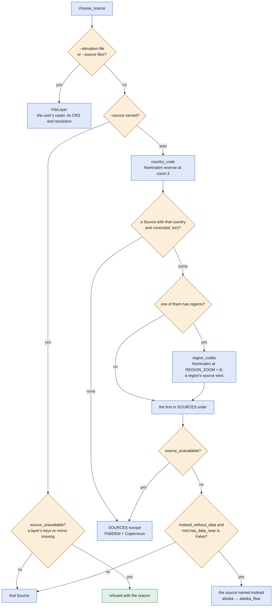
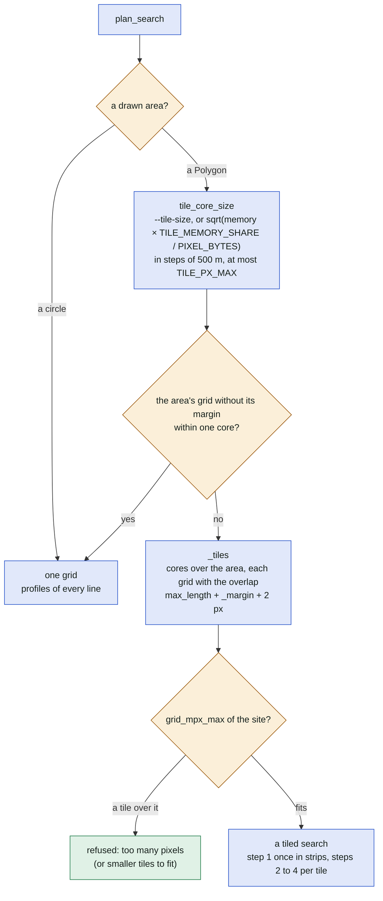
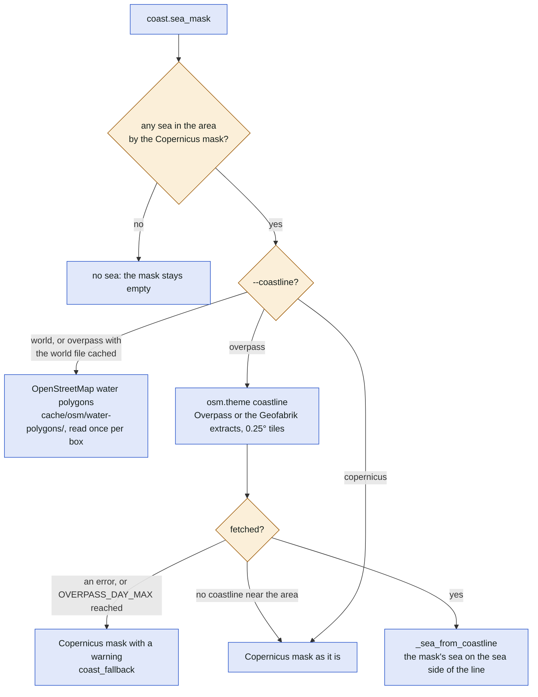
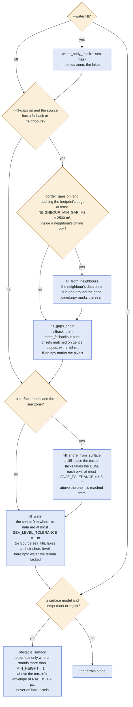

# The decisions a search makes

The decision trees inside a search ([search.md](search.md)): which source, one grid or tiles, where
the sea is, what is filled and from where, and what is an obstacle. Each tree names the option that
sets it and the constant that decides a branch.

## In plain words

Before it searches, the program decides where to take the height map from (the country's own survey
if there is one, else a world-wide model), whether the area is small enough for one piece, where the
sea and the lakes are (so a line over water is found), how to fill the holes in the data, and which
raised things in the surface map are trees and roofs rather than the rock itself.

## Which source

`--source auto` picks by the country of the centre; a named source or an elevation file skips the
lookup. Offline, `OFFLINE_BOXES` stand in for the lookup.

## One grid or tiles

Only a drawn area (`area.Polygon`) is tiled; a circle is always one grid. The core of a tile comes
from `--tile-size` or from the memory: a compute slot's budget on the public site, the free memory
locally, at most `TILE_PX_MAX` pixels with the overlap.

## Where the sea is

`--coastline overpass|world|copernicus` (step 1, `coast.sea_mask`). The Copernicus water body mask
marks the sea coarsely (30 m); the OpenStreetMap coastline gives the exact shore.

## What is filled, and from where

The order of step 1 (`prepare_data`): the sea zone first, then the gaps on land, then a sea cliff's
face from the surface model, then the water. Pixels from a neighbour are a seam (no anchors on its
edge), never "filled"; a filling layer that filled no pixel is not credited.

## Anchors and lines: the thresholds that cut

| Decision | Option or constant | Where |
| --- | --- | --- |
| a pixel is an anchor | slope ≥ `slope_threshold` (45° by default; the country layer 60°, 45° at 5 m) | `helpers.find_significant_slopes` |
| an anchor is kept | within `--min-elevation`/`--max-elevation`; not at a seam of filled or joined pixels; at most `ANCHORS_MAX` | `search._anchors`, `at_seams` |
| a pair is a candidate | `min_length` ≤ length ≤ `max_length`; the anchors' height difference at most 5 % and 50 m; both open towards each other; the wall angle under `--max-wall-angle` within EPS | `linesearch._pairs` |
| a line is valid | every pixel under `helpers.max_safe_elevation` (the formula, or the sag table of `--model sag`) | `linesearch._line_ok`, then `_evaluate` |
| a line over trees | fails the same test against the obstacle surface: kept and marked (`--nmpt mark`) or dropped (`reject`) | `linesearch._evaluate` |
| too many lines | over `lines_max` (a site's limit) or the memory: stopped early (`lines_early_stop`) or refused at the end | `search._early_check`, `_check_lines` |

## Where in the code

| Node | File | Function or name |
| --- | --- | --- |
| choose_source | [sources/choose.py](../../sources/choose.py) | `choose_source`, `country_code`, `region_codes`, `REGION_ZOOM`, `source_unavailable`, `OFFLINE_BOXES` |
| FileLayer | [sources/layers/files.py](../../sources/layers/files.py) | `FileLayer` |
| SOURCES europe | [sources/catalogue/__init__.py](../../sources/catalogue/__init__.py), [sources/catalogue/world.py](../../sources/catalogue/world.py) | `SOURCES`, `FAMILIES` |
| instead_without_data, covers, has_data_near | [sources/source.py](../../sources/source.py), [sources/composed.py](../../sources/composed.py) | `Source.instead_without_data`, `Source.covers`, `Index.has_data_near` |
| tile_core_size, _tiles | [search.py](../../search.py) | `tile_core_size`, `_tiles`, `_margin`, `_overlap`, `TILE_MEMORY_SHARE`, `TILE_PX_MAX`, `PIXEL_BYTES`, `_check_tiles` |
| grid_mpx_max | [settings.py](../../settings.py) | `Limits.grid_mpx_max` |
| coast.sea_mask | [coast.py](../../coast.py) | `sea_mask`, `sea_mask_rows`, `world_polygons`, `_sea_from_coastline` |
| osm.theme coastline | [osm.py](../../osm.py) | `theme`, `fetch_tile`, `OVERPASS_DAY_MAX`, `OverpassDayMax` |
| water_body_mask, fill_water | [sources/filling.py](../../sources/filling.py) | `water_body_mask`, `fill_water`, `water_with_data`, `SEA_LEVEL_TOLERANCE`, `Source.sea_fill` |
| border_gaps, fill_from_neighbours | [sources/filling.py](../../sources/filling.py) | `border_gaps`, `NEIGHBOUR_MIN_GAP_M2`, `fill_from_neighbours`, `neighbour_window` |
| fill_gaps_chain | [sources/filling.py](../../sources/filling.py) | `fill_gaps_chain`, `fill_gaps`, `_fill` |
| fill_shore_from_surface | [sources/filling.py](../../sources/filling.py) | `fill_shore_from_surface`, `FACE_TOLERANCE` |
| obstacle_surface | [obstacles.py](../../obstacles.py) | `obstacle_surface`, `RULE`, `MIN_HEIGHT`, `RADIUS` |
| the thresholds | [helpers.py](../../helpers.py), [linesearch.py](../../linesearch.py), [search.py](../../search.py) | `find_significant_slopes`, `max_safe_elevation`, `_pairs`, `_line_ok`, `_evaluate`, `_anchors`, `_early_check`, `_check_lines` |
