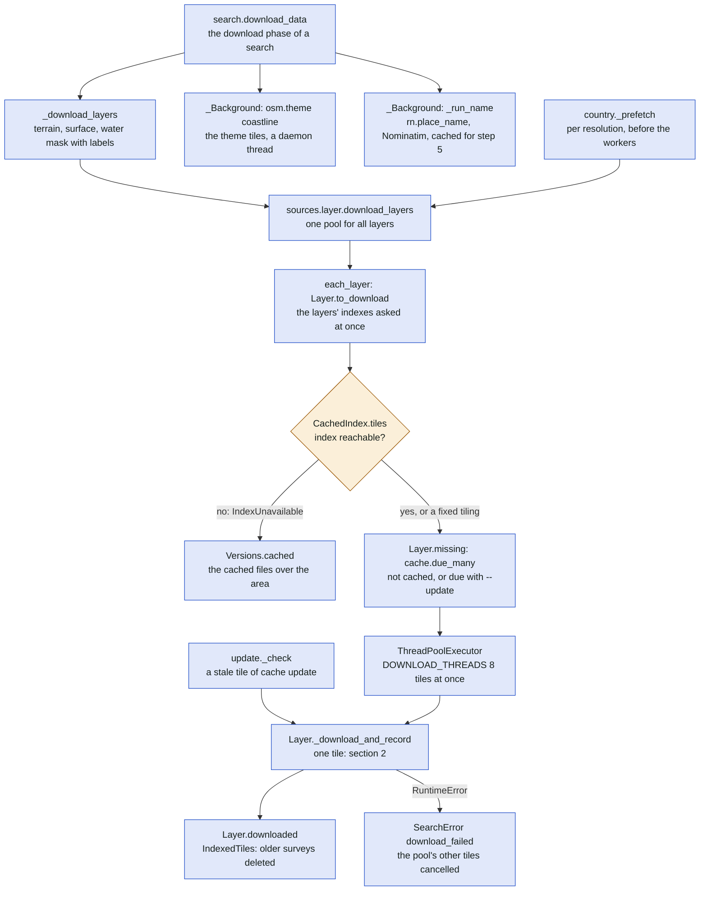
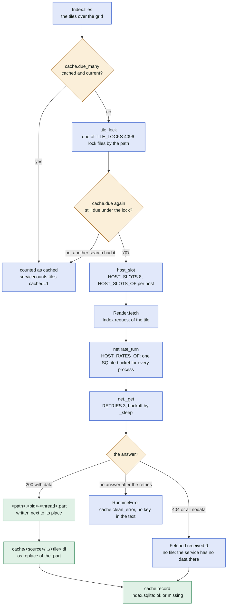
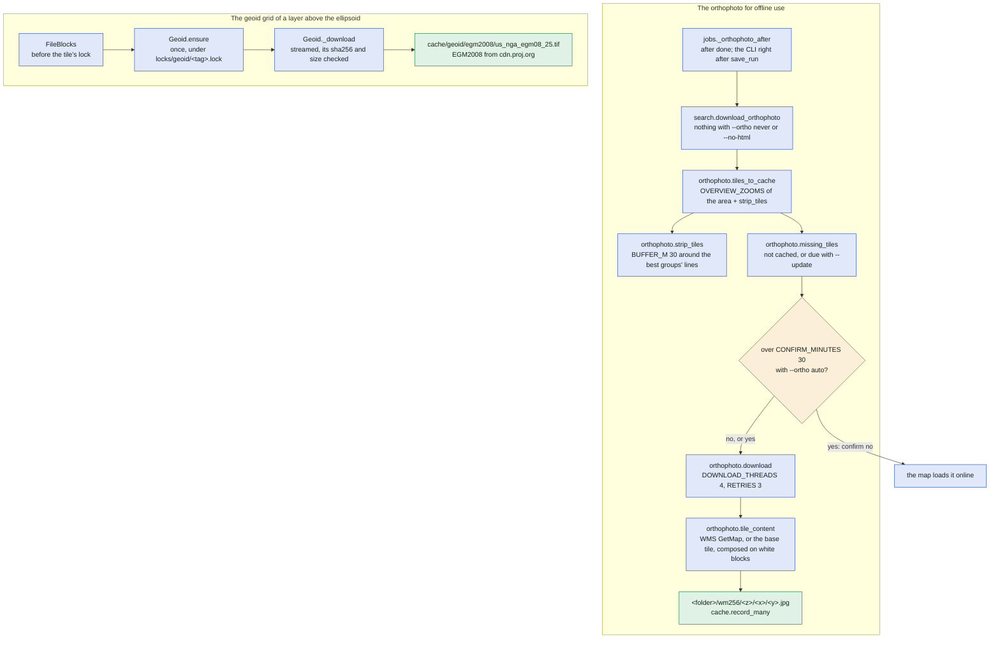
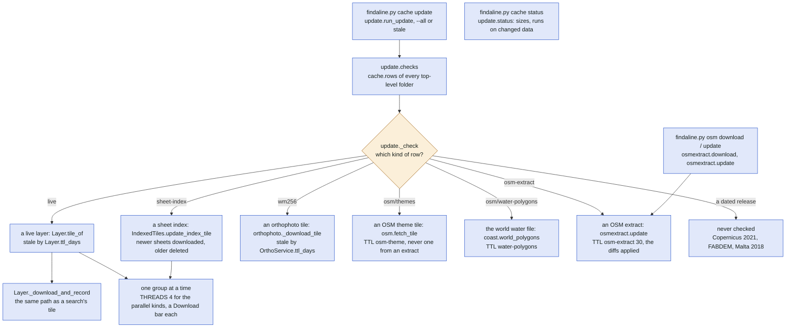
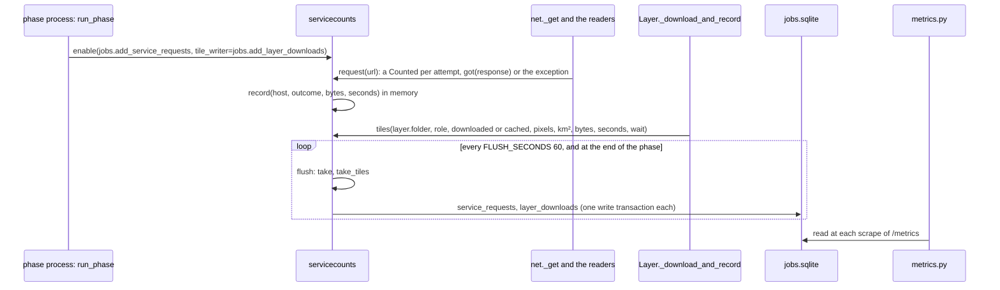

# How the data is downloaded

This file shows every way data comes in from outside: the download phase of a search, the life of
one cached tile (locks, slots, rates, outcomes), the kinds of readers and indexes a source is built
from, the other downloads (the orthophoto, the geoid grid, OpenStreetMap, the service keys), the
cache commands, the country layer's prefetch and the counting of requests for the monitoring. It
covers [sources/net.py](../../sources/net.py), [sources/layer.py](../../sources/layer.py),
[sources/composed.py](../../sources/composed.py), [sources/readers/](../../sources/readers/),
[sources/indexes/](../../sources/indexes/), [sources/vertical.py](../../sources/vertical.py),
[cache.py](../../cache.py), [osm.py](../../osm.py), [osmextract.py](../../osmextract.py),
[coast.py](../../coast.py), [orthophoto.py](../../orthophoto.py), [update.py](../../update.py),
[servicecounts.py](../../servicecounts.py), `_prefetch` of [country.py](../../country.py) and
`download_data` of [search.py](../../search.py). It relies on
[docs/data-sources.md](../data-sources.md) (how a source is chosen and tested) and on the rows F11
and F18 of [docs/monitoring.md](../monitoring.md). The sources themselves are in
[sources.md](sources.md); where the download phase sits in a search is in [search.md](search.md).

In plain words: before a search can look at the terrain, the program fetches the height maps of the
area from the mapping agency's servers and keeps them on disk, so the next search of the same place
asks for nothing. Every file is fetched once, under a lock, with a cap on how many requests go to one
server at a time, and whatever else is needed later (the shoreline, aerial pictures, a place name) is
fetched the same careful way.

## 1. The download phase of a search

`search.download_data` fetches the tiles of all layers of a search in one pool, with two small
threads beside it; the country layer's `_prefetch` and `cache update` reach the same functions.

The coastline thread runs only when the search fills water, `--coastline overpass` is set and no
world water file is cached (`coast.world_file`); its failure is passed over, the search then falls
back to the Copernicus water body mask. The place name's lookup never fails the download either.
Gap filling layers (`Source.more_fallbacks`, the neighbours) are not downloaded here: whether they
are needed shows only on the grid, in step 1 (`sources.filling.fill_gaps_chain`).

## 2. The life of one tile

Every tile of a layer goes through `Layer._download_and_record`: the tile's lock, a slot of its host,
the host's rate, the reader, a `.part` file, then the cached file and its row in `index.sqlite`.

What "current" means: a file is due when it has no row or no file, when its row's `processing`
differs from the layer's, or, only with `--update stale|all`, when `cache.stale` finds it older than
its TTL (`Layer.ttl_days`: `cache.TTL_DAYS["live"]` 730 days for a layer whose folder holds `/live`,
none for a dated release; a "missing" tile is asked again after `MISSING_TTL_DAYS` 90). The lock and
the slots are OS file locks under `cache/locks/` (a killed process releases them); a wait longer than
`LOCK_WAIT_S` 3600 s is an error. `rate_turn` applies only to the hosts of `HOST_RATES_OF` (swisstopo,
the Environment Agency, the Géoplateforme); its bucket lives in the system's temporary folder
(`findaline-rates.sqlite`), so it is shared by every process of the machine, and a turn not had
within `RATE_WAIT_S` 600 s is an error.

### The outcomes and the errors of a tile

| Outcome | Where it is decided | What happens |
| --- | --- | --- |
| downloaded | `Reader.fetch` returns `Fetched` with bytes | the `.part` replaces the file; `cache.record` writes "ok" with the URL, ETag, Last-Modified and the survey date (`Layer.source_date`) |
| missing | a 404 of `net._get`, an all-nodata answer (`ImageServerReader`, `WmsrReader`, `WcsReader` outside `coverage_extent`), no file over a block (`Windows`), `ZipTiling.url` None | no file; `cache.record` writes "missing", so the tile is not asked again (until `MISSING_TTL_DAYS` with an update) |
| a transient error | `net._get` (HTTP errors, no answer): `RETRIES` 3 attempts, `_sleep` of 0.5-1.5 × 2^attempt s, longer after a 429 or 503; `WmsrReader`: `TRANSIENT` answers get `TRANSIENT_ROUNDS` 2 more rounds | retried inside the reader |
| a short answer of GDAL | `Windows._read_file` raises `Incomplete` when `net.gdal_errors` saw an error of a read that returned; `_read_block` calls `rasterio.cache.invalidate` (`_forget`) and reads again up to `net.RETRIES` | never a block made of what GDAL filled in |
| a wrong file | `Download.fetch`: the sha256 differs; `ZipMember.fetch`: the CRC-32 or size differs, or the local header is not the member's (`ArchiveChanged`: `renew` once) | asked again up to `RETRIES`, then an error, never cached |
| error | the reader raises `RuntimeError` | `download_layers` stops, the tiles not started are cancelled, `search.download_data` raises `SearchError` `download_failed` |
| the index cannot be asked | `IndexUnavailable` (a `requests.RequestException`) from a `Listing.fetch` | `CachedIndex.tiles` gives None: the cached files over the area are used (`Versions.cached`), printed as "index not available" |

## 3. How a tile is fetched, and how we know which tiles exist

A layer of `sources/layers/` is a `ComposedLayer`: an `Index` (which tiles cover a grid, where each is
cached, what the reader needs) and a `Reader` (how one tile is fetched). The two tables list the kinds.

### The readers (`sources/readers/`)

| Reader | How one tile is fetched | Layer | Example source |
| --- | --- | --- | --- |
| `Download` | a whole file per GET through `net._get`, checked against a sha256 when the index gives one; `average` writes a coarser copy, `crs` another CRS name | `DegreeTiles`, `OpenTopographyTiles`, `StacTiles`, `MetalinkTiles` | `copernicus`, `swisstopo`, `bavaria` |
| `WcsReader` | a GetCoverage of WCS 2.0.1 or 1.0.0, clipped to DescribeCoverage's extent (`coverage_extent`), multipart answers unpacked, `edge_px` pixels next to nodata dropped | `WcsTiles`, `ImageServerTiles` (its tiling) | `malta`, `england`, `denmark` |
| `Windows` | windows of big remote files read by GDAL's `/vsicurl/` inside `net._gdal_http`, newest file first until the block has no hole; `geoid`: heights moved to the geoid | `DegreeBlocks`, `FileBlocks`, `TnmBlocks`, `S3Blocks`, `LidarBcBlocks` | `usa`, `austria`, `scotland`, `greenland` |
| `ZipMember` | one member of a remote ZIP by a Range GET of its local header and data (`ranged`), inflated, its CRC-32 checked | `ZipMemberTiles` | `saarland` |
| `SheetFile` | a sheet file (ASCII grid, XYZ, GeoTIFF, zipped once or twice; `members`: every matching member of one ZIP merged) through `net._get` | `SheetTiles`, `ZippedTiles` | `geoportal`, `saxony`, `trento` |
| `XyzFile` (a `SheetFile`) | a plain XYZ text file, `text/plain` only, under a byte cap; an HTML page instead is `StaleLink`, which makes the index be read again | `GeoJsonTiles` | `schleswig_holstein` |
| `WmsrReader` | a GetMap of WMS 1.3.0 answered as a GeoTIFF of raw heights (IGN's WMS-R), the box checked to the pixel | `WmsrTiles` | `france` |
| `ImageServerReader` | an ArcGIS ImageServer's `exportImage` on the service's own pixels, TIFF magic bytes checked (errors come with HTTP 200) | `ImageServerTiles` | `czechia`, `queensland` |
| `TileBases` | our own tiles from the mirror of `FINDALINE_MIRROR` (`MIRROR_ENV`), then the URLs | `GridTiles` | `slovakia` |

### The indexes (`sources/indexes/`)

| Index | How we know which tiles exist | Example source |
| --- | --- | --- |
| `MetricTiling`, `DegreeTiling`, `TenthDegreeTiling`, `WcsTiling`, `FileBlockTiling` (`tilings.py`) | a fixed tiling computed from the grid's bounds, no service asked; `FileBlockTiling` names the COG of a block by formula | `malta` (WCS), `copernicus` (degrees), `austria` (50 km COGs) |
| `CachedIndex` over a `Listing` (`cached.py`) | the service's answer per 0.25° tile kept in `<top>/sheet-index/<prefix>/<tile>.json` for `ttl_days` (`TTL_DAYS["sheet-index"]` 180 unless the index says otherwise), asked under `tile_lock`; a `Versions` policy (`NewestPerSheet`, `ComposedBlocks`, `ShaPerTile`, `ZipPerTile`, `XyzPerTile`) picks the files | every row below |
| `WfsSheets` (`listings.py`) | GetCapabilities and a GetFeature per year layer (`WFS_THREADS` 4 at once, each under `host_slot`), the GML read by pyogrio; the year layers kept `CAPABILITIES_DAYS` 30 | `geoportal` |
| `StacItems` | a STAC API's item search through pystac-client, each page in its `rate_turn`; `APIError` becomes `IndexUnavailable` | `swisstopo`, `lower_saxony` |
| `TnmProducts` | The National Map's products API | `usa`, `alaska_ifsar` |
| `MetalinkFiles` (`metalink.py`) | Metalink 4 documents of a whole Land read once per TTL, kept in `<top>/metalink/<key>.json.gz`, the 0.25° tiles picked from them; `ShaPerTile` names a file by its sha256 | `bavaria`, `rhineland_palatinate` |
| `S3Objects` (`s3listing.py`) | S3 ListObjectsV2 pages (`MAX_PAGES` 1000) under the prefixes of a tile; an `<Error>` or a page without a new token is `IndexUnavailable` | `scotland`, `british_columbia` |
| `GeoJsonFiles` (`geojsonfiles.py`) | one GeoJSON index of file links of a whole Land, streamed under `GEOJSON_MAX_BYTES`, kept as `<top>/geojson/<key>.json.gz` | `schleswig_holstein` |
| `ZipDirectories` (`zipdir.py`) | the central directories of remote ZIPs read by Range from their ends (at most `DIRECTORY_MAX` bytes), kept per TTL with each archive's ETag; a share's token resolved from its redirect | `saarland` |
| `query_features` (`arcgis.py`) | an ArcGIS FeatureServer query paged by `resultOffset` (`LidarBcFiles`, then `S3Objects` under what it names) | `british_columbia` |

## 4. The other downloads

### The orthophoto and the geoid grid

The orthophoto is fetched after the run is saved (the web worker after "done", holding no slot) and
the geoid grid once per data folder, before the first block of a layer that needs it.

`orthophoto_lines` chooses the lines whose strips are cached in detail: one per group, the best
first, as many as `--ortho-detail`, the service's `OrthoService.detail` or `ORTHO_DETAIL` 50 for an
area (a circle: every group). Every tile request of `orthophoto._get` takes `net.rate_turn` and is
counted. A failed tile is skipped and reported; the map loads it online. The geoid is never read
through PROJ (`GeoidMissing` instead of a silent N = 0).

### OpenStreetMap: themes, places, extracts and the world water file

Four services, each with its own limit shared by every process of the data folder.

```mermaid
flowchart TD
    subgraph themes["Theme tiles: osm.theme"]
        TH["osm.theme<br/>a theme over a WGS84 box, 0.25° tiles"]
        Q1{"cache.due<br/>TTL osm-theme 365 days?"}
        FT["osm.fetch_tile<br/>one tile"]
        Q2{"osmextract.build_tile<br/>the extracts cover the tile?"}
        EX["from the extracts' themes.json<br/>recorded as geofabrik:&lt;ids&gt;"]
        OT["_overpass_turn<br/>cache/osm/overpass.lock, one query at a time"]
        CQ["_count_query<br/>OVERPASS_DAY_MAX 75 a UTC day, else OverpassDayMax"]
        OV["Overpass<br/>overpass-api.de, out geom"]
        TF["cache/osm/themes/&lt;theme&gt;/&lt;tile&gt;.geojson<br/>cache.record"]
    end
    subgraph places["Place names: osm._ask"]
        NA["osm._ask<br/>search, places, reverse"]
        BR["BEFORE_REQUEST<br/>the user's Nominatim quota, jobs.nominatim_quota"]
        NT["_nominatim_turn<br/>NOMINATIM_INTERVAL_MS 1100, nominatim-rate.sqlite"]
        NM["Nominatim<br/>nominatim.openstreetmap.org"]
        NDB["cache/osm/nominatim.sqlite<br/>answers kept, failures FAILED_DAYS 30"]
    end
    subgraph extracts["Extracts and the world file"]
        GD["osmextract.download<br/>a Geofabrik region's .osm.pbf, streamed"]
        GU["osmextract.update<br/>replication diffs by pyosmium, DIFF_BATCH_KB"]
        WP["coast.world_polygons<br/>WORLD_URL, about WORLD_MB 910 MB, once"]
    end
    TH --> Q1
    Q1 -- "yes" --> FT --> Q2
    Q1 -- "no" --> TF
    Q2 -- "yes" --> EX --> TF
    Q2 -- "no" --> OT --> CQ --> OV --> TF
    NA --> BR --> NT --> NM --> NDB
    classDef step fill:#e1e8fa,stroke:#2350c8,color:#17201c
    classDef q fill:#fbefd9,stroke:#995500,color:#17201c
    classDef file fill:#e0f1e6,stroke:#1d7a47,color:#17201c
    classDef actor fill:#e9eee9,stroke:#45524b,color:#17201c
    class TH,FT,EX,OT,CQ,NA,BR,NT,GD,GU,WP step
    class Q1,Q2 q
    class TF,NDB file
    class OV,NM actor
```

The extracts (`findaline.py osm download|update`, also an "osm" job of the web app's OSM page run by
`jobs.run_phase`) go to `cache/<country>/osm-extract/<region>.osm.pbf` with their outline and
`themes.json` of `EXTRACT_THEMES` (`coastline`, `cliff`); a theme tile comes from them when their
outlines cover it whole. The world water file goes to `cache/osm/water-polygons/<date>/` and is
checked again after `TTL_DAYS["water-polygons"]` 365 days, downloaded only when the server's file is
newer (`coast.world_newer`). After a 429 or 406 Overpass is left alone for `OVERPASS_PAUSE_S` 30 s,
or as long as its Retry-After asks.

### The service keys

A layer that names `keys` (`Layer.keys`, from its reader) is unavailable without them
(`Layer.unavailable`, `settings.missing_keys`). A key is read when the request is made
(`settings.service_key`: the environment variable in upper case, or the worker's Docker secret in
`/run/secrets`), put into the request by the reader (`WcsReader.key_params`) and never into the
catalogue, a printed text or a run's files: every message passes `cache.clean_error`, which masks
the values `settings.redact` knows. Only the worker holds them; the web process never reads a key of
a data service.

## 5. The cache commands

`findaline.py cache update` reads every row of the `index.sqlite` files and checks the rows whose
data can change; `cache status` lists what is cached; `osm download|update` are the extracts.

A row is checked only when `cache.stale` says so: with `--all` always, otherwise when its
`checked_at` is older than the kind's TTL (`cache.TTL_DAYS`: `live` 730, `sheet-index` 180,
`osm-theme` 365, `osm-extract` 30, `water-polygons` 365 days; a "missing" row `MISSING_TTL_DAYS` 90).
A file downloaded again with the same content keeps its fetch time, so `cache status` can list the
runs whose data changed (`update.changed_runs`). A layer without `tile_of` is skipped by the update.
`--update stale|all` of a search does the same for the area of that search, inside
`download_layers`.

## 6. The country layer's prefetch

`country._prefetch` runs once per `country run`, before the workers start: for every resolution of
the selected bands it takes the band with the largest grid and calls `sources.download_layers` on
that grid with the terrain, the surface model when the band uses it, and the water mask when water is
filled or gaps are (`search._fills_gaps`). The tiles of every band of that resolution lie within it,
so the workers find their data cached and download at most the gap fillers of a tile. A failure is a
warning: the tiles then download what they need themselves, through the same path as section 2.

## 7. The counting of requests for the monitoring

In the worker's processes every request to an outside service and every tile of a layer is counted
in memory and flushed into `jobs.sqlite`, from which the web process's `/metrics` reads (F11, F18).

`servicecounts.request` is a context manager for a request made by hand (`net._get`, `orthophoto._get`,
`Windows._read_block` per file, the streamed downloads of `osmextract`, `coast.world_polygons` and
`Geoid._download`); `servicecounts.get` and `servicecounts.call` wrap a `requests.get` or any send (the
listings, `osm._ask`, the Overpass queries). The outcome is the HTTP status' class (`OUTCOMES`), or
`other` when a 200 holds an error page instead of data. The role of a tile (`ROLES`: terrain, surface,
water mask, gap fill, other) is `role_of` the label `download_layers` was given. Nothing is counted
without `enable`: the command line and `tests/regression.py` count nothing, and the quick lane
(`run_quick`) counts as a phase does. A failed flush keeps the rows for the next one.

## Where in the code

| Node | File | Function or name |
| --- | --- | --- |
| search.download_data | [search.py](../../search.py) | `download_data` |
| country._prefetch | [country.py](../../country.py) | `_prefetch` |
| update._check | [update.py](../../update.py) | `_check` |
| _Background: osm.theme coastline | [search.py](../../search.py), [osm.py](../../osm.py) | `_Background`, `theme` |
| _Background: _run_name | [search.py](../../search.py), [runs.py](../../runs.py) | `_run_name`, `place_name` |
| _download_layers | [search.py](../../search.py) | `_download_layers` |
| sources.layer.download_layers | [sources/layer.py](../../sources/layer.py) | `download_layers` |
| each_layer: Layer.to_download | [sources/layer.py](../../sources/layer.py) | `each_layer`, `Layer.to_download` |
| CachedIndex.tiles | [sources/indexes/cached.py](../../sources/indexes/cached.py) | `CachedIndex.tiles`, `IndexUnavailable` |
| Versions.cached | [sources/indexes/cached.py](../../sources/indexes/cached.py) | `Versions.cached` |
| Layer.missing: cache.due_many | [sources/layer.py](../../sources/layer.py), [cache.py](../../cache.py) | `Layer.missing`, `due_many` |
| ThreadPoolExecutor DOWNLOAD_THREADS | [sources/layer.py](../../sources/layer.py) | `DOWNLOAD_THREADS` |
| Layer._download_and_record | [sources/layer.py](../../sources/layer.py) | `Layer._download_and_record` |
| Layer.downloaded | [sources/layer.py](../../sources/layer.py), [sources/layers/indexed.py](../../sources/layers/indexed.py) | `Layer.downloaded`, `IndexedTiles.downloaded` |
| SearchError download_failed | [search.py](../../search.py) | `SearchError`, `download_data` |
| Index.tiles | [sources/composed.py](../../sources/composed.py) | `Index.tiles` |
| cache.due_many | [cache.py](../../cache.py) | `due_many`, `stale` |
| counted as cached | [servicecounts.py](../../servicecounts.py) | `tiles` |
| tile_lock | [sources/net.py](../../sources/net.py) | `tile_lock`, `TILE_LOCKS` |
| cache.due again | [cache.py](../../cache.py) | `due` |
| host_slot | [sources/net.py](../../sources/net.py) | `host_slot`, `HOST_SLOTS`, `HOST_SLOTS_OF` |
| Reader.fetch | [sources/composed.py](../../sources/composed.py) | `Reader.fetch`, `Index.request`, `ComposedLayer.download_tile` |
| net.rate_turn | [sources/net.py](../../sources/net.py) | `rate_turn`, `HOST_RATES_OF`, `RATE_WAIT_S` |
| net._get | [sources/net.py](../../sources/net.py) | `_get`, `RETRIES`, `_sleep` |
| .part file | [sources/net.py](../../sources/net.py) | `_part` |
| cache/<source>/.../<tile>.tif | [sources/layer.py](../../sources/layer.py), [cache.py](../../cache.py) | `_write_tile`, the layout in the module docstring |
| cache.record | [cache.py](../../cache.py) | `record` |
| Fetched received 0 | [sources/layer.py](../../sources/layer.py) | `Fetched` |
| RuntimeError, cache.clean_error | [cache.py](../../cache.py) | `clean_error` |
| jobs._orthophoto_after | [jobs.py](../../jobs.py) | `_orthophoto_after` |
| search.download_orthophoto | [search.py](../../search.py) | `download_orthophoto`, `_orthophoto`, `orthophoto_lines`, `ORTHO_DETAIL`, `CONFIRM_MINUTES` |
| orthophoto.tiles_to_cache | [orthophoto.py](../../orthophoto.py) | `tiles_to_cache`, `OVERVIEW_ZOOMS`, `DETAIL_ZOOMS` |
| orthophoto.strip_tiles | [orthophoto.py](../../orthophoto.py) | `strip_tiles`, `BUFFER_M` |
| orthophoto.missing_tiles | [orthophoto.py](../../orthophoto.py) | `missing_tiles` |
| orthophoto.download | [orthophoto.py](../../orthophoto.py) | `download`, `DOWNLOAD_THREADS`, `RETRIES` |
| orthophoto.tile_content | [orthophoto.py](../../orthophoto.py) | `tile_content`, `_get_map`, `_get`, `_white_blocks` |
| <folder>/wm256/<z>/<x>/<y>.jpg | [orthophoto.py](../../orthophoto.py) | `cache_folder`, `tile_path`, `_download_tile` |
| the map loads it online | [search.py](../../search.py) | `download_orthophoto` |
| FileBlocks | [sources/layers/fileblocks.py](../../sources/layers/fileblocks.py) | `FileBlocks` |
| Geoid.ensure | [sources/vertical.py](../../sources/vertical.py) | `Geoid.ensure` |
| Geoid._download | [sources/vertical.py](../../sources/vertical.py) | `Geoid._download`, `Geoid._fetch` |
| cache/geoid/egm2008/us_nga_egm08_25.tif | [sources/vertical.py](../../sources/vertical.py) | `EGM2008`, `Geoid.path` |
| osm.theme | [osm.py](../../osm.py) | `theme`, `tiles` |
| cache.due TTL osm-theme | [cache.py](../../cache.py) | `due`, `TTL_DAYS` |
| osm.fetch_tile | [osm.py](../../osm.py) | `fetch_tile` |
| osmextract.build_tile | [osmextract.py](../../osmextract.py) | `build_tile`, `EXTRACT_THEMES` |
| from the extracts' themes.json | [osmextract.py](../../osmextract.py) | `_take_features`, `_finish` |
| _overpass_turn | [osm.py](../../osm.py) | `_overpass_turn`, `OVERPASS_WAIT_S` |
| _count_query | [osm.py](../../osm.py) | `_count_query`, `OVERPASS_DAY_MAX`, `OverpassDayMax` |
| Overpass | [osm.py](../../osm.py) | `OVERPASS_URL`, `overpass_url`, `_pause` |
| cache/osm/themes/<theme>/<tile>.geojson | [osm.py](../../osm.py) | `theme_path`, `write_tile` |
| osm._ask | [osm.py](../../osm.py) | `_ask`, `search`, `places`, `reverse` |
| BEFORE_REQUEST | [osm.py](../../osm.py), [jobs.py](../../jobs.py) | `BEFORE_REQUEST`, `nominatim_quota` |
| _nominatim_turn | [osm.py](../../osm.py) | `_nominatim_turn`, `NOMINATIM_INTERVAL_MS`, `NOMINATIM_WAIT_S` |
| Nominatim | [osm.py](../../osm.py) | `NOMINATIM_URL`, `SEARCH_URL` |
| cache/osm/nominatim.sqlite | [osm.py](../../osm.py) | `_nominatim_db`, `_store`, `FAILED_DAYS`, `MIGRATIONS` |
| osmextract.download | [osmextract.py](../../osmextract.py) | `download`, `INDEX_URL` |
| osmextract.update | [osmextract.py](../../osmextract.py) | `update`, `_replication_server`, `DIFF_BATCH_KB` |
| coast.world_polygons | [coast.py](../../coast.py) | `world_polygons`, `world_file`, `world_newer`, `WORLD_URL`, `WORLD_MB` |
| findaline.py cache update | [update.py](../../update.py) | `main`, `run_update` |
| findaline.py cache status | [update.py](../../update.py) | `status`, `changed_runs` |
| findaline.py osm download / update | [update.py](../../update.py), [osmextract.py](../../osmextract.py) | `main`, `download`, `update` |
| update.checks | [update.py](../../update.py), [cache.py](../../cache.py) | `checks`, `rows` |
| update._check | [update.py](../../update.py) | `_check`, `Check` |
| a live layer: Layer.tile_of | [sources/layer.py](../../sources/layer.py), [update.py](../../update.py) | `Layer.tile_of`, `Layer.ttl_days`, `_live_layers` |
| a sheet index: IndexedTiles.update_index_tile | [sources/layers/indexed.py](../../sources/layers/indexed.py), [update.py](../../update.py) | `IndexedTiles.update_index_tile`, `_sheets` |
| an orthophoto tile: orthophoto._download_tile | [orthophoto.py](../../orthophoto.py), [sources/source.py](../../sources/source.py) | `_download_tile`, `tile_of`, `OrthoService.ttl_days` |
| an OSM theme tile: osm.fetch_tile | [osm.py](../../osm.py) | `fetch_tile`, `from_extract` |
| the world water file: coast.world_polygons | [coast.py](../../coast.py) | `world_polygons` |
| an OSM extract: osmextract.update | [osmextract.py](../../osmextract.py) | `update` |
| one group at a time | [update.py](../../update.py) | `run_update`, `THREADS` |
| never checked | [cache.py](../../cache.py) | `stale` (ttl None) |
| phase process: run_phase | [jobs.py](../../jobs.py) | `run_phase`, `run_quick` |
| servicecounts | [servicecounts.py](../../servicecounts.py) | `enable`, `request`, `get`, `call`, `record`, `tiles`, `flush`, `FLUSH_SECONDS`, `OUTCOMES`, `ROLES`, `role_of` |
| net._get and the readers | [sources/net.py](../../sources/net.py), [sources/readers/windows.py](../../sources/readers/windows.py) | `_get`, `_read_block` |
| jobs.sqlite | [jobs.py](../../jobs.py) | `Jobs.add_service_requests`, `Jobs.add_layer_downloads` |
| metrics.py | [metrics.py](../../metrics.py) | `Metrics` |
