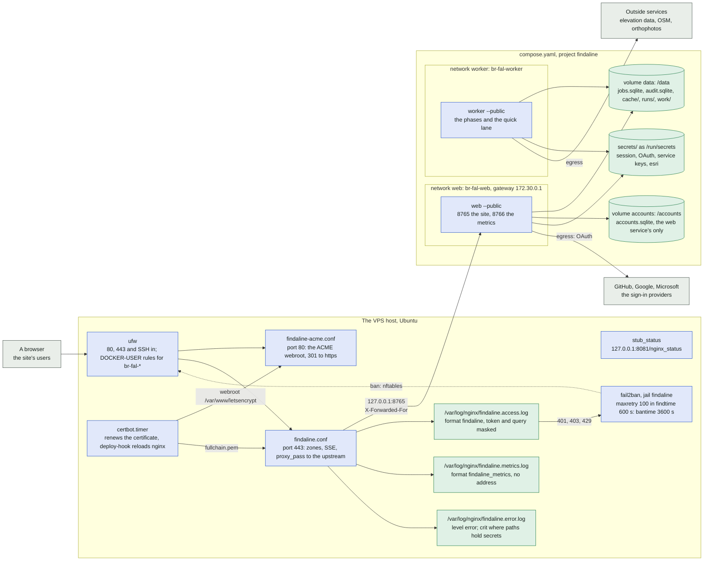
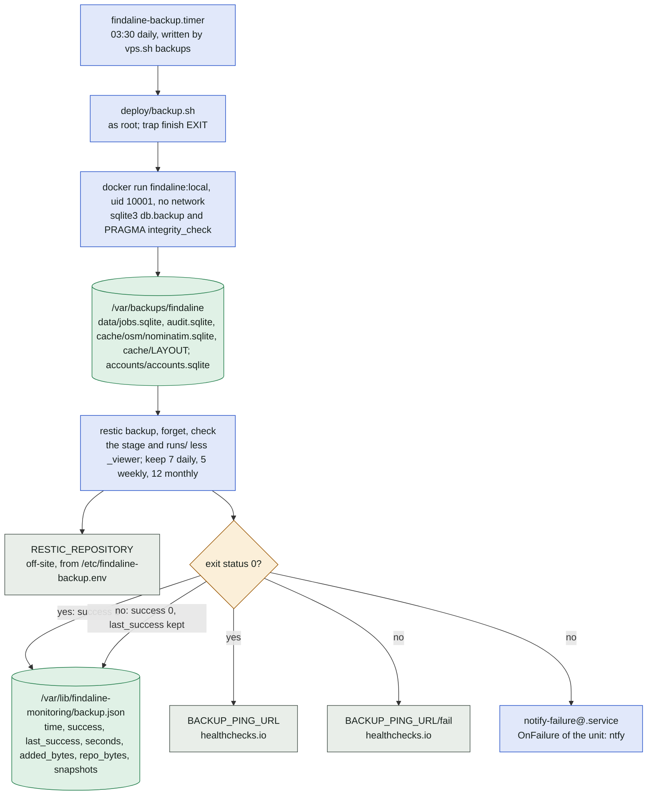
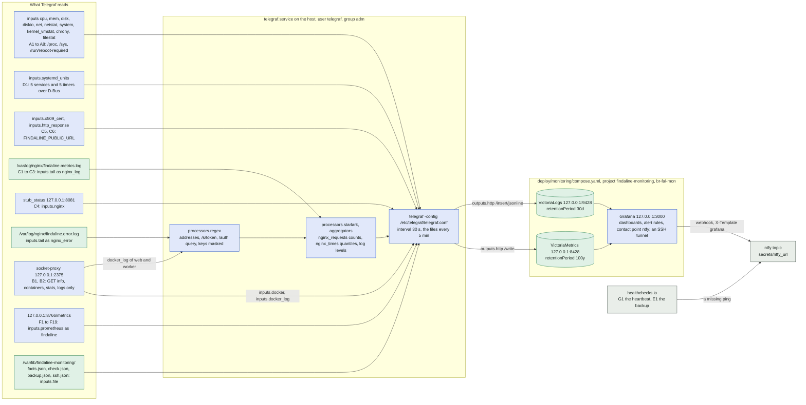
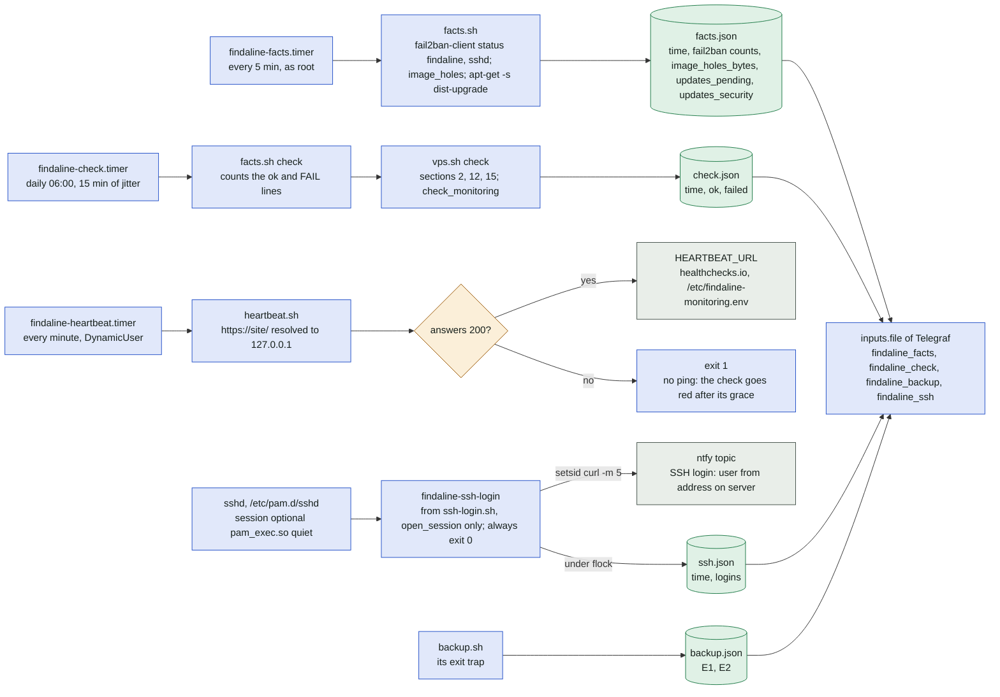
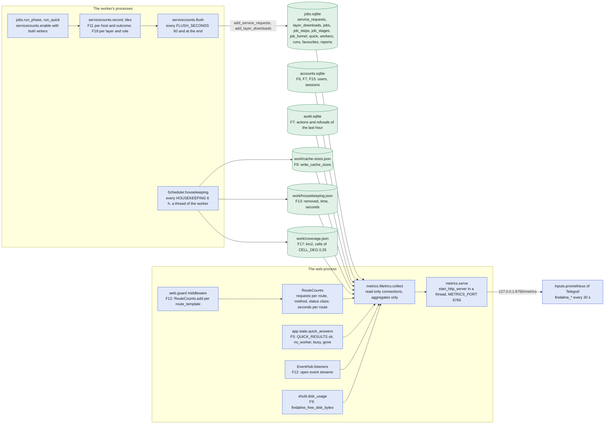

# The public site and its monitoring

How the public site runs on its server and how it is watched: the processes and networks of the
VPS (nginx, fail2ban, ufw, certbot and the two containers of the site), the backup, the monitoring
stack (Telegraf, VictoriaMetrics, VictoriaLogs, Grafana, ntfy), the timers and scripts on the host,
the application's own metrics and the counts of its requests to outside services, the commands of
`deploy/vps.sh` and what the logs may hold. It covers [deploy/vps.sh](../../deploy/vps.sh),
[deploy/nginx/](../../deploy/nginx/) (`findaline-http.conf`, `findaline-acme.conf`,
`findaline-tls.conf`, `findaline.conf`), [deploy/fail2ban/](../../deploy/fail2ban/),
[deploy/firewall/](../../deploy/firewall/), [deploy/backup.sh](../../deploy/backup.sh),
[deploy/monitoring/](../../deploy/monitoring/) (`compose.yaml`, `telegraf.conf`, `grafana/`,
`facts.sh`, `heartbeat.sh`, `ssh-login.sh`, `systemd/`), [compose.yaml](../../compose.yaml),
[Dockerfile](../../Dockerfile), [metrics.py](../../metrics.py),
[servicecounts.py](../../servicecounts.py), [jobs.py](../../jobs.py) (`Scheduler.housekeeping`,
`Redact`) and [web.py](../../web.py) (`RouteCounts`, `guard`, `METRICS_PORT`). The tests of these
parts are [tests/test_deploy.py](../../tests/test_deploy.py),
[tests/test_monitoring.py](../../tests/test_monitoring.py) and
[tests/test_metrics.py](../../tests/test_metrics.py). The plan with its rows A1 to G2 is
[docs/monitoring.md](../monitoring.md); the server's set-up section by section is
[docs/deployment.md](../deployment.md) (the firewall in section 2, the backups in 11, the
monitoring in 15). The site itself, its jobs and processes, is in [processes.md](processes.md) and
[web-jobs.md](web-jobs.md).

In plain words: the program runs on one rented server behind a web server that takes the traffic
from the internet, keeps a log without secrets and bans addresses that misbehave; the searches run
in two sealed boxes that can reach the internet but not the server itself. A collector on the
server reads the machine, the boxes, the web server's logs and the program's own counts every half
minute, keeps them for years, and a dashboard on the operator's laptop shows them and sends a push
message to the phone when something is wrong, while an outside service notices when the server
itself goes silent.

## The VPS: processes and network

Everything the internet can reach is nginx on ports 80 and 443; the two containers publish their
ports on the loopback only and share the data volume, talking only through `jobs.sqlite` in it.
The app trusts `X-Forwarded-For` from the gateway of the network `web`, 172.30.0.1, which is
`FINDALINE_TRUSTED_PROXY`.

What each part of the diagram holds, as the files set it:

| Part | Where | What |
| --- | --- | --- |
| The firewall | `deploy/firewall/ufw-after.rules`, `ufw-before.rules`; `vps.sh` `firewall`, `ufw_files` | `ufw allow OpenSSH` (or from `--my-ip` only), `80/tcp`, `443/tcp`; `deny in on br-fal-web` and `br-fal-worker`; the chain `DOCKER-USER`: each bridge `br-fal-web`, `br-fal-worker`, `br-fal-mon` may talk to itself, and `br-fal-+` never to `10.0.0.0/8`, `172.16.0.0/12`, `192.168.0.0/16`, `169.254.0.0/16`, `100.64.0.0/10`; in `before.rules` `-A ufw-before-input -i br-fal-+ -j DROP` (nothing from a container to the host) |
| nginx, the http block | `deploy/nginx/findaline-http.conf` in `conf.d/` | the upstream `findaline` (`127.0.0.1:8765`, `keepalive_timeout 4s`, under `web.KEEP_ALIVE_SECONDS` 5 s), `client_header_timeout`/`client_body_timeout` 10 s, the zones `findaline` 20r/s, `findaline_tiles` 100r/s, `findaline_login` 10r/m, `findaline_conn`; the maps `$findaline_request`, `$findaline_referer` and the format `findaline`; the map `$findaline_group` and the format `findaline_metrics`; the server of `stub_status` on `127.0.0.1:8081` |
| nginx, port 80 | `findaline-acme.conf` in `sites-available/` | a default server answering 444; the site's server: `/.well-known/acme-challenge/` from `/var/www/letsencrypt`, everything else `301` to https |
| nginx, port 443 | `findaline.conf`, `findaline-tls.conf` (`snippets/`) | a default server with `ssl_reject_handshake on`; `www.` sent to the site; the site's server: HSTS, `client_max_body_size 2m`, `400` for an `Upgrade` header, `proxy_read_timeout 620s` (over `web.QUICK_WAIT_MAX` 600 s), `limit_conn findaline_conn 40`, gzip; the locations `/` (`findaline`, burst 200), `/s/` (as `/`, error log `crit`), `/cache/` (`findaline_tiles`, burst 1000, `limit_conn` 100), `/login/` and `/auth/` (`findaline_login`, burst 10), `= /api/events` (SSE: `proxy_buffering off`, `proxy_read_timeout 1h`) |
| The route groups | `map $uri $findaline_group` | `/api/events` → `events`, `/api/patch` → `patch`, `/api/` → `api`, `/cache/` → `cache`, `/s/` → `share`, `/login`, `/auth`, `/logout` → `auth`, `/app/`, `/runs/` → `app`, else `page` |
| fail2ban | `deploy/fail2ban/findaline.conf` (filter), `findaline.local` (jail) | `failregex` on `401`, `403`, `429` of `findaline.access.log`; `ignoreregex` the `429` of `GET /cache/` (a map zooming); `maxretry` 100, `findtime` 600, `bantime` 3600 |
| The image | `Dockerfile` | a `uv sync --frozen` build stage, a `python:3.13-slim` runtime without uv, `compileall` of the scripts, uid 10001, `FINDALINE_DATA=/data`, `ENTRYPOINT ["python", "findaline.py"]` |
| `web` | `compose.yaml` | `web --public --host 0.0.0.0 --port 8765`; ports `127.0.0.1:${WEB_PORT:-8765}:8765` and `127.0.0.1:${METRICS_PORT:-8766}:8766`; volumes `data`, `accounts`, `/tmp` tmpfs 64 MB; `read_only`, `cap_drop ALL`, `no-new-privileges`, `init`; the healthcheck a GET of `/` with the public host; secrets `findaline_session_secret`, the three `*_client_secret`, `esri_api_key` |
| `worker` | `compose.yaml` | `worker --public`; volumes `data`, the mirror read-only, `/tmp` tmpfs 512 MB; `NUMBA_NUM_THREADS` = `WORKER_CPUS`; `FINDALINE_LIMIT_COMPUTE_SLOTS`/`_DOWNLOAD_SLOTS`; secrets `opentopography_api_key`, `datafordeler_api_key`, `lantmateriet_user`, `lantmateriet_password`, `nls_api_key`; no network shared with `web` |

(check) `compose.yaml` declares two volumes, `data` and `accounts` (`accounts.sqlite` is the web
service's only); the diagram follows it, while CLAUDE.md's row on Docker speaks of one data volume.

## The backup

`findaline-backup.timer` runs `deploy/backup.sh` daily as root; whatever ends the script, its exit
trap `finish` writes `backup.json` and pings healthchecks.io (E1, E2).

## The monitoring stack

Telegraf runs on the host and is the only process that reads anything; it writes the samples to
VictoriaMetrics and the log lines to VictoriaLogs, both on the loopback in the compose project
`findaline-monitoring` (bridge `br-fal-mon`); Grafana reads both and sends its alerts to the ntfy
topic. The rows of docs/monitoring.md: A (the host), B (Docker), C (nginx and the site), D (units
and security), E (the backup), F (the application), G (the monitoring itself).

The alert rules of `deploy/monitoring/grafana/provisioning/alerting/rules.yaml`, by folder, and
the dashboards of `grafana/dashboards/` (uid in brackets):

| Folder | Rules |
| --- | --- |
| `vps` | A1 CPU steal; A2 Memory available, A2 OOM kill; A3 Free disk on /srv/docker, A3 Free disk on /, A3 Inodes; A4 Holes in the disk image; A7 Reboot required, A7 Security updates pending (info); A8 Clock offset; B1 Container not running, B1 web unhealthy, B1 Container restarted, B1 Container OOM-killed; B2 worker memory |
| `site` | C1 5xx answers; C2 Slow API; C5 Certificate expires; C6 Site not answering; D1 systemd unit failed; D2 fail2ban: bans of the site, D2 fail2ban: bans of SSH; D3 vps.sh check failed, D3 vps.sh check not run; E1 No backup |
| `monitoring` | G2 Telegraf cannot write; G2 A source stopped reporting; G2 A daily file is missing; G2 Host facts stale; G2 VictoriaMetrics unreachable |
| `findaline` | F1 No live worker; F2 Search waiting long, F2 Queue nearly full; F3 Internal error, F3 Many searches failed; F5 Quick lane slow; F6 New account to approve (info); F7 Jump of refusals; F8 New problem report (info); F11 Outside service failing; F13 Housekeeping not run; G2 Application metrics stopped |
| Dashboards | Overview (`overview`, Grafana's home), VPS (`vps`), Site (`site`), Searches (`searches`), Use (`use`), Data and computing (`performance`), Logs (`logs`) |

The contact points are `ntfy` (priority 4) and `ntfy-info` (priority 2, the rules with the label
`level=info`, repeated every 24 h); both post to `FINDALINE_NTFY_URL`, which Grafana's entrypoint
reads from `/run/secrets/ntfy_url` (`grafana://noop` while the secret is empty).

The units D1 watches (`inputs.systemd_units` of `telegraf.conf`: `active_code` 3 or `load_code`
above 0 fires): `nginx.service`, `docker.service`, `fail2ban.service`, `ssh.service`,
`unattended-upgrades.service`; `certbot.timer`, `findaline-backup.timer`, `findaline-facts.timer`,
`findaline-check.timer`, `findaline-heartbeat.timer`. Not `telegraf.service`: stopped, it cannot
report itself; G2 A source stopped reporting does.

## The host's timers and scripts

What only root can read, and what must be seen from outside the stack, comes from timers on the
host and from sshd: each writes a small JSON file that Telegraf reads every 5 minutes.

Each file is written whole: a temporary file next to it, then `mv -f` (`publish` of `facts.sh`,
`finish` of `backup.sh`, the `flock` block of `ssh-login.sh`), so Telegraf never reads half of one.
The alert D4 is the ntfy message itself, sent straight from the host; the stack only counts.

## The application's metrics

The worker counts its requests to outside services and the tiles it downloads in memory and
flushes them into `jobs.sqlite`; the housekeeping writes three JSON files; the web process keeps
its own counts. `metrics.Metrics` reads all of it at each scrape, through read-only connections,
and `metrics.serve` answers on `METRICS_PORT` 8766 from a thread of `web`. The rule: no label with
a user id, an IP address, a title, a place name or a path
(`tests/test_metrics.py::test_no_personal_data_in_labels`).

Where each row of F comes from in `metrics.py`:

| Rows | Method | Reads | Metrics |
| --- | --- | --- | --- |
| F1, F2, F3, F4, F5, F8, F9, F14, F15, F16, F19 | `_jobs`, `_compute` | `jobs.sqlite`: `workers`, `jobs`, `quick`, `reports`, `runs`, `favourites`, `job_steps`, `job_stages`, `job_funnel` | `findaline_workers_alive`, `findaline_worker_lease_age_seconds`, `findaline_jobs`, `findaline_queue_max`, `findaline_slots`, `findaline_job_oldest_waiting_seconds`, `findaline_jobs_finished`, `findaline_job_duration_seconds`, `findaline_job_phase_seconds`, `findaline_computed_mpx`, `findaline_computed_seconds`, `findaline_compute_step_seconds`, `findaline_compute_step_cpu_seconds`, `findaline_compute_stage_seconds`, `findaline_compute_stage_cpu_seconds`, `findaline_line_funnel`, `findaline_quick_waiting`, `findaline_quick_oldest_waiting_seconds`, `findaline_users_searched_in`, `findaline_area_km2`, `findaline_searches`, `findaline_reports_open`, `findaline_runs`, `findaline_runs_bytes`, `findaline_favourites` |
| F11 | `_services` | `service_requests` | `findaline_service_requests`, `findaline_service_bytes`, `findaline_service_seconds` |
| F18 | `_layers` | `layer_downloads` (`LAYER_COUNTS`) | `findaline_download_tiles`, `_tiles_cached`, `_pixels`, `_km2`, `_bytes`, `_seconds`, `_wait_seconds` |
| F6, F7, F15 | `_accounts` | `accounts.sqlite`: `users`, `sessions` (`SESSION_WINDOWS` 15m, 24h) | `findaline_users`, `findaline_users_by_country`, `findaline_sessions_active` |
| F7 | `_audit` | `audit.sqlite`: the last `HOUR` | `findaline_audit_events_last_hour`, `findaline_refusals_last_hour` (`REFUSALS` rate, quota, other) |
| F9 | `_disk` | `shutil.disk_usage`, `work/cache-sizes.json` (`jobs.CACHE_SIZES`) | `findaline_free_disk_bytes`, `findaline_cache_bytes` |
| F13 | `_housekeeping` | `work/housekeeping.json` (`jobs.HOUSEKEEPING_FILE`) | `findaline_housekeeping_removed`, `findaline_housekeeping_last_run_timestamp_seconds`, `findaline_housekeeping_seconds` |
| F17 | `_coverage` | `work/coverage.json` (`jobs.COVERAGE_FILE`) | `findaline_coverage_km2`, `findaline_searches_by_cell` |
| F5, F12, F10 | `collect`, `_routes` | the web process's `quick_answers`, `RouteCounts.snapshot`, `EventHub.listeners`, `cache.VERSION` | `findaline_quick_answers`, `findaline_http_requests`, `findaline_http_request_seconds`, `findaline_event_streams`, `findaline_build_info` |

`servicecounts` is hooked into every request path of the worker: `sources.net._get` (each
attempt), the listings of `sources/indexes/listings.py`, `WcsReader`'s DescribeCoverage,
`Windows` (one per file read for a block), `osm._ask`, the Overpass queries, `osmextract`,
`coast`'s world file and `orthophoto._get`; the tiles through `sources.layer.download_layers`
(`servicecounts.tiles`, the role from `role_of` of the label). A request made around these is not
counted (F11 does not see it). A local path (a mirror, the tests' files) is never a host.

## `deploy/vps.sh`: setup, update, check

One script, run as root from the checkout, with the commands of docs/deployment.md; every step
looks at what is there first, so each command can run again. Sourced, it only defines its
functions (`facts.sh` and `tests/nginx_check.sh` do that).

| Command | Step (function) | What it touches |
| --- | --- | --- |
| `setup` | `check_system` | Ubuntu 26.04, cgroup v2, root |
| | `install_packages` | `git sqlite3 restic nginx certbot fail2ban unattended-upgrades ufw curl ca-certificates python3 bind9-dnsutils` |
| | `disk_image` (with `--disk-image`) | `/srv/findaline-docker.img` (`IMAGE_FILE`, fallocate, ext4), `/etc/fstab`, mounted at `--data-root` |
| | `install_docker` | Docker's repository and packages, `/etc/docker/daemon.json` `data-root`, `docker.service.d/findaline-data-root.conf` |
| | `ssh_key_only` | `/etc/ssh/sshd_config.d/10-key-only.conf` (after a key login of the sudo user was seen) |
| | `firewall`, `ufw_files` | ufw's rules, `/etc/ufw/after.rules` and `before.rules` (the blocks of `deploy/firewall/`), checked with `iptables -S DOCKER-USER` |
| | the site | `findaline.env` from `findaline.env.example`, `FINDALINE_PUBLIC_URL` |
| | `nginx_and_certificate`, `nginx_files`, `dns_ready`, `www_ready` | `/etc/nginx/conf.d/findaline-http.conf` (the upstream at `WEB_PORT`), `snippets/findaline-tls.conf`, `sites-available/findaline-acme` and `findaline` (the site's name), `sites-enabled/`, `certbot certonly --webroot`, `certbot renew --dry-run` |
| | `fail2ban`, `fail2ban_files` | `/etc/fail2ban/filter.d/findaline.conf`, `jail.d/findaline.local`, `jail.d/00-ignore.local` with `--my-ip` |
| | `security_updates` | `unattended-upgrades` on |
| | `settings`, `ask_provider`, `secret_files` | `.env` (`WORKER_CPUS`, `WORKER_MEMORY`), `findaline.env` (`FINDALINE_TRUSTED_PROXY` 172.30.0.1, `FINDALINE_CONTACT`, the providers' client ids, `FINDALINE_ADMINS`), `secrets/` (every file of `deploy/secrets.example/`, uid 10001 or 472, mode 0400; a new session secret) |
| | `start` | `compose build --pull`, `up -d --wait`, the gateway of `findaline_web` against `FINDALINE_TRUSTED_PROXY` |
| | `osm_data` | the world water polygons and the catalogue's Geofabrik extracts into the data volume (`OSM_EXTRACTS_SKIP`: us, canada, nunavut, british-columbia) |
| | `backups` (with `/etc/findaline-backup.env`) | `findaline-backup.service` and `.timer` in `/etc/systemd/system` |
| | `monitoring ask`, `monitoring_units`, `ping_url`, `ssh_login_notice`, `grafana_plugins`, `telegraf_install` | `/var/lib/findaline-monitoring`, `/etc/findaline-monitoring.env` (`HEARTBEAT_URL`, `BACKUP_PING_URL`), `secrets/grafana_admin_password`, `secrets/ntfy_url` (uid 472), the units of `deploy/monitoring/systemd/` with `@REPO@` replaced, the three timers of `MONITORING_TIMERS`, `/usr/local/sbin/findaline-ssh-login` and its line in `/etc/pam.d/sshd`, `deploy/monitoring/.env` (`DOCKER_GID`), `/var/lib/findaline-grafana-plugins` (`GRAFANA_PLUGIN` at `GRAFANA_PLUGIN_VERSION`, sha256 checked), `docker compose -f deploy/monitoring/compose.yaml pull` and `up -d --wait --remove-orphans`, Telegraf's `.deb` (`TELEGRAF_VERSION`, sha256 per architecture), `/etc/telegraf/telegraf.conf`, `/etc/systemd/system/telegraf.service.d/findaline.conf` |
| | `check` | as below |
| `update` | new commits (`ci_passed`) | `git fetch`, the check runs of the new commit, `git merge --ff-only`, then the new script runs the rest (`--pulled`) |
| | `nginx_files`, `fail2ban_files`, `ufw_files`, `backups`, `secret_files` | the same files as in setup; nginx reloaded, fail2ban restarted, ufw reloaded only when a file changed |
| | `start`, `osm_data`, `monitoring` | the image built again and the services restarted, the OSM data not there yet, the monitoring as in setup (without questions) |
| `check` | `check` | the web service on `127.0.0.1:WEB_PORT`, `https://site/` over HTTP/2 with its security headers, gzip, the `www` redirect, ufw active, the jail, `certbot.timer`, `sshd -T`, the mode and owner of every secret, from inside `web` and `worker` no host or private address reached and the internet reached, the worker does not see `web`, at least 20 GB free for Docker, the disk image's holes at most 1 GiB |
| | `check_monitoring` | VictoriaMetrics, VictoriaLogs and Grafana answer, `stub_status`, the three timers active, `facts.json` younger than 15 min, `HEARTBEAT_URL` set, the SSH login notice in place, Telegraf at `TELEGRAF_VERSION` and running with samples of the last 2 min in VictoriaMetrics, Grafana's plugin at `GRAFANA_PLUGIN_VERSION` |

## What the logs may hold

Each place that stores text about a request masks what it must not keep; the masking is tested
with Python's `re` on the same patterns (`tests/test_deploy.py::test_access_log_masking`,
`test_metrics_log_format`; `tests/test_monitoring.py::test_telegraf_logs` with `LOG_LINES`).

| Where | What is masked or left out | By |
| --- | --- | --- |
| `findaline.access.log` (format `findaline`, nginx's combined) | the token of a share link `/s/<token>/...` and the query of `/auth/<provider>?...` in the request line and in the Referer | `map $request $findaline_request`, `map $http_referer $findaline_referer` in `findaline-http.conf` |
| `findaline.metrics.log` (format `findaline_metrics`, JSON) | no client address, no `X-Forwarded-For`, no path or query, no Referer, no User-Agent; the path only as `$findaline_group` | `log_format findaline_metrics` in `findaline-http.conf` |
| `findaline.error.log` | level `error` for the site, `crit` for the locations `/s/`, `/cache/`, `/login/`, `/auth/` and on port 80 (their lines would name the request and its Referer) | `error_log` lines of `findaline.conf`, `findaline-acme.conf` |
| The stored log lines of `web`, `worker` and nginx's error log (VictoriaLogs, 30 days) | `client: <address>`; every IPv4 and IPv6 address `<address>`; `/s/<token>`; `/auth/...?<query>`; `?token=`, `api_key=`, `apikey=`, `key=`, `password=` values `<secret>` | `processors.regex` of `telegraf.conf`, before the line reaches an output |
| Docker's own copy of the containers' output | `json-file`, `max-size` 10m, `max-file` 5 (the 50 MB of the privacy page) | `compose.yaml` logging |
| The application's events, errors and the quick lane's answers | the data folder made relative, the app's folder and any absolute path `<path>`; the values of the service keys (`settings.redact`); the field `heights` of `Redact.RAW` left as data | `jobs.Redact` on `Jobs(public=True)`: `event`, `set(error=...)`, `quick_answer`; `cache.clean_error` on every message |
| The metrics | labels from fixed sets only: statuses, phases, error codes, actions, countries, cache folders, layers, roles, steps, stages, levels, resolution classes; never a user id, address, title, place name or path | `metrics.py`, `tests/test_metrics.py::CONTRACT` |
| The facts files | numbers only: fail2ban's counts per jail, never an address; `ssh.json` a time and a total, no user | `facts.sh`, `ssh-login.sh` |
| The audit log | no IP addresses; purged after `audit.KEEP_DAYS` 90 by `Scheduler.housekeeping` | `audit.py` |
| uvicorn | its access log is off (`log_level` warning) | `web.py`, the server's settings |

## Where in the code

| Node | File | Function or name |
| --- | --- | --- |
| user | [deploy/nginx/findaline.conf](../../deploy/nginx/findaline.conf) | the site's `server` on 443 |
| oauth | [accounts.py](../../accounts.py) | `oauth_clients`, `CLIENTS` |
| services | [servicecounts.py](../../servicecounts.py) | the hosts of `record` |
| ufw | [deploy/vps.sh](../../deploy/vps.sh) | `firewall`, `ufw_files` |
| acme | [deploy/nginx/findaline-acme.conf](../../deploy/nginx/findaline-acme.conf) | the site's `server` on 80 |
| site | [deploy/nginx/findaline.conf](../../deploy/nginx/findaline.conf) | the site's `server` on 443 |
| certbot | [deploy/vps.sh](../../deploy/vps.sh) | `nginx_and_certificate` (`certbot certonly`, `certbot.timer`) |
| access | [deploy/nginx/findaline-http.conf](../../deploy/nginx/findaline-http.conf) | `log_format findaline` |
| metricslog | [deploy/nginx/findaline-http.conf](../../deploy/nginx/findaline-http.conf) | `log_format findaline_metrics`, `map $uri $findaline_group` |
| errorlog | [deploy/nginx/findaline.conf](../../deploy/nginx/findaline.conf) | `error_log /var/log/nginx/findaline.error.log` |
| status | [deploy/nginx/findaline-http.conf](../../deploy/nginx/findaline-http.conf) | the `server` of `127.0.0.1:8081`, `stub_status` |
| f2b | [deploy/fail2ban/findaline.local](../../deploy/fail2ban/findaline.local), [findaline.conf](../../deploy/fail2ban/findaline.conf) | `[findaline]`, `failregex`, `ignoreregex` |
| web | [compose.yaml](../../compose.yaml) | service `web` |
| worker | [compose.yaml](../../compose.yaml) | service `worker` |
| data | [compose.yaml](../../compose.yaml) | volume `data` |
| accounts | [compose.yaml](../../compose.yaml) | volume `accounts` |
| secrets | [compose.yaml](../../compose.yaml) | `secrets` |
| timer | [deploy/vps.sh](../../deploy/vps.sh) | `backups` (`findaline-backup.timer`) |
| script | [deploy/backup.sh](../../deploy/backup.sh) | the script |
| copy | [deploy/backup.sh](../../deploy/backup.sh) | the `docker run` of `python -c` with `db.backup` |
| stage | [deploy/backup.sh](../../deploy/backup.sh) | `STAGE`, `DATABASES` |
| restic | [deploy/backup.sh](../../deploy/backup.sh) | `restic backup`, `restic forget`, `restic check` |
| repo | [deploy/backup.sh](../../deploy/backup.sh) | `RESTIC_REPOSITORY` |
| status (backup) | [deploy/backup.sh](../../deploy/backup.sh) | `finish` |
| json | [deploy/backup.sh](../../deploy/backup.sh) | `finish`, `backup.json` |
| ping, pingfail | [deploy/backup.sh](../../deploy/backup.sh) | `BACKUP_PING_URL` in `finish` |
| notify | [deploy/vps.sh](../../deploy/vps.sh) | `backups` (`OnFailure=notify-failure@%N.service`) |
| hostinputs | [deploy/monitoring/telegraf.conf](../../deploy/monitoring/telegraf.conf) | `inputs.cpu`, `inputs.system`, `inputs.mem`, `inputs.kernel_vmstat`, `inputs.disk`, `inputs.diskio`, `inputs.net`, `inputs.netstat`, `inputs.filestat`, `inputs.chrony` |
| units | [deploy/monitoring/telegraf.conf](../../deploy/monitoring/telegraf.conf) | `inputs.systemd_units` |
| probes | [deploy/monitoring/telegraf.conf](../../deploy/monitoring/telegraf.conf) | `inputs.x509_cert`, `inputs.http_response` |
| metricslog (Telegraf) | [deploy/monitoring/telegraf.conf](../../deploy/monitoring/telegraf.conf) | `inputs.tail` as `nginx_log` |
| status (Telegraf) | [deploy/monitoring/telegraf.conf](../../deploy/monitoring/telegraf.conf) | `inputs.nginx` |
| errorlog (Telegraf) | [deploy/monitoring/telegraf.conf](../../deploy/monitoring/telegraf.conf) | `inputs.tail` as `nginx_error` |
| proxy | [deploy/monitoring/compose.yaml](../../deploy/monitoring/compose.yaml) | service `socket-proxy` |
| appmetrics | [deploy/monitoring/telegraf.conf](../../deploy/monitoring/telegraf.conf) | `inputs.prometheus` of `127.0.0.1:8766/metrics` |
| factsfiles | [deploy/monitoring/telegraf.conf](../../deploy/monitoring/telegraf.conf) | `inputs.file` as `findaline_facts`, `findaline_check`, `findaline_backup`, `findaline_ssh` |
| agent | [deploy/monitoring/systemd/telegraf.service.d/findaline.conf](../../deploy/monitoring/systemd/telegraf.service.d/findaline.conf) | `ExecStart`, `[agent]` of `telegraf.conf` |
| regex | [deploy/monitoring/telegraf.conf](../../deploy/monitoring/telegraf.conf) | `processors.regex` |
| starlark | [deploy/monitoring/telegraf.conf](../../deploy/monitoring/telegraf.conf) | `processors.starlark`, `aggregators.basicstats`, `aggregators.quantile` |
| vm | [deploy/monitoring/compose.yaml](../../deploy/monitoring/compose.yaml) | service `victoriametrics` |
| vl | [deploy/monitoring/compose.yaml](../../deploy/monitoring/compose.yaml) | service `victorialogs` |
| grafana | [deploy/monitoring/compose.yaml](../../deploy/monitoring/compose.yaml) | service `grafana`; [grafana/provisioning/](../../deploy/monitoring/grafana/provisioning/) |
| ntfy | [deploy/monitoring/grafana/provisioning/alerting/contact-points.yaml](../../deploy/monitoring/grafana/provisioning/alerting/contact-points.yaml) | `ntfy`, `ntfy-info` |
| hc | [deploy/monitoring/heartbeat.sh](../../deploy/monitoring/heartbeat.sh) | `HEARTBEAT_URL` |
| factstimer | [deploy/monitoring/systemd/findaline-facts.timer](../../deploy/monitoring/systemd/findaline-facts.timer) | `OnCalendar=*:0/5` |
| facts | [deploy/monitoring/facts.sh](../../deploy/monitoring/facts.sh) | `facts`, `jail`, `publish` |
| factsjson | [deploy/monitoring/facts.sh](../../deploy/monitoring/facts.sh) | `facts.json` |
| checktimer | [deploy/monitoring/systemd/findaline-check.timer](../../deploy/monitoring/systemd/findaline-check.timer) | `OnCalendar=*-*-* 06:00` |
| factscheck | [deploy/monitoring/facts.sh](../../deploy/monitoring/facts.sh) | `checks` |
| vpscheck | [deploy/vps.sh](../../deploy/vps.sh) | `check`, `check_monitoring` |
| checkjson | [deploy/monitoring/facts.sh](../../deploy/monitoring/facts.sh) | `check.json` |
| hbtimer | [deploy/monitoring/systemd/findaline-heartbeat.timer](../../deploy/monitoring/systemd/findaline-heartbeat.timer) | `OnCalendar=minutely` |
| hb | [deploy/monitoring/heartbeat.sh](../../deploy/monitoring/heartbeat.sh) | the script |
| answered, nothing, hcping | [deploy/monitoring/heartbeat.sh](../../deploy/monitoring/heartbeat.sh) | `code != 200`, `HEARTBEAT_URL` |
| sshd | [deploy/vps.sh](../../deploy/vps.sh) | `SSH_LOGIN_PAM`, `ssh_login_notice` |
| sshlogin | [deploy/monitoring/ssh-login.sh](../../deploy/monitoring/ssh-login.sh) | the script (`PAM_TYPE`, `open_session`) |
| sshjson | [deploy/monitoring/ssh-login.sh](../../deploy/monitoring/ssh-login.sh) | `ssh.json` |
| backup, backupjson | [deploy/backup.sh](../../deploy/backup.sh) | `finish` |
| telegraf (files) | [deploy/monitoring/telegraf.conf](../../deploy/monitoring/telegraf.conf) | `inputs.file` |
| phase | [jobs.py](../../jobs.py) | `run_phase`, `run_quick` |
| sc | [servicecounts.py](../../servicecounts.py) | `record`, `tiles`, `request`, `get`, `call` |
| flush | [servicecounts.py](../../servicecounts.py) | `flush`, `enable`, `FLUSH_SECONDS` |
| housekeeping | [jobs.py](../../jobs.py) | `Scheduler.housekeeping`, `HOUSEKEEPING` |
| jobsdb | [jobs.py](../../jobs.py) | `Jobs.add_service_requests`, `Jobs.add_layer_downloads`, `MIGRATIONS` |
| cachesizes | [jobs.py](../../jobs.py) | `write_cache_sizes`, `CACHE_SIZES` |
| hkjson | [jobs.py](../../jobs.py) | `HOUSEKEEPING_FILE` |
| coveragejson | [jobs.py](../../jobs.py) | `coverage`, `COVERAGE_FILE`, `CELL_DEG` |
| accountsdb | [accounts.py](../../accounts.py) | `Accounts` |
| auditdb | [audit.py](../../audit.py) | `Audit`, `purge`, `KEEP_DAYS` |
| guard | [web.py](../../web.py) | `guard`, `route_template` |
| routes | [web.py](../../web.py) | `RouteCounts`, `HTTP_METHODS`, `EVENT_STREAM` |
| quick | [web.py](../../web.py) | `QUICK_RESULTS`, `app.state.quick_answers` |
| hub | [web.py](../../web.py) | `EventHub.listeners` |
| collector | [metrics.py](../../metrics.py) | `Metrics.collect`, `_read` |
| disk | [metrics.py](../../metrics.py) | `Metrics._disk` |
| serve | [metrics.py](../../metrics.py), [web.py](../../web.py) | `serve`, `registry`; `METRICS_PORT` |
| telegraf (prometheus) | [deploy/monitoring/telegraf.conf](../../deploy/monitoring/telegraf.conf) | `inputs.prometheus` as `findaline` |
