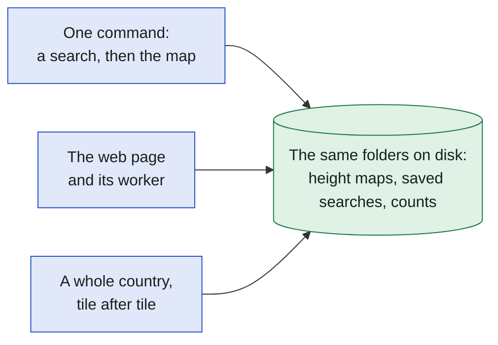
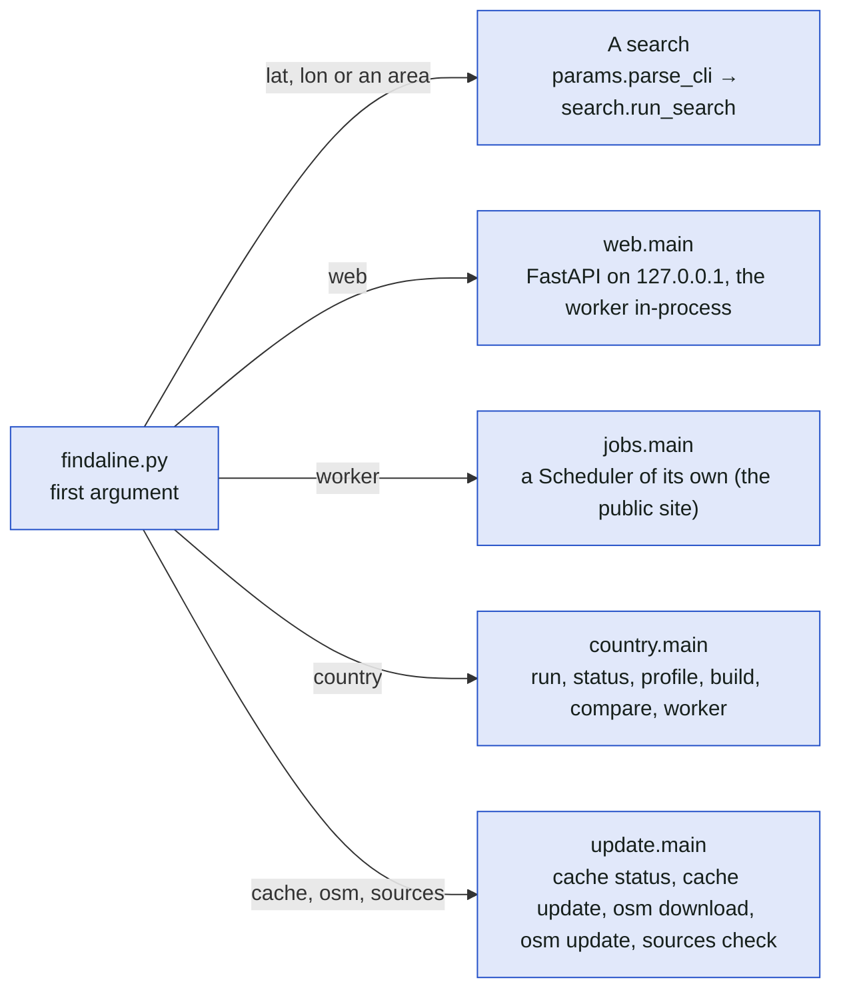
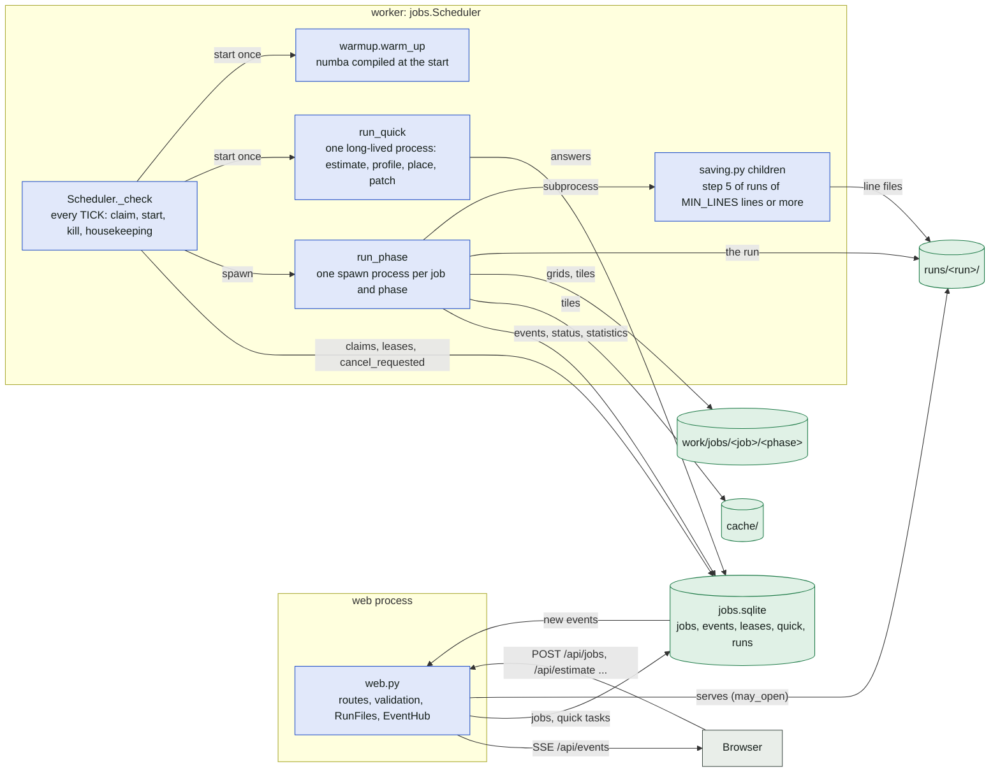
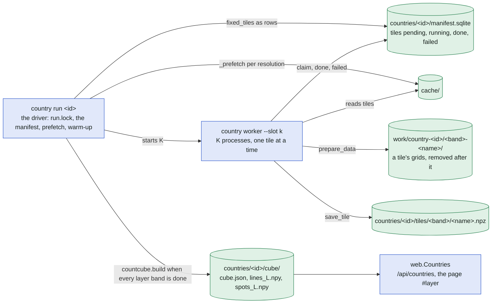

# Processes and stores

The second level: the commands of [findaline.py](../../findaline.py), the processes each starts, and
the stores they share. A search itself is [search.md](search.md); a web job's life is
[web-jobs.md](web-jobs.md); the country layer is [search-vs-country.md](search-vs-country.md).

## In plain words

The program can run as a one-off command, as a small web server with a worker that does the
searches one after another, or as a long run over a whole country. All of them read and write the
same folders on disk, so a search from the command line and one from the browser share the
downloaded height maps.

## The commands

`findaline.py` looks at its first argument. Everything else is a search from the command line.

## The processes of the web app and the worker

The web process validates and queues; it never searches, downloads or imports numba. The worker
(in the same process locally, its own process on the public site) runs each job's phase in a spawned
process and the quick answers in one long-lived process. They talk only through `jobs.sqlite`.

Rules that keep this safe, all in [jobs.py](../../jobs.py): a status change and its event go in one
write transaction; a phase ends a job only while it is still in that phase's status (`when=`); a job
is failed as interrupted only when its worker's lease (`LEASE`, renewed every `HEARTBEAT`) has
expired; the phase process gets its `Limits` as an argument and prints nothing to a terminal (its
stdout becomes `info` events).

## The processes of the country layer

## The public site

The same two programs in two containers behind nginx on the host; the monitoring beside them is
[monitoring.md](monitoring.md).

| Piece | Runs as | Talks to |
| --- | --- | --- |
| nginx, fail2ban, ufw, certbot | the host's packages (`deploy/vps.sh`) | the browser; `127.0.0.1:8765` of the web container |
| `web --public` | the container `web` of `compose.yaml`, uid 10001, read-only root | `jobs.sqlite`, `accounts.sqlite`, `audit.sqlite` on the volume `/data`; the sign-in providers |
| `worker --public` | the container `worker`, no published port | the same `/data`; the data providers and OpenStreetMap |
| `metrics.serve` | a thread of `web`, `127.0.0.1:8766` on the host | Telegraf |

## Where in the code

| Node | File | Function or name |
| --- | --- | --- |
| findaline.py, first argument | [findaline.py](../../findaline.py) | the dispatch in `__main__`: `cache`, `osm`, `sources`, `web`, `worker`, `country` |
| A search | [params.py](../../params.py), [search.py](../../search.py) | `parse_cli`, `run_search` |
| web.main | [web.py](../../web.py) | `main`, `create_app` |
| jobs.main | [jobs.py](../../jobs.py) | `main`, `Scheduler` |
| country.main | [country.py](../../country.py) | `main`: `run`, `status`, `profile`, `build`, `compare`, `worker` |
| update.main | [update.py](../../update.py) | `main` |
| Scheduler._check | [jobs.py](../../jobs.py) | `Scheduler._check`, `TICK`, `housekeeping` |
| run_phase | [jobs.py](../../jobs.py) | `run_phase` |
| run_quick | [jobs.py](../../jobs.py) | `run_quick`, `QUICK` |
| warmup.warm_up | [warmup.py](../../warmup.py) | `warm_up`, `Scheduler(warm_up=True)` |
| saving.py children | [saving.py](../../saving.py) | `write_files`, `MIN_LINES` |
| RunFiles, EventHub | [web.py](../../web.py) | `RunFiles`, `EventHub`, `may_open` |
| LEASE, HEARTBEAT | [jobs.py](../../jobs.py) | `LEASE`, `HEARTBEAT`, `Jobs.set(when=)` |
| country run, country worker | [country.py](../../country.py) | `_run`, `_run_workers`, `Manifest`, `TileWork` |
| countcube.build | [countcube.py](../../countcube.py) | `build` |
| web.Countries | [web.py](../../web.py) | `Countries` |
| compose.yaml, deploy/vps.sh | [compose.yaml](../../compose.yaml), [deploy/vps.sh](../../deploy/vps.sh) | the services `web` and `worker`; `setup`, `update`, `check` |
| metrics.serve | [metrics.py](../../metrics.py), [web.py](../../web.py) | `serve`, `web.METRICS_PORT` |
