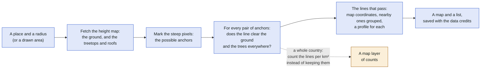
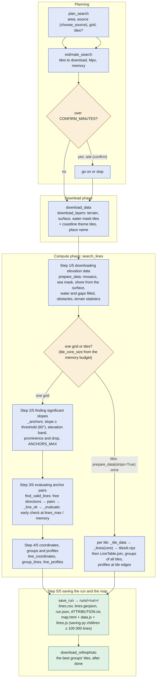
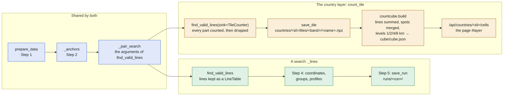
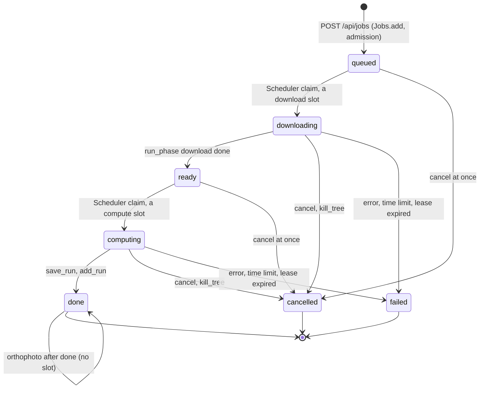

# Prototype A: Mermaid in Markdown

One Markdown file per level, the diagrams as Mermaid blocks. GitHub renders them in README, issues and
wikis without any tool; a diff shows what changed; a test can read every block and check that the names
in it exist in the code. The same slice of the system is drawn in prototypes B and C in other forms.

## 1. A search, in plain words

Every search answers one question: where could a highline go? The steps are the same whether you
start it from the command line, in the browser, or over a whole country.

## 2. A search, step by step

The five steps are the ones printed as `Step n/5` (`search._step`). The download phase and the compute
phase are the two processes of a web job; the command line runs them one after the other in one process.

## 3. Where the country layer forks off

The country layer (`findaline.py country run <id>`) shares steps 1 to 3 with a search and replaces
steps 4 and 5 by counting. Each band (S 1 m, M 2 m, L 5 m) is its own plan over fixed tiles.

| | A search | The country layer |
| --- | --- | --- |
| Area | a circle or a drawn area | a country's OSM outline, in fixed tiles named `E<left>_N<bottom>` |
| Grids | one, or tiles sized by the memory budget | one per band: S 1 m (30–300 m), M 2 m (300–1000 m), L 5 m (1000–5000 m) |
| Step 3 | lines kept (`LineTable`), stopped early over `lines_max` | lines counted in a `TileCounter` and dropped |
| Steps 4–5 | coordinates, groups, profiles, the run's files | none: `save_tile`, then `countcube.build` |
| Result | `runs/<run>/` with a map | `countries/<id>/cube/` shown as the layer `#layer` |
| Resumes | a tiled search on the next start | the manifest's pending tiles (`manifest.sqlite`) |

## 4. A web job's states

The statuses of `jobs.sqlite` (`jobs.ACTIVE`, `WAITING`, `FINISHED`) and who moves a job between them.

## For and against

- **For**: no tool to install, GitHub renders it, a diff in a pull request shows the change, a test can
  read every block and check the names against the code.
- **Against**: the automatic layout gets crowded above about 20 nodes, so a level is several diagrams
  with links between files; no zoom, the "general to detailed" path is a link.
