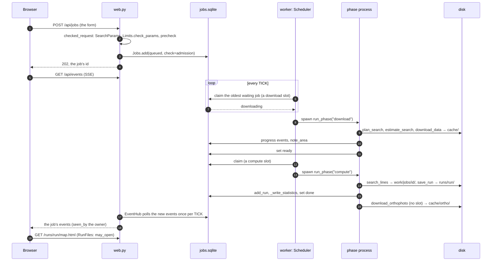
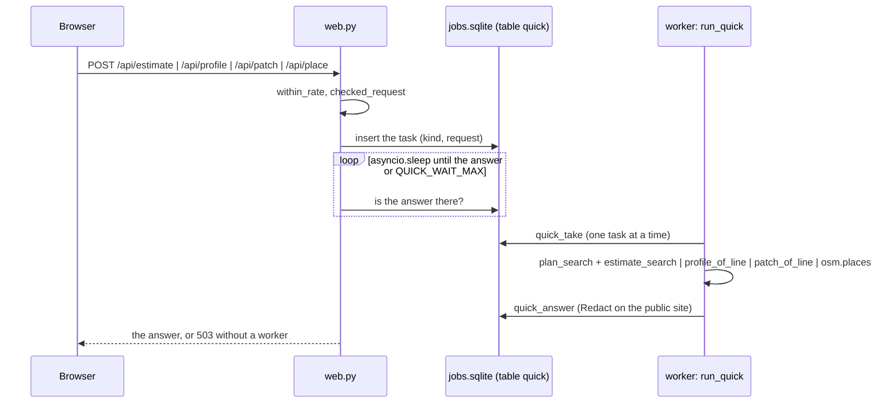
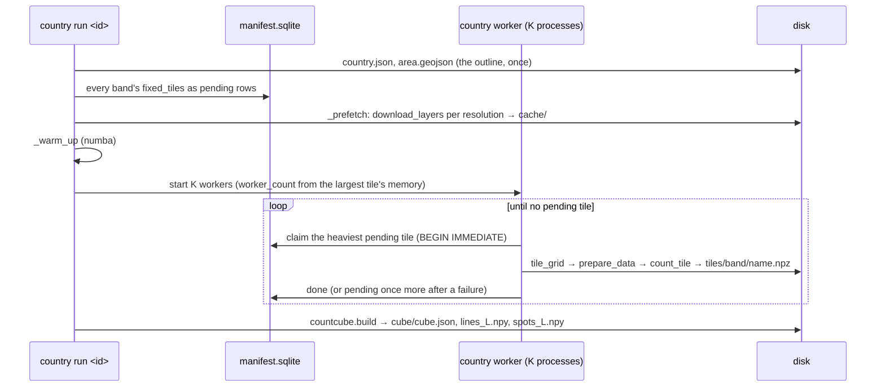

# Prototype C: swimlanes of processes and stores

Time flows down. The lanes are the processes and the stores, so every arrow answers "who writes what,
when". Mermaid's sequence diagrams render on GitHub too; the grid of processes against stores below
is a hand-drawn picture (an SVG in the HTML version, a table here).

## 1. A web job, from the form to the map

## 2. The quick lane beside it

## 3. The country layer's run

## 4. Who writes where

| Process \ Store | `cache/` | `work/` | `runs/` | `countries/<id>/` | `jobs.sqlite` |
| --- | --- | --- | --- | --- | --- |
| CLI search | tiles, indexes, OSM | `work/<id>/` grids and tiles | the run, `runs.js` | | |
| web.py | | | reads (`RunFiles`), `runs.js` per user | | jobs, quick tasks, favourites, runs' owners |
| worker: phase process | tiles, orthophoto | `work/jobs/<job>/<phase>` | the run | | events, status, statistics |
| worker: quick lane | OSM answers | `work/quick/` | | | answers |
| saving.py children | | reads `<work>/saving/` | the line files, `data.js`, `lines.js` | | |
| country run / worker | tiles (prefetch) | `work/country-<id>/` | | tiles, `manifest.sqlite`, `cube/`, `logs/` | |

## For and against

- **For**: the only form that shows the hand-over between processes (web, worker, quick lane, children)
  and the stores they share; resuming, leases and slots have a place.
- **Against**: a poor fit for the five steps of the search itself and for the hierarchy; a complement to
  A or B, not a replacement.
