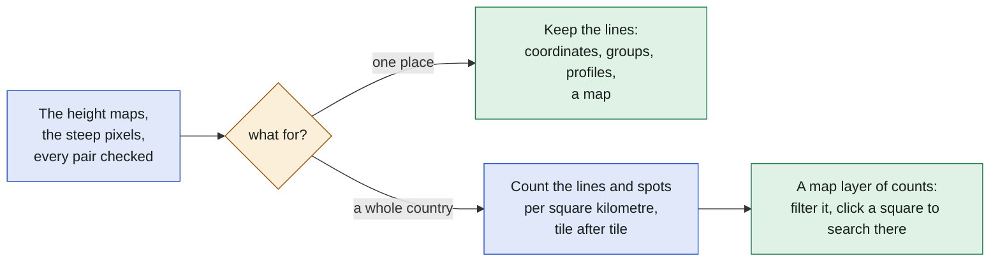
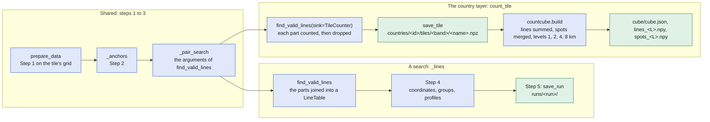
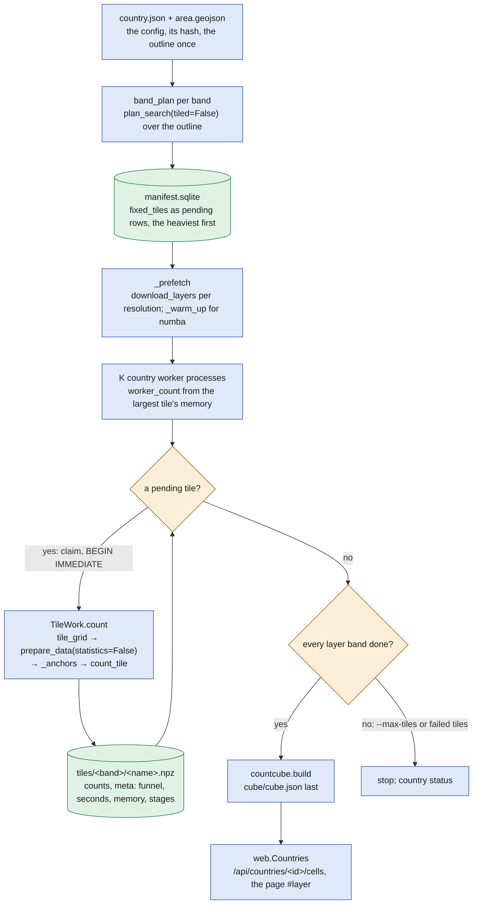

# A search and the country layer

Where the country layer (`findaline.py country run <id>`, [country.py](../../country.py)) forks off a
search ([search.md](search.md)): it shares steps 1 to 3 and replaces steps 4 and 5 by counting into
a cube ([countcube.py](../../countcube.py)). The contract behind it:
[country-precompute/contract.md](../country-precompute/contract.md); the feasibility report:
[country-precompute.md](../country-precompute.md).

## In plain words

A search keeps every line it finds and draws them on a map. Over a whole country that would be
billions of lines, so the country layer keeps only how many lines, and how many distinct spots,
each square kilometre holds, split by length and by the usual filters. The app shows the squares as
a coloured layer; a click on one starts an ordinary search there.

## The fork

`_lines` (a search) and `count_tile` (the country layer) call the same `_anchors` and build the
same arguments of `find_valid_lines` through `_pair_search`; only what happens to the evaluated
parts differs: a `LineTable` to sort and keep, or a `TileCounter` that reduces each part and drops it.

| | A search | The country layer |
| --- | --- | --- |
| Area | a circle or a drawn area | the country's OSM outline (`area.from_spec`), clipped to the option `within` |
| Grids | one, or tiles sized by the memory budget (`tile_core_size`) | one per band on fixed tiles named `E<left>_N<bottom>` (`fixed_tiles`): S 1 m, M 2 m, L 5 m, and the control band M2 |
| Anchors | `slope_threshold` of the request | the band's: 60° on 1 and 2 m grids, 45° at 5 m |
| Clearance | the formula or `--model sag` with one pretension | the formula below 300 m; from 300 m the sag estimator with the pretension T(L) of the span (`sag.TensionTable`) |
| Step 3 | the lines kept; stopped early over `lines_max` or the memory | every part reduced by `TileCounter`; no `_early_check`, no "no lines" errors |
| Steps 4 and 5 | coordinates, groups, profiles, the run's files | none: `save_tile` with its meta, then `countcube.build` |
| Spots | groups of lines within a distance (`group_lines`) | pairs of 50 m anchor clusters (`CLUSTER_M`), merged across tiles and bands |
| Surface model | `--nmpt mark` by default | with or without (`dsm` of the country); a changed `obstacles.RULE` counts the tiles again |
| Result | `runs/<run>/` with a map | `countries/<id>/cube/`, the page `#layer` through `/api/countries/<id>/cells` |
| Resumes | a tiled search on the next start of the same search | the manifest's pending tiles; a failed tile once more |

## A country run

A tile is light or heavy by its weight (the lines of the done tiles whose core overlaps it,
`_weights`); a heavy one takes its share of the cores left after `LIGHT_CORES` per light tile
running, a light one at most `LIGHT_THREADS` while a heavy one runs (`_threads`). A tile whose
grid lies inside the outline asks no neighbour for its border gaps (`_at_border`, `Plan.border`).

## Where in the code

| Node | File | Function or name |
| --- | --- | --- |
| prepare_data, _anchors, _pair_search | [search.py](../../search.py) | `prepare_data`, `_anchors`, `_pair_search` |
| _lines, find_valid_lines | [search.py](../../search.py), [linesearch.py](../../linesearch.py) | `_lines`, `find_valid_lines`, `LineTable` |
| count_tile, the sink | [search.py](../../search.py), [countcube.py](../../countcube.py) | `count_tile`, `TileCounter` |
| save_tile | [countcube.py](../../countcube.py) | `save_tile`, `load_tile`, `VERSION` |
| countcube.build | [countcube.py](../../countcube.py) | `build`, `merge_spots`, `spot_ids`, `CLUSTER_M`, `CELL_M`, `LENGTH_EDGES`, `EDGES` |
| country.json, area.geojson | [country.py](../../country.py), [area.py](../../area.py) | `Country`, `Band`, `COUNTRIES`, `config_hash`, `area.from_spec` |
| band_plan | [country.py](../../country.py), [search.py](../../search.py) | `band_plan`, `form_params`, `plan_search(tiled=False)`, `fixed_tiles`, `FixedTile` |
| manifest.sqlite | [country.py](../../country.py) | `Manifest`, `MIGRATIONS`, `ATTEMPTS`, `_weights`, `_threads`, `LIGHT_CORES`, `LIGHT_THREADS`, `_at_border` |
| _prefetch, _warm_up | [country.py](../../country.py) | `_prefetch`, `_warm_up` |
| K country worker processes | [country.py](../../country.py) | `_run_workers`, `worker_count`, `WORKER_BASE`, `COUNT_PIXEL_BYTES` |
| TileWork.count | [country.py](../../country.py), [search.py](../../search.py) | `TileWork`, `tile_grid` |
| T(L) | [sag.py](../../sag.py) | `TensionTable`, `tension_at`, `EnvelopeTable` |
| web.Countries | [web.py](../../web.py), [countcube.py](../../countcube.py), [viewer/src/app/c/LayerPage.tsx](../../viewer/src/app/c/LayerPage.tsx) | `Countries`, `Filters.parse`, `cell_request` |
