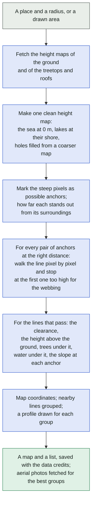
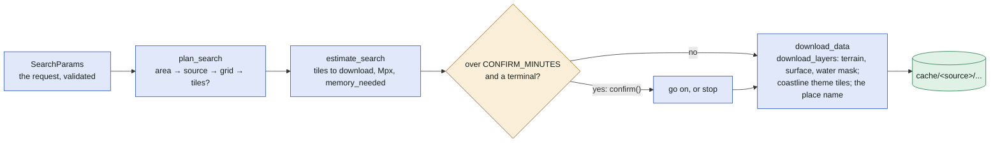
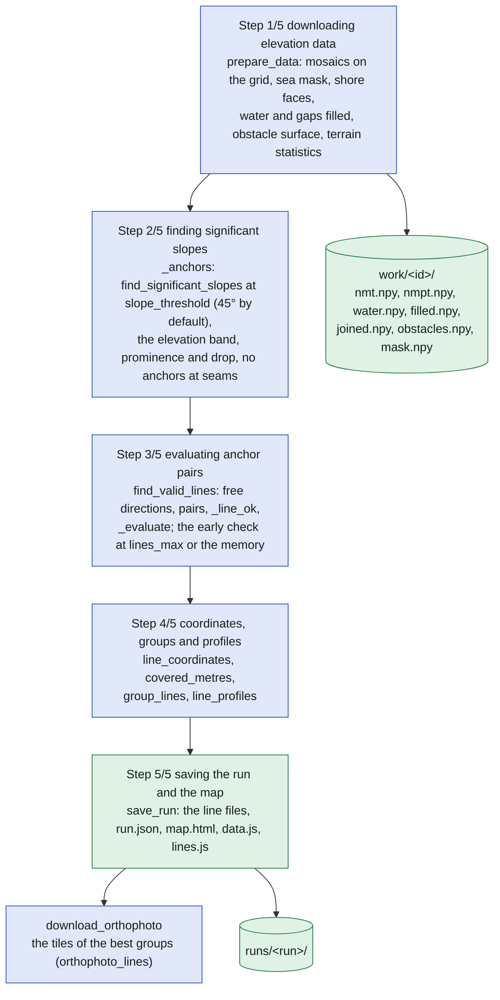
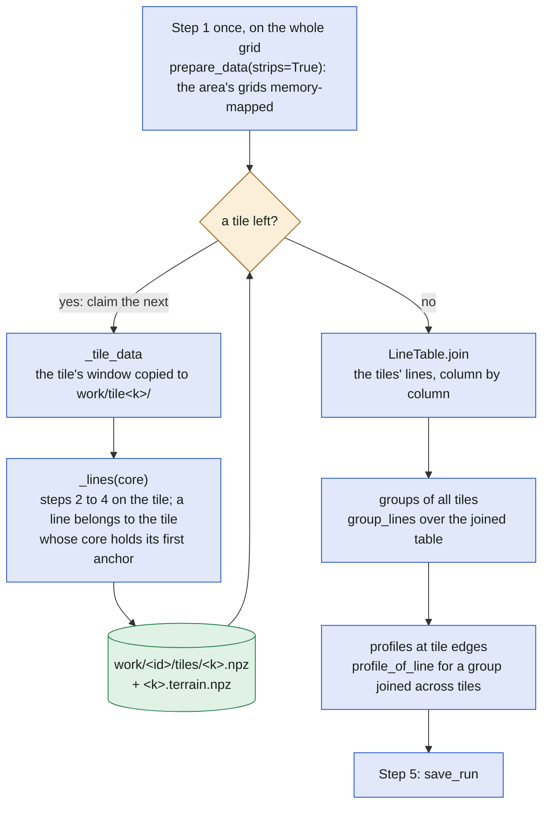

# A search, step by step

The third level: one search from the request to the saved map, whether it runs from the command
line ([findaline.py](../../findaline.py) → `search.run_search`) or as a web job (two phases of
[jobs.run_phase](../../jobs.py)). The library is [search.py](../../search.py); the five steps are
the ones its progress prints as `Step n/5`. The decisions along the way (which source, one grid or
tiles, how water and gaps are filled) are drawn in [decisions.md](decisions.md); how the tiles are
fetched in [download.md](download.md); the inside of steps 1, 3 and 5 in
[step1.md](step1.md), [step3.md](step3.md) and [step5.md](step5.md).

## In plain words

## Before the steps: plan, estimate, download

`plan_search` turns the request into a `Plan` (the area, the source, the metric grid, the tiles if
any) and refuses what the limits forbid before any cost. `estimate_search` asks the layers' indexes
what has to be downloaded and how much memory the grids take. `download_data` fetches the tiles.
The command line asks before a long estimate; the web worker's download phase is these three.

## The five steps

`search_lines` runs steps 1 to 4; `save_run` is step 5. For a circle the grid is one; a drawn area
larger than the memory budget allows is searched in tiles (below).

What each step reads and writes:

| Step | Reads | Writes | Progress bars |
| --- | --- | --- | --- |
| 1 `prepare_data` | the cached tiles, the OSM coastline or the world water file | the grids of `work/<id>/`, `Data` (mask, terrain histogram) | `stitching ...`, `area coverage`, `sea mask (...)`, `shore zone`, `shore from surface`, `filling sea and lakes`, `border gaps (...)`, `gap filling (...)`, `uncertain shore`, `surface coverage`, `terrain statistics` |
| 2 `_anchors` | `nmt`, the slope, the seams of `filled`/`joined` | `Anchors` (anchors, prominence, drop, strong) | `finding anchors`, `anchor prominence and drop` |
| 3 `_lines` → `find_valid_lines` | the anchors, `nmt`, `obstacles`, the limits (formula or the sag table) | a `LineTable` of the valid lines, the funnel's counts (`Plan.funnel`) | `sag estimator table`, `free directions`, `anchor pairs`, `checking lines` |
| 4 `_lines` | the `LineTable`, `water`, `filled` | columns of coordinates, metres over water and gaps, `Groups`, `Profiles` | `coordinates`, `over water and filled gaps`, `grouping lines`, `line profiles` |
| 5 `save_run` | the table, the groups, the profiles, the plan's credits | `runs/<run>/` and `runs/runs.js` | `saving results`, `saving the map` |

## A large area: tiles

A drawn area whose grid does not fit the memory budget is cut into tiles (`tile_core_size`, or
`--tile-size`). Step 1 runs once on the whole grid in strips, so the sea, the lakes and the gaps
are filled as for one grid; each tile then takes its window and gives exactly the lines of one
grid. A tiled search resumes from its finished tiles on the next start of the same search.

The overlap of a tile is `--max-length` plus `_margin` (the larger of `--prominence-span` and
`--drop-radius`) plus 2 pixels, so the anchors and their prominence at a tile's edge equal one
grid's; `tests/test_offline.py::test_area_in_tiles` keeps that.

## Where in the code

| Node | File | Function or name |
| --- | --- | --- |
| SearchParams | [params.py](../../params.py) | `SearchParams` |
| plan_search | [search.py](../../search.py) | `plan_search`, `Plan`, `_check_params` |
| estimate_search | [search.py](../../search.py) | `estimate_search`, `memory_needed`, `CONFIRM_MINUTES`, `confirm` |
| download_data | [search.py](../../search.py), [sources/layer.py](../../sources/layer.py) | `download_data`, `download_layers`, `_run_name` |
| Step 1 prepare_data | [search.py](../../search.py), [sources/mosaic.py](../../sources/mosaic.py), [sources/filling.py](../../sources/filling.py), [coast.py](../../coast.py), [obstacles.py](../../obstacles.py), [hypsometry.py](../../hypsometry.py) | `prepare_data`, `prepare_layer`, `sea_mask`, `fill_shore_from_surface`, `fill_water`, `fill_from_neighbours`, `fill_gaps_chain`, `obstacle_surface`, `land_histogram` |
| Step 2 _anchors | [search.py](../../search.py), [helpers.py](../../helpers.py), [terrain.py](../../terrain.py) | `_anchors`, `Anchors`, `find_significant_slopes`, `prominence`, `drop`, `at_seams` |
| Step 3 find_valid_lines | [search.py](../../search.py), [linesearch.py](../../linesearch.py), [sag.py](../../sag.py) | `_lines`, `_pair_search`, `find_valid_lines`, `free_directions`, `pair_chunk`, `_line_ok`, `_evaluate`, `_early_check`, `EnvelopeTable` |
| Step 4 | [search.py](../../search.py), [mapping.py](../../mapping.py), [grouping.py](../../grouping.py), [lineprofiles.py](../../lineprofiles.py), [linesearch.py](../../linesearch.py) | `line_coordinates`, `coordify`, `group_lines`, `greedy`, `line_profiles`, `covered_metres` |
| Step 5 save_run | [search.py](../../search.py), [runs.py](../../runs.py), [mapping.py](../../mapping.py), [saving.py](../../saving.py) | `save_run`, `save_results`, `save_map`, `write_index`, `write_files` |
| download_orthophoto | [search.py](../../search.py), [orthophoto.py](../../orthophoto.py) | `orthophoto_lines`, `download_orthophoto`, `download` |
| work/<id>/ grids | [search.py](../../search.py) | `prepare_data`, `Data`, `Paths` |
| tiles | [search.py](../../search.py) | `search_lines`, `tile_core_size`, `_tiles`, `_tile_data`, `_margin`, `_overlap`, `LineTable.join`, `profile_of_line` |
