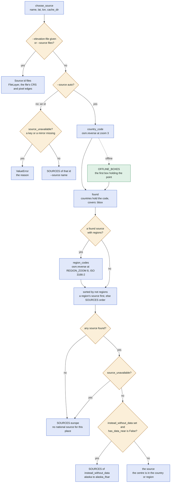
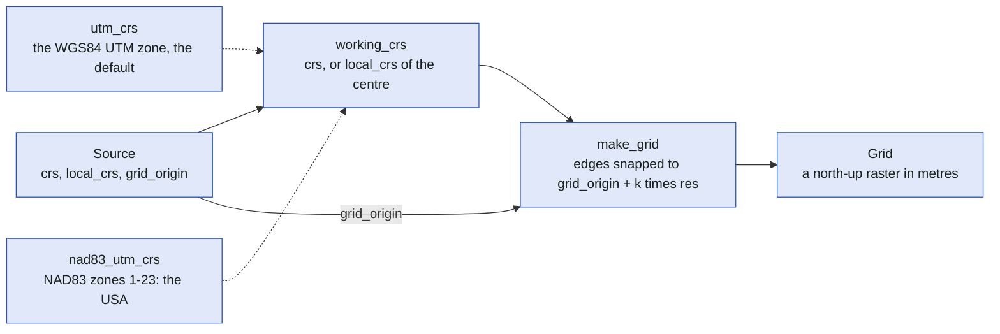
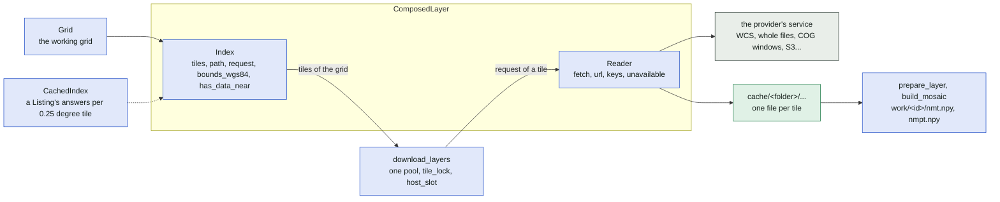
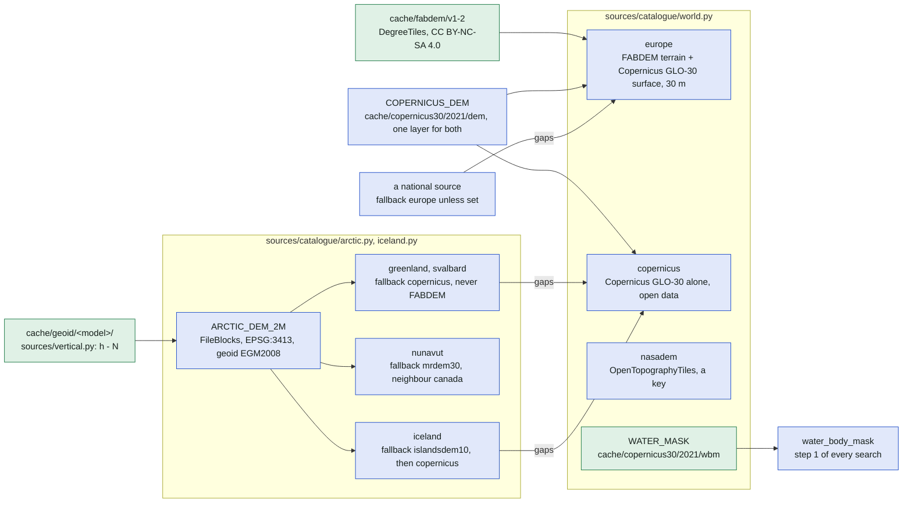

# The data sources

How a search gets its heights: which source `--source auto` picks, what a `Source` declares, how a layer is
composed of an index and a reader, how the gaps on land are filled in step 1, and the global datasets that
every search falls back on. It covers [sources/choose.py](../../sources/choose.py),
[sources/source.py](../../sources/source.py), [sources/composed.py](../../sources/composed.py),
[sources/layers/](../../sources/layers/), [sources/catalogue/\_\_init\_\_.py](../../sources/catalogue/__init__.py),
[sources/catalogue/world.py](../../sources/catalogue/world.py),
[sources/catalogue/arctic.py](../../sources/catalogue/arctic.py), [sources/filling.py](../../sources/filling.py)
and [grid.py](../../grid.py). The step they belong to is in [search.md](search.md); how a tile is fetched (locks,
slots, retries) in [download.md](download.md). The docs: [docs/data-sources.md](../data-sources.md) (how a source
is found and checked) and [docs/sources-architecture.md](../sources-architecture.md), a proposal: its options
and its "as today" section describe the one-module layout before the package; the parts of its option B are
what the code is now (`sources/composed.py`, `sources/indexes/`, `sources/readers/`, `sources/layers/`,
`sources/catalogue/`). README's "Data sources" table is written by
[tools/source_docs.py](../../tools/source_docs.py) from the catalogue and is not repeated here.

In plain words: the program asks OpenStreetMap which country the centre of the search lies in and takes that
country's own height survey, the finest one it knows; a region such as a German Land or Svalbard has a survey
of its own. Where that survey has holes on land, the neighbouring country's survey fills them at a border and a
coarse world model fills the rest, and every dataset used is named in the run's credits.

## Which source a search uses

`choose_source` returns the source and a sentence saying why. An explicit id must be available (a key, a
mirror); `auto` asks Nominatim for the country at zoom 3, and for the regions at `REGION_ZOOM` 8 only when a
found source has `regions`. Offline, both lookups fall back on `OFFLINE_BOXES`, the sources' own `offline`
boxes in the order of `SOURCES`: the first box holding the point wins.

`region_codes` keeps only the codes of the country found (`gb-wls` of `gb`); offline it takes the first region
box of that country. A source with `regions` wins over its country's sources whatever their order in
`SOURCES`; `bbox` keeps `spain_canarias` and `alaska` to their own boxes (`covers`).

## What a source declares

`Source` is a dataclass of data only: its layers, where it applies, how the grid is laid, what fills its gaps,
and what the run says about it. The working grid takes two things from it.

| Field of `Source` | What it is | Used by |
| --- | --- | --- |
| `nmt`, `nmpt` | the terrain layer and the optional surface layer (`Layer`) | `prepare_layer`, `download_layers`, the obstacle test |
| `countries`, `regions`, `bbox`, `offline` | ISO 3166-1 codes, ISO 3166-2 codes (lower case), a box `(south, north, west, east)`, rough boxes per country or region code | `choose_source`, `OFFLINE_BOXES`, `neighbour_window` |
| `crs`, `local_crs`, `grid_origin` | a fixed working CRS, or a function of the centre (`utm_crs` by default, `nad83_utm_crs`, `bc_utm_crs`, `mga_crs`); the pixel edges of the data, `(0.5, 0.5)` for pixel centres on whole metres | `working_crs`, `make_grid` |
| `default_resolution` | the data's own (`native_res`), at least `MIN_RESOLUTION` 1 m | `plan_search` |
| `fallback`, `more_fallbacks` | the sources that fill gaps on land, in turn (`fallbacks`); `"europe"` unless set, `None` for the gap fillers themselves | `fill_gaps_chain` |
| `neighbours` | the sources across a border, tried before the fallbacks; declared both ways | `fill_from_neighbours` |
| `instead_without_data` | the source taken when `nmt.has_data_near` says False | `choose_source` |
| `credits`, `note`, `listing`, `coverage`, `sample` | `Credit` objects (one credit is given to the layers), the note printed at the start, the README row (`ReadmeRow`), the coverage map's entry (`Coverage`), the probe's point | `save_run`, the about page, `tools/source_docs.py`, `tools/coverage_data.py`, `sources/probe.py` |
| `ortho` | the `OrthoService`: a WMS (`wms_version`, `wms_crs`) and/or base tiles, `detail`, the attribution | `orthophoto.py`, the viewer |
| `sea_fill` | the constant a provider wrote over the sea (`SH_SEA_FILL`): counts as water within `SEA_FILL_EPS` | `fill_water`, `water_with_data`, `land_histogram` |
| `obstacles` | whether the surface model is told from the terrain's rock (`obstacles.obstacle_surface`); False for `europe`, whose difference is the trees by construction | `prepare_data` |

## How a layer is composed

A `ComposedLayer` is an `Index` (which tiles cover a grid, where each is cached, what to request) and a
`Reader` (how one request becomes a cached file). The parts know nothing of each other; a layer class of
`sources/layers/` only builds its two parts in its constructor.

The layer classes, each one combination (`IndexedTiles` is the base of those whose index is a `CachedIndex`:
a listing's answers cached per 0.25° tile with a version policy, `NewestPerSheet` or `ComposedBlocks`):

| Layer class | Index | Reader | Example source |
| --- | --- | --- | --- |
| `WcsTiles` | `WcsTiling` | `WcsReader` | `spain`, `malta`, `hesse`, `england`, `norway` |
| `DegreeTiles`, `OpenTopographyTiles` | `DegreeTiling` | `Download` | `europe`, `copernicus`, `nasadem` |
| `DegreeBlocks` | `TenthDegreeTiling` | `Windows` | `usgs10m` |
| `FileBlocks` | `FileBlockTiling` | `Windows` (with `geoid`) | `austria`, `wales`, `luxembourg`, `canada`, `new_zealand`, `tasmania`, `greenland` |
| `GridTiles` | `MetricTiling` | `TileBases` | `slovakia` |
| `SheetTiles` | `CachedIndex` of `WfsSheets`, `NewestPerSheet` | `SheetFile` | `geoportal` |
| `StacTiles` | `CachedIndex` of `StacItems`, `NewestPerSheet` | `Download` (sha256) | `swisstopo`, `lower_saxony` |
| `TnmBlocks` (`Usgs1mBlocks`, `IfsarBlocks`) | `CachedIndex` of `TnmProducts`, `ComposedBlocks` | `Windows` | `usa`, `alaska_ifsar` |
| `S3Blocks` | `CachedIndex` of `S3Objects`, `ComposedBlocks` | `Windows` | `scotland` |
| `LidarBcBlocks` (an `S3Blocks`) | `CachedIndex` of `LidarBcFiles` | `Windows` | `british_columbia` |
| `MetalinkTiles` | `MetalinkIndex` of `MetalinkFiles`, `ShaPerTile` | `Download` (sha256) | `bavaria`, `rhineland_palatinate` |
| `GeoJsonTiles` (a `MetalinkTiles`) | `MetalinkIndex` of `GeoJsonFiles`, `XyzPerTile` | `XyzFile` | `schleswig_holstein` |
| `ZipMemberTiles` (a `MetalinkTiles`) | `MetalinkIndex` of `ZipDirectories`, `ZipPerTile` | `ZipMember` | `saarland` |
| `ZippedTiles` | `ZipTiling` (a `MetricTiling`) | `SheetFile` (with `members`) | `saxony`, `baden_wurttemberg`, `trento`, `slovenia` |
| `WmsrTiles` | `ResolutionTiling` of `WcsTiling`s | `WmsrReader` | `france`, `france_rgealti` |
| `ImageServerTiles` | `WcsTiling`, or `ZonedTiling` per CRS | `ImageServerReader`, or `ZonedReader` | `czechia`, `queensland` |
| `FileLayer` | a plain `Layer`, not composed: one local raster | | `files` |

The catalogue joins one module per family into `FAMILIES`, and `SOURCES` is every family's list in that order,
which is the order `--source auto` tries them and the order of `OFFLINE_BOXES`:

| Position in `FAMILIES` | Why there (the comment in the code) |
| --- | --- |
| `czechia` first | its offline boxes lie inside Poland's and Slovakia's |
| `poland`, then `france` before `switzerland`, `spain`, `uk`, `germany`, `luxembourg` | their offline boxes reach into France; France's own keep clear of their land |
| `arctic` before `canada` | Canada's offline box holds north-western Greenland, and Nunavut's boxes lie inside it |
| `slovenia` before `austria` | Austria's offline box reaches over Triglav |
| `australia`, `iceland` anywhere before `world` | their regions and boxes clash with nothing |
| `world` last | the global datasets, the fallback of everything |

## The gap filling of step 1

`prepare_data` fills in a fixed order: the sea zone is found first, then the gaps on land outside it, then the
shore faces and the water. The neighbours' national data comes before the fallbacks, only at a border.
Every filler is credited only when it filled a pixel (`used_data`).

```mermaid
flowchart TD
    layers["prepare_layer<br/>work/&lt;id&gt;/nmt.npy, nmpt.npy"] --> wbm["water_body_mask<br/>work/&lt;id&gt;/wbm.npy, OCEAN where a tile is missing"]
    wbm --> sea["coast.sea_mask<br/>the OSM coastline or the Copernicus sea"]
    sea --> zone["near<br/>the shore zone: the sea grown by shore_buffer"]
    zone --> qfill{"--fill-gaps on?"}
    qfill -- no --> water
    qfill -- yes --> qborder{"Plan.border and<br/>Source.neighbours?"}
    qborder -- yes --> bg["border_gaps<br/>gaps touching the footprint's edge,<br/>at least NEIGHBOUR_MIN_GAP_M2 2500 m2"]
    bg --> qwin{"neighbour_window:<br/>a gap under the neighbour's offline or bbox box?"}
    qwin -- "no: next neighbour" --> chain
    qwin -- yes --> qun{"source_unavailable?"}
    qun -- "yes: next neighbour" --> chain
    qun -- no --> fn["fill_gaps of the neighbour<br/>a sub-grid around its gaps, surface_from_terrain False"]
    fn --> joined["work/&lt;id&gt;/joined.npy<br/>a seam for the anchors, never filled_m"]
    qborder -- no --> chain
    joined --> chain["fill_gaps_chain<br/>fallback, then more_fallbacks, each what is left"]
    chain --> fg["fill_gaps per fallback<br/>offset: the median in GAP_RING 3 px<br/>on slopes under GAP_MATCH_SLOPE 15 degrees"]
    fg --> filled["work/&lt;id&gt;/filled.npy<br/>a seam, counted as filled_m"]
    filled --> qcredit{"pixels filled?"}
    qcredit -- yes --> used["used_data<br/>the layer's credit in the run"]
    qcredit -- "no: not credited" --> water
    used --> water["fill_shore_from_surface, fill_water<br/>the shore faces from the surface model, then the water"]
    classDef step fill:#e1e8fa,stroke:#2350c8,color:#17201c
    classDef q fill:#fbefd9,stroke:#995500,color:#17201c
    classDef file fill:#e0f1e6,stroke:#1d7a47,color:#17201c
    classDef actor fill:#e9eee9,stroke:#45524b,color:#17201c
    class layers,sea,zone,bg,fn,chain,fg,used,water step
    class qfill,qborder,qwin,qun,qcredit q
    class wbm,joined,filled file
```

Details the diagram leaves out: a neighbour's `fill_gaps` runs on `neighbour_window`'s sub-grid only, with
`exclude` the sea zone; `border_gaps` is computed once and again only after a neighbour wrote pixels into
either grid or failed midway; a local offset more than `GAP_MAX_LOCAL_SHIFT` 3 m from the overall one is not
trusted; without `--water fill` the zone is the Copernicus sea grown by `SHORE_BUFFER` 45 m, so the gap filling
stays off the sea. Both masks are seams (`at_seams` in `search._anchors`): no anchor stands where two surveys
meet, but only the fallbacks' pixels count as `filled_m` on the map. The shore faces of
`fill_shore_from_surface` go into `covered.npy` with the filled gaps and are no seam (a cliff's top edge
stands next to its face).

## The world family and the Arctic

`world.py` holds the global datasets: `europe` (FABDEM as the terrain, Copernicus GLO-30 as the surface) is
the default `fallback` of every national source, `copernicus` the open filler of the sources whose runs must
stay free of FABDEM's non-commercial licence, `nasadem` an alternative behind an OpenTopography key, and
`WATER_MASK` the water body mask every search with water filling reads. The Arctic sources share one
`FileBlocks` layer on ArcticDEM whose heights above the ellipsoid are cached above the EGM2008 geoid.

The Arctic rule: ArcticDEM is a surface model from satellite stereo (no terrain model, so `obstacles` has
nothing to compare and the note says the tree check is off), its voids are filled from `copernicus`, never from
`europe`, so a run stays under CC BY; `nunavut` fills from NRCan's `mrdem30` and has `canada` as its neighbour;
`iceland` fills from `islandsdem10` first. The geoid grid is read by `sources/vertical.py` itself, never
through PROJ, which answers N = 0 without a word when its grid is missing.

## Where in the code

| Node | File | Function or name |
| --- | --- | --- |
| choose_source | [sources/choose.py](../../sources/choose.py) | `choose_source` |
| --elevation-file given or --source files? | [sources/choose.py](../../sources/choose.py) | `choose_source` (`elevation_file`, `name == "files"`) |
| Source id files | [sources/choose.py](../../sources/choose.py), [sources/layers/files.py](../../sources/layers/files.py) | `Source(id="files", ...)`, `FileLayer` |
| --source auto? | [sources/choose.py](../../sources/choose.py) | `choose_source` (`name != "auto"`) |
| source_unavailable? | [sources/choose.py](../../sources/choose.py) | `source_unavailable` |
| ValueError | [sources/choose.py](../../sources/choose.py) | `choose_source` |
| SOURCES of that id | [sources/catalogue/\_\_init\_\_.py](../../sources/catalogue/__init__.py) | `SOURCES` |
| country_code | [sources/choose.py](../../sources/choose.py) | `country_code` |
| OFFLINE_BOXES | [sources/choose.py](../../sources/choose.py) | `OFFLINE_BOXES` |
| found | [sources/choose.py](../../sources/choose.py), [sources/source.py](../../sources/source.py) | `choose_source` (`found`), `Source.covers` |
| a found source with regions? | [sources/source.py](../../sources/source.py) | `Source.regions` |
| region_codes | [sources/choose.py](../../sources/choose.py) | `region_codes`, `REGION_ZOOM` |
| sorted by not regions | [sources/choose.py](../../sources/choose.py) | `choose_source` (`sorted(..., key=lambda s: not s.regions)`) |
| any source found? | [sources/choose.py](../../sources/choose.py) | `choose_source` |
| SOURCES europe | [sources/catalogue/world.py](../../sources/catalogue/world.py) | `SOURCES` (`id="europe"`) |
| instead_without_data set and has_data_near is False? | [sources/source.py](../../sources/source.py), [sources/composed.py](../../sources/composed.py) | `Source.instead_without_data`, `Index.has_data_near` |
| SOURCES of instead_without_data | [sources/catalogue/usa.py](../../sources/catalogue/usa.py) | `alaska`, `alaska_ifsar` |
| the source | [sources/choose.py](../../sources/choose.py) | `choose_source` |
| Source | [sources/source.py](../../sources/source.py) | `Source` |
| working_crs | [sources/source.py](../../sources/source.py) | `Source.working_crs`, `Source.local_crs` |
| utm_crs | [grid.py](../../grid.py) | `utm_crs` |
| nad83_utm_crs | [grid.py](../../grid.py) | `nad83_utm_crs` |
| make_grid | [grid.py](../../grid.py), [sources/source.py](../../sources/source.py) | `make_grid` (`origin` = `Source.grid_origin`) |
| Grid | [grid.py](../../grid.py) | `Grid` |
| ComposedLayer | [sources/composed.py](../../sources/composed.py) | `ComposedLayer` |
| Index | [sources/composed.py](../../sources/composed.py) | `Index` |
| Reader | [sources/composed.py](../../sources/composed.py) | `Reader` |
| CachedIndex | [sources/indexes/cached.py](../../sources/indexes/cached.py) | `CachedIndex` |
| download_layers | [sources/layer.py](../../sources/layer.py) | `download_layers` |
| the provider's service | [sources/readers/](../../sources/readers/) | `Reader.fetch` |
| cache/&lt;folder&gt;/... | [sources/composed.py](../../sources/composed.py) | `ComposedLayer.tile_path`, `Index.path` |
| prepare_layer, build_mosaic | [sources/mosaic.py](../../sources/mosaic.py) | `prepare_layer`, `build_mosaic` |
| water_body_mask | [sources/filling.py](../../sources/filling.py) | `water_body_mask`, `OCEAN` |
| coast.sea_mask | [coast.py](../../coast.py) | `sea_mask`, `sea_mask_rows` |
| near | [sources/filling.py](../../sources/filling.py) | `near`, `near_rows` |
| --fill-gaps on? | [search.py](../../search.py) | `_fills_gaps` |
| Plan.border and Source.neighbours? | [search.py](../../search.py), [sources/source.py](../../sources/source.py) | `Plan.border`, `Source.neighbours` |
| border_gaps | [sources/filling.py](../../sources/filling.py) | `border_gaps`, `NEIGHBOUR_MIN_GAP_M2` |
| neighbour_window | [sources/filling.py](../../sources/filling.py) | `neighbour_window`, `_box_ranges` |
| fill_gaps of the neighbour | [sources/filling.py](../../sources/filling.py) | `fill_from_neighbours`, `fill_gaps` (`window`, `surface_from_terrain=False`) |
| work/&lt;id&gt;/joined.npy | [search.py](../../search.py) | `prepare_data` (`joined_path`), `Data.joined` |
| fill_gaps_chain | [sources/filling.py](../../sources/filling.py) | `fill_gaps_chain`, `Source.fallbacks` |
| fill_gaps per fallback | [sources/filling.py](../../sources/filling.py) | `fill_gaps`, `_fill`, `GAP_RING`, `GAP_MATCH_SLOPE`, `GAP_MAX_LOCAL_SHIFT` |
| work/&lt;id&gt;/filled.npy | [search.py](../../search.py) | `prepare_data` (`filled_path`), `Data.filled` |
| pixels filled? | [sources/filling.py](../../sources/filling.py) | `fill_gaps` (`used_data`) |
| used_data | [sources/mosaic.py](../../sources/mosaic.py) | `used_data` |
| fill_shore_from_surface, fill_water | [sources/filling.py](../../sources/filling.py) | `fill_shore_from_surface`, `fill_water` |
| europe, copernicus, nasadem | [sources/catalogue/world.py](../../sources/catalogue/world.py) | `SOURCES` |
| WATER_MASK | [sources/catalogue/world.py](../../sources/catalogue/world.py) | `WATER_MASK` |
| cache/fabdem/v1-2 | [sources/catalogue/world.py](../../sources/catalogue/world.py) | `DegreeTiles("FABDEM (terrain)", "fabdem/v1-2", ...)`, `FABDEM_CREDIT` |
| COPERNICUS_DEM | [sources/catalogue/world.py](../../sources/catalogue/world.py) | `COPERNICUS_DEM` |
| a national source | [sources/source.py](../../sources/source.py) | `Source.fallback` |
| ARCTIC_DEM_2M | [sources/catalogue/arctic.py](../../sources/catalogue/arctic.py) | `ARCTIC_DEM_2M`, `ARCTIC_CRS` |
| greenland, svalbard, nunavut | [sources/catalogue/arctic.py](../../sources/catalogue/arctic.py) | `SOURCES` |
| iceland | [sources/catalogue/iceland.py](../../sources/catalogue/iceland.py) | `SOURCES` (`iceland`, `islandsdem10`) |
| cache/geoid/&lt;model&gt;/ | [sources/vertical.py](../../sources/vertical.py) | `Geoid`, `EGM2008` |
