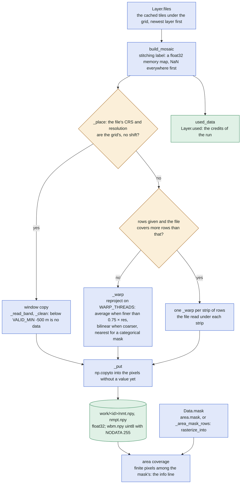
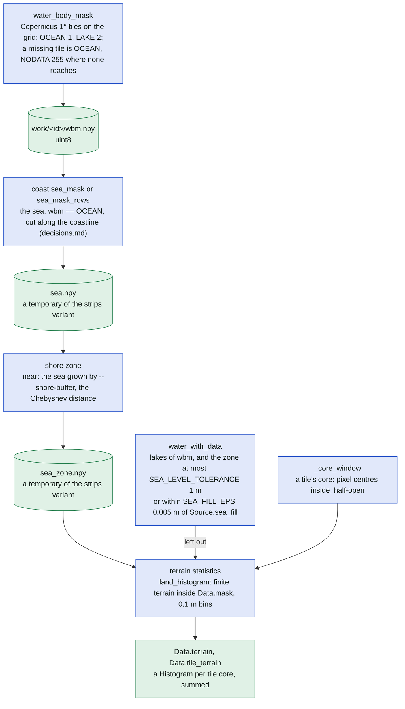
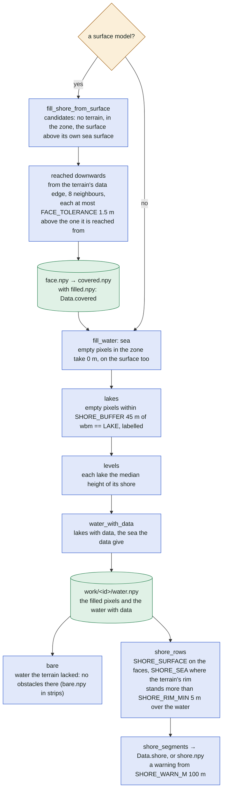
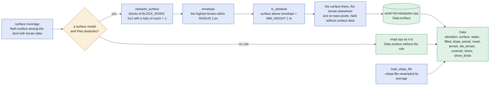

# Step 1: one clean height map

The inside of step 1 of a search ([search.md](search.md), "Step 1/5 downloading elevation data"):
`prepare_data` of [search.py](../../search.py) turns the cached tiles into the grids of
`work/<id>/` that steps 2 to 4 read. Its parts are [sources/mosaic.py](../../sources/mosaic.py)
(the mosaics), [sources/filling.py](../../sources/filling.py) (the water body mask, the shore
faces, the water, the gaps, the neighbours), [coast.py](../../coast.py) (the sea mask),
[hypsometry.py](../../hypsometry.py) (the terrain statistics) and [obstacles.py](../../obstacles.py)
(the obstacle surface). The decision trees of the sea mask and of what is filled are drawn in
[decisions.md](decisions.md); here each is one node. The user-facing account is README's
[Sea, lakes and gaps in the data](../../README.md#sea-lakes-and-gaps-in-the-data); the memory of
step 1 is measured in [docs/performance.md](../performance.md) ("The memory of step 1").

## The order of step 1

`prepare_data` runs its parts in a fixed order: where the sea is, then the terrain statistics
on the raw data, then the gaps on land outside the sea, then a cliff's face from the surface
model, then the water. Each node names its progress bar where it has one.

```mermaid
flowchart TD
    dl["_download_layers<br/>the tiles of terrain, surface, water mask (cache only)"]
    mos["prepare_layer<br/>stitching terrain, stitching surface: nmt.npy, nmpt.npy"]
    cov["area coverage<br/>Data.mask, the share of pixels with data"]
    wq{"--water fill?"}
    wbm["water_body_mask + sea mask + shore zone<br/>wbm.npy, the sea, near by --shore-buffer"]
    g0{"_fills_gaps?"}
    zone2["shore zone<br/>near by SHORE_BUFFER 45 m: the gap filling kept off the sea"]
    stat["terrain statistics<br/>land_histogram on the unfilled terrain"]
    g1{"_fills_gaps?<br/>--fill-gaps on and a fallback or neighbours"}
    nb["fill_from_neighbours<br/>border gaps (neighbour): joined.npy"]
    chain["fill_gaps_chain<br/>gap filling (source): filled.npy"]
    w2{"--water fill?"}
    face["fill_shore_from_surface<br/>shore from surface (a surface model only): face.npy, covered.npy"]
    fw["fill_water<br/>filling sea and lakes: water.npy, bare"]
    shore["uncertain shore<br/>shore_segments, or shore.npy for the 3D patch"]
    sc["surface coverage<br/>a warning when over 1 % of the land lacks it"]
    rule["obstacle_surface<br/>obstacles.npy, the rule of Plan.obstacles"]
    slope["load_slope_file<br/>--slope-file on the grid: slope.npy"]
    data["Data<br/>the memory-mapped grids, the mask, the histograms"]
    dl --> mos --> cov --> wq
    wq -- "fill" --> wbm --> stat
    wq -- "off" --> g0
    g0 -- "yes" --> zone2 --> stat
    g0 -- "no" --> stat
    stat --> g1
    g1 -- "yes" --> nb --> chain --> w2
    g1 -- "no" --> w2
    w2 -- "fill" --> face --> fw --> shore --> sc
    w2 -- "off" --> sc
    sc --> rule --> slope --> data
    classDef step fill:#e1e8fa,stroke:#2350c8,color:#17201c
    classDef q fill:#fbefd9,stroke:#995500,color:#17201c
    classDef file fill:#e0f1e6,stroke:#1d7a47,color:#17201c
    classDef actor fill:#e9eee9,stroke:#45524b,color:#17201c
    class dl,mos,cov,wbm,zone2,stat,nb,chain,face,fw,shore,sc,rule,slope step
    class wq,g0,g1,w2 q
    class data file
```

The second shore zone (`SHORE_BUFFER` 45 m, the width of the Copernicus mask's uncertainty) exists
so that, with `--water off`, the gap filling never writes land heights into the sea; the
statistics use it too. With `--water fill` the zone is the sea mask grown by `--shore-buffer`
(20 m by default). Every `RuntimeError` of the parts becomes a `SearchError` `download_failed`.

## The mosaics

`prepare_layer` brings one layer onto the working grid: `build_mosaic` opens each cached file
with GDAL's `WARP_THREADS` (the cores numba may use, at most 8), copies it when it already lies on
the grid's pixels and reprojects it otherwise. The first raster to reach a pixel wins. The area
mask is computed once per grid and kept in `Data.mask` for step 2.

A file whose pixel centres lie on whole metres (geoportal's sheets) is a copy only when the grid
was made with the source's `grid_origin` ([grid.py](../../grid.py)); otherwise it is interpolated
half a pixel off and the cliff edges are smoothed. A warp of another CRS in strips may differ from
one whole warp within GDAL's approximate transformer; a file of the grid's CRS is bit for bit the
same (`tests/test_units.py::test_mosaic_rows_as_whole`).

## Where the water is, and the terrain statistics

The Copernicus water body mask says where water may be; the coastline refines the sea's edge. The
statistics count the source's own heights before any pixel is filled, so a tiled search and one
grid give the same percentiles.

`water_with_data` is one rule in two places: what `fill_water` keeps in its water mask and what
the statistics leave out of the land (`tests/test_hypsometry.py::test_water_with_data_is_fill_waters_rule`).

## The gaps on land

The neighbours' national data first (only around the gaps at a border), then the source's
fallbacks in turn, each filling what the ones before left. Every gap is shifted so that it joins
its surroundings without a step.

```mermaid
flowchart TD
    start["_fills_gaps<br/>--fill-gaps on and Source.fallback or neighbours"]
    bq{"Plan.border and<br/>Source.neighbours?"}
    bg["border_gaps<br/>gaps on land reaching the footprint's edge,<br/>at least NEIGHBOUR_MIN_GAP_M2 2500 m²"]
    nw{"neighbour_window:<br/>a border gap inside the neighbour's boxes?"}
    un{"source_unavailable?"}
    fgn["fill_gaps with a window<br/>the neighbour's layer on a sub-grid, NEIGHBOUR_PAD 6 px around"]
    joined[("work/&lt;id&gt;/joined.npy<br/>a seam for at_seams, never filled")]
    chain["fill_gaps_chain<br/>Source.fallback, then more_fallbacks in turn"]
    fg["fill_gaps<br/>the terrain pair, then the surface pair: gap_nmt.npy, gap_nmpt.npy"]
    slopes["slopes<br/>matched where both have data and the slope is under GAP_MATCH_SLOPE 15°"]
    overall["the overall offset<br/>the median of the matched differences"]
    rings["rings<br/>the gaps labelled, GAP_RING 3 px around each"]
    medians["medians<br/>a gap's own offset from its ring, kept within<br/>GAP_MAX_LOCAL_SHIFT 3 m of the overall, else the overall"]
    write["target of the gaps = other + offset<br/>a layer that filled no pixel is not credited"]
    filled[("work/&lt;id&gt;/filled.npy<br/>a seam, and what filled_m counts")]
    start --> bq
    bq -- "yes" --> bg --> nw
    nw -- "yes" --> un
    nw -- "no" --> chain
    un -- "no" --> fgn --> joined --> chain
    un -- "yes: skipped" --> chain
    bq -- "no" --> chain
    chain --> fg --> slopes --> overall --> rings --> medians --> write --> filled
    classDef step fill:#e1e8fa,stroke:#2350c8,color:#17201c
    classDef q fill:#fbefd9,stroke:#995500,color:#17201c
    classDef file fill:#e0f1e6,stroke:#1d7a47,color:#17201c
    classDef actor fill:#e9eee9,stroke:#45524b,color:#17201c
    class start,bg,fgn,chain,fg,slopes,overall,rings,medians,write step
    class bq,nw,un q
    class joined,filled file
```

`slopes`, `rings` and `medians` are the three parts of the Compute bar `gap filling (<source>):
terrain|surface` of `_fill`. The border gaps are found once and again only after a neighbour
wrote pixels or failed midway. A neighbour's surface gaps come from its surface model only
(`surface_from_terrain=False`); a fallback without one fills them from its terrain.

## The shore faces and the water

With a surface model, a sea cliff's face that the terrain model lacks is taken from it first,
reached downwards from the terrain's data edge; the rest of the zone without data becomes the
sea at 0 m, the lakes their shore level. Where the terrain model ends on a cliff above the water,
the run records the uncertain shore.

`sea`, `lakes` and `levels` are the parts of the bar `filling sea and lakes`. The faces are
filled data (`Data.covered`, what `filled_m` and the map's filter count), never water and never
a seam: the anchors at a cliff's top edge stand right next to its face. The surface model's own
sea surface (`water_with_data` on it) is left for `fill_water`: the exact shoreline.

## The obstacle surface and what step 1 hands over

The surface model is kept only where it stands clearly above the highest terrain around; elsewhere
the obstacle test compares with the terrain itself, so it passes wherever the terrain test does.

`Plan.obstacles` is `obstacles.RULE` (`radius` 2, `min_height` 1.0), recorded in run.json;
`profile_of_line` applies the run's rule and `patch_of_line` sets None (the 3D view draws the
terrain, the surface model fills the shore faces only). A source whose surface minus terrain is
trees and buildings by construction (`Source.obstacles` False) gets no rule.

## One grid or strips

A search of one grid runs every operation on the whole grid at once (`rows` None). The area of a
tiled search runs step 1 once with `strips=True`: `rows` = `strip_rows(width)`, strips of about
`STRIP_PX` (2²²) pixels with a halo of each operation's reach, the masks memory-mapped in the
work folder as temporaries and removed after their use; `_remove_grids` removes every `.npy` of
the work folder after the last tile. Both give the same values (the `*_rows_*` tests of
`tests/test_units.py`). `AREA_TEMP_BYTES` 4 per pixel is what the estimate adds for the
temporaries held at once.

| Operation | One grid (`rows` None) | Strips (`rows` given) |
| --- | --- | --- |
| `build_mosaic` | a file warped whole | a file covering more rows than `rows` warped strip by strip (`_warp` per strip) |
| the area mask | `area.mask(grid)` in memory | `_area_mask_rows` into `mask.npy` (a circle strip by strip, a polygon burned whole by `rasterize_into`) |
| the sea mask | `coast.sea_mask`, in memory | `sea_mask_rows` into `sea.npy`; the polygons and the coastline's faces burned whole, their share of the Copernicus sea counted per strip |
| the shore zone | `near`: two passes of `maximum_filter1d` | `near_rows` into `sea_zone.npy`, a halo of n rows |
| `land_histogram` | blocks of rows anyway | the same, one window per tile core (`Data.tile_terrain`) |
| `border_gaps` | `geometry_mask`, `binary_erosion`, `label` in memory | `_border_gaps_rows` into `border.npy`; the footprint burned whole into `footprint.npy`, its edge into `edge.npy` (a row of halo); one int32 array of labels |
| `fill_gaps` / `_fill` | the gaps and the matched pixels in memory, `np.median` | `_fill_gaps_rows`, `_fill_rows`: a pair's gaps in `<name>_<which>_gaps.npy`, the matched pixels in `both.npy` (a row of halo for the slopes, `GAP_RING` for the rings), the overall offset an exact selection over the float32 bit patterns (`_keys`, `_median_of`, `_select`); one int32 array of labels |
| `fill_shore_from_surface` | the candidates found whole, the mask saved by `np.save` | the candidates found strip by strip into `face.npy`; the rest on their indices either way |
| `fill_water` | in memory, `bare` = NaN terrain before the fill `&` water after | `_fill_water_rows`: the lake mask in `lake.npy` (a halo of n rows), one int32 array of labels, the pixels filled into `bare.npy` |
| `shore_segments` / `shore_rows` | blocks of rows anyway, a halo of `SHORE_BAND` 2 | the same |
| `obstacle_surface` | blocks of `BLOCK_ROWS` anyway | the same, `bare` read from `bare.npy` |
| `_tile_data` | – | each tile's window copied strip by strip into `work/tile<k>/` (nmt, surface, water, filled, slope, joined, covered), the mask in memory |

## The files of `work/<id>/`

What step 1 writes, and who reads it afterwards. "Temporary" files exist only while they are
used; the rest stays until the search ends (a tiled search: `_remove_grids` after the last tile).
`work_bytes` counts the lasting files for the disk estimate.

| File | dtype | Written by | Meaning | Read later by |
| --- | --- | --- | --- | --- |
| `nmt.npy` | float32 | `prepare_layer`, then written in place by the neighbours, the fallbacks, the faces and the water | the terrain, filled | step 2 (`find_significant_slopes`, `prominence`, `drop`), step 3 (`find_valid_lines`), step 4 (`line_profiles`), `_tile_data` |
| `nmpt.npy` | float32 | `prepare_layer`, written in place by the fallbacks and the water | the surface model | `obstacle_surface`, `fill_shore_from_surface`; `Data.surface` itself only without a rule |
| `obstacles.npy` | float32 | `obstacle_surface` | the surface where it is an obstacle, the terrain elsewhere | step 3 (`find_valid_lines`), step 4 (`line_profiles`), `_tile_data` as `surface.npy` |
| `wbm.npy` | uint8 | `water_body_mask` | `OCEAN` 1, `LAKE` 2, `NODATA` 255 | the sea mask, the zone, the statistics, `fill_water`; released after it (`del wbm`) |
| `mask.npy` | bool | `_area_mask_rows` (strips only) | the search area on the grid, `Data.mask` | step 2's anchors, `_tile_data` (its window) |
| `water.npy` | bool | `fill_water` | the sea and lakes filled, and the water with data | step 4 (`line_coordinates`: `water_m`, `line_profiles`), `shore_rows`, `_tile_data` |
| `filled.npy`, `filled1.npy` … | bool | `fill_gaps_chain` (`fill_gaps` per fallback, joined into `filled.npy`) | the terrain pixels the fallbacks filled | step 2 (`at_seams`), step 4 (`filled_pixels` when no `covered`), `_tile_data` |
| `joined0.npy` …, `joined.npy` | bool | `fill_from_neighbours` (`fill_gaps` per neighbour, joined) | the pixels a neighbour's survey filled: a seam | step 2 (`at_seams`), `_tile_data` |
| `covered.npy` | bool | `prepare_data` (`face.npy` copied, `filled.npy` or-ed in) | the faces and the gaps: `Data.covered` | step 4 (`filled_pixels`: `filled_m`, `line_profiles`), `_tile_data` |
| `gap_nmt.npy`, `gap_nmpt.npy`, `gap1_…` | float32 | `fill_gaps` through `prepare_layer` | a fallback's layers on the grid | `_fill` only |
| `border<n>_nmt.npy`, `border<n>_nmpt.npy` | float32 | `fill_gaps` with a window | a neighbour's layers on the sub-grid around its border gaps | `_fill` only |
| `slope.npy` | float32 | `load_slope_file` | the user's slope raster on the grid | step 2 (`find_significant_slopes`), `_tile_data` |
| `shore.npy` | uint8 | `prepare_data` with `shore="kinds"` (`shore_rows`) | `SHORE_SURFACE` 1, `SHORE_SEA` 2: `Data.shore_kinds` | `patch_of_line` (`encode_shore`) only |
| `face.npy` | bool | `fill_shore_from_surface` | the faces taken from the surface model | `shore_rows`; removed after the shore, temporary |
| `sea.npy` | bool | `sea_mask_rows` (strips) | the sea | `near_rows`; removed after the zone, temporary |
| `sea_zone.npy` | bool | `near_rows` (strips) | the sea grown by the buffer | the statistics, the gap filling's `exclude`, the faces, the water; removed at the end of step 1, temporary |
| `lake.npy` | bool | `_fill_water_rows` (strips) | empty pixels next to lakes | labelled, then removed, temporary |
| `bare.npy` | bool | `_fill_water_rows` (strips) | water the terrain lacked | `obstacle_surface`; removed after it, temporary |
| `border.npy`, `footprint.npy`, `edge.npy` | bool | `_border_gaps_rows` (strips) | the border gaps, the grid's footprint, its edge | `neighbour_window`; removed, temporary |
| `<name>_<which>_gaps.npy`, `both.npy` | bool | `_fill_gaps_rows`, `_fill_rows` (strips) | a pair's gaps, the matched pixels | `_fill_rows`; removed after the pair, temporary |

Step 2 reads the seams of `filled` and `joined` through `at_seams` (nine gathers at the anchors
of a 3 × 3 dilation less the erosion). Step 3's kernel gets the terrain and the obstacle surface
only; the water and the filled masks are read in step 4 (`line_coordinates`, `line_profiles`).
`profile_of_line` and `patch_of_line` run their own `prepare_data` on a small grid of the run's
source, resolution and filling (`statistics=False`, the shore as segments never, as kinds for the
patch), in a work folder of their own.

## Where in the code

| Node | File | Function or name |
| --- | --- | --- |
| _download_layers | [search.py](../../search.py), [sources/layer.py](../../sources/layer.py), [sources/catalogue/world.py](../../sources/catalogue/world.py) | `_download_layers`, `_water_mask`, `download_layers`, `WATER_MASK` |
| prepare_layer, Layer.files, used_data | [sources/mosaic.py](../../sources/mosaic.py), [sources/layer.py](../../sources/layer.py) | `prepare_layer`, `Layer.files`, `Layer.used`, `used_data` |
| build_mosaic, _place, window copy, _warp, _put | [sources/mosaic.py](../../sources/mosaic.py), [sources/layer.py](../../sources/layer.py) | `build_mosaic`, `_place`, `_read_band`, `_clean`, `VALID_MIN`, `_warp`, `_put`, `WARP_THREADS`, `NODATA` |
| area coverage, Data.mask | [search.py](../../search.py), [area.py](../../area.py), [sources/filling.py](../../sources/filling.py) | `prepare_data`, `_area_mask_rows`, `_share_rows`, `Area.mask`, `rasterize_into`, `new_mask` |
| --water fill?, _fills_gaps? | [search.py](../../search.py), [params.py](../../params.py) | `_fills_gaps`, `_water_mask`, `SearchParams.water`, `fill_gaps`, `shore_buffer`, `coastline` |
| water_body_mask | [sources/filling.py](../../sources/filling.py) | `water_body_mask`, `OCEAN`, `LAKE`, `NODATA` |
| coast.sea_mask | [coast.py](../../coast.py) | `sea_mask`, `sea_mask_rows`, `_sea_from_coastline`, `_sea_from_coastline_rows`, `_world_water` |
| shore zone | [sources/filling.py](../../sources/filling.py) | `near`, `near_rows`, `SHORE_BUFFER` |
| terrain statistics, _core_window, Data.terrain | [hypsometry.py](../../hypsometry.py), [search.py](../../search.py) | `land_histogram`, `Histogram`, `statistics`, `_core_window`, `Data.terrain`, `Data.tile_terrain` |
| water_with_data | [sources/filling.py](../../sources/filling.py) | `water_with_data`, `SEA_LEVEL_TOLERANCE`, `SEA_FILL_EPS`, `Source.sea_fill` |
| fill_from_neighbours, border_gaps, neighbour_window, source_unavailable | [sources/filling.py](../../sources/filling.py), [sources/choose.py](../../sources/choose.py), [sources/source.py](../../sources/source.py) | `fill_from_neighbours`, `border_gaps`, `_border_gaps_rows`, `NEIGHBOUR_MIN_GAP_M2`, `neighbour_window`, `NEIGHBOUR_PAD`, `source_unavailable`, `Source.neighbours`, `Plan.border` |
| fill_gaps_chain, fill_gaps | [sources/filling.py](../../sources/filling.py), [sources/source.py](../../sources/source.py) | `fill_gaps_chain`, `fill_gaps`, `_fill_gaps_rows`, `_subgrid`, `_or_rows`, `Source.fallback`, `Source.more_fallbacks`, `Source.fallbacks` |
| _fill: slopes, the overall offset, rings, medians, the write | [sources/filling.py](../../sources/filling.py) | `_fill`, `_fill_rows`, `GAP_MATCH_SLOPE`, `GAP_RING`, `GAP_MAX_LOCAL_SHIFT`, `_keys`, `_median_of`, `_select` |
| fill_shore_from_surface, reached downwards | [sources/filling.py](../../sources/filling.py) | `fill_shore_from_surface`, `FACE_TOLERANCE` |
| face.npy → covered.npy | [search.py](../../search.py) | `prepare_data`, `Data.covered`, `Data.filled_pixels` |
| fill_water: sea, lakes, levels, bare | [sources/filling.py](../../sources/filling.py) | `fill_water`, `_fill_water_rows`, `SHORE_BUFFER`, `LAKE` |
| shore_rows, shore_segments | [sources/filling.py](../../sources/filling.py), [search.py](../../search.py) | `shore_rows`, `shore_segments`, `SHORE_SURFACE`, `SHORE_SEA`, `SHORE_RIM_MIN`, `SHORE_BAND`, `SHORE_WARN_M`, `Data.shore`, `Data.shore_kinds` |
| surface coverage | [search.py](../../search.py) | `prepare_data` (the note `no_surface`) |
| obstacle_surface, envelope, is_obstacle | [obstacles.py](../../obstacles.py) | `obstacle_surface`, `envelope`, `is_obstacle`, `reach`, `RADIUS`, `MIN_HEIGHT`, `BLOCK_ROWS`, `RULE` |
| Plan.obstacles | [search.py](../../search.py), [sources/source.py](../../sources/source.py) | `Plan.obstacles`, `Source.obstacles`, `profile_of_line`, `patch_of_line` |
| load_slope_file | [sources/mosaic.py](../../sources/mosaic.py) | `load_slope_file` |
| Data | [search.py](../../search.py) | `Data`, `prepare_data` |
| strips, _remove_grids, _tile_data | [sources/filling.py](../../sources/filling.py), [search.py](../../search.py) | `STRIP_PX`, `strip_rows`, `strips`, `remove_grid`, `_remove_grids`, `_tile_data`, `_tile_window`, `AREA_TEMP_BYTES`, `work_bytes`, `tile_bytes` |
| at_seams | [search.py](../../search.py) | `at_seams`, `_anchors` |
| grid_origin | [grid.py](../../grid.py), [sources/source.py](../../sources/source.py) | `make_grid`, `Source.grid_origin` |
