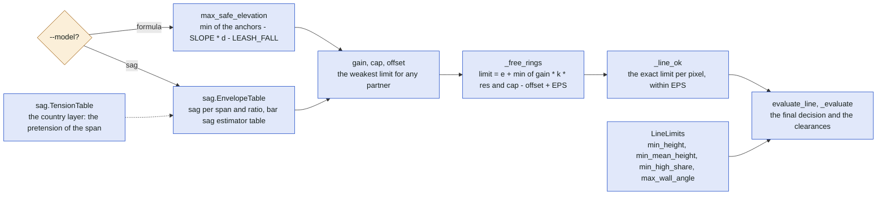
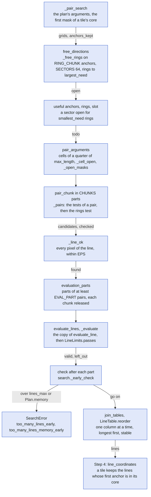
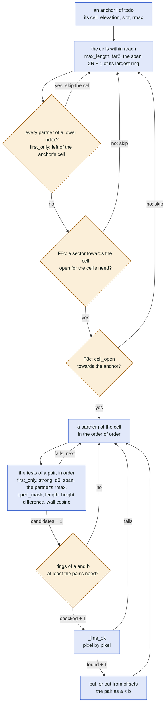
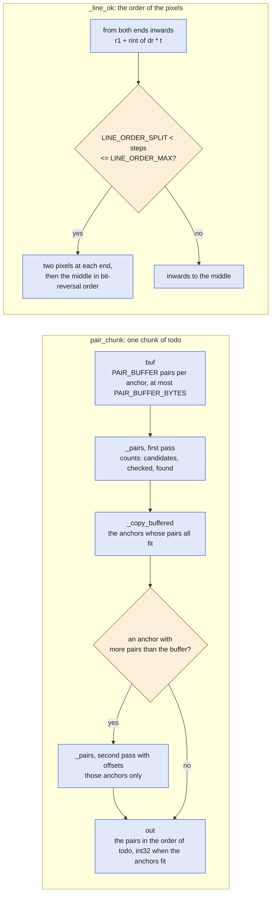
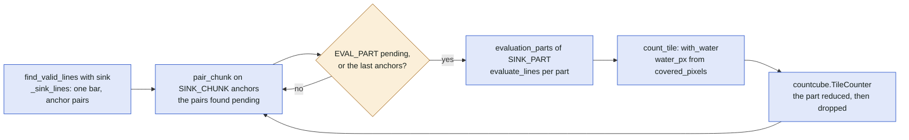
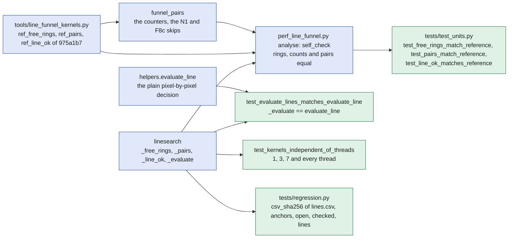

# Step 3: the line search

The inside of step 3 of a search ([search.md](search.md), "Step 3/5 evaluating anchor pairs"):
`search._lines` calls `linesearch.find_valid_lines` through `_pair_search`, and this file follows
that function in the order of its code, from the limit a line must stay under to the sorted table
of valid lines, then the count mode the country layer runs in the same function
([search-vs-country.md](search-vs-country.md)), what keeps the results pinned, the rules of the
numba kernels and the memory per line. Modules: [linesearch.py](../../linesearch.py) (all of it),
[helpers.py](../../helpers.py) (`max_safe_elevation`, `evaluate_line`, `LineLimits`,
`webbing_height`, `fall_allowance`, `wall_angles`, `downslope`, `LineTable`),
[sag.py](../../sag.py) (`EnvelopeTable`, `TensionTable`), [search.py](../../search.py)
(`_lines`, `_pair_search`, `count_tile`, `_early_check`, `_check_lines`, `LINE_BYTES`,
`memory_needed`), [jobs.py](../../jobs.py) (`FUNNEL_STEPS`), [warmup.py](../../warmup.py),
[tools/line_funnel_kernels.py](../../tools/line_funnel_kernels.py) and
[tools/perf_line_funnel.py](../../tools/perf_line_funnel.py). Docs: README's "Algorithm
Breakdown" ([README.md](../../README.md)) and "Order of elimination" in
[performance.md](../performance.md).

In plain words: every pair of steep pixels at the right distance is a possible line, and the
program walks each line pixel by pixel and stops at the first pixel too high for the webbing.
Almost every pair fails within a few metres of an anchor, so the search first works out, for each
anchor and 64 directions, how far a line could leave it at all, and skips whole groups of partners
that no open direction reaches; whatever is left is checked exactly, so nothing valid is lost.

## The limit a line must stay under

Every test of step 3 compares the terrain with the same limit. Without `--model sag` it is the
formula of `max_safe_elevation`: the lower anchor less `SLOPE` (0.15 m per metre of distance from
the nearest anchor) less `LEASH_FALL` (6 m). With the sag estimator it is the chord between the
anchors less the sag under the athlete (`sag.EnvelopeTable`, solved once per span of a geometric
grid of `SPAN_STEP` 1.05 and per ratio of `RATIOS`, the bar "sag estimator table"; built once per
process by `search._sag_table`) less the rigging's `fall_zone`. `find_valid_lines` derives from
either the weakest limit any partner could give an anchor, as `gain`, `cap` and `offset`, for the
rings; `_line_ok` repeats the exact limit in numba within `EPS` (1e-6 m), so the kernels may pass
too much and never too little, and `evaluate_line` (as `_evaluate`) makes the final decision.

| | Formula | Sag estimator |
| --- | --- | --- |
| Limit at fraction t | `min(e1, e2) - SLOPE * min(t, 1 - t) * length - LEASH_FALL` | `e1 + (e2 - e1) * t - sag(length, e1 - e2, t) - fall_zone` |
| `gain` | `-SLOPE` | `max_dh_ratio * sqrt(2)`: the chord rises by at most the allowed height difference |
| `cap` | infinite | `max_dh` |
| `offset` | `LEASH_FALL` | `fall_zone + min(0, table.min())`: the sag is never negative |
| `fall_allowance` | `LEASH_FALL` | `rig.fall_zone` (3 m by default) |

`LineLimits` are not part of the limit: `evaluate_lines` applies them after the clearances
(`passes`: the webbing heights `height_max`, `height_mean`, `high_pct` of `webbing_height` =
margin + `fall_allowance`, and the wall angles of `wall_angles` from `downslope`), counting the
lines left out in `left_out`. `_pairs` drops pairs over `max_wall_angle` earlier with the cosine of
the limit (`cos_limit`, within `EPS`) and the height difference with `d0`; both may pass too many.

## The funnel

`find_valid_lines` is three stages that lose no valid line, each counted into `Plan.funnel` with
the keys of `jobs.FUNNEL_STEPS` (on the edges below). It runs on
`min(threads, NUMBA_NUM_THREADS)` threads (`numba.set_num_threads`; `threads` from
`search.line_threads`).

| Count of `FUNNEL_STEPS` | Counted where | What it is |
| --- | --- | --- |
| `grids` | `_pair_search` | one per call of `find_valid_lines` (a tile is one) |
| `anchors` | `_anchors` | the anchors kept after the elevation band, the prominence and the drop |
| `anchors_kept` | `_pair_search` | what the line search gets (the same anchors) |
| `open` | `_add_stats` | anchors with a sector open for `smallest_need` rings (`useful`) |
| `todo` | `_add_stats` | the anchors pairs start from: all useful ones, or those in a tile's core (`first`) |
| `candidates` | `_pairs` | pairs that passed every test before the rings' test |
| `checked` | `_pairs` | candidates whose rings allow the pair: checked pixel by pixel by `_line_ok` |
| `found` | `_pairs` | pairs `_line_ok` passed |
| `valid` | `evaluate_lines` | lines `_evaluate` passed (clearance over 0, `nmpt_mode` reject, `LineLimits`) |
| `left_out` | `LineLimits.passes` | valid lines that missed the line limits |
| `lines` | `_lines` | the lines after step 4's core filter (a tile's own) |

The first stage, `free_directions`: `_free_rings` takes `RING_CHUNK` (65 536) anchors at a time
and, for each anchor and each of `SECTORS` (64) directions, counts the rings of pixels (Chebyshev
distance k, up to `largest_need`: the rings the longest line can need, at most `RINGS` 64) a line
can cross before the terrain is certainly too high. The k-th pixel of a line lies at most half a
pixel off it, so the sectors a pixel may belong to are its bits in `_sector_masks` (a uint64 per
pixel of the 129 × 129 square, delta = asin(0.7072 / k)); a pixel none of whose sectors is alive
is not read. Only the rows of the anchors with a sector open for `smallest_need` are kept
(`useful`, their `rings` as uint8 rows, `slot` the row of every anchor, -1 for the others).

## Inside the pair search

The second stage, `pair_arguments` and `pair_chunk` → `_pairs`: the useful anchors are bucketed
into cells of a quarter of `max_length` (`cell`, `order`, `starts`), with the OR of the open
sectors of each cell (`_cell_open`) and of each anchor (`_open_masks`), both for the need of the
shortest line. For each anchor of `todo` the kernel visits the cells within reach and, in them,
the partners in the order of `order`; it skips only what fails a test, so the pairs found keep
the order of the visits. The skips of F8c come before the candidates are counted: they fail the
rings' test, which is counted after.

The tests of a pair in `_pairs`, in the order of the code:

| Test | What it does | Exact, or may pass too many? |
| --- | --- | --- |
| dedup | only partners of a higher index; with `first_only` those for which the anchor is the first (smaller x, then y) | exact: a pair is checked and written from its lower index, `a < b` |
| strong | one anchor of the pair must be strong (`--min-prominence`; all are without it) | exact |
| `d0` | the heights differ by at most `min(max_dh_ratio * max_length, max_dh)` | passes too many (the longest length's allowance) |
| span, `own_max` | the partner within 2R + 1 pixels (Chebyshev) when the anchor's largest ring R is below `largest_need`, and the anchor's rings in the sectors of the cell reach the partner's need | the need of a pair is `min(RINGS, max(dr, dc) // 2)` |
| the partner's `rmax` | the same for the partner's largest ring | same |
| `open_mask` | the partner has a sector open for `smallest_need` towards the cell's sectors | F8c |
| length | `min_length` ≤ length ≤ `max_length` | exact |
| height difference | at most `max_anchor_diff` (5 %) of the length and `max_anchor_diff_m` (50 m) | exact |
| wall cosine | with `--max-wall-angle`: the line leaves both anchors within the angle's cosine, within `EPS` (`downslope`) | passes too many: `wall_angles` in `evaluate_lines` decides |
| rings | the rings of a towards b and of b towards a reach the pair's need | the rings are a lower bound |
| `_line_ok` | every pixel of the line against the limit, within `EPS` | passes too many: `_evaluate` decides |

`pair_chunk` runs `_pairs` over one chunk of `todo` (`CHUNKS` 200 parts, one bar update each)
holding the first `PAIR_BUFFER` (1024) pairs of each anchor in a buffer of at most
`PAIR_BUFFER_BYTES` (16 MiB), then a second pass with `offsets` over the anchors that found more
only. `_line_ok` tests the pixels `r1 + rint(dr * t)`, `c1 + rint(dc * t)` (the offset rounded,
not the position: `rint` rounds halves to even) from both ends inwards; a line of more than
`LINE_ORDER_SPLIT` (129) and at most `LINE_ORDER_MAX` (1024) steps tests two pixels at each end,
then the middle in bit-reversal order. Every pixel is tested either way: the order only changes
how soon a failing line is noticed.

The third stage: `evaluation_parts` hands the chunks' pairs out in parts of at least `EVAL_PART`
(10 000) pairs (and of at least 1/`CHUNKS` of all found), releasing each chunk as soon as its
pairs are out. `evaluate_lines` runs `_evaluate` on a part: a copy of `evaluate_line` with the
same arithmetic (`_interp` repeats `np.interp` to the last bit, `_interp_forward` walks its
index forward along the line), giving the anchors' heights, the length, the clearance over the
terrain, the clearance over the obstacle surface (`--nmpt mark` keeps a line that fails it, `reject`
drops it, NaN where not measured), the webbing's `height_max`, `height_mean` (summed one pixel
after another) and `high_pct` of `--high-above`; then the wall angles and `LineLimits.passes`. After
each part `check` (`search._early_check`, with `Plan.early_stop`) compares the valid lines so far
plus those of the tiles done already with `lines_max` and with `Plan.memory`
(`memory_needed` without profile points: a lower bound of what `_check_lines` asks at the end), and
raises `too_many_lines_early` or `too_many_lines_memory_early`. `join_tables` joins the parts one
column at a time and `LineTable.reorder` sorts in place by length, longest first and stable
(lines of the same length keep their order). `_check_lines` then decides on the exact count
(`too_many_lines`, `too_many_lines_memory`, a circle's profile points included).

## The count mode of the country layer

With `sink=` (`search.count_tile`, through `_pair_search`) the same function keeps nothing:
`_sink_lines` runs `pair_chunk` on `SINK_CHUNK` (2048) anchors at a time, evaluates the pending
pairs once `EVAL_PART` of them wait (and after the last anchors) in parts of at most `SINK_PART`
(1 048 576), and hands each evaluated part to the sink at once. No `check`, no join, no sort; the
function returns None, and the funnel's counts are the same.

| | A search (`_lines`) | The count mode (`count_tile`) |
| --- | --- | --- |
| Anchors per `pair_chunk` | `todo` split into `CHUNKS` parts | `SINK_CHUNK` at a time |
| The pairs found | all chunks kept until evaluated | evaluated once `EVAL_PART` are pending |
| A part of the evaluation | at least `EVAL_PART` pairs | at most `SINK_PART` pairs |
| After a part | `check` (`_early_check`), the table kept | the sink reduces it, the part dropped |
| At the end | `join_tables`, `reorder` longest first, `_check_lines` | nothing joined, None returned |
| Errors | `no_lines` without a core | none: an empty tile hands the sink nothing |

## What keeps the results pinned

`tools/line_funnel_kernels.py` holds `ref_free_rings`, `ref_pairs` and `ref_line_ok`, frozen
copies of `_free_rings`, `_pairs` and `_line_ok` of 975a1b7, and the `self_check` of
`tools/perf_line_funnel.py analyse` stops when production differs from them: the rings must be the
references' capped at `largest_need` (`capped_rings`), the useful anchors, the counts of checked
and found pairs per anchor and the pairs written must be equal, and the candidates must be the
references' less what N1 and F8c skip (`C_N1_CANDIDATES`, `C_F8C_CANDIDATES` of `funnel_pairs`).
The tool reaches production only through `free_directions`, `pair_arguments` and `pair_chunk`
(`production_directions`, `production_args`), and `rebuild` mirrors the set-up of
`find_valid_lines`. `tests/test_units.py` runs the same checks on small grids.

What may change and what may not:

| May change | May not change | Kept by |
| --- | --- | --- |
| a skip rule of `_pairs`, if it skips only pairs that fail before `_line_ok` (the rings' test or earlier) | the pairs checked pixel by pixel and found, per anchor, and their order (the stable sorts by length and of the groups carry it into `lines.csv`) | `self_check`, `test_pairs_match_reference`, `test_f8c_skips_only_rings_failures`, `test_pair_buffer_overflow_matches_reference` |
| the order in which `_line_ok` tests the pixels | its decision on every line (every pixel tested) | `test_line_ok_matches_reference` |
| how `_free_rings` reads the pixels | the rings, capped at `largest_need` | `test_free_rings_match_reference` |
| `_cell_sectors`, `_arc` | every pixel's sector within the cell's sectors | `test_cell_sectors_hold_every_pixel` |
| the parts, buffers and chunks (`EVAL_PART`, `PAIR_BUFFER`, `SINK_CHUNK`) | the valid lines and their values (`==`), the funnel's `checked` and `found` | `test_evaluate_lines_matches_evaluate_line`, `tests/test_count_mode.py` |
| the number of threads | the results (`==`, in the same order) | `test_kernels_independent_of_threads` |
| the references themselves | only by a decision that the counters may change: the regression's `open` and `checked` counts and `ZABI_KON` are re-baselined | `tests/regression.py` (`csv_sha256` of `lines.csv` with its totals) |
| `max_safe_elevation` | not alone: `_line_ok` (twice), the `gain`/`cap`/`offset` of `find_valid_lines`, `_evaluate` and `webbing_height` change with it, and every regression checksum | `test_evaluate_lines_matches_evaluate_line`, the regression set |

## The rules of the numba kernels

| Rule | Why | Where |
| --- | --- | --- |
| No float sum across `prange` iterations, no `np.sum`/`mean` of an array inside `parallel=True` code | the order of a sum follows the split between threads: results must not depend on `--threads` or `NUMBA_NUM_THREADS` | `test_kernels_independent_of_threads`; `_evaluate` sums each line's heights on its own iteration |
| Each iteration writes at its own index: a count first, then offsets | no shared counter between threads | `_pairs` writes `counts[q]` and `buf[q]`/`out[offsets[q] + k]`; `_covered_pixels` `out[k]` |
| Inside `@njit` only numpy, math and module constants | numba compiles what it can type | `SECTORS`, `RINGS`, `EPS`, `LINE_ORDER_*`, `sh.SLOPE`, `sh.LEASH_FALL` |
| The float operations of `_line_ok` in the order of `max_safe_elevation` | the same result to the last bit, within `EPS` | `_line_ok`, `_evaluate`, `_interp` |
| The kernels may pass too much, never too little | `evaluate_line` decides: results equal the plain pixel-by-pixel search | `EPS` in `_free_rings`, `_pairs`, `_line_ok` |
| A new kernel, or a new argument type of one (an optional array, a dtype, a view), gets a search in `warmup.SEARCHES` | each signature is compiled once: the public worker's numba cache is a tmpfs, compiled again after every start | `warmup.run`: the scenes `small` and `wide`, with and without a surface, `MASKS`, a tile's core, `PAIR_BUFFER` 1 for the second pass, the sag model; `test_numba_warm_up` |
| `cache=True` on every kernel | compiled once per machine into numba's cache (`NUMBA_CACHE_DIR`) | every `@njit` of `linesearch.py` |

## The memory of the lines

`search.LINE_BYTES` (450 B) is the largest per-line peak of steps 3, 4 and 5 with a margin
(measured with `tools/perf_lines_memory.py`: step 4's profiles of the representatives, 389 B);
`PROFILE_POINT_BYTES` (100 B) a point of a kept profile; `PIXEL_BYTES` (50 B) a pixel of the
grids. `memory_needed(pixels, lines, profile_points)` is their sum, what `_early_check` (without
profile points) and `_check_lines` (a circle's points when every profile is kept, up to
`CIRCLE_PROFILES_BYTES`) compare with `Plan.memory`, a compute slot's budget.

| Where | What is held | When it is released |
| --- | --- | --- |
| `free_directions` | the rings of `RING_CHUNK` anchors (64 B each) | after each chunk: only the useful rows are kept |
| `pair_chunk` | `buf` of at most `PAIR_BUFFER_BYTES`, `counts`, `out` (8 B a pair with int32 indices) | `buf` after the chunk; `out` kept in `pairs` until evaluated |
| `evaluation_parts` | each chunk's pairs once, a part as a view or one copy of small pieces | a chunk set to None as soon as its pairs are handed out, `del part` after each |
| `evaluate_lines` | `out` of 9 float64 per pair, the table of the part | the parts until `join_tables` |
| `join_tables` | one column of all parts twice at most | each part's column deleted once copied |
| `LineTable.reorder` | one column twice at most | in place, column after column |
| `_lines` after step 3 | the same table through `line_coordinates` (`del valid_lines`), the pixel columns until the profiles | `without_pixels` at the end: 32 B per line go |
| a tiled search | `before`: the lines of the tiles done already count in `_early_check` and `_check_lines` | each tile's table saved to `tiles/<k>.npz` ([search.md](search.md)) |

## Where in the code

| Node | File | Function or name |
| --- | --- | --- |
| --model? | [search.py](../../search.py), [params.py](../../params.py) | `_lines` (`p.model == "sag"`), `SearchParams.model` |
| max_safe_elevation | [helpers.py](../../helpers.py) | `max_safe_elevation`, `SLOPE`, `LEASH_FALL` |
| sag.EnvelopeTable | [sag.py](../../sag.py), [search.py](../../search.py) | `EnvelopeTable`, `RATIOS`, `SPAN_STEP`, `envelope`, `Rigging.fall_zone`, `_sag_table`, `_SAG_TABLES`, `SAG_TABLES_MAX` |
| sag.TensionTable | [sag.py](../../sag.py) | `TensionTable`, `tension_at`, `_rig_at` |
| gain, cap, offset | [linesearch.py](../../linesearch.py) | `find_valid_lines` |
| _free_rings | [linesearch.py](../../linesearch.py) | `_free_rings`, `EPS`, `RINGS`, `SECTORS`, `_sector_masks`, `sector_masks` |
| _line_ok | [linesearch.py](../../linesearch.py) | `_line_ok`, `_index`, `LINE_ORDER_SPLIT`, `LINE_ORDER_MAX` |
| evaluate_line, _evaluate | [helpers.py](../../helpers.py), [linesearch.py](../../linesearch.py) | `evaluate_line`, `_evaluate`, `evaluate_lines`, `_interp`, `_interp_forward`, `webbing_height`, `fall_allowance`, `HIGH_ABOVE` |
| LineLimits | [helpers.py](../../helpers.py) | `LineLimits`, `passes`, `left_out`, `wall_angles`, `downslope` |
| _pair_search | [search.py](../../search.py) | `_pair_search`, `_count`, `line_threads` |
| free_directions | [linesearch.py](../../linesearch.py) | `free_directions`, `RING_CHUNK`, `largest_need`, `smallest_need` |
| useful anchors, rings, slot | [linesearch.py](../../linesearch.py) | `free_directions` (`useful`, `rows`, `slot`) |
| pair_arguments | [linesearch.py](../../linesearch.py) | `pair_arguments`, `_cell_open`, `_open_masks`, `_cell_sectors`, `_arc`, `_sector` |
| pair_chunk, _pairs | [linesearch.py](../../linesearch.py) | `pair_chunk`, `_pairs`, `_copy_buffered`, `CHUNKS`, `PAIR_BUFFER`, `PAIR_BUFFER_BYTES` |
| the tests of a pair | [linesearch.py](../../linesearch.py), [params.py](../../params.py) | `_pairs` (`first_only`, `strong`, `d0`, `far2`, `kmax`, `cos_limit`, `open_mask`, `cell_open`), `max_anchor_diff`, `max_anchor_diff_m`, `max_wall_angle` |
| evaluation_parts | [linesearch.py](../../linesearch.py) | `evaluation_parts`, `EVAL_PART` |
| check after each part, SearchError | [search.py](../../search.py) | `_early_check`, `_check_lines`, `Plan.early_stop`, `Plan.memory`, `SearchError` |
| join_tables, LineTable.reorder | [linesearch.py](../../linesearch.py), [helpers.py](../../helpers.py) | `join_tables`, `LineTable.reorder`, `LineTable.join`, `without_pixels` |
| Step 4: line_coordinates | [search.py](../../search.py) | `_lines`, `line_coordinates` |
| FUNNEL_STEPS | [jobs.py](../../jobs.py), [linesearch.py](../../linesearch.py) | `FUNNEL_STEPS`, `_add_stats`, `_summary` |
| find_valid_lines with sink, _sink_lines | [linesearch.py](../../linesearch.py) | `find_valid_lines`, `_sink_lines`, `SINK_CHUNK`, `SINK_PART` |
| count_tile: with_water | [search.py](../../search.py), [linesearch.py](../../linesearch.py) | `count_tile`, `covered_pixels`, `_covered_pixels`, `COVERED_PART` |
| countcube.TileCounter | [countcube.py](../../countcube.py) | `TileCounter` |
| tools/line_funnel_kernels.py | [tools/line_funnel_kernels.py](../../tools/line_funnel_kernels.py) | `ref_free_rings`, `ref_pairs`, `ref_line_ok`, `ref_sector`, `funnel_pairs`, `funnel_rings`, `C_N1_CANDIDATES`, `C_F8C_CANDIDATES` |
| perf_line_funnel.py analyse: self_check | [tools/perf_line_funnel.py](../../tools/perf_line_funnel.py) | `self_check`, `capped_rings`, `production_directions`, `production_args`, `rebuild` |
| tests/test_units.py | [tests/test_units.py](../../tests/test_units.py) | `test_free_rings_match_reference`, `test_pairs_match_reference`, `test_line_ok_matches_reference`, `test_evaluate_lines_matches_evaluate_line`, `test_kernels_independent_of_threads`, `test_pair_buffer_overflow_matches_reference`, `test_f8c_skips_only_rings_failures`, `test_cell_sectors_hold_every_pixel`, `test_interp_forward_matches_interp` |
| tests/regression.py | [tests/regression.py](../../tests/regression.py) | `ALWAYS` (`csv_sha256`, `anchors`, `open`, `checked`, `lines`, `spots`) |
| warmup.SEARCHES | [warmup.py](../../warmup.py) | `SEARCHES`, `SCENES`, `MASKS`, `run`, `warm_up` |
| the memory of the lines | [search.py](../../search.py) | `LINE_BYTES`, `PROFILE_POINT_BYTES`, `PIXEL_BYTES`, `CIRCLE_PROFILES_BYTES`, `memory_needed`, `profile_points` |
