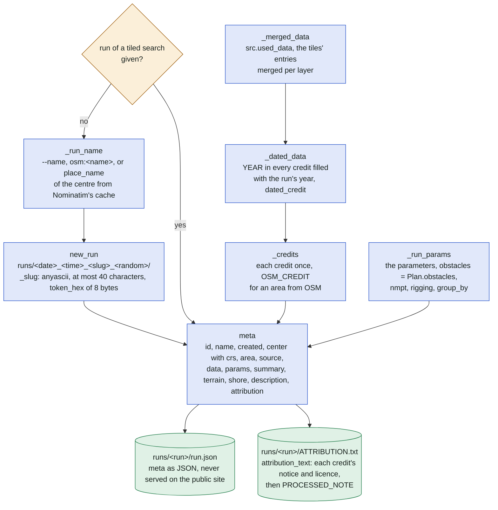
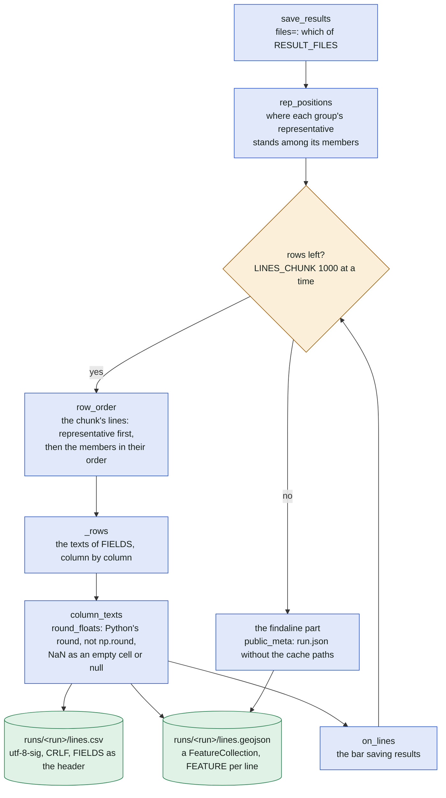
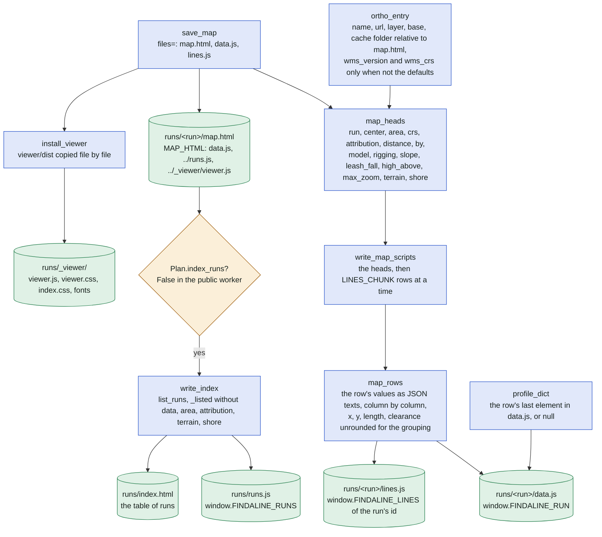
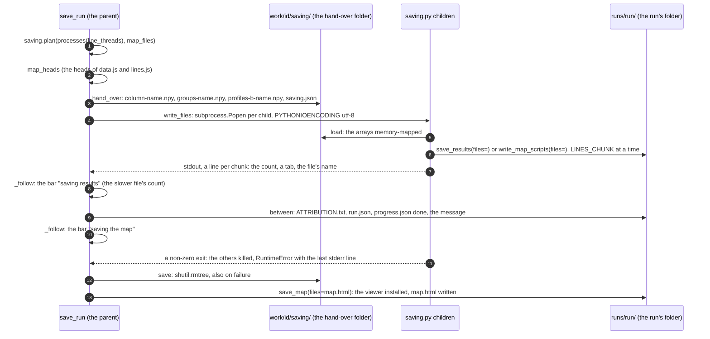
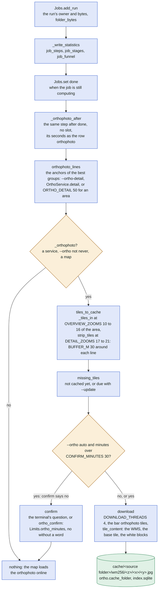
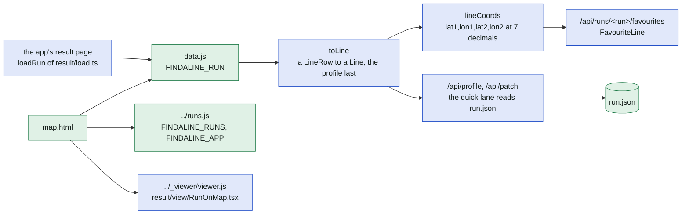

# Step 5: the run and its map

The inside of `search.save_run` ([search.py](../../search.py)), the last step of
[search.md](search.md): the run's folder and its credits, the line files of [runs.py](../../runs.py),
the map of [mapping.py](../../mapping.py), the child processes of [saving.py](../../saving.py) that
write the line files of a large run, the orthophoto of [orthophoto.py](../../orthophoto.py) fetched
after the run, and who reads each file afterwards ([web.py](../../web.py), [jobs.py](../../jobs.py),
the viewer's [result/load.ts](../../viewer/src/result/load.ts), [keys.ts](../../viewer/src/keys.ts)
and [types.ts](../../viewer/src/types.ts)). The credits come from
[sources/credit.py](../../sources/credit.py). The user's view of these files is README's
"Results" ([README.md](../../README.md)); a web job's phases are [web-jobs.md](web-jobs.md).

In plain words: every search gets a folder of its own with a map, a list of the lines, the
settings and the credits of the height data it used. The map is a web page that works from a
plain folder on disk, with the aerial photos of the best spots fetched afterwards so they also
show without internet.

## The run's folder, its record and its credits

`save_run` names the folder, gathers `meta` (what `run.json` holds) and writes the small files.
A tiled search made its folder at its start (`_open_run`) and hands it in as `run`; a circle gets
a new one here.

`run.json` holds `params["obstacles"]` (the rule of `obstacles.RULE` the search applied) and
`terrain` (`hypsometry.statistics` of the land with data), which `profile_of_line` and the viewer's
percentile filters read later. The `data` entries keep the paths of the cached files the run used;
`runs.public_meta` strips them (`without_paths`) for `lines.geojson`, a file meant to be passed on.
For an area (not a circle) `save_run` keeps a profile only for each group's representative before
anything is written (`summary["profiles"]` says "all" or "representatives").

## The line files

`runs.save_results` writes `lines.csv` and `lines.geojson` together, `LINES_CHUNK` (1000) rows at
a time, group by group: each group's representative first, then its other members in their order.
The text is built column by column and equals byte for byte what `csv.DictWriter` and `json.dumps`
of rows of Python values with `round()` wrote (`tests/test_units.py::test_saved_text_as_before`).

The rounding of the columns: anchors at 7 decimals, lengths at 1, clearances, heights and
elevations at 2, angles, prominence and drop at 1 (`_rows`). `ATTRIBUTION.txt` and `run.json` are
written by the same function after the line files (in that order of `RESULT_FILES`), or by the
parent alone when children write the line files (below).

## The map

`mapping.save_map` writes `map.html`, `data.js` and `lines.js`. Both scripts start with a head
(`map_heads`: everything before the lines) and then the lines, `LINES_CHUNK` (1000) at a time
(`write_map_scripts`); a row of `data.js` ends with the line's profile, `null` without one, and a
row of `lines.js` has no profile. The page works from `file://`, so the data is a script, not JSON.

The run's `terrain` is in the heads of both scripts (`RunData.terrain`, `RunLines.terrain` of
`types.ts`), so a map of another run can rank its anchors too. The orthophoto's `cache` entry is
a relative path from `map.html` (`_relative_url`), which is why the `runs` and `cache` folders must
stay where they are; `ortho_entry` is also the 3D view's patch meta. The command line also writes
`findaline_map.html` (`write_latest_redirect`), a page that opens the latest map.

## A large run: the line files by children

With `MIN_LINES` (100 000) lines or more and `processes(line_threads)` of 2 or more (1 below 2
threads, 2 below 4, else 4), `save_run` hands the lines to child processes: one per file with 4,
the results' files apart from the map's with 2 (`plan(count, map_files)`). They are plain
subprocesses (`python saving.py <folder> <run path> <files>`), never `multiprocessing`: the
worker's phase process is daemonic and may not start a pool. Each child writes the same text as
the parent would.

The child imports numpy, `runs` and `mapping` only (never `search`), and `load` gives the same
Python values from the memory-mapped copies (`.tolist()`), so `tests/test_units.py::test_saved_by_children_as_in_process`
and `tests/test_offline.py::test_run_saved_by_children_as_in_process` compare the files byte for
byte with one process's. A failed child keeps `STDERR_LINES` (30) lines of its stderr for the error.

## After the run: the orthophoto and the job's row

The orthophoto for offline use is a step after `save_run`: the command line and `run_search` call
it right after, the web worker after the job is "done", so the page shows the result meanwhile and
the compute slot is free. The map reads a tile from the cache when it is there and loads it online
until then.

The estimate of the download is `ORTHO_SECONDS_PER_TILE` (0.3 s) per tile. In the worker the lines
are released before the orthophoto (`del lines, result`, `gc.collect()`), so the process holds
its imports only and `slot_memory` reserves nothing for it; an error there never touches the job
or its run (a warning event, the map loads online). At the start of `web --public`, `Jobs.adopt_runs`
gives the runs of the folder without a row (saved on the command line or before the accounts) and
the rows without a user (the local app's) to the first administrator, with the local app's
favourites; runs still in progress (no `run.json` yet) are left to their job.

## Who reads what afterwards

| File | Written by | Read by | Served on the public site |
| --- | --- | --- | --- |
| `map.html` | `save_map` (`MAP_HTML`) | the browser: `data.js`, `../runs.js`, `../_viewer/viewer.js` (`viewer/src/map/main.tsx`) | yes, `RUN_FILES` through `RunFiles` (`may_open`: the owner, administrators, anyone for a demo run) |
| `data.js` | `write_map_scripts` | `map.html`; the app's `loadRun` of `result/load.ts` (a script element, `window.FINDALINE_RUN` taken and deleted); `toLine` of `types.ts` reads each `LineRow`, the profile as its last element | yes |
| `lines.js` | `write_map_scripts` | other maps' "Compare" (`window.FINDALINE_LINES[id]`, `others.loadLines`) | yes |
| `lines.csv`, `lines.geojson` | `save_results` | the user: spreadsheets, QGIS; the map's *Download* | yes |
| `ATTRIBUTION.txt` | `save_results` (`attribution_text`) | the user; the map's *notices* link | yes |
| `run.json` | `save_results` | `profile_of_line` and `patch_of_line` through `_run_values` (the run's source, resolution, filling, water, model, rigging and the `obstacles` rule); `web.py`'s line bounds of a profile request; `list_runs`, `adopt_runs`, `may_open` (its presence) | never: the owner's parameters and data paths |
| `progress.json` | `_progress` of a tiled search | `_open_run` to resume the search | never |
| `runs/_viewer/` | `install_viewer` | every map from disk; on the public site `RunFiles` serves `viewer/dist` of the code instead | `_viewer/` for anyone |
| `runs/runs.js`, `runs/index.html` | `write_index` when `Plan.index_runs` | the maps' "Other runs" and the runs page, locally; on the public site `runs.js` is generated per user and `index.html` redirects to the app | generated |
| `cache/.../wm256/` | `orthophoto.download` | the map and the 3D view through `ortho.cache`; `/cache/` is open to anyone | yes |

The favourite lines are keyed by `keys.lineCoords`: `lat1,lon1,lat2,lon2` of a row of `data.js`
or `lines.js`, the anchors as `map_rows` rounds them (7 decimals), so the same line has the same
key on every map and after every reload; a change of that rounding loses everyone's favourites.
`window.FINDALINE_APP` comes from the server's `runs.js` (`profiles`, `favourites`, `esri_key`);
undefined means a map from disk (no profiles, no favourites, no Esri layer).

## Where in the code

| Node | File | Function or name |
| --- | --- | --- |
| run of a tiled search given? | [search.py](../../search.py) | `save_run`, `_open_run`, `search_lines` |
| _run_name | [search.py](../../search.py), [runs.py](../../runs.py) | `_run_name`, `place_name` |
| new_run | [runs.py](../../runs.py) | `new_run`, `_slug` |
| _merged_data | [search.py](../../search.py), [sources/mosaic.py](../../sources/mosaic.py) | `_merged_data`, `used_data` |
| _dated_data | [search.py](../../search.py), [sources/credit.py](../../sources/credit.py) | `_dated_data`, `dated_credit`, `dated`, `YEAR` |
| _credits | [search.py](../../search.py), [sources/credit.py](../../sources/credit.py) | `_credits`, `OSM_CREDIT`, `Credit` |
| _run_params | [search.py](../../search.py) | `_run_params`, `Plan.obstacles` |
| meta | [search.py](../../search.py), [runs.py](../../runs.py) | `save_run`, `params_summary` |
| run.json | [runs.py](../../runs.py) | `save_results`, `RESULT_FILES`, `without_paths`, `public_meta` |
| ATTRIBUTION.txt | [runs.py](../../runs.py), [sources/credit.py](../../sources/credit.py) | `attribution_text`, `PROCESSED_NOTE` |
| save_results | [runs.py](../../runs.py) | `save_results`, `LINES_CHUNK`, `FIELDS` |
| rep_positions, row_order | [runs.py](../../runs.py) | `rep_positions`, `row_order`, `_group_of` |
| _rows | [runs.py](../../runs.py) | `_rows`, `FEATURE` |
| column_texts | [runs.py](../../runs.py) | `column_texts`, `round_floats`, `rounded` |
| lines.csv, lines.geojson | [runs.py](../../runs.py) | `save_results` |
| the findaline part | [runs.py](../../runs.py) | `public_meta` |
| on_lines | [search.py](../../search.py), [progress.py](../../progress.py) | `save_run`, `progress.compute` |
| save_map | [mapping.py](../../mapping.py) | `save_map`, `MAP_FILES`, `MAP_HTML` |
| install_viewer | [mapping.py](../../mapping.py) | `install_viewer`, `VIEWER_DIST`, `VIEWER_FOLDER` |
| map_heads | [mapping.py](../../mapping.py) | `map_heads`, `_script_head` |
| ortho_entry | [mapping.py](../../mapping.py) | `ortho_entry`, `_relative_url` |
| write_map_scripts | [mapping.py](../../mapping.py) | `write_map_scripts`, `LINES_CHUNK` |
| map_rows | [mapping.py](../../mapping.py) | `map_rows` |
| profile_dict | [helpers.py](../../helpers.py) | `profile_dict`, `Profile`, `Profiles` |
| data.js, lines.js, map.html | [mapping.py](../../mapping.py) | `save_map`, `write_map_scripts` |
| Plan.index_runs? | [search.py](../../search.py), [jobs.py](../../jobs.py) | `Plan.index_runs`, `run_phase` |
| write_index | [runs.py](../../runs.py) | `write_index`, `list_runs`, `_listed`, `write_latest_redirect` |
| runs/runs.js, runs/index.html | [runs.py](../../runs.py) | `write_index` |
| saving.plan, processes | [saving.py](../../saving.py), [search.py](../../search.py) | `plan`, `processes`, `MIN_LINES`, `line_threads` |
| hand_over, load | [saving.py](../../saving.py) | `hand_over`, `load`, `FOLDER`, `PROFILE_ARRAYS` |
| write_files, _follow | [saving.py](../../saving.py) | `write_files`, `_follow`, `_read`, `STDERR_LINES` |
| between | [search.py](../../search.py) | `save_run`, `_progress` |
| save | [saving.py](../../saving.py) | `save`, `main` |
| orthophoto_lines | [search.py](../../search.py) | `orthophoto_lines`, `ORTHO_DETAIL` |
| _orthophoto? | [search.py](../../search.py) | `_orthophoto`, `_dated_ortho` |
| tiles_to_cache | [orthophoto.py](../../orthophoto.py) | `tiles_to_cache`, `_tiles_in`, `strip_tiles`, `OVERVIEW_ZOOMS`, `DETAIL_ZOOMS`, `BUFFER_M` |
| missing_tiles | [orthophoto.py](../../orthophoto.py) | `missing_tiles` |
| CONFIRM_MINUTES, confirm | [search.py](../../search.py), [jobs.py](../../jobs.py) | `download_orthophoto`, `CONFIRM_MINUTES`, `ORTHO_SECONDS_PER_TILE`, `ortho_confirm` |
| download | [orthophoto.py](../../orthophoto.py) | `download`, `_download_tile`, `tile_content`, `DOWNLOAD_THREADS` |
| the orthophoto cache | [orthophoto.py](../../orthophoto.py) | `cache_folder`, `tile_path` |
| Jobs.add_run | [jobs.py](../../jobs.py), [runs.py](../../runs.py) | `Jobs.add_run`, `folder_bytes` |
| _write_statistics | [jobs.py](../../jobs.py) | `_write_statistics` |
| Jobs.set done | [jobs.py](../../jobs.py) | `Jobs.set`, `run_phase` |
| _orthophoto_after | [jobs.py](../../jobs.py) | `_orthophoto_after` |
| Jobs.adopt_runs | [jobs.py](../../jobs.py) | `Jobs.adopt_runs` |
| RUN_FILES, RunFiles | [web.py](../../web.py) | `RUN_FILES`, `RunFiles`, `may_open`, `VIEWER` |
| runs.js of the server | [web.py](../../web.py) | `runs_js`, `local_runs_js`, `share_runs_js` |
| loadRun | [viewer/src/result/load.ts](../../viewer/src/result/load.ts) | `loadRun`, `orthoForApp`, `loadRunList` |
| toLine | [viewer/src/types.ts](../../viewer/src/types.ts) | `toLine`, `LineRow`, `RunData`, `RunLines`, `FINDALINE_APP` |
| lineCoords | [viewer/src/keys.ts](../../viewer/src/keys.ts), [viewer/src/favourites.ts](../../viewer/src/favourites.ts) | `lineCoords`, `lineKey`, `favouriteLine` |
| /api/runs/<run>/favourites | [web.py](../../web.py) | `FavouriteLine` |
| /api/profile, /api/patch | [search.py](../../search.py), [jobs.py](../../jobs.py) | `profile_of_line`, `patch_of_line`, `_run_values`, `quick_profile`, `quick_patch` |
| map.html's scripts | [viewer/src/map/main.tsx](../../viewer/src/map/main.tsx) | `RunOnMap` |
