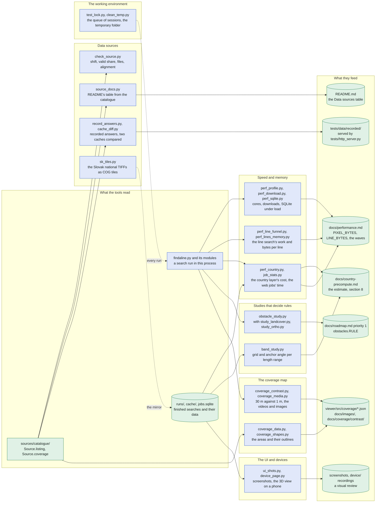
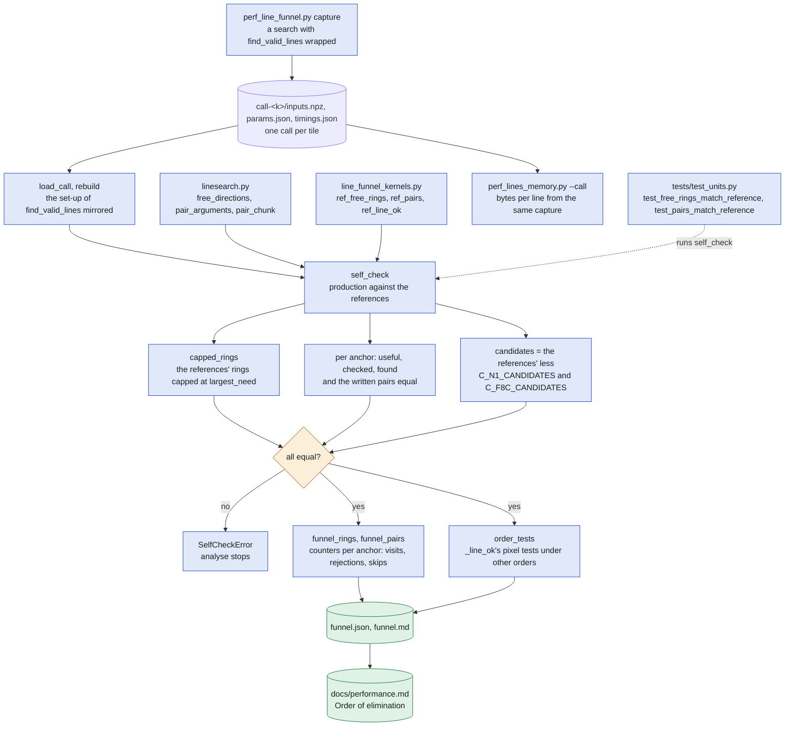
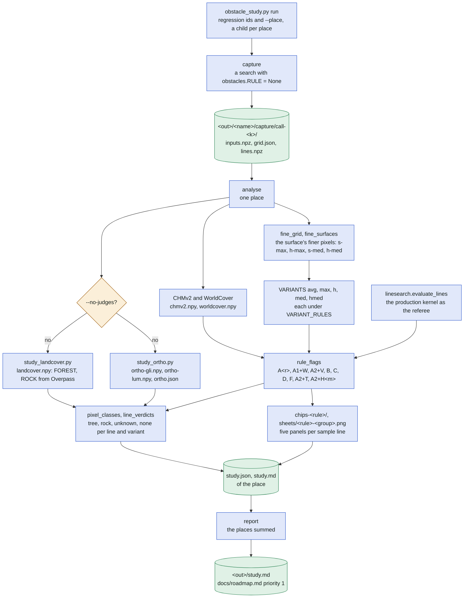
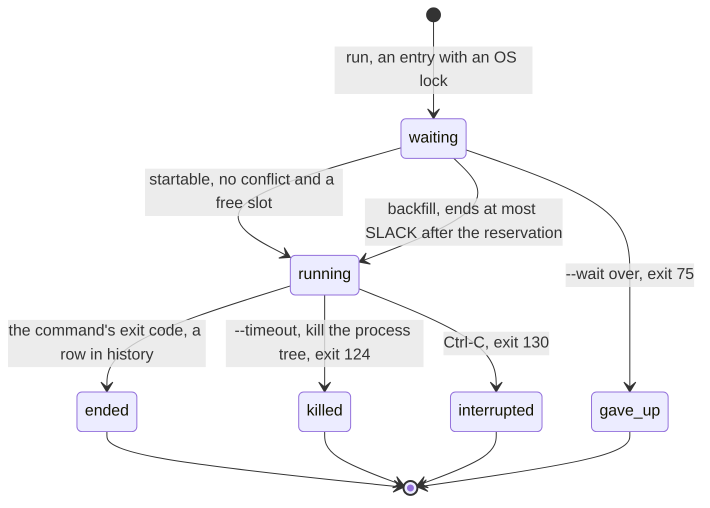

# The tools: what measures, generates and checks what

The scripts of `tools/` are run by hand, by a test or by another tool; none runs inside the app. This
file shows what each one reads, what it writes and which document, generated file or test it feeds:
the measurements of speed and memory ([tools/perf_profile.py](../../tools/perf_profile.py),
[perf_download.py](../../tools/perf_download.py), [perf_sqlite.py](../../tools/perf_sqlite.py),
[perf_lines_memory.py](../../tools/perf_lines_memory.py), [perf_line_funnel.py](../../tools/perf_line_funnel.py)
with [line_funnel_kernels.py](../../tools/line_funnel_kernels.py), [perf_country.py](../../tools/perf_country.py),
[job_stats.py](../../tools/job_stats.py)), the studies that decide rules
([obstacle_study.py](../../tools/obstacle_study.py) with [study_landcover.py](../../tools/study_landcover.py)
and [study_ortho.py](../../tools/study_ortho.py), [band_study.py](../../tools/band_study.py)), the data sources
([check_source.py](../../tools/check_source.py), [source_docs.py](../../tools/source_docs.py),
[record_answers.py](../../tools/record_answers.py), [cache_diff.py](../../tools/cache_diff.py),
[sk_tiles.py](../../tools/sk_tiles.py)), the coverage map's media ([coverage_data.py](../../tools/coverage_data.py),
[coverage_shapes.py](../../tools/coverage_shapes.py), [coverage_contrast.py](../../tools/coverage_contrast.py),
[coverage_media.py](../../tools/coverage_media.py); their detail is in [coverage.md](coverage.md)), the UI and
devices ([ui_shots.py](../../tools/ui_shots.py), [device_page.py](../../tools/device_page.py)) and the working
environment ([test_lock.py](../../tools/test_lock.py), [clean_temp.py](../../tools/clean_temp.py)). It relies on
[docs/performance.md](../performance.md), [docs/regression-tests.md](../regression-tests.md),
[docs/country-precompute.md](../country-precompute.md) (section 8) and [docs/roadmap.md](../roadmap.md)
(priority 1, the obstacle study).

In plain words: beside the program that finds lines there is a drawer of helper scripts. They time the
program, measure its memory, test a new map of heights before it is trusted, decide which rule tells a
tree from a rock, draw the pictures of the coverage map, take screenshots of the pages, and keep several
people working on the same computer from running their tests at once.

## The tools at a glance

"Run by": by hand (a developer at the keyboard), by a test (`pytest` calls it or compares its output), by
another tool, or by CI. A test named in the last column tests the tool itself; every script's entry point
is also read by `tests/test_entry_points.py`.

| Tool | Run by | Inputs | Outputs | Feeds | Test |
| --- | --- | --- | --- | --- | --- |
| [perf_profile.py](../../tools/perf_profile.py): cores and memory of a search per stage | by hand; by `perf_country.py` | a search's options after `--`; `--cores N`, `--memory BYTES`, `--tracemalloc` | `<out>/<name>.csv`, `<name>-stages.csv`, `<name>.png` | docs/performance.md (`search.PIXEL_BYTES`, the tiles' size) | entry point only |
| [perf_download.py](../../tools/perf_download.py): the download phase with N threads on an empty cache | by hand | `--osm-from cache/osm`, `--threads`, the search's options | wall time, MB, MB/s, CPU time (printed); data folders under `--out` | docs/performance.md section 2 | entry point only |
| [perf_sqlite.py](../../tools/perf_sqlite.py): `jobs.sqlite` under K jobs and M pages | by hand | `--jobs`, `--pages`, `--seconds`, `--burst` | latencies, events per second, the database's and WAL's size (printed) | docs/performance.md section 3 | entry point only |
| [perf_lines_memory.py](../../tools/perf_lines_memory.py): bytes per line of steps 3, 4 and 5 | by hand | `--call` (a capture of `perf_line_funnel.py`) or `--tiles` (a tiled run's tiles), `--repo` | bytes per line per stage (printed, `--json`) | docs/performance.md, `search.LINE_BYTES` | entry point only |
| [perf_line_funnel.py](../../tools/perf_line_funnel.py): where the line search's work goes | by hand; `self_check` by tests | `capture`: the search's options; `analyse`: `call-<k>/` folders | `call-<k>/inputs.npz`, `params.json`, `timings.json`; `funnel.json`, `funnel.md` | docs/performance.md "Order of elimination"; the pinned kernels | tests/test_perf_line_funnel.py, tests/test_units.py |
| [line_funnel_kernels.py](../../tools/line_funnel_kernels.py): the frozen reference kernels and the counting copies | by `perf_line_funnel.py`; by tests | the kernels' arguments | `ref_*` results, the counters | the self-check of `analyse` | tests/test_units.py |
| [perf_country.py](../../tools/perf_country.py): the country layer's cost (`bench`, `profile`, `compare`, `cube`, `relief`, `estimate`) | by hand | the Żabi Koń clip; a search's options; `samples.json`; `inputs.json`; Copernicus GLO-30 | `bench.json`, `samples.json`, the relief JSON, the estimate (`--json`) | docs/country-precompute.md | tests/test_perf_country.py |
| [job_stats.py](../../tools/job_stats.py): the computing time of the finished web searches | by hand, also on the VPS host | `--db jobs.sqlite` (`--immutable`, `--days`, `--phases`) | tables printed, `--csv` | docs/performance.md rounds 3 and 4; docs/monitoring.md F19 | tests/test_job_stats.py |
| [obstacle_study.py](../../tools/obstacle_study.py): which rule tells trees from rock (`run`, `capture`, `analyse`, `report`) | by hand | regression ids or `--place NAME=OPTIONS`, the cache (`--cache`) | `<out>/<name>/capture/`, `study.json`, `study.md`, `chips-<rule>/`, `sheets/`; `<out>/study.md` | docs/roadmap.md priority 1 → `obstacles.RULE` | tests/test_obstacle_study.py |
| [study_landcover.py](../../tools/study_landcover.py): OSM's land cover on a captured grid | by `obstacle_study.py`; by hand | `call-<k>/grid.json`; the theme `landcover` (Overpass) | `landcover.npy` | the study's judges | tests/test_study_landcover.py |
| [study_ortho.py](../../tools/study_ortho.py): the orthophoto's greenness as a judge | by `obstacle_study.py` | `grid.json`, the lines, the orthophoto cache | `ortho-gli.npy`, `ortho-lum.npy`, `ortho.json` | the study's judges | tests/test_study_ortho.py |
| [band_study.py](../../tools/band_study.py): the grid and anchor angle per length range (`setup`, `analyse`) | by hand (the counting by `findaline.py country run`) | `AREAS`, `BANDS`, `PAIRS`; `countries/<id>/` tiles and cube | `countries/<id>/country.json`; `study.json`, `study.md`, `pictures/<area>-<variant>.png` | docs/country-precompute.md section 8 | tests/test_band_study.py |
| [check_source.py](../../tools/check_source.py): the data checks of a new source | by hand | a source id, `--lat`, `--lon`, a scratch `--data-dir`; a reference (FABDEM, Copernicus or a file) | PASS/WARN/FAIL per check, `--json` | docs/regression-tests.md "Data checks for a new source or download path" | tests/test_check_source.py |
| [source_docs.py](../../tools/source_docs.py): README's "Data sources" table | by hand; `--check` by a test | `sources/catalogue/` (`Source.listing`) | README.md (the table and the `--source` ids) | README.md | tests/test_catalogue.py `test_docs_list_every_source` |
| [record_answers.py](../../tools/record_answers.py): recorded answers of the index services | by hand | a layer's index of one 0.25° tile (`RECIPES`) | `tests/data/recorded/<interface>/<case>/` (`answers.json`, the bodies, `expected.json`) | tests/test_parts.py through tests/http_server.py | tests/test_parts.py |
| [cache_diff.py](../../tools/cache_diff.py): two cache folders compared | by hand | two cache folders (`--only`, `--ignore`) | the differences, exit 1 | a refactoring of `sources/` | entry point only |
| [sk_tiles.py](../../tools/sk_tiles.py): the Slovak national TIFFs as 2 km COG tiles (`download`, `extract`, `cut`, `upload`) | by hand | ÚGKK SR's ZIPs | `<product>/1m/<block>/<E>_<N>.tif`, `index.json`, the dataset card (the mirror) | `SLOVAK_TILES` of `sources/catalogue/slovakia.py` | entry point only |
| [coverage_data.py](../../tools/coverage_data.py): the coverage map's data | by hand; `--check` by a test | `Source.coverage` of the catalogue | `viewer/src/coverage/coverage.json` | the coverage map | tests/test_coverage.py |
| [coverage_shapes.py](../../tools/coverage_shapes.py): the coverage map's outlines | by hand | Natural Earth (downloaded, sha256 pinned), `CUT`, `SMALL_KM2` | `viewer/src/coverage/shapes.json` | the coverage map | tests/test_coverage.py |
| [coverage_contrast.py](../../tools/coverage_contrast.py): 30 m against 1 m at famous places (`search`, `write`) | by hand | `PLACES`, `RADIUS`, `THRESHOLD`, `MATCH_RADIUS`; the national data | `docs/coverage/contrast/` (hillshades, spots, `contrast.json`) | the coverage map's animations; docs/roadmap.md priority 2 | entry point only |
| [coverage_media.py](../../tools/coverage_media.py): the videos, GIFs, images and poster (`video`, `gif`, `images`, `all`, `readme`) | by hand | the media bundle (`node build.mjs --media`), `contrast/`, `--music` | MP4, GIF, PNG, PDF; `readme` into `docs/images/` | README.md, docs/images/ | tests/test_coverage_media.py |
| [ui_shots.py](../../tools/ui_shots.py): screenshots of every page on a desktop and two phones | by hand | `PAGES`, `DEVICES`, `--dark`; a scratch public site | `<page>-<device>-<theme>.png` | a visual review of a UI change | entry point only |
| [device_page.py](../../tools/device_page.py): the 3D view on a real phone (`record`, `serve`, `measure`) | by hand | the runs of a data folder; the local app in-process; the LAN | `<folder>/device/index.json` and the answers; the HTTPS page; the rows per open (`--json`) | docs/3d-view-contract.md "Wave 4" | tests/test_device_page.py |
| [test_lock.py](../../tools/test_lock.py): the queue of parallel sessions (`run`, `status`) | by hand; by agents | a command, `--exclusive`, `--resource`, `--expect`, `--first` | the queue `<git common dir>/findaline-locks/` (`entries`, `history`) | every test, build and search run in parallel | tests/test_test_lock.py |
| [clean_temp.py](../../tools/clean_temp.py): what tests and sessions left in the temporary folder | by hand | the system's temporary folder, `KINDS`, `--hours`, `--session-hours` | the list by kind, or the folders removed (`--delete`) | the working environment | tests/test_clean_temp.py |

## 1. From the code and the runs to the documents

What every tool reads and what it writes, grouped by purpose. The small tools of a group share a node.

## 2. The line funnel: a capture analysed against the frozen kernels

`perf_line_funnel.py capture` saves the inputs of every selected `find_valid_lines` call of a search;
`analyse` rebuilds the kernels' arguments and first proves that production still gives the references'
results, then counts where the work goes. The references are copies of `linesearch.py` at 975a1b7 and
never change; they change only by a decision that the counters may change.

What the self-check pins: the rings must be the references' capped at `linesearch.largest_need` (every
decision compares a ring with a need up to it); the useful anchors, the checked and found counts per anchor
and the written pairs must be equal; the candidates must be the references' less the pairs that N1 and F8c
skip (they fail the rings' test, which comes after the count). A faster kernel may skip only pairs that fail
before `_line_ok`, because the order of the found pairs carries into `lines.csv`.

## 3. The obstacle study: a place captured, judged and reported

`obstacle_study.py run` searches each place in a child process with the raw surface (`obstacles.RULE = None`),
then `analyse` tries every candidate rule on every surface variant and asks three judges what stands on the
pixels a line crosses above its limit; `report` sums the places. The rule chosen is `obstacles.RULE`.

The judges: OSM's land cover (`study_landcover.py`, one Overpass query per new 0.25° tile under
`osm.OVERPASS_DAY_MAX` 75), the orthophoto's green leaf index and luminance (`study_ortho.py`, the threshold
`tau` set on the sure forest and rock of the place, none under `MIN_PIXELS` 50) and Meta/WRI's CHMv2 with ESA
WorldCover (range requests, off with `--offline`). A pixel is a tree only on terrain gentler than `TREE_SLOPE`
or where CHMv2 reaches `TREE`.

## 4. The test lock: a command in the queue of parallel sessions

`test_lock.py run -- <command>` puts an entry into one first-come-first-served queue (SQLite in the git
common directory, an OS lock per entry) and starts the command when `startable` admits it. Shared commands
take one of `SLOTS` (6) slots below the normal priority with their threads capped to cores / `THREAD_SHARE`
(3); an exclusive one runs alone at the normal priority; a resource (`data`, `docker`, `opentopo`) is held by
one command at a time.

| In the queue | Rule |
| --- | --- |
| Conflict | two entries conflict when either is `exclusive` or they share a resource (`conflicts`) |
| Shared slot | at most `SLOTS` running shared commands, each at `NICE` 10 below the normal priority with `THREAD_VARS` capped to cores / `THREAD_SHARE` |
| Order | a command waits for every earlier waiting one it conflicts with; `--first` waits ahead of the waiting ones, never of a running one |
| Reservation | the time the last running command that did not pass a waiting one is expected to end |
| Backfill | a later command passes a waiting one when it is expected to end at most `SLACK` (120 s) after that reservation; those that passed it never move it |
| Estimate | `--expect`, else the longest of the last `SAME_RUNS` (5) runs of the same command, else the 90th percentile of the last `KIND_RUNS` (10) of its kind, from the table `history` (`HISTORY_ROWS` 2000 kept); to pass, the longest of its kind's last runs |
| Defaults | `--timeout` from `TIMEOUT` (3600 s shared, 3 × 3600 s exclusive), `--wait` `WAIT` (4 × 3600 s), the queue looked at every `POLL` (2 s) |

## Where in the code

| Node | File | Function or name |
| --- | --- | --- |
| code | [findaline.py](../../findaline.py) | the command line, run in the tool's process |
| stores | [cache.py](../../cache.py), [jobs.py](../../jobs.py) | `runs/`, `cache/`, `jobs.sqlite` |
| catalogue | [sources/catalogue/__init__.py](../../sources/catalogue/__init__.py), [sources/source.py](../../sources/source.py) | `SOURCES`, `Source.listing`, `Source.coverage` |
| profile | [tools/perf_profile.py](../../tools/perf_profile.py), [tools/perf_download.py](../../tools/perf_download.py), [tools/perf_sqlite.py](../../tools/perf_sqlite.py) | `main` |
| funnel | [tools/perf_line_funnel.py](../../tools/perf_line_funnel.py), [tools/perf_lines_memory.py](../../tools/perf_lines_memory.py) | `capture`, `analyse`; `main` |
| country | [tools/perf_country.py](../../tools/perf_country.py), [tools/job_stats.py](../../tools/job_stats.py) | `bench`, `profile`, `compare`, `cube`, `relief`, `estimate`; `main` |
| obstacle | [tools/obstacle_study.py](../../tools/obstacle_study.py) | `run`, `capture`, `analyse`, `report` |
| band | [tools/band_study.py](../../tools/band_study.py) | `setup`, `analyse`; `AREAS`, `BANDS`, `PAIRS`, `TOLERANCE` |
| check | [tools/check_source.py](../../tools/check_source.py) | `main` |
| docs | [tools/source_docs.py](../../tools/source_docs.py) | `render`, `ids`, `--check` |
| record | [tools/record_answers.py](../../tools/record_answers.py), [tools/cache_diff.py](../../tools/cache_diff.py) | `RECIPES`; `main` |
| sk | [tools/sk_tiles.py](../../tools/sk_tiles.py) | `download`, `extract`, `cut`, `upload`; `PRODUCTS` |
| covdata | [tools/coverage_data.py](../../tools/coverage_data.py), [tools/coverage_shapes.py](../../tools/coverage_shapes.py) | `render`, `areas_of`; `CUT`, `SMALL_KM2` |
| covmedia | [tools/coverage_contrast.py](../../tools/coverage_contrast.py), [tools/coverage_media.py](../../tools/coverage_media.py) | `search`, `write`; `STORIES`, `GROUPS` |
| shots | [tools/ui_shots.py](../../tools/ui_shots.py), [tools/device_page.py](../../tools/device_page.py) | `PAGES`, `DEVICES`; `record`, `serve`, `measure` |
| lock | [tools/test_lock.py](../../tools/test_lock.py), [tools/clean_temp.py](../../tools/clean_temp.py) | `run`, `status`, `startable`; `KINDS` |
| perfdoc | [docs/performance.md](../performance.md) | `search.PIXEL_BYTES`, `search.LINE_BYTES` |
| countrydoc | [docs/country-precompute.md](../country-precompute.md) | section 8, "The band study" |
| roadmap | [docs/roadmap.md](../roadmap.md), [obstacles.py](../../obstacles.py) | priority 1; `RULE` |
| readme | [README.md](../../README.md) | the "Data sources" table, the `--source` row |
| recorded | [tests/data/recorded/](../../tests/data/recorded/), [tests/http_server.py](../../tests/http_server.py) | `answers.json`, `expected.json` |
| covfiles | [viewer/src/coverage/](../../viewer/src/coverage/), [docs/images/](../images/), [docs/coverage/contrast/](../coverage/contrast/) | `coverage.json`, `shapes.json`, `contrast.json` |
| review | [tools/ui_shots.py](../../tools/ui_shots.py), [tools/device_page.py](../../tools/device_page.py) | `<page>-<device>-<theme>.png`, `<folder>/device/index.json` |
| capture (funnel) | [tools/perf_line_funnel.py](../../tools/perf_line_funnel.py) | `capture`, `save_call` |
| call | [tools/perf_line_funnel.py](../../tools/perf_line_funnel.py) | `inputs.npz`, `params.json`, `timings.json` |
| rebuild | [tools/perf_line_funnel.py](../../tools/perf_line_funnel.py) | `load_call`, `rebuild` |
| prod | [linesearch.py](../../linesearch.py) | `free_directions`, `pair_arguments`, `pair_chunk` |
| refs | [tools/line_funnel_kernels.py](../../tools/line_funnel_kernels.py) | `ref_free_rings`, `ref_pairs`, `ref_line_ok`, `ref_sector` |
| check (funnel) | [tools/perf_line_funnel.py](../../tools/perf_line_funnel.py) | `self_check`, `production_directions`, `production_args` |
| rings | [tools/perf_line_funnel.py](../../tools/perf_line_funnel.py), [linesearch.py](../../linesearch.py) | `capped_rings`, `largest_need` |
| counts | [tools/perf_line_funnel.py](../../tools/perf_line_funnel.py) | `self_check` |
| cands | [tools/line_funnel_kernels.py](../../tools/line_funnel_kernels.py) | `C_N1_CANDIDATES`, `C_F8C_CANDIDATES` |
| ok, stop | [tools/perf_line_funnel.py](../../tools/perf_line_funnel.py) | `SelfCheckError` |
| work | [tools/line_funnel_kernels.py](../../tools/line_funnel_kernels.py) | `funnel_rings`, `funnel_pairs` |
| orders | [tools/line_funnel_kernels.py](../../tools/line_funnel_kernels.py) | `order_tests`, `counted_line_ok`, `line_fails` |
| out | [tools/perf_line_funnel.py](../../tools/perf_line_funnel.py) | `analyse`: `funnel.json`, `funnel.md` |
| doc | [docs/performance.md](../performance.md) | "Order of elimination" |
| memory | [tools/perf_lines_memory.py](../../tools/perf_lines_memory.py) | `--call` |
| tests | [tests/test_units.py](../../tests/test_units.py) | `test_free_rings_match_reference`, `test_pairs_match_reference`, `test_line_ok_matches_reference` |
| run | [tools/obstacle_study.py](../../tools/obstacle_study.py) | `run` |
| capture (study) | [tools/obstacle_study.py](../../tools/obstacle_study.py), [obstacles.py](../../obstacles.py) | `capture`; `RULE` |
| files | [tools/obstacle_study.py](../../tools/obstacle_study.py) | `capture`: `grid.json`, `lines.npz` |
| analyse | [tools/obstacle_study.py](../../tools/obstacle_study.py) | `analyse`, `analyse_call` |
| fine | [tools/obstacle_study.py](../../tools/obstacle_study.py) | `fine_grid`, `fine_surfaces`, `FINE_FILES` |
| variants | [tools/obstacle_study.py](../../tools/obstacle_study.py) | `VARIANTS`, `VARIANT_RULES`, `OVER_AVG_RULE` |
| rules | [tools/obstacle_study.py](../../tools/obstacle_study.py) | `rule_flags`, `HEIGHT_CAPS` |
| kernel | [linesearch.py](../../linesearch.py) | `evaluate_lines` |
| outside | [tools/obstacle_study.py](../../tools/obstacle_study.py) | `chmv2.npy`, `worldcover.npy`; `--offline` |
| judges | [tools/obstacle_study.py](../../tools/obstacle_study.py) | `judge_layers`, `--no-judges` |
| landcover | [tools/study_landcover.py](../../tools/study_landcover.py) | `landcover_on_grid`, `write_landcover`; `NONE`, `FOREST`, `ROCK` |
| ortho | [tools/study_ortho.py](../../tools/study_ortho.py) | `greenness_on_grid`, `threshold`, `write_greenness`; `ZOOM`, `MIN_PIXELS` |
| verdicts | [tools/obstacle_study.py](../../tools/obstacle_study.py) | `pixel_classes`, `line_verdicts`; `TREE_SLOPE`, `TREE`, `ANCHOR_NEAR` |
| chips | [tools/obstacle_study.py](../../tools/obstacle_study.py) | `chips_dir`, `contact_sheet`, `VERDICT_GROUPS` |
| study | [tools/obstacle_study.py](../../tools/obstacle_study.py) | `analyse`: `study.json`, `study.md` |
| report | [tools/obstacle_study.py](../../tools/obstacle_study.py) | `report` |
| doc (study) | [docs/roadmap.md](../roadmap.md) | priority 1 |
| waiting, running, ended, killed, interrupted, gave_up | [tools/test_lock.py](../../tools/test_lock.py) | `run`, `startable`, `Entry.started`; exit codes 75, 124, 130 |
| the lock's constants | [tools/test_lock.py](../../tools/test_lock.py) | `SLOTS`, `THREAD_SHARE`, `NICE`, `SLACK`, `POLL`, `TIMEOUT`, `WAIT`, `SAME_RUNS`, `KIND_RUNS`, `HISTORY_ROWS`, `THREAD_VARS`, `conflicts` |
