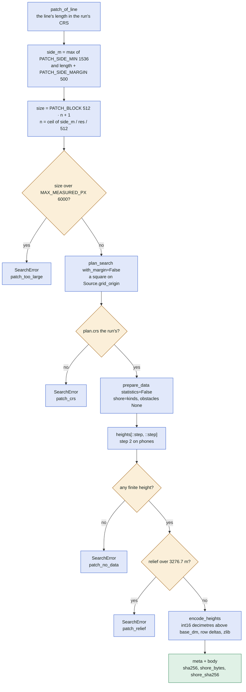
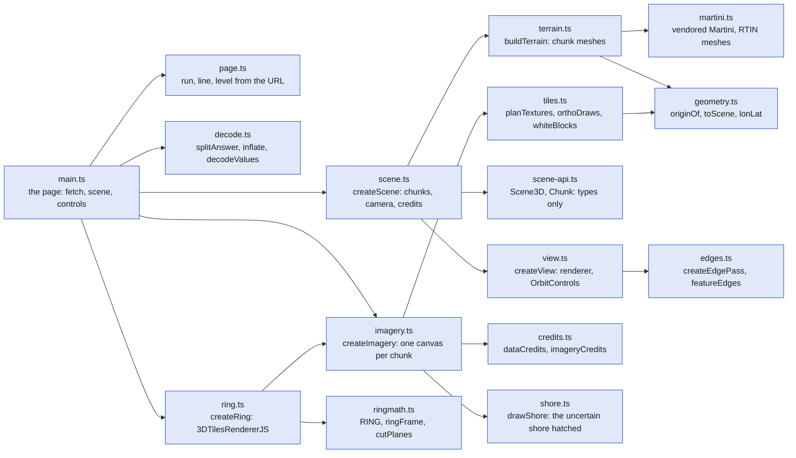
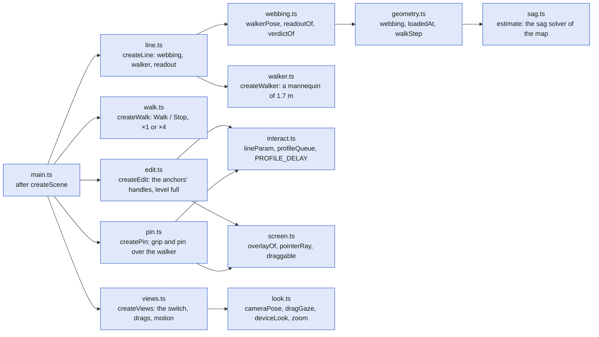
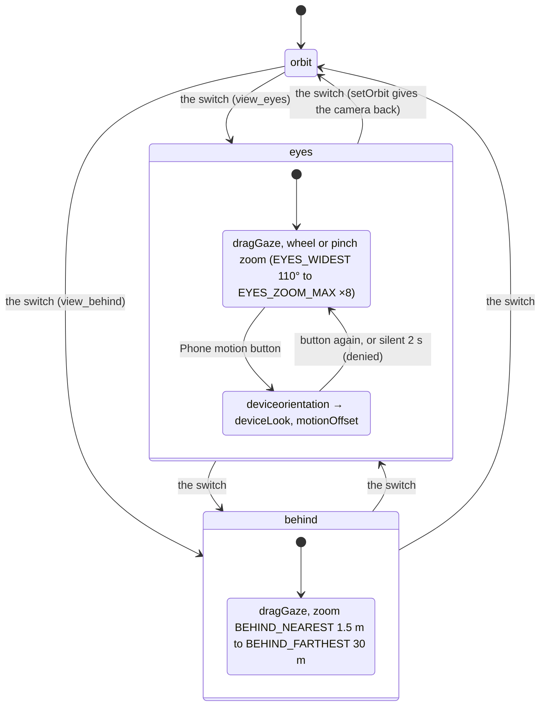
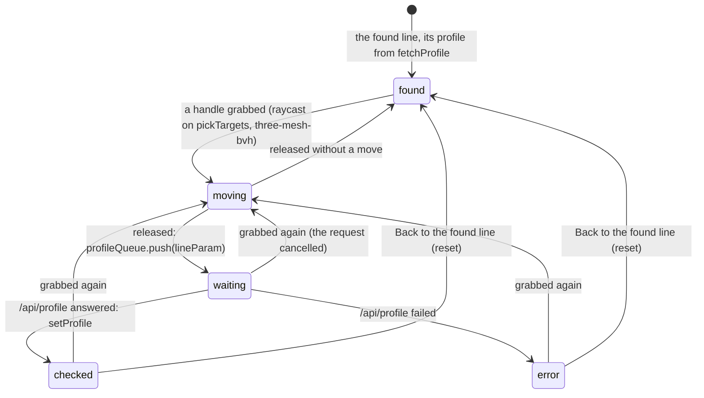
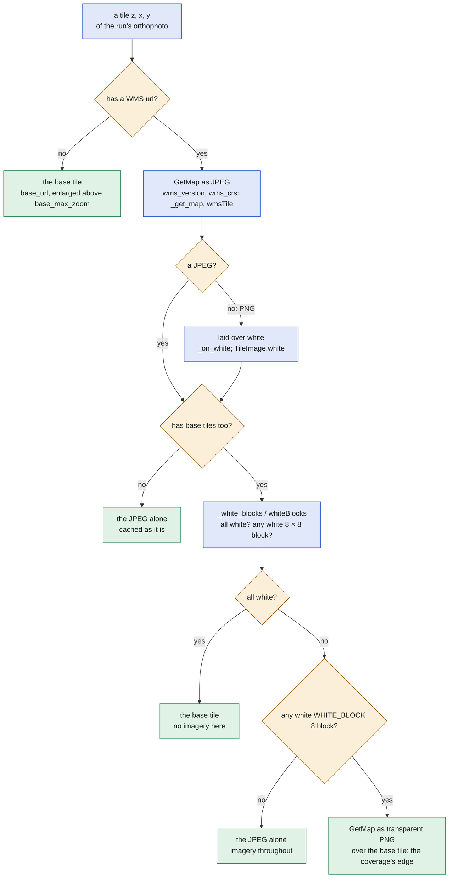

# The 3D view of a line

How a line's "3D view" button becomes a scene in the browser: the page `/view3d`, the terrain patch
`/api/patch` computed by the worker's quick lane, the page's modules, its views and controls, and the
orthophoto composition it shares with the 2D map. Modules: [web.py](../../web.py) (`/view3d`,
`/api/patch`, `patch_body`, `page_csp`, `PAGE_PERMISSIONS`, `ortho_origins`), [jobs.py](../../jobs.py)
(`quick_patch`, `run_quick`), [search.py](../../search.py) (`patch_of_line`, `encode_heights`,
`encode_shore`, `profile_of_line`), [orthophoto.py](../../orthophoto.py) (`tile_content`,
`_white_blocks`), [viewer/src/view3d/](../../viewer/src/view3d/) and the reference encoder
[tests/data/make_patch_fixture.py](../../tests/data/make_patch_fixture.py). The contract of the format
and every decision: [docs/3d-view-contract.md](../3d-view-contract.md); the research:
[docs/3d-view.md](../3d-view.md). The quick lane itself is drawn in [web-jobs.md](web-jobs.md), the
search that made the run in [search.md](search.md).

In plain words: the page asks the server for a square of heights around the line, about one and a half
kilometres wide, packed so it travels fast, and builds a relief from it with the webbing strung between
the anchors and a small walker on it. Then it lays the aerial imagery over the relief, asks for the
line's profile to colour the webbing, and lets the reader orbit, look through the walker's eyes, walk
the line or, on a desktop, drag the anchors somewhere else.

## 1. From the button to the decoded patch

The sequence from the result view's button to the heights in the page's memory. The checks of
`/api/patch` run in the order of `/api/profile`; the patch is computed in the worker's quick lane
(one task at a time), never in the web process.

```mermaid
sequenceDiagram
    autonumber
    participant A as App: LineDetails.tsx
    participant P as Page: view3d.js
    participant W as web.py
    participant J as jobs.sqlite (table quick)
    participant Q as worker: run_quick

    A->>W: GET /view3d#run=id&line=lat1,lon1,lat2,lon2 (view3dOf)
    W-->>A: VIEW3D_HTML: metas findaline-user, findaline-esri-key, findaline-3d-ring
    Note over W: guard adds page_csp (ring on: connect-src + ring_origin, ESRI_TILES_ORIGIN, ortho_origins), PAGE_PERMISSIONS, no-store
    P->>P: currentPage: ?level=phone|full, else pointer coarse → phone
    P->>W: GET /api/patch?run&line&step=1|2, header X-Findaline-Patch (patchUrl)
    W->>W: run_access, current_user, four finite numbers, step 1 or 2
    W->>W: public: profile_problem(patch=True): patch_outside, patch_admin_only; within_rate "patch"
    W->>J: quick_add("patch")
    loop every QUICK_POLL, at most QUICK_WAIT_MAX
        W->>J: quick_take
    end
    Q->>J: claim the task (QUICK["patch"] = quick_patch)
    Q->>Q: runs/id/run.json, Paths work/profiles/uuid
    Q->>Q: patch_of_line: plan_search(geometry=square), prepare_data(shore="kinds"), obstacles None
    Q->>Q: encode_heights, encode_shore, meta (anchors, affine, ortho_entry, attribution, sha256)
    Q->>J: quick_answer {meta, heights base64url} (Redact.RAW keeps heights)
    W->>W: patch_body: sha256 checked (500 patch_damaged), uint32 N | meta | body
    W-->>P: application/octet-stream
    P->>P: splitAnswer, sha256 (crypto.subtle), inflate (DecompressionStream deflate)
    P->>P: decodeValues (int16 deltas wrapped), toHeights (NaN, padded to 512·k + 1)
```

The size of the patch and its refusals are decided in `patch_of_line`:



## 2. From the patch to the first frame

What the page does once the patch is decoded: the meshes, the first frame, then the imagery, the ring
and the profile. The terrain is drawn before the profile arrives; the webbing stays neutral until then.

```mermaid
sequenceDiagram
    autonumber
    participant P as Page: main.ts
    participant T as terrain.ts + martini.ts
    participant S as scene.ts / view.ts
    participant I as imagery.ts + tiles.ts
    participant R as ring.ts
    participant W as web.py
    participant X as outside: orthophoto WMS, Esri, Mapterhorn

    P->>S: createScene(patch, level)
    S->>T: buildTerrain(MAX_ERROR[level], VERTEX_BUDGET[level])
    T->>T: forcedSamples: the anchors and the line's footprint
    T->>T: chunkTile per 513 × 513 chunk, one shared Martini(513)
    T->>T: chunkMesh with skirts; error × 1.5 until vertices fit the budget
    S->>S: createView: renderer, OrbitControls, drawn on demand (invalidate)
    P->>P: createLine (webbing from sag.ts), createWalk, createPin, createEdit (level full), createViews
    S-->>P: onDrawn: the first frame
    P->>I: createImagery: available = ortho? esri (key)? shaded, edges (edgesSupported)?
    I->>I: planTextures: LINE_ZOOM 19 on the line's chunks at level full, else OVERVIEW_ZOOM 17, within BUDGET
    I->>W: GET /cache/… (cacheFirst: zoom ≤ 16, or the corridor CORRIDOR_M 60 along the line)
    I->>X: else the service: orthoComposed or orthoLayers, esriDraws (never cached)
    P->>R: createRing(url) when ringUrl() is not "off" (meta findaline-3d-ring)
    R->>X: TilesRenderer + TerrariumMeshPlugin: FINDALINE_3D_RING_URL tiles, RING[level].radius
    P->>W: GET /api/profile?run&line, header X-Findaline-Profile (fetchProfile)
    W-->>P: the profile (quick lane: profile_of_line)
    P->>P: edit.found → line.setProfile: readoutOf, VERDICT_COLOUR; root data-ready
```

## 3. The page's modules

What feeds what among the modules of `viewer/src/view3d/`. Pure modules (no DOM, no three.js: tested
in Node) are the ones the others compute with; the arrows point from a module to the one it imports.
First the data and the scene.



Then the line, the walker and the controls, all made by `main.ts` once the scene exists.



## 4. The views and the controls

The three views of `views.ts` (`VIEWS`: orbit, eyes, behind) and the phone's motion. The orbit view is
the default and the only one where anchors are dragged; the walker's views place the camera from the
walker's pose before every frame (`look.ts cameraPose`), so they draw on demand like the rest.



| Control | Where | What it does | Pure part |
| --- | --- | --- | --- |
| Orbit | `view.ts` `OrbitControls` | three.js orbit around the line; the camera as left when a walker view is entered | none |
| Walker's eyes | `views.ts`, `look.ts` | the camera `EYE_HEIGHT` 1.6 m over the walker's feet on the loaded webbing; the mannequin, pin and grip hidden; horizontal angle 60° by default | `cameraPose`, `cameraFov`, `verticalFov` |
| Behind the walker | `views.ts`, `look.ts` | the camera `BEHIND_DISTANCE` 5 m behind the walker, at least `BEHIND_CLEARANCE` 1 m above the terrain | `cameraPose`, `behindDistance` |
| Looking around | `views.ts` | a drag on the canvas turns the gaze, the pitch clamped | `dragGaze`, `clampGaze` |
| Zoom | `views.ts` | wheel, two-finger pinch, +/- buttons; each view keeps its zoom | `zoomRange`, `zoomStep`, `wheelFactor`, `pinchFactor` |
| Phone motion | `views.ts` | shown where `DeviceOrientationEvent` exists and the pointer is coarse; iOS `requestPermission` inside the click; readings stay in the page (`web.PAGE_PERMISSIONS` allows the sensors to `/view3d` only) | `deviceLook`, `motionOffset`, `MOTION_DEADBAND` |
| Walker's slider, Walk / Stop | `line.ts`, `walk.ts` | the walker along the span; the walk at `WALK_SPEED` 1 m/s or `SPEEDS` ×4, none under `prefers-reduced-motion` | `walkStep`, `walkFrom` |
| Grip and pin | `pin.ts` | drag the walker along the line (level full); a pin above a walker under `PIN_BELOW_PX` 20 px | `nearestOnSegment`, `pinShown` |
| Imagery switch | `imagery.ts` | ortho, esri, shaded, edges: the available kinds, the first the default | `planTextures` |

The anchors' editing (`edit.ts`, at level full only, in the orbit view): the root's `data-edit` names
the state. A release sends the moved line to `/api/profile` through `interact.ts profileQueue`
(`PROFILE_DELAY` 300 ms, one request in flight, the newest wins); "Back to the found line" brings back
the found anchors and their profile. Nothing is saved.



## 5. The orthophoto composed as on the 2D map

A WMS over base tiles is composed the same way by the server for the 2D map's cache
(`orthophoto.tile_content`, `_white_blocks`) and by the page in the browser (`tiles.ts orthoComposed`,
`whiteBlocks`; `imagery.ts drawComposed`). The server's test of white is a grey of exactly 255; the
browser's every channel at least `WHITE_MIN` 250, since browsers' JPEG decoders differ by a few levels.
The page tries our cache first where it can hold the tile (`cacheFirst`), then the service.



On the server the result is written to the cache as JPEG (`_download_tile`); in the page it is drawn
onto the chunk's canvas (`compose`) and a JPEG that fails to load or whose pixels cannot be read takes
the base with the PNG over it. Esri's tiles are never cached (`esriDraws`: its terms).

## Where in the code

| Node | File | Function or name |
| --- | --- | --- |
| LineDetails.tsx, view3dOf | [viewer/src/result/view/LineDetails.tsx](../../viewer/src/result/view/LineDetails.tsx), [viewer/src/app/d/AppD.tsx](../../viewer/src/app/d/AppD.tsx) | `view3dOf` |
| GET /view3d, VIEW3D_HTML | [web.py](../../web.py) | `view3d`, `VIEW3D_HTML`, `key_meta` |
| guard, page_csp, PAGE_PERMISSIONS | [web.py](../../web.py) | `guard`, `page_csp`, `PAGE_CSP`, `PAGE_PERMISSIONS`, `ESRI_TILES_ORIGIN`, `ortho_origins`, `cache_control` |
| ring_origin, FINDALINE_3D_RING_URL | [settings.py](../../settings.py) | `ViewSettings.ring`, `ring_url`, `ring_origin` |
| currentPage, patchUrl | [viewer/src/view3d/page.ts](../../viewer/src/view3d/page.ts) | `parsePage`, `currentPage`, `patchUrl`, `backUrl` |
| GET /api/patch, profile_problem, within_rate | [web.py](../../web.py) | `line_patch`, `profile_problem`, `ADMIN_SOURCES`, `within_rate`, `run_access`, `current_user` |
| quick, quick_add, quick_take, QUICK_POLL, QUICK_WAIT_MAX | [web.py](../../web.py), [jobs.py](../../jobs.py) | `quick`, `QUICK_POLL`, `QUICK_WAIT_MAX`, `Jobs.quick_add`, `Jobs.quick_take`, `Jobs.quick_answer` |
| run_quick, QUICK, quick_patch | [jobs.py](../../jobs.py) | `run_quick`, `QUICK`, `quick_patch`, `quick_profile`, `Redact.RAW` |
| patch_of_line | [search.py](../../search.py) | `patch_of_line`, `Paths`, `plan_search`, `prepare_data` |
| PATCH_SIDE_MIN, PATCH_SIDE_MARGIN, PATCH_BLOCK, MAX_MEASURED_PX | [search.py](../../search.py) | `PATCH_SIDE_MIN`, `PATCH_SIDE_MARGIN`, `PATCH_BLOCK`, `MAX_MEASURED_PX`, `PATCH_NO_DATA` |
| patch_too_large, patch_crs, patch_no_data, patch_relief | [search.py](../../search.py) | `SearchError` codes in `patch_of_line`, `encode_heights` |
| encode_heights, encode_shore | [search.py](../../search.py) | `encode_heights`, `encode_shore`, `PATCH_ROWS` |
| encode, decode (the reference) | [tests/data/make_patch_fixture.py](../../tests/data/make_patch_fixture.py) | `encode`, `decode_values`, `decode` |
| ortho_entry | [mapping.py](../../mapping.py) | `ortho_entry` |
| patch_body, patch_damaged | [web.py](../../web.py) | `patch_body` |
| splitAnswer, inflate, decodeValues, toHeights | [viewer/src/view3d/decode.ts](../../viewer/src/view3d/decode.ts) | `splitAnswer`, `inflate`, `decodeValues`, `toHeights`, `paddedSize`, `decodePatch`, `CHUNK`, `NO_DATA` |
| fetchPatch, fetchProfile, main.ts | [viewer/src/view3d/main.ts](../../viewer/src/view3d/main.ts) | `fetchPatch`, `fetchProfile`, `sha256Hex`, `start` |
| createScene, MAX_ERROR, VERTEX_BUDGET | [viewer/src/view3d/scene.ts](../../viewer/src/view3d/scene.ts) | `createScene`, `MAX_ERROR`, `VERTEX_BUDGET`, `heightAt` |
| buildTerrain, forcedSamples, chunkTile, chunkMesh | [viewer/src/view3d/terrain.ts](../../viewer/src/view3d/terrain.ts) | `buildTerrain`, `forcedSamples`, `footprint`, `chunkTile`, `chunkMesh`, `skirtDepth`, `martini` |
| martini.ts | [viewer/src/view3d/martini.ts](../../viewer/src/view3d/martini.ts) | `Martini`, `Tile` |
| geometry.ts | [viewer/src/view3d/geometry.ts](../../viewer/src/view3d/geometry.ts) | `originOf`, `toScene`, `webbing`, `loadedAt`, `walkStep`, `WALK_SPEED`, `SPEEDS`, `lonLat`, `mercator` |
| sag.ts | [viewer/src/sag.ts](../../viewer/src/sag.ts) | `estimate` |
| createView, OrbitControls, setOrbit | [viewer/src/view3d/view.ts](../../viewer/src/view3d/view.ts) | `createView`, `View.invalidate`, `onFrame`, `setOrbit`, `setEdges` |
| scene-api.ts | [viewer/src/view3d/scene-api.ts](../../viewer/src/view3d/scene-api.ts) | `Scene3D`, `Chunk`, `GridBounds`, `Credits` |
| edges.ts | [viewer/src/view3d/edges.ts](../../viewer/src/view3d/edges.ts) | `createEdgePass`, `edgesSupported`, `featureEdges`, `TERRAIN_LAYER`, `WALL_OPACITY` |
| createImagery, drawComposed, compose | [viewer/src/view3d/imagery.ts](../../viewer/src/view3d/imagery.ts) | `createImagery`, `ImageryKind`, `drawComposed`, `compose`, `whiteOf`, `Loader` |
| planTextures, LINE_ZOOM, OVERVIEW_ZOOM, BUDGET, CORRIDOR_M | [viewer/src/view3d/tiles.ts](../../viewer/src/view3d/tiles.ts) | `planTextures`, `maxZoomOf`, `LINE_ZOOM`, `OVERVIEW_ZOOM`, `BUDGET`, `CORRIDOR_M`, `corridorOf` |
| cacheFirst, orthoDraws, orthoLayers, esriDraws | [viewer/src/view3d/tiles.ts](../../viewer/src/view3d/tiles.ts) | `cacheFirst`, `cacheTile`, `orthoDraws`, `orthoLayers`, `esriDraws`, `cacheBusted` |
| orthoComposed, wmsTile, templateTile, whiteBlocks, WHITE_MIN, WHITE_BLOCK | [viewer/src/view3d/tiles.ts](../../viewer/src/view3d/tiles.ts) | `orthoComposed`, `Composed`, `wmsTile`, `templateTile`, `whiteBlocks`, `WHITE_MIN`, `WHITE_BLOCK`, `TileImage.white` |
| tile_content, _white_blocks, _on_white, _get_map, _download_tile | [orthophoto.py](../../orthophoto.py) | `tile_content`, `_white_blocks`, `_on_white`, `_get_map`, `_base_tile`, `_download_tile` |
| base_url, base_max_zoom, wms_version, wms_crs | [sources/source.py](../../sources/source.py) | `OrthoService.url`, `base_url`, `base_max_zoom`, `wms_version`, `wms_crs` |
| credits.ts | [viewer/src/view3d/credits.ts](../../viewer/src/view3d/credits.ts) | `dataCredits`, `imageryCredits`, `RING_CREDIT`, `noticesUrl` |
| shore.ts | [viewer/src/view3d/shore.ts](../../viewer/src/view3d/shore.ts) | `drawShore`, `shoreCells`, `shoreWithin`, `SHORE_SURFACE`, `SHORE_SEA` |
| createRing, ringUrl, TerrariumMeshPlugin | [viewer/src/view3d/ring.ts](../../viewer/src/view3d/ring.ts) | `createRing`, `ringUrl`, `RingTerrain`, `regionPlugin` |
| ringmath.ts, RING | [viewer/src/view3d/ringmath.ts](../../viewer/src/view3d/ringmath.ts) | `RING`, `ringFrame`, `cutPlanes`, `overlaySpecs`, `refines`, `MESH_ZOOM`, `TERRAIN_PX` |
| GET /api/profile, profile_of_line | [web.py](../../web.py), [search.py](../../search.py) | `line_profile`, `profile_of_line` |
| createLine, setProfile, readoutOf, VERDICT_COLOUR | [viewer/src/view3d/line.ts](../../viewer/src/view3d/line.ts), [viewer/src/view3d/webbing.ts](../../viewer/src/view3d/webbing.ts) | `createLine`, `LineView.setProfile`, `setAnchors`, `readoutOf`, `verdictOf`, `VERDICT_COLOUR`, `walkerPose`, `WALKER_HEIGHT` |
| createWalker | [viewer/src/view3d/walker.ts](../../viewer/src/view3d/walker.ts) | `createWalker` |
| createWalk | [viewer/src/view3d/walk.ts](../../viewer/src/view3d/walk.ts) | `createWalk` |
| createPin, PIN_BELOW_PX | [viewer/src/view3d/pin.ts](../../viewer/src/view3d/pin.ts), [viewer/src/view3d/interact.ts](../../viewer/src/view3d/interact.ts) | `createPin`, `pinShown`, `PIN_BELOW_PX`, `nearestOnSegment`, `walkFrom` |
| createEdit, pickTargets, found, moving, waiting, checked, error, reset | [viewer/src/view3d/edit.ts](../../viewer/src/view3d/edit.ts) | `createEdit`, `Edit.found`, `root.dataset.edit` states `""`, `moving`, `waiting`, `checked`, `error`, `reset` |
| profileQueue, lineParam, PROFILE_DELAY | [viewer/src/view3d/interact.ts](../../viewer/src/view3d/interact.ts) | `profileQueue`, `lineParam`, `PROFILE_DELAY` |
| screen.ts | [viewer/src/view3d/screen.ts](../../viewer/src/view3d/screen.ts) | `overlayOf`, `toScreen`, `place`, `pointerRay`, `draggable` |
| createViews, orbit, eyes, behind, Phone motion | [viewer/src/view3d/views.ts](../../viewer/src/view3d/views.ts) | `createViews`, `VIEWS`, `startMotion`, `stopMotion`, `motionState`, `root.dataset.view`, `data-motion` |
| look.ts and its constants | [viewer/src/view3d/look.ts](../../viewer/src/view3d/look.ts) | `cameraPose`, `cameraFov`, `verticalFov`, `dragGaze`, `clampGaze`, `deviceLook`, `motionOffset`, `MOTION_DEADBAND`, `zoomRange`, `zoomStep`, `wheelFactor`, `pinchFactor`, `behindDistance`, `EYE_HEIGHT`, `BEHIND_DISTANCE`, `BEHIND_CLEARANCE`, `EYES_WIDEST`, `EYES_ZOOM_MAX`, `BEHIND_NEAREST`, `BEHIND_FARTHEST` |
| /cache/ (our orthophoto cache for the page) | [viewer/src/result/load.ts](../../viewer/src/result/load.ts) | `orthoForApp` |
| esriTileUrl, ESRI_MAX_ZOOM | [viewer/src/layers.ts](../../viewer/src/layers.ts) | `esriTileUrl`, `ESRI_MAX_ZOOM`, `esriKey` |
