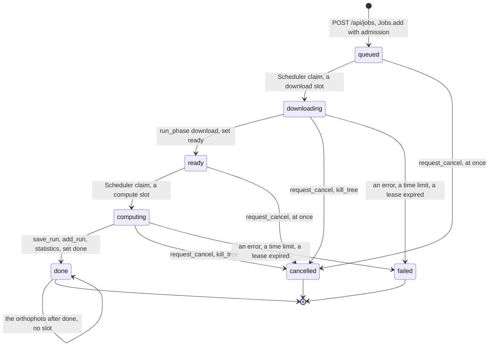
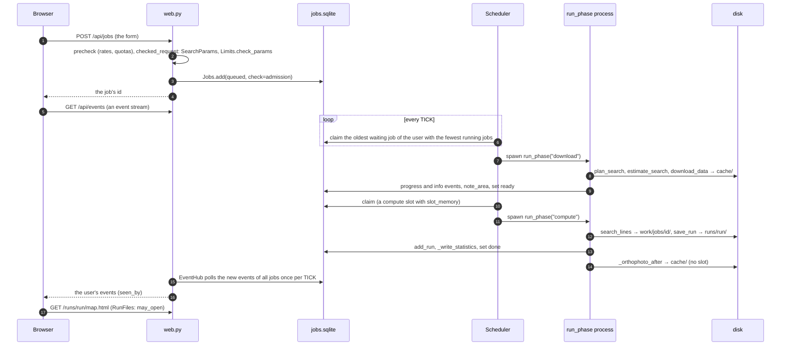
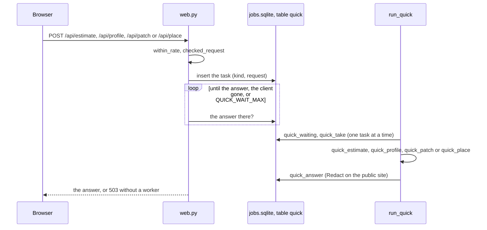

# A web job's life

What happens to a search started in the browser: the request through [web.py](../../web.py), the
queue and the worker of [jobs.py](../../jobs.py), the two phases, the events back to the page, and
the quick lane beside it. The search inside a phase is [search.md](search.md); the processes are
[processes.md](processes.md).

## In plain words

You fill in the form and press search. The page checks the request and puts it in a queue; a
worker takes it when a slot is free, first to fetch the height maps, then to search. The page shows
the progress as it comes in and opens the map at the end. Meanwhile the form's live estimate and
the profile of a line you measure get quick answers from the same worker, without waiting in the
queue.

## The states of a job

The statuses of `jobs.sqlite` and who moves a job between them. `ACTIVE` is downloading and
computing; `WAITING` queued and ready; `FINISHED` done, failed and cancelled.

A status change writes its event in the same transaction (`Jobs._insert_event`), and a phase ends
a job only if the job is still in that phase's status (`Jobs.set(when=)`), so a cancelled or failed
job stays so. A job is failed as interrupted only when its worker's lease expired (`LEASE` seconds
without a renewal every `HEARTBEAT`), so restarting the web process never touches a running job.

## From the form to the map

Every endpoint names who may call it through its dependencies (`current_user`, `require_admin`,
`run_access`, `visible_job`, `own_job`); another user's job or run answers 404. On the public site
every text that reaches the page passes `Jobs(public=True)` (`Redact`).

## The quick lane

The form's estimate, a line's profile, the 3D view's patch and the place box are rows of the table
`quick`, answered one after another by one long-lived process of the worker, so the search's state
is never shared between threads. The endpoint waits with `asyncio.sleep` and answers 503 without a
worker.

## The worker's slots and safeguards

| Setting | Where | What it bounds |
| --- | --- | --- |
| `download_slots`, `compute_slots` | `settings.Limits`, `Scheduler.running` | the phases running at once (1 and 1 unless set); a compute process whose job is done, downloading the orthophoto, holds no slot |
| `slot_memory` | `search.slot_memory`, `Scheduler.memory` | a compute slot's memory budget, measured once at the worker's start; sizes the tiles of every job |
| `download_seconds`, `compute_seconds`, the quick lane's limit | `settings.Limits`, `Scheduler._check` | a phase or a task over it is killed, the job failed |
| `queue_max`, `free_disk_gb_min` | `Jobs.admission`, `run_phase` | the server's safeguards for everyone |
| `lines_early_stop` | `settings.Limits`, `Plan.early_stop` | the line search stops as soon as its lines are over `lines_max` or the memory |
| the user's quotas | `Jobs.admission`, `Jobs.use` | jobs a day, Mpx a day, download MB, runs GB, Nominatim requests |

## Where in the code

| Node | File | Function or name |
| --- | --- | --- |
| POST /api/jobs | [web.py](../../web.py), [jobs.py](../../jobs.py) | `checked_request`, `Jobs.precheck`, `within_rate`, `Jobs.add` |
| the statuses | [jobs.py](../../jobs.py) | `ACTIVE`, `WAITING`, `FINISHED` |
| Jobs.add, admission | [jobs.py](../../jobs.py) | `Jobs.add`, `Jobs.admission`, `QuotaExceeded` |
| Scheduler claim | [jobs.py](../../jobs.py) | `Scheduler._check`, `Jobs.claim`, `TICK` |
| run_phase | [jobs.py](../../jobs.py) | `run_phase`, `note_area`, `_write_statistics`, `_orthophoto_after` |
| set ready, set done | [jobs.py](../../jobs.py) | `Jobs.set`, `Jobs._insert_event` |
| request_cancel, kill_tree | [jobs.py](../../jobs.py) | `Jobs.request_cancel`, `kill_tree` |
| a lease expired | [jobs.py](../../jobs.py) | `Jobs.interrupted`, `LEASE`, `HEARTBEAT` |
| EventHub, the event stream | [web.py](../../web.py), [jobs.py](../../jobs.py) | `EventHub`, `Jobs.owned_events`, `Jobs.events`, `SSE_PER_USER` |
| RunFiles, may_open | [web.py](../../web.py) | `RunFiles`, `may_open`, `run_access` |
| the quick lane | [web.py](../../web.py), [jobs.py](../../jobs.py) | `quick`, `QUICK_WAIT_MAX`, `run_quick`, `QUICK`, `quick_estimate`, `quick_profile`, `quick_patch`, `quick_place`, `Jobs.quick_take`, `Jobs.quick_answer` |
| the slots and safeguards | [settings.py](../../settings.py), [search.py](../../search.py) | `Limits`, `PUBLIC`, `slot_memory` |
| Redact | [jobs.py](../../jobs.py) | `Redact`, `Jobs(public=True)` |
